# DataBridge

> **Sesiones ES256:** antes del primer arranque, genera la pareja P-256 con `./scripts/generar-claves-jwt.ps1` y configura `JWT_KEY_DIRECTORY`. Solo auth recibe privada. [Generacion, montaje, corte inicial y rotacion](docs/seguridad/jwt.md). V7 revoca las sesiones anteriores una sola vez: todos vuelven a entrar.


[](https://github.com/TechnicalBridge/TB_web/actions/workflows/gateway.yml) [](https://github.com/TechnicalBridge/TB_web/actions/workflows/ms-auth.yml) [](https://github.com/TechnicalBridge/TB_web/actions/workflows/ms-debt.yml) [](https://github.com/TechnicalBridge/TB_web/actions/workflows/ms-payments.yml) [](https://github.com/TechnicalBridge/TB_web/actions/workflows/frontend.yml) [](https://github.com/TechnicalBridge/TB_web/actions/workflows/ms-ai.yml) [](https://github.com/TechnicalBridge/TB_web/actions/workflows/codeql.yml) [](https://github.com/TechnicalBridge/DataBridge/actions/workflows/secretos.yml)

**La plataforma donde el deudor en cobranza paga, repacta o reclama su deuda, sin llamar a nadie**, sea
del rubro que sea: arriendos, aranceles, tratamientos, planes mensuales. Proyecto de Capstone del equipo
**Technical Bridge**; las empresas, las personas y los RUT son ficticios.

```powershell
docker compose --profile app up -d --build --wait    # y queda en http://localhost:8080
```

## Índice

| El proyecto | Los diagramas | En detalle |
| :--- | :--- | :--- |
| [1. Descripción](#1-descripción)<br>[2. Tecnologías utilizadas](#2-tecnologías-utilizadas)<br>[3. Cómo ejecutarlo localmente](#3-cómo-ejecutar-el-proyecto-localmente)<br>[4. Integrantes del equipo](#4-integrantes-del-equipo)<br>[5. Metodología de trabajo](#5-metodología-de-trabajo-scrumban)<br>[6. Arquitectura de la solución](#6-arquitectura-de-la-solución) | [7.1 Comunicación entre servicios](#71-comunicación-entre-servicios)<br>[7.2 Entidad-relación](#72-entidad-relación)<br>[7.3 Casos de uso](#73-casos-de-uso)<br>[7.4 Clases](#74-clases)<br>[7.5 Secuencias](#75-secuencias)<br>[7.6 Componentes](#76-componentes) | [8. Reglas del negocio](#8-reglas-del-negocio)<br>[9. Requisitos no funcionales](#9-requisitos-no-funcionales)<br>[10. Docker](#10-docker)<br>[11. Pruebas](#11-pruebas)<br>[12. Innovación](#12-innovación)<br>[13. Recorrido de demostración](#13-recorrido-de-demostración)<br>[14. Estado](#14-estado-al-19-de-octubre-de-2026) |

---

## 1. Descripción

### Qué hace

**DataBridge es donde el deudor moroso paga.** Entra con su RUT y un código de seis caracteres que
le llegó por correo, sin cuenta ni contraseña. Ve qué debe y a quién, con los intereses por mora si
su acreedor los pactó, y decide:

- **pagar de una vez**, con Webpay, Mercado Pago o Khipu;
- **repactar en 3 a 24 cuotas**, y pagar una o varias, siempre desde la que vence primero. Las
  cuotas llevan interés solo si el acreedor lo pactó;
- **reclamar** si la deuda no corresponde (no la reconoce, ya la pagó, o el monto está mal).
  Mientras la empresa lo revisa, la deuda no se cobra ni le llegan recordatorios.

Una barra le muestra en qué va cada deuda: **pendiente → en convenio → pago conciliado**. Si tiene
dudas, le pregunta a un asistente que lee su deuda con su propia sesión. Cuando termina de pagar,
descarga su certificado de deuda cero.

Adentro tiene además:

- sus **próximos vencimientos**, que puede pasar al calendario del teléfono;
- su **historial de pagos**, con un comprobante en PDF de cada uno;
- un **recordatorio por correo** unos días antes de cada cuota, sin monto ni enlace;
- **sus datos**, donde apaga ese recordatorio si no lo quiere.

**La empresa que gestiona la cartera** —la agencia, o el acreedor que cobra directo— la ve al
día desde el mismo portal:

- carga a sus deudores **dentro de una campaña**, con una planilla de Excel. Antes de confirmar ve qué
  entraría, qué se rechazaría y por qué, sin que nada quede guardado;
- ve cuándo se le escribió por última vez a cada deudor y le **reenvía el código** si lo perdió,
  dentro de lo que permite la ley;
- **resuelve los reclamos**, reanudando el cobro o retirando la deuda;
- revisa los pagos que entraron y sigue los **convenios en riesgo** (con una cuota vencida);
- mira en un panel cuánto se ha recuperado y exporta la cartera a Excel.

**Los deudores entran solo por campaña,** cargados desde el portal. La entrega por API
(`/api/v1`, con clave de API), pensada para que el sistema de una empresa entregue solo, está
**apagada por omisión** y responde `404`. `INTEGRACION_API=true` la enciende
([§7.1](#71-comunicación-entre-servicios)).

**La campaña se cumple sola:** DataBridge le escribe a cada deudor los días que fijó quien cobra
(la agencia o, si cobra sin agencia, el mismo acreedor), dentro de lo que permite la ley.

**Cada pago, convenio o reclamo queda a la vista de la empresa** en su portal. Si además tiene un
sistema propio y la entrega por API está encendida, le llega ahí como un aviso firmado: el
acreedor se entera sin entrar. Con la API apagada nadie se puede suscribir a esos avisos, porque
la suscripción se hace por `/api/v1/suscripciones`.

### A quién va dirigido

| Quién | Qué hace acá |
| --- | --- |
| **La persona que debe** | Entra, mira, repacta, paga o reclama. Es quien usa el portal de verdad |
| **La empresa que cobra**: una agencia de cobranza (APOFYX) o el acreedor que cobra sin agencia | Crea sus campañas, carga a sus deudores en ellas, reenvía el código, resuelve los reclamos y sigue la recuperación, todo desde el portal de empresas. Los códigos los manda DataBridge |
| **El acreedor** (una inmobiliaria, un instituto, una clínica), si cobra por una agencia | No entra: su agencia ve la cartera. Con la entrega por API encendida, recibe en su propio sistema el aviso de cada pago, convenio o reclamo |
| **El equipo de DataBridge** (`admin`) | Da de alta a las empresas y a su gente, mira el estado de la operación, las reglas y los accesos en el panel de administración, y reintenta lo que no se entregó |

**Contexto.** Kobra fue el cliente directo original del equipo y se retiró. Para continuar el
Capstone se creó **APOFYX**, una agencia de cobranza ficticia. DataBridge es la solución
tecnológica, y se demuestra con APOFYX y tres acreedores ficticios de rubros distintos:

- Patrimonio Inmuebles (arriendos);
- Instituto Andes (aranceles);
- Clínica Dental Sonrisa Norte (tratamientos).

### Qué problema resuelve

Cobrar deudas chicas cuesta más que la deuda. Una llamada a alguien que debe $40.000 se come el
margen, así que a esa persona nadie la llama: le mandan cartas, la mandan a DICOM y la deuda
envejece hasta que se castiga.

Del otro lado está el problema espejo, el que casi nadie mira: **el deudor que sí quiere pagar no
puede**. Tiene que llamar en horario de oficina, esperar, dar sus datos y que alguien le diga
cuánto debe. Y si cree que la deuda no es suya, no tiene dónde decirlo.

DataBridge saca a la persona del medio en los dos sentidos. El deudor paga, repacta o reclama
solo, a las 11 de la noche si quiere. El acreedor se entera sin que nadie escriba un correo.

---

## 2. Tecnologías utilizadas

### Lenguajes

| Lenguaje | Versión | Dónde se usa |
| --- | --- | --- |
| **Java** | 25 | Los cinco servicios del backend: gateway, ms-auth, ms-debt, ms-payments y ms-ai |
| **JavaScript** | ES2022, con JSX | El portal |
| **SQL** | El de MySQL 8.4 | Las migraciones de cada base |

### Frameworks y librerías

| Capa | Tecnología | Para qué |
| --- | --- | --- |
| **Backend** | Spring Boot 3.5 · Spring Security · Spring Data JPA · Bean Validation | Cuatro microservicios de Spring: ms-auth, ms-debt, ms-payments y ms-ai |
| **Gateway** | Spring Cloud Gateway · Bucket4j | La única puerta: enruta, limita las peticiones y revisa CORS |
| **API** | springdoc-openapi (Swagger) · Spring HATEOAS · Spring Boot Actuator | Todos los endpoints en una página; respuestas que dicen qué se puede hacer después; salud para Docker |
| **Frontend** | React 18 · React Router 7 · Vite · Zustand · Recharts · CSS propio | El portal del deudor, el de las empresas y el panel de administración |
| **Autenticación** | JWT (JJWT) · códigos de un solo uso | Sin contraseñas |
| **Cifrado** | AES-256-GCM, de la JCA | Los secretos que hay que leer de vuelta se guardan cifrados |
| **Correo** | Jakarta Mail · Thymeleaf | Los correos en HTML y en texto, por Brevo o por un servidor SMTP |
| **Mensajería** | RabbitMQ 3.13 | Lleva el aviso de pago entre servicios |
| **Asistente** | SDK oficial de OpenAI para Java (`openai-java`) | Le habla a Grok (xAI), o a cualquier API compatible con la de OpenAI. Sin llave, el asistente responde con sus reglas |

### Base de datos

| Tecnología | Cómo se usa |
| --- | --- |
| **MySQL 8.4** | Una base por servicio, cada una en su propio MySQL: `tb_auth`, `tb_debt` y `tb_payments`. Es el mismo motor que usa APOFYX |
| **Flyway** | Versiona el esquema. Cada servicio arranca con `ddl-auto: validate`: si las entidades y las tablas no calzan, no parte |

Las tablas y cómo se relacionan están en el [diagrama entidad-relación](#72-entidad-relación).

### Cloud y servicios externos

El despliegue de referencia es **local, con contenedores**. Para la demo, el mismo compose corre en un
**VPS de Namecheap**, en `https://technicalbridge.site`, hasta diciembre ([§10](#en-un-servidor)). Ningún
servicio externo es obligatorio: sin sus llaves, cada uno se simula o se reemplaza.

| Servicio | Para qué | Sin configurarlo |
| --- | --- | --- |
| **Namecheap** · un VPS (4 núcleos, 6 GB) y el dominio `technicalbridge.site` | Donde corre la demo hasta diciembre, con HTTPS de Let's Encrypt y despliegue automático desde `main`. La guía está en [`docs/despliegue`](docs/despliegue/README.md) | Todo corre en el equipo, con Docker |
| **GitHub Container Registry** | Guarda las imágenes que compila GitHub Actions, para que el servidor solo las descargue | Las imágenes se compilan en el equipo |
| **Transbank** · Webpay Plus, API REST v1.2 | Cobrar con tarjeta, en la página real de Transbank | Funciona igual, contra su ambiente de integración y con tarjetas de prueba. Sin internet, `TRANSBANK_ENVIRONMENT=SIMULADA` |
| **Khipu** · API de pagos v3 | Cobrar por transferencia; con una cuenta en modo desarrollador, contra un banco ficticio | Simulada, sin `KHIPU_LLAVE` |
| **Mercado Pago** · Checkout Pro | Cobrar con tarjeta en la página de Mercado Pago | Simulada, sin `MERCADOPAGO_ACCESS_TOKEN` |
| **Brevo**, o un servidor SMTP | Mandar los correos de verdad | Los correos van al buzón de prueba (Mailpit) |
| **Banco Central** | La UF de cada día | La UF se carga a mano |
| **Un LLM** (Grok, de xAI) | Las respuestas del asistente | Responde con sus reglas |

### Herramientas

| Para qué | Tecnología |
| --- | --- |
| **Contenedores** | Docker · Docker Compose: once contenedores, una orden |
| **Servidor web** | nginx sin privilegios: sirve el portal compilado y hace de proxy al gateway |
| **Integración continua** | GitHub Actions · CodeQL · Dependabot: pruebas y análisis de seguridad en cada push |
| **Pruebas** | JUnit 5 · Mockito · MockMvc · k6: unitarias, de la capa web y de rendimiento |
| **Correo de prueba** | Mailpit: recibe los correos sin mandárselos a nadie |

---

## 3. Cómo ejecutar el proyecto localmente

### La forma corta: todo en Docker

Lo único que hace falta es **Docker Desktop** corriendo, con al menos 4 GB de memoria para
Docker, e internet la primera vez: se bajan las imágenes y las dependencias de Maven, npm y pip.
La primera vez, `generar-claves-jwt.ps1` crea las llaves de las sesiones
([`docs/seguridad/jwt.md`](docs/seguridad/jwt.md)) y `preparar-env.ps1` crea el `.env` con los secretos: claves
al azar para las bases, RabbitMQ y lo interno. **Ningún secreto tiene un valor escrito en el repositorio**, porque
sería público: sin el `.env`, `docker compose` se detiene y dice cuál falta.

```powershell
git clone https://github.com/TechnicalBridge/TB_web.git
cd TB_web
powershell -ExecutionPolicy Bypass -File .\scripts\generar-claves-jwt.ps1    # una sola vez: las llaves de las sesiones
powershell -ExecutionPolicy Bypass -File .\preparar-env.ps1    # una sola vez: el .env con claves al azar
# Para la demo en una base nueva, poner DEMO_DATOS=true en el .env antes de arrancar.
docker compose --profile app up -d --build --wait
```

`--wait` devuelve el control recién cuando los once contenedores están **sanos**, no cuando
arrancaron. La primera vez compila todo y tarda de uno a varios minutos, según la máquina y la
conexión; después son segundos.

| | |
| --- | --- |
| **Portal** | http://localhost:8080 |
| **Documentación de la API (Swagger)** | http://localhost:8080/swagger-ui.html |
| Buzón de prueba (los códigos llegan acá) | http://localhost:8025 |
| RabbitMQ | http://localhost:15672 · `guest`, con la clave de `RABBIT_PASSWORD` de tu `.env` |
| Las tres bases | `127.0.0.1:3308` (`tb_auth`), `3309` (`tb_debt`) y `3310` (`tb_payments`) · `tbridge`, con la clave de cada una en tu `.env` (`DB_AUTH_PASSWORD`, `DB_DEBT_PASSWORD`, `DB_PAYMENTS_PASSWORD`) |

Para apagar: `docker compose --profile app down`. Con `-v` borra además los datos.

> **Si ya tenías DataBridge corriendo antes de [#238](https://github.com/TechnicalBridge/TB_web/issues/238)**, con un solo MySQL (`tbridge-db`): antes de
> levantar, tus datos se pasan una vez a las tres bases, sin tocar el volumen de antes, como dice
> [`docs/base-de-datos`](docs/base-de-datos/README.md#si-ya-tenías-datos-de-antes-de-238).

### Si algo falla en un equipo nuevo

<details>
<summary><b>Los problemas comunes</b>, y qué hacer</summary>

| Qué pasa | Qué hacer |
| --- | --- |
| Faltan claves de firma o secretos de infraestructura | Generar pareja con `scripts/generar-claves-jwt.ps1`, configurar `JWT_KEY_DIRECTORY` y ejecutar `preparar-env.ps1`; ver [JWT](docs/seguridad/jwt.md) |
| Tu `.env` es de antes y tiene los valores de desarrollo que venían en el repositorio | Esos valores son públicos. El script los reconoce y avisa; con `-Renovar` los cambia. Después, `docker compose --profile app up -d` |
| Una clave se filtró (quedó en una captura, en un registro, en un chat) | `-Cambiar NOMBRE` la cambia aunque ya no sea la de antes. Si es la de una base (`DB_DEBT_PASSWORD`, …), la cambia también dentro de esa base, que tiene que estar arriba, sin perder datos. Después, `docker compose --profile app up -d` |
| `db-auth` no parte con `port is already allocated` (3308), después de traer [#238](https://github.com/TechnicalBridge/TB_web/issues/238) | Es el MySQL de antes (`tbridge-db`), que sigue corriendo con tus datos. Pasa tus datos como dice [`docs/base-de-datos`](docs/base-de-datos/README.md#si-ya-tenías-datos-de-antes-de-238): el primer paso lo apaga, sin borrar sus datos |
| El check *Secretos* falla en tu PR | Encontró una clave en tus commits: dice la regla, el archivo y la línea, nunca el valor. Si es de verdad, **revócala primero en el proveedor** (con el push ya es pública) y después sácala de tus commits. Los pasos, y qué hacer con un falso positivo, en [`docs/seguridad/secretos.md`](docs/seguridad/secretos.md) |
| `port is already allocated` | Otro programa usa ese puerto. Cámbialo en tu `.env`: `PORTAL_PORT` (8080), `DB_AUTH_PORT` (3308), `DB_DEBT_PORT` (3309), `DB_PAYMENTS_PORT` (3310), `RABBIT_PORT` (5672), `RABBIT_ADMIN_PORT` (15672), `MAILPIT_SMTP_PORT` (1025) o `MAILPIT_PORT` (8025) |
| `--wait` termina con un contenedor `unhealthy` o `exited` | `docker compose --profile app ps` dice cuál, y `docker compose logs <servicio>` por qué. Lo más común es poca memoria para Docker: en Docker Desktop, *Settings → Resources* |
| La construcción se cae bajando dependencias | Sin internet, o un proxy que la corta. Se vuelve a correr la misma orden: lo que ya bajó queda en caché |
| Todos los deudores reciben *Demasiadas solicitudes* a la vez | El gateway no reconoce al nginx del portal como proxy y ve a todos como una sola IP. Ya confía en las tres redes privadas que usa Docker; si tu red es otra, ajústala en `TRUSTED_PROXIES` |
| Webpay no abre | Necesita internet. Sin internet, `TRANSBANK_ENVIRONMENT=SIMULADA` |
| Cambiaste el `.env` y no se nota | Las variables se leen al crear el contenedor: `docker compose --profile app up -d` lo vuelve a crear |
| Reconstruiste un solo servicio (por ejemplo `ms-debt`) y el portal responde *error 500* | El gateway se quedó con la dirección vieja del contenedor. Reinícialo también: `docker compose --profile app restart gateway` |

> Se probó así el 4 de octubre de 2026: un clon nuevo de GitHub con los finales de línea de
> Windows, sin imágenes ni caché de Docker. Los nueve contenedores quedaron sanos al primer intento
> (92 s en un i5-14400F con buena conexión), y funcionaron el código de acceso de abajo, la cartera
> de ejemplo, un pago simulado, la ida a Webpay, el asistente y el enlace de la empresa. Apagar y
> volver a levantar sobre la misma base también.

</details>

### Para entrar como empresa

Con `DEMO_DATOS=true` y una base nueva, en el portal, **Soy de una empresa**, con
`camila.reyes@example.com`. El código para entrar llega al buzón de prueba o, si el correo sale por
un servidor real, desviado a `CORREO_DESVIAR_A`. La empresa de ejemplo es **Servicios Horizonte**
(`76.000.000-0`): cobra lo suyo, sin agencia ni mandato, así que crea sus campañas sin depender de
nadie. Una agencia, en cambio, necesita el mandato de cada acreedor, que hoy solo nace por la API
([#234](https://github.com/TechnicalBridge/TB_web/issues/234)).

La demo viene apagada por omisión y solo se instala en una base vacía: si ya hay empresas, deudores
o deudas, ms-debt no instala ni completa datos ficticios, y reiniciar no duplica ni restaura lo que
se haya cambiado. Las bases de la demo anterior conservan sus cuentas y su cartera. En un equipo
cuya base no tiene nada que conservar, la demo nueva se instala así:

```powershell
docker compose --profile app down -v      # borra la base de ESTE equipo
docker compose --profile app up -d --build --wait
```

### Código primero en los tres portales

**Enviar código** manda un solo correo con el código, sin enlace de acceso. El deudor indica
su RUT; el usuario de empresa y el admin, su correo registrado. Lo canjean con **Entrar**.
**¿No te llegó?** genera otro código y un enlace, juntos en un único correo; no envía dos mensajes.
El código solicitado y su enlace opcional duran `MAGIC_TTL_MINUTES` (15 minutos por omisión),
comparten cinco intentos y un solo uso: usar cualquiera invalida ambos. Pedir otro acceso invalida
el solicitado anteriormente. No es doble factor: son dos formas de canjear la misma credencial.

Rutas públicas: `POST /api/auth/codigo` solicita solo código; `POST /api/auth/enlace` solicita
el respaldo. Ambas reciben `{rut}` para deudor o `{correo}` para personal y responden `202` sin
revelar si existe esa identidad. `POST /api/auth/acceso` recibe esa identidad y `codigo`;
`POST /api/auth/verify` canjea el `token` del enlace. El destinatario del deudor siempre se obtiene
de ms-debt, no de un correo elegido en el navegador. Los códigos de campaña siguen durando
`CODE_TTL_HOURS` (24 horas), y las invitaciones de alta del personal conservan su enlace de 24 h.

### Para entrar como deudor

La demo independiente tiene dos campañas propias, *Cartera en pesos* (`DEMO-PESOS`) y *Cartera en UF*
(`DEMO-UF`), con seis deudores ficticios. No necesita APOFYX ni Patrimonio corriendo:

| RUT | Deudor | Campaña | Situación |
| --- | --- | --- | --- |
| 16.482.337-7 | Felipe Rojas Muñoz | Cartera en pesos | En convenio de 6 cuotas, con 3 pagadas |
| 19.230.418-0 | Carolina Muñoz Vera | Cartera en pesos | Pagó toda la deuda |
| 14.583.206-3 | Rodrigo Pérez Contreras | Cartera en pesos | Reclamo por monto incorrecto, en revisión |
| 17.893.456-2 | Ignacio Tapia Rojas | Cartera en pesos | Convenio con una cuota vencida, en riesgo |
| 76.991.245-2 | Comercial Ñandú SpA | Cartera en UF | Deuda abierta por 77 UF |
| 76.284.519-9 | Panadería La Espiga Ltda. | Cartera en UF | Convenio de 3 cuotas en UF, con la primera pagada en pesos |

Al arrancar, ms-debt registra las campañas y carga dos lotes por `CarteraIntakeService`, la misma
ingesta del portal, como origen `file`: valida RUT, moneda, cargos, mora y campaña. Cada deuda tiene
dos cargos de meses anteriores al primer arranque. Después prepara convenios, pagos simulados y
un reclamo con los servicios del producto; para mostrar riesgo deja una cuota de ejemplo vencida.

Los pagos sembrados dicen `demo`: no llaman pasarelas, no crean cobros ni comprobantes en
ms-payments. El pago de ejemplo en UF usa un valor fijo histórico, solo en su evento, sin cargar
la UF del día. Una carga nueva se hace desde *Cargar cartera*; la API `/api/v1` sigue apagada.

Para conseguir un código de campaña, la empresa toca **Reenviar código** en su cartera y el código llega al
buzón.

<details>
<summary><b>Pedirle un código directo a ms-auth</b>, desde PowerShell</summary>

También se puede pedir directo a ms-auth:

```powershell
$cuerpo = @{ rut = "16482337-7"; canales = @("correo"); correo = "felipe.rojas@example.com"
             acreedor = "Servicios Horizonte"; paraQue = "DEMO-CONVENIO" } | ConvertTo-Json -Compress
$cuerpo | docker compose --profile app exec -T ms-auth sh -c 'curl -s -X POST http://127.0.0.1:8081/internal/codigos -H X-Internal-Key:$INTERNAL_KEY -H Content-Type:application/json --data-binary @-'
```

Responde con el `codigo`. Con él se entra al portal en **Tengo un código de acceso**, con el RUT
`16.482.337-7`. El código sirve **una sola vez** y dura 24 horas.

> El JSON va por la entrada estándar (`--data-binary "@-"`) y no como argumento a propósito:
> PowerShell 5.1 parte en dos un argumento que trae comillas y espacios. Y se pide desde dentro
> del contenedor porque los endpoints internos **no** están publicados hacia afuera
> ([§9](#9-requisitos-no-funcionales)).

</details>

### Para mandar correos de verdad

Sin tocar nada, los correos van al **buzón de prueba** (http://localhost:8025) y no le llegan a
nadie: sirve para programar, no para producción. Para que lleguen de verdad hay dos caminos, y
los dos se eligen en el `.env`, sin editar el compose ni el código:

| Camino | Cuándo | Qué hace falta |
| --- | --- | --- |
| **La API de Brevo** | El de producción: va por HTTPS, así que sale aunque el servidor bloquee el SMTP | Una cuenta gratuita de Brevo (300 correos al día) y su clave de API |
| **Un servidor SMTP** | Para probar en un equipo, o con otro proveedor | Una cuenta de Gmail con contraseña de aplicación, u otro servidor |

Si están los dos, gana Brevo.

<details>
<summary><b>Con Brevo</b>, paso a paso</summary>

1. **Un Gmail del equipo**, solo para DataBridge: es el remitente.
2. **Una cuenta en [Brevo](https://www.brevo.com)** con ese Gmail, en el plan gratuito. Entre sus
   remitentes (*Senders*), el Gmail tiene que aparecer verificado; si no, se agrega y se confirma
   con el código que le llega. Si Brevo pide completar los datos de la cuenta antes de mandar, se
   completan.
3. **Una clave de API**, en *SMTP & API → API Keys*. Se copia directo al `.env`, y a ningún otro
   lado. Si Brevo la entrega en base64 (es la clave para MCP), la de la API es la que va adentro, en
   `api_key`, y empieza con `xkeysib-`.
4. **Sin bloqueo por IP.** Brevo rechaza con `401` las llamadas desde una IP que no conoce. En
   [*Security → Authorised IPs*](https://app.brevo.com/security/authorised_ips) se desactiva el
   bloqueo de las IPs desconocidas: los correos salen del equipo de cada integrante y del servidor,
   cada uno con su IP, y no hay una sola que autorizar.
5. **En el `.env`:**

```
BREVO_API_KEY=la clave de API de Brevo
MAIL_FROM=tucuenta@gmail.com
MAIL_FROM_NAME=DataBridge
CORREO_SOLO_A=tucuenta@gmail.com
CORREO_DESVIAR_A=tucuenta@gmail.com
```

Como un Gmail no se puede autenticar desde otro servicio, Brevo cambia la dirección del
remitente por una suya (`…@….brevosend.com`); el nombre que se ve sigue siendo *DataBridge*. Con
un dominio propio autenticado en Brevo, basta cambiar `MAIL_FROM`.

</details>

<details>
<summary><b>Con un servidor SMTP</b>, paso a paso</summary>

1. **En la cuenta de Google.** Activar la verificación en dos pasos y crear una **contraseña de
   aplicación** (16 letras). Esa es la que usa DataBridge: la clave de la cuenta no se escribe en
   ningún sistema.
2. **En el `.env`:**

```
SMTP_HOST=smtp.gmail.com
SMTP_PORT=587
SMTP_USER=tucuenta@gmail.com
SMTP_PASSWORD=la contraseña de aplicación
SMTP_AUTH=true
SMTP_STARTTLS=true
MAIL_FROM=tucuenta@gmail.com
MAIL_FROM_NAME=DataBridge
CORREO_SOLO_A=tucuenta@gmail.com
CORREO_DESVIAR_A=tucuenta@gmail.com
```

Con Gmail, `MAIL_FROM` tiene que ser la misma cuenta. Para otro proveedor cambian el servidor, el
puerto y las credenciales; con uno que pide SSL desde el principio (puerto 465), `SMTP_SSL=true` y
`SMTP_STARTTLS=false`. El `.env` no se sube al repositorio.

</details>

**El modo de prueba, que no es opcional con los datos de la demo.** Los deudores de ejemplo
usan el dominio reservado `example.com`, que no entrega correo. Las bases de la demo anterior
pueden conservar direcciones de otros dominios, y la campaña corre sola cada 15 minutos. Para
evitar rebotes y cualquier envío a terceros, con un servidor real se usa siempre el modo de prueba.

| Variable | Qué hace |
| --- | --- |
| `CORREO_SOLO_A` | Las direcciones o dominios a los que **sí** se les escribe directo, separados por coma. Una dirección incluye sus alias con `+` (`tucuenta+deudor1@gmail.com`); un dominio va con arroba (`@empresa-prueba.cl`) |
| `CORREO_DESVIAR_A` | Adonde va **todo lo demás**. Llega con el destinatario original en el asunto: *[para felipe.rojas@example.com] Tu código de acceso* |
| `CORREO_DESVIO_MAXIMO_POR_DIA` | Hasta cuántos correos se desvían en un día de Chile (100, por omisión; `0`, sin tope). **El desvío sale por el proveedor y gasta su cupo**, que en Brevo es diario: pasado el tope, lo desviado no sale y queda en el registro |

**El cupo del proveedor no se gasta en direcciones que no existen** ([#236](https://github.com/TechnicalBridge/TB_web/issues/236)):
- **Lo que va a un dominio reservado** (`example.com`, `example.net`, `example.org` o lo que termina en
  `.example`, `.test`, `.invalid` o `.localhost`) nunca sale por Brevo ni por el servidor SMTP directo. En
  Docker local va a Mailpit (http://localhost:8025), con su destinatario de siempre: ahí llega, por ejemplo,
  el código de `camila.reyes@example.com`. En el servidor, donde no hay Mailpit, sigue el desvío, con su
  tope por día.
- **Las invitaciones salen de a poco:** a lo más 100 cada 15 minutos (`INVITACIONES_POR_CUARTO_DE_HORA`),
  entre las de una carga y las de la pasada de contacto. Una planilla de mil deudores no manda mil correos
  en el mismo minuto: lo que pasa del tope sale en las pasadas siguientes.
- **Las cargas masivas se prueban sin Brevo.** El 19 de octubre, una planilla de prueba con mil deudores
  en `example.com` agotó el cupo diario en un minuto, y después no salió ni un código de verdad.

Con la lista y sin el desvío, lo que está fuera de la lista no sale. Sin ninguna de las dos se le
escribe a cualquier dirección: eso es producción, y ms-auth lo avisa al arrancar.

Con una sola cuenta de Gmail alcanza para probar todos los papeles, porque `tucuenta+algo@gmail.com`
llega al mismo buzón y para DataBridge es otra dirección: `tucuenta+admin@gmail.com` para un admin,
`tucuenta+empresa@gmail.com` para la persona de una empresa y `tucuenta+deudor1@gmail.com` para un
deudor.

<details>
<summary><b>Probar que el correo sale</b></summary>

**Reiniciar ms-auth y probar.** `docker compose --profile app up -d ms-auth`, y después un
correo de prueba, que dice si salió, adónde llegó de verdad y por dónde, o lo que respondió el
servidor o Brevo si no salió:

```powershell
docker compose --profile app exec -T ms-auth sh -c 'curl -s -X POST "http://127.0.0.1:8081/internal/correo/prueba?para=tucuenta@gmail.com" -H X-Internal-Key:$INTERNAL_KEY'
```

Al arrancar, ms-auth deja dicho en su registro por dónde manda y en qué modo está. Ni la
contraseña ni la clave de Brevo aparecen ahí ni en la respuesta de la prueba.

Para volver al buzón de prueba, se dejan vacías `BREVO_API_KEY` y `SMTP_HOST`, y se reinicia
ms-auth.

</details>

<details>
<summary><b>Lo que dice cada correo</b>: las plantillas, en HTML y en texto</summary>

**Lo que dice cada correo.** Las plantillas viven en
[`ms-auth/src/main/resources/correos`](ms-auth/src/main/resources/correos), no en el código. Cada
correo tiene su versión en HTML y su versión en texto, y salen juntas (`multipart/alternative`): un
cliente que no muestra HTML muestra el texto, con el código.

| Correo | Plantilla | A quién |
| --- | --- | --- |
| El código de acceso | `codigo` | Al deudor: en la invitación, en cada toque de la campaña y cuando la empresa se lo reenvía |
| El recordatorio de cuota | `recordatorio` | Al deudor con convenio, antes de que venza una cuota, con un código nuevo |
| El acceso solicitado | `acceso` | En los tres portales: **Enviar código** manda solo el código; **¿No te llegó?** manda código y enlace juntos en un único correo |
| El enlace anterior | `enlace` | Plantilla conservada por compatibilidad; no es el envío habitual del login |
| La invitación | `invitacion` | A quien un admin de DataBridge da de alta |
| La prueba | `prueba` | A quien pide el correo de prueba |

- **Con los colores del portal:** crema y verde, y carbón y morado en los clientes que siguen el
  tema oscuro (Apple Mail, Outlook). Están escritas como se escriben los correos, con tablas y el
  estilo en cada elemento, porque Gmail ignora parte del `<style>` y Outlook de escritorio dibuja
  con Word. No llevan imágenes, que casi todos los clientes bloquean.
- **El correo de campaña del deudor no trae el monto ni un enlace:** solo la dirección del portal, para que
  la escriba él. El nombre del acreedor se escapa, así que una empresa no puede meter etiquetas ni
  enlaces en el correo de un deudor. El acceso solicitado tampoco lleva enlace, salvo el respaldo
  que pide expresamente con **¿No te llegó?**.
- **El adelanto que muestra el buzón** antes de abrir el correo, que también se ve en la pantalla
  bloqueada del teléfono, nunca trae el código.

</details>

<details>
<summary><b>Si un correo no sale</b>: qué hacen ms-auth y ms-debt</summary>

**Si un correo no sale.** Con un servidor real o con Brevo pasa: una clave mala, el cupo del
día, una dirección que no existe. Un correo que no sale **no cuenta como enviado**:

- ms-auth responde `502` con lo que dijo el servidor, y anula el código de ese correo: nadie lo
  recibió, y el que el deudor ya tenía le sigue sirviendo.
- ms-debt no lo anota como contacto ni lo cuenta para el límite de dos por semana. El motivo queda
  en el deudor, y la empresa lo ve en su cartera: *No se pudo enviar el correo del …: …*. Si
  reenvía el código, ve el error en el momento.
- **Si la culpa es del servidor de correo**, el mismo correo sale solo cuando se corrige: la
  pasada de contacto (cada 15 minutos, dentro del horario de la ley) invita a toda deuda en
  cobranza que todavía no recibió ningún correo, y la campaña vuelve a intentar su toque. La
  pasada se corta al primer fallo, en vez de esperar al servidor una vez por deuda.
- **Si la culpa es de la dirección** (el servidor la rechazó), tres rechazos seguidos la dejan como
  *correo con problemas*: ya no se le escribe solo, hasta que una cartera traiga otro correo. La
  empresa igual puede reenviarle el código a mano.

</details>

> Una cuenta de Gmail deja mandar unos cientos de correos al día y es para probar. Los enlaces de
> los correos apuntan a `PUBLIC_URL` (`http://localhost:8080`), así que se abren en el equipo donde
> corre DataBridge, no desde un teléfono.

### Para pagar con Webpay

Webpay abre la página real de Transbank, en su ambiente de **integración**: no se mueve plata.
Necesita internet, y no hay que configurar nada: DataBridge trae las credenciales públicas de
integración que publica Transbank.

**Las tarjetas de prueba** son las de Transbank (las de Mercado Pago no sirven aquí):

| Tarjeta | Número | CVV | Resultado |
| --- | --- | --- | --- |
| VISA crédito | `4051 8856 0044 6623` | `123` | Aprobada |
| AMEX crédito | `3700 0000 0002 032` | `1234` | Aprobada |
| Mastercard crédito | `5186 0595 5959 0568` | `123` | **Rechazada** |
| Redcompra débito | `4051 8842 3993 7763` | — | Aprobada |
| Redcompra débito | `5186 0085 4123 3829` | — | **Rechazada** |
| Prepago VISA | `4051 8860 0005 6590` | `123` | Aprobada |
| Prepago Mastercard | `5186 1741 1062 9480` | `123` | **Rechazada** |

El vencimiento es cualquier fecha futura, y la autenticación del banco, RUT `11.111.111-1` y clave
`123`. Al aceptar, Transbank devuelve al portal con **Pago aprobado**. **Anular compra** devuelve con
*El pago no se completó*, y la deuda sigue igual.

<details>
<summary><b>Cómo trabaja DataBridge con Webpay</b>, según Transbank</summary>

**Cómo trabaja DataBridge con Webpay**, según la
[documentación de Transbank](https://www.transbankdevelopers.cl/documentacion/webpay-plus):

- **El token sirve una sola vez.** La página que lleva a Webpay lo manda una vez. Si se vuelve a
  abrir (recargar, volver atrás), dice *Webpay ya se abrió para este pago* en vez del *Error 21*
  de Transbank. En el portal, *Abrirla de nuevo* trae al frente la ventana de Webpay, y si se
  cerró, abre un pago nuevo.
- **Si el deudor paga y cierra la ventana antes de volver, el pago se registra igual.** Cada 10
  segundos ms-payments le pregunta a Transbank por los cobros abiertos
  (`GET /transactions/{token}`): pagado y sin confirmar, lo confirma; ya confirmado, lo registra;
  rechazado o anulado, queda fallido.
- **Los plazos son los de Transbank.** El token dura 5 minutos y el formulario 10 en integración
  (4 en producción): el cobro vence a los 15 minutos (9 en producción), y el portal dice hasta qué
  hora se puede pagar. Ningún cobro se da por vencido sin preguntarle antes a Transbank.
- **Al abrir otro cobro de la misma deuda,** el anterior se mira en Transbank. Si ya se pagó, se
  registra y no se cobra de nuevo; si no, queda vencido, y aunque se pagara después no se confirma
  (sin confirmar, Transbank lo reversa).
- **La vuelta por tiempo agotado se comprueba.** Webpay devuelve solo la orden de compra y la
  sesión: la orden lleva el número del pago, que se adivina, pero la sesión es una firma del pago
  que solo conoce ms-payments. Sin ella, nadie puede hacer fallar el cobro de otro deudor.

</details>

<details>
<summary><b>Para pasar Webpay a producción</b></summary>

1. **HTTPS obligatorio.** Transbank no acepta comercios sin https, ni una vuelta a `http://`.
2. **Registrarse como comercio** en [publico.transbank.cl](https://publico.transbank.cl) y recibir
   el código de comercio.
3. **Validar la integración:** enviar las evidencias en el formulario de Transbank. Transbank
   revisa las transacciones de prueba y entrega la llave secreta productiva.
4. **Configurar** `TRANSBANK_API_URL=https://webpay3g.transbank.cl`, `TRANSBANK_COMMERCE_CODE` y
   `TRANSBANK_API_KEY` con los valores productivos. El plazo de los cobros pasa solo a 9 minutos.
5. **Hacer una compra de $50** para comprobar que todo funciona, antes de abrir al público.

Transbank pide además escaneos de vulnerabilidades cada tres meses, los componentes al día y un WAF
o IPS delante del sitio.

</details>

### Para pagar con Mercado Pago de verdad

Sin configurar nada, Mercado Pago es simulada. Para que cobre de verdad hace falta el access
token de una cuenta de Mercado Pago: en [Mercado Pago Developers](https://www.mercadopago.cl/developers),
crea una aplicación y usa las **credenciales de prueba** de una cuenta de vendedor de prueba.

1. Copia `.env.example` como `.env` y pon el token en `MERCADOPAGO_ACCESS_TOKEN` (y la public key
   en `MERCADOPAGO_PUBLIC_KEY`). **El token es un secreto, también el de prueba:** va solo en el
   `.env`, que no se sube al repositorio.
2. `docker compose --profile app up -d ms-payments` para que lo tome.

Con eso, **Mercado Pago** abre su página y se paga con la tarjeta de prueba Mastercard
`5416 7526 0258 2580`, vencimiento `11/30`, CVV `123`. Mercado Pago descarta las direcciones de
vuelta que no son https, así que en local no devuelve solo al portal. No hace falta: cada 10 s
DataBridge le pregunta a Mercado Pago por los cobros abiertos y registra el pago aunque el deudor
cierre la ventana. La preferencia vence a los 30 minutos (`MERCADOPAGO_VENCE_EN`): pasado eso,
Mercado Pago ya no la deja pagar y el cobro queda vencido también aquí. Con un túnel https la vuelta
automática funciona.

La vuelta lleva `pago` y `sig`, generados por ms-payments al abrir el cobro. La firma permite mostrar ese
resultado, pero no autoriza un abono: retorno, aviso y consulta periódica verifican la preferencia
guardada y el pago de esa preferencia (identificador, referencia, monto en pesos y moneda CLP).
Los estados que agregue el navegador no se usan para confirmar ni rechazar pagos. Si la pasarela
no responde, se reintenta sin abonar; un intento rechazado permite probar otra tarjeta. Los cobros
abiertos antes de este cambio, sin firma en su dirección de vuelta, regresan a `/app` sin revelar
el enlace del pago y siguen conciliándose en segundo plano.

### Para pagar con Khipu de verdad

Sin configurar nada, Khipu es simulada. Para que cobre de verdad hace falta la llave de una cuenta
de cobro:

1. En [khipu.com](https://khipu.com), crea una cuenta y una **cuenta de cobro en modo
   desarrollador**: ahí los bancos y la plata son de mentira.
2. En las opciones de esa cuenta, *Para integrar Khipu a tu sitio web*, crea una **llave de API**.
3. Copia `.env.example` como `.env` y pon la llave en `KHIPU_LLAVE`. **La llave es un secreto:**
   el `.env` no se sube al repositorio.
4. `docker compose --profile app up -d ms-payments` para que la tome.

Con eso, **Khipu** abre la página de Khipu. Se paga con el banco de prueba (DemoBank), y Khipu
devuelve al portal, que le pregunta a Khipu cómo quedó: *Verificando tu pago* y después **Pago
aprobado**. Khipu no da el pago por hecho hasta verificar la transferencia: con DemoBank se midió
cerca de un minuto entre que el deudor transfiere y Khipu la confirma. La página sigue preguntando
hasta que vence el cobro, y el portal se actualiza solo. Si el deudor se arrepiente en Khipu, el cobro se anula en Khipu para que nadie lo pague
después, el pago queda como no completado y la deuda sigue igual.

Khipu no puede avisarle a un DataBridge que corre en `localhost`, así que ms-payments le pregunta
a Khipu por los cobros abiertos cada 10 segundos. Con una dirección pública, `KHIPU_URL_AVISOS` y
`KHIPU_SECRETO` activan el aviso firmado de Khipu.

### En un servidor, para la demo

Para la demo, DataBridge corre en un VPS con el mismo `docker compose`, más
[`docker-compose.prod.yml`](docker-compose.prod.yml): Caddy delante con HTTPS, y nada más publicado. La guía
paso a paso, desde comprar el dominio hasta encender el despliegue automático, está en
[`docs/despliegue`](docs/despliegue/README.md) ([§10](#en-un-servidor)).

### Para programar

Con las imágenes no se programa: recompilar en cada cambio sería insoportable. Se levanta la
infraestructura en Docker y los servicios en la máquina.

Hace falta **Docker Desktop**, un **JDK 25** (no un JRE: Maven compila) y **Node 22+**. Si
`JAVA_HOME` apunta a otro Java, se corrige en cada terminal:
`$env:JAVA_HOME = "C:\Program Files\Java\jdk-25"`.

```powershell
powershell -ExecutionPolicy Bypass -File .\preparar-env.ps1    # si todavía no tienes .env
docker compose up -d                 # solo las tres bases, RabbitMQ y el buzón
```

Para no subir una clave por error, conviene activar una vez el hook que la busca antes de cada commit
([`docs/seguridad/secretos.md`](docs/seguridad/secretos.md)):

```powershell
winget install --id Gitleaks.Gitleaks --version 8.30.1
git config core.hooksPath .githooks
```

Después, **una terminal por pieza**: cada servicio se compila y arranca solo, con su propio
`pom.xml`, y lee los secretos del mismo `.env`: cada uno se conecta a su base con su clave y su puerto
(`DB_DEBT_PASSWORD` y `DB_DEBT_PORT` para ms-debt, y así). El perfil `dev` muestra el SQL y el detalle de
cada ruta:

```powershell
.\mvnw.cmd -f ms-auth\pom.xml spring-boot:run "-Dspring-boot.run.profiles=dev"
.\mvnw.cmd -f ms-debt\pom.xml spring-boot:run "-Dspring-boot.run.profiles=dev"
.\mvnw.cmd -f ms-payments\pom.xml spring-boot:run "-Dspring-boot.run.profiles=dev"
.\mvnw.cmd -f gateway\pom.xml spring-boot:run "-Dspring-boot.run.profiles=dev"
.\mvnw.cmd -f ms-ai\pom.xml spring-boot:run "-Dspring-boot.run.profiles=dev"
```

```powershell
cd frontend
npm install
npm run dev
```

El portal queda en http://localhost:5173, servido por Vite con recarga automática.

---

## 4. Integrantes del equipo

| Integrante | Rol |
| --- | --- |
| **Flavio Henríquez** | Product Owner |
| **Martín Gutiérrez** | Scrum Master |
| **Esteban Maino** | Desarrollador fullstack y Project Coordinator |
| **Pedro Campos** | Desarrollador fullstack y QA Tester |

---

## 5. Metodología de trabajo: Scrumban

**Scrumban.** Usamos los **roles de Scrum**, pero el trabajo fluye como en **Kanban**: sin sprints, cada
tarjeta pasa por el tablero hasta quedar hecha. Para entregar, sumamos algunas prácticas ligeras de **DevOps**.

- **Roles (Scrum).**
  - **Flavio Henríquez, Product Owner:** prioriza el backlog, escribe los criterios de aceptación y decide qué
    pasa a *Ready*.
  - **Martín Gutiérrez, Scrum Master:** cuida que el trabajo fluya, que nadie tenga más de dos tarjetas en
    curso, y abre las retrospectivas.
  - **Esteban Maino, desarrollador fullstack y Project Coordinator:** programa en el backend y el portal, y
    coordina el proyecto.
  - **Pedro Campos, desarrollador fullstack y QA Tester:** programa en el backend y el portal, y prueba lo
    que se entrega.
- **Revisión.** Cada autor elige quién revisa su PR. En los de Flavio, las dos cuentas se reparten
  el trabajo:
  1. **`4mnesia` hace:** el issue, la rama, los commits y el PR, a nombre de Flavio.
  2. **`H4desDevs` revisa.** Si algo está mal o la CI falla, pide cambios en el PR y dice
     exactamente qué corregir.
  3. **`4mnesia` corrige**, responde nombrando el commit, y se repite hasta que la CI pasa en verde.
  4. **`H4desDevs` aprueba**, y recién ahí se mergea, en orden si los PRs van apilados.
- **Flujo (Kanban).** Sin sprints: cada persona toma la siguiente tarjeta de *Ready* cuando termina
  la que tiene. Las columnas del [tablero](https://github.com/orgs/TechnicalBridge/projects/3) son
  Backlog, Ready, In progress, In review y Done, y el tablero reúne los tres repositorios.
- **Issues.** Cada repositorio trae formularios en `.github/ISSUE_TEMPLATE/`, y todo issue entra solo
  al tablero. Para el producto: historia de usuario (con su criterio de aceptación), épica, error e
  investigación. Para el equipo: tarea técnica, decisión, versión mayor de una dependencia y, en este
  repositorio, la retrospectiva.
- **Ramas (trunk-based).** Todo entra a `main` por PRs chicos y bien descritos. Cada rama vive uno o
  dos días, sale de `main` y se llama `tipo/número-qué`, por ejemplo `feat/45-descuento-contrato`. Un
  issue grande se entrega en varios PRs: los intermedios dicen *Parte de #45* y el último *Closes #45*.
  Lo que todavía no está terminado entra apagado, detrás de una configuración, en vez de esperar en
  una rama larga. Cada PR pasa la CI y se mergea con squash.
- **PRs.** La plantilla pide qué cambia, cómo se probó y cómo se deshace, y trae la **Definition of
  Done** como checklist. Es la del informe de la fase 2: cumplimiento funcional, verificación,
  validación de interfaz, seguridad, integración, documentación, y revisión y entrega. Lo que queda
  pendiente se deja identificado y no se presenta como terminado.

El trabajo se organizó en un tablero con cinco épicas —autenticación, gestión de deudas,
pagos, asistente y reportes— y un backlog de tareas que se fueron tomando de a una. El
seguimiento tarea por tarea hasta el 2 de octubre, con **en qué nos apartamos del plan original y
por qué**, está en [`docs/metodologia/plan-kanban.md`](docs/metodologia/plan-kanban.md). Desde ahí, el trabajo vive en el
tablero, en épicas como el panel de administración (#136) y la entrada por campaña (#193).

De DevOps se tomaron tres prácticas, cada una porque resolvía un problema concreto:

| Práctica | Qué resuelve |
| --- | --- |
| **Integración continua** (GitHub Actions) | Las pruebas corren en cada push, en un equipo limpio. Lo que funciona "en mi máquina" no cuenta |
| **Infraestructura como código** (Docker Compose) | Levantar el sistema es una orden, y no una página de instrucciones que alguien sigue mal |
| **Esquema versionado** (Flyway) | Cambiar la base es un archivo con número, revisable, y no un `ALTER TABLE` que alguien corrió una vez |

---

## 6. Arquitectura de la solución

DataBridge es una **arquitectura de microservicios**: cuatro servicios de negocio, cada uno con su
base, detrás de un **API Gateway**. El navegador solo habla con el portal; el portal manda todo lo
que empiece con `/api` al gateway, y el gateway decide a qué servicio le toca. Ningún servicio
queda expuesto hacia afuera.

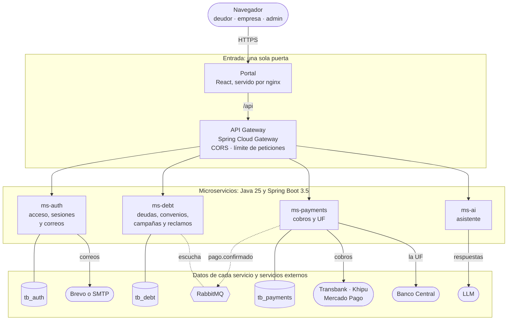

**Qué la hace de microservicios:**

- **Una sola puerta.** El API Gateway es lo único que recibe peticiones de afuera: aplica CORS y el
  límite de peticiones, y enruta a cada servicio por el comienzo de la ruta.
- **Una base por servicio.** ms-auth, ms-debt y ms-payments tienen cada uno la suya (`tb_auth`,
  `tb_debt`, `tb_payments`) y ninguno lee la de otro. Lo que necesitan de otro servicio se lo piden
  por HTTP con la clave interna: ms-debt le pide a ms-auth que mande un correo, ms-payments le
  pregunta a ms-debt cuánto cobrar y ms-auth le pregunta a ms-debt si existe una empresa. ms-ai no
  tiene base: lee las deudas en ms-debt con la sesión del deudor.
- **Mensajes asíncronos.** El aviso de pago viaja de ms-payments a ms-debt por RabbitMQ
  (`pago.confirmado`). Sale de una bandeja con reintentos y, si RabbitMQ está apagado, va por HTTP.
- **Cada uno por su cuenta.** Cada servicio tiene su `pom.xml`, su `Dockerfile`, su workflow y su
  imagen, y se compila, se prueba y se despliega sin los demás.
- **Por dentro, en capas.** Cada microservicio se ordena igual: `controller` → `service` →
  `repository` ([cómo está organizado cada servicio](#cómo-está-organizado-cada-servicio)). Las
  capas son la forma de cada servicio; la solución completa es de microservicios.

Las rutas del gateway y las llamadas entre servicios, con sus llaves, están en
[§7.1](#71-comunicación-entre-servicios). La entrega por API para los sistemas de otras empresas
(`/api/v1`) está **apagada por omisión**, porque los deudores entran por campaña desde el portal;
`INTEGRACION_API=true` la enciende.

### Los componentes

| Pieza | Qué hace |
| --- | --- |
| **portal** | React 18, Zustand 5, React Router 7, Vite 6 y CSS propio. Se compila y lo sirve nginx, que además hace de proxy hacia el gateway: el navegador ve un solo origen y no hay CORS que resolver |
| **gateway** | La única puerta (`Spring Cloud Gateway`): CORS, límite de peticiones por IP con Bucket4j y enrutamiento. Al retorno de Webpay le quita el `Origin`, porque es la página de Transbank la que devuelve al navegador con un formulario; CORS no se abre a nadie más |
| **ms-auth** | Código primero en los tres portales: RUT del deudor o correo del personal. El solicitado dura 15 min; el de campaña, 24 h. El respaldo reúne código y enlace en un correo y comparte su único uso. Emite el JWT firmado con **ES256 (ECDSA P-256)** y expone `/.well-known/jwks.json`, maneja las sesiones y manda los correos por la API de Brevo o SMTP, incluido el recordatorio de cuota |
| **ms-debt** | Deudas, cargos y cuotas; convenios de 3 a 24 cuotas con cálculo de CAE y costo total; los intereses por mora y del convenio, si el acreedor los pactó; la ejecución de las campañas; reclamos y su resolución; la carga de la cartera en una campaña, con la planilla y su revisión antes de confirmar; resumen para el panel; certificado y comprobantes en PDF; recordatorio de las cuotas por vencer. Con `INTEGRACION_API=true`, además el contrato v1: la cartera por API, las claves de API y los eventos firmados con HMAC-SHA256 de vuelta a quien se suscribió |
| **ms-payments** | Los cobros. Webpay contra Transbank, Mercado Pago con Checkout Pro y Khipu (si tiene llave) de verdad; sin credenciales, simulados. El monto lo decide ms-debt (`GET /internal/debts/{id}`), nunca el navegador. En UF consulta la **API del Banco Central (`si3.bcentral.cl`)**, guarda el valor diario en `uf_values` y fija los pesos al abrir el cobro. Un cobro abandonado se vence: a los 15 minutos en Webpay, a los 30 en Khipu y en Mercado Pago |
| **ms-ai** | Asistente de solo lectura. Lee las deudas en ms-debt con el JWT de la sesión del deudor, sin acceso propio a la base, y detecta frustración o desconfianza para ajustar el tono. Usa un LLM vía el SDK oficial de OpenAI (`LlmService`, configurable con `XAI_API_KEY`, `XAI_BASE_URL` y `XAI_MODEL` para xAI Grok o proveedores compatibles como Groq y Gemini); si no hay llave o el proveedor falla, responde con su motor local de reglas (`MotorLocal`) |
| **MySQL 8.4** | Tres instancias independientes (`db-auth`, `db-debt`, `db-payments`), una por servicio, con el esquema versionado en Flyway ([`docs/base-de-datos`](docs/base-de-datos/README.md)) |
| **RabbitMQ** | Lleva el aviso de pago (`pago.confirmado`) de ms-payments a ms-debt. Si está apagado, el mismo aviso va por HTTP; en los dos casos sale de una bandeja con reintentos, así que no se pierde |

### Los roles de acceso

Hay dos roles para las personas que trabajan con DataBridge, y el control lo tiene solo DataBridge:

| Rol | Quién es | Dónde entra | Qué ve |
| --- | --- | --- | --- |
| `admin` | Solo DataBridge. Ninguna otra empresa puede tener un `admin` | El panel de administración (`/api/admin/**`) | La plataforma: totales por empresa, nunca los datos de un deudor |
| `usuario` | Una empresa usuaria: la que incorpora DataBridge a su operación, sea una agencia de cobranza o un acreedor que cobra directo | El portal de empresas | Solo la cartera de su empresa: la de sus clientes |

Los clientes de una empresa usuaria son los deudores. No tienen un rol ni una cuenta: entran al
portal del deudor con su RUT y su código de acceso.

- **Un `admin` nunca es de una empresa, y una persona de una empresa nunca es `admin`.** Lo exige
  la base, no solo el código: `staff_users` no deja guardar un `admin` con empresa ni un `usuario`
  sin ella.
- **El primer `admin` sale de `ADMIN_CORREO`.** Al arrancar, si todavía no hay ninguno, ms-auth lo
  crea con ese correo. Entra con el código que solicita ahí, sin contraseña, igual que un usuario.
  Sin esa variable no hay `admin` y nadie entra al panel.
- **Cada sesión lleva su rol en el JWT:** `ADMIN`, `CREDITOR` (el usuario de una empresa) o
  `DEBTOR`. Todo lo que cuelga de `/api/admin` exige `ADMIN`, y todo lo demás exige `CREDITOR` o
  `DEBTOR`: el `admin` no entra a un portal ajeno, y un usuario o un deudor reciben `403` en el
  panel. La regla es de la ruta entera, no de cada endpoint, así que uno nuevo no puede quedar
  abierto por olvido.

**El panel de administración** (`/admin`) tiene *Inicio* (si cada servicio responde con esa
sesión), *Empresas* (dar de alta una empresa con su primera persona y ver sus totales, mandatos y
gente, nunca un deudor), *Equipo de DataBridge* (otros `admin`), *Accesos* (la bitácora de entradas
y rechazos, con el RUT a medias y la IP solo como huella) y *Reglas* (lo que rige en cada servicio,
de solo lectura).

- **Dar de alta es dar acceso:** llega una invitación de un solo uso que dura 24 horas. Quitar el
  acceso anula los enlaces sin abrir y cierra las sesiones; un `admin` no se lo puede quitar a sí
  mismo.
- **La empresa vive en ms-debt y su gente en ms-auth**, unidas por el RUT, y todo queda en
  `admin_log` con el `admin` que lo hizo. Lo que falta del panel está en
  [#136](https://github.com/TechnicalBridge/TB_web/issues/136).

### Cómo está organizado cada servicio

Los tres servicios con base de datos tienen la misma forma, así que quien conoce uno se ubica en
los otros:

```
com/tbridge/<servicio>/
├── config/        seguridad, Swagger, RabbitMQ, cifrado, datos de ejemplo
├── controller/    los endpoints: traducen HTTP y delegan, sin reglas de negocio
├── service/       las reglas de negocio
├── repository/    el acceso a la base (Spring Data JPA)
├── model/         las entidades, una por tabla
├── dto/request/   lo que entra, validado con Bean Validation
├── dto/response/  lo que sale, documentado para Swagger
├── assembler/     los enlaces de HATEOAS de cada recurso
├── client/        las llamadas a otros sistemas (otro servicio, Transbank, Khipu, el Banco Central)
└── exception/     los errores propios del servicio
```

**Cada servicio por sí solo.** No hay pom padre ni librería compartida: cada uno tiene su
`pom.xml`, su `Dockerfile`, su workflow y su base, y copia en sus paquetes solo lo que usa
(`security/`, `exception/`, `util/`). El aviso de pago (`events/PagoConfirmado`) lo tienen
ms-payments, que lo escribe, y ms-debt, que lo lee, y los dos se prueban contra el mismo contrato,
explicado en [`docs/eventos`](docs/eventos/README.md): cada uno guarda una copia en sus pruebas, y la CI revisa
que sean iguales. El gateway y ms-ai no
tienen base.

**Swagger, HATEOAS y configuración.** El gateway junta la documentación de todos en
http://localhost:8080/swagger-ui.html, en grupos según quién llama (portal, panel, contrato e
interno), cada uno con su llave en *Authorize*. Las respuestas del portal traen `_links` con lo que
se puede hacer después según el estado (`simular`, `repactar`, `pagar`, `certificado`…). Cada
servicio se configura con `${VARIABLE:valor por omisión}`; los secretos no tienen valor por
omisión y, si falta uno, el servicio no arranca y dice cuál.

---

## 7. Diagramas

Los diagramas siguen el modelo **4+1** de Kruchten. Aquí se presentan los **cinco diagramas
generales del 4+1** junto con lo que está implementado en el código; el desglose por servicio, con
todas las columnas, clases y secuencias, está en [`docs/diagramas`](docs/diagramas/README.md).

| Vista 4+1 | Diagrama general en este README | El detalle en `docs/diagramas/` |
| --- | --- | --- |
| **Escenarios** (el +1) | [§7.3 Casos de uso](#73-casos-de-uso) (`casos-de-uso.png`) | [Cada actor y sus endpoints](docs/diagramas/casos-de-uso.md) |
| **Lógica** | [§7.2 Entidad-relación](#72-entidad-relación) (`entidad-relacion.png`) y [§7.4 Clases](#74-clases) | [Las tres bases con sus columnas](docs/diagramas/entidad-relacion.md) · [Clases de cada servicio](docs/diagramas/clases.md) · [Estados](docs/diagramas/estados.md) |
| **Procesos** | [§7.5 Secuencias](#75-secuencias) (`secuencia-pago.png`) y [§7.1 Comunicación](#71-comunicación-entre-servicios) | [Las 16 secuencias](docs/diagramas/secuencia.md) · [BPMN y flujos](docs/diagramas/procesos.md) |
| **Desarrollo** | [§7.1 Comunicación](#71-comunicación-entre-servicios) y [§7.6 Componentes](#76-componentes) (`componentes.png`) | [Cada servicio y el portal por dentro](docs/diagramas/componentes.md) |
| **Física** | [§10 Docker y despliegue](#los-contenedores-y-sus-puertos) (`despliegue.png`) | [Contenedores, orden de arranque y perfiles](docs/diagramas/despliegue.md) |

### 7.1 Comunicación entre servicios

Quién le habla a quién y por dónde. Las flechas continuas son llamadas HTTP; las punteadas, lo que va por
la cola o lo que está apagado por omisión.

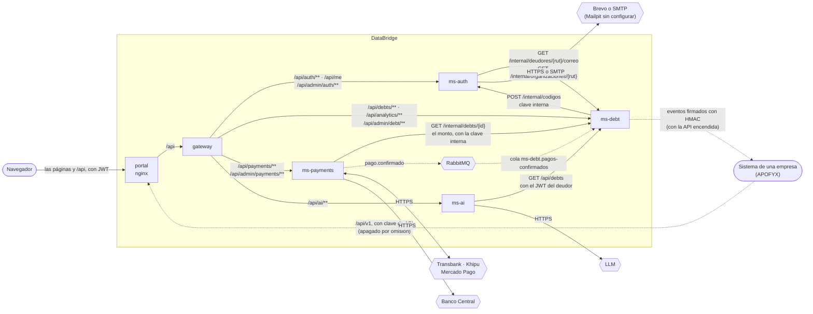

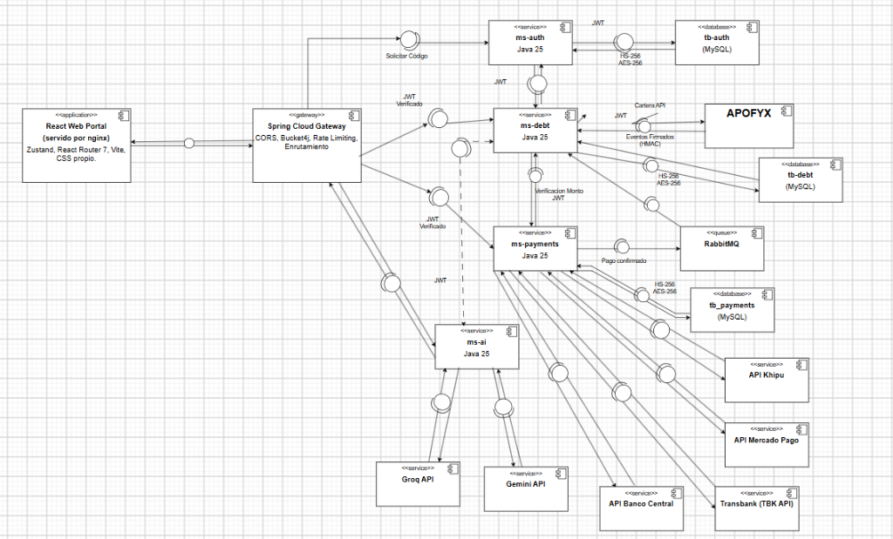

| Entre quiénes | Cómo | Por qué así |
| --- | --- | --- |
| Navegador → Portal (nginx) → Gateway | HTTPS/HTTP hacia nginx y proxy `/api` al gateway, con JWT **ES256** | Una sola puerta pública con CORS y límite de peticiones (Bucket4j) |
| Sistemas de las empresas → ms-debt | HTTP por el gateway (`/api/v1`), con clave de API. **Solo con `INTEGRACION_API=true`** | Entran por la misma puerta, con su límite de peticiones |
| ms-payments → ms-debt | **RabbitMQ** (AMQP), cola `ms-debt.pagos-confirmados` | El pago ya ocurrió: si ms-debt está caído, el aviso espera en la cola en vez de perderse |
| ms-debt ↔ ms-auth, ms-payments → ms-debt | HTTP interno (`/internal/**`) con `X-Internal-Key`, fuera del gateway | Son llamadas entre servicios (pedir código, consultar correo/empresa, verificar monto de deuda en `GET /internal/debts/{id}`); el gateway no las expone |
| ms-ai → ms-debt | HTTP (`GET /api/debts`) reenviando el JWT del deudor | El asistente no tiene base ni acceso privilegiado: ve solo lo que el deudor autenticado puede ver |
| ms-payments ↔ Transbank | HTTPS con el código de comercio y su llave (`TBK API`) | Crear la transacción Webpay Plus y confirmarla; el navegador solo va y vuelve |
| ms-payments ↔ Khipu | HTTPS con la llave de la cuenta de cobro (`x-api-key`) | Crear el cobro y preguntar en qué va; el navegador solo va y vuelve |
| ms-payments ↔ Mercado Pago | HTTPS con el token de acceso (`Bearer`) | Crear la preferencia de Checkout Pro y verificar el pago servidor a servidor |
| ms-payments → Banco Central | HTTPS contra el Web Service REST (`si3.bcentral.cl`) | Traer el valor oficial de la UF del día, guardarlo en `tb_payments.uf_values` y fijar los pesos al abrir un cobro en UF |
| ms-ai → Proveedor LLM | HTTPS con el SDK de OpenAI (`XAI_BASE_URL` / `XAI_API_KEY`) | Consultar el modelo configurado (xAI Grok, o APIs compatibles como Groq y Gemini); si no hay llave o falla, responde `MotorLocal` |
| APOFYX ↔ DataBridge | HTTP con clave de API, y webhooks firmados con `HMAC-SHA256`. **Solo con `INTEGRACION_API=true`** | Son empresas distintas: ninguna entra en la base de la otra |
| ms-auth → el correo | La API de Brevo (HTTPS) o un servidor SMTP; sin ninguno, Mailpit | El único servicio que escribe correos. ms-debt le pide el código y el recordatorio |

**Lo que hace el código en las firmas y las bases respecto al diagrama de componentes:**
- **JWT con ES256 (ECDSA P-256):** `ms-auth` firma los tokens con la llave privada montada en `JWT_KEY_DIRECTORY` (`JwtKeyRing`, `JwtService`) y publica la llave pública en `/.well-known/jwks.json`. `ms-debt` y `ms-payments` verifican la firma consultando ese JWKS (la migración `V7` dejó atrás `HS256`).
- **Conexión JDBC, huellas SHA-256 y cifrado AES-256-GCM:** Cada servicio se conecta a su MySQL por JDBC. En `tb_auth`, los códigos, enlaces mágicos, llaves de renovación e IPs se guardan como hashes **SHA-256** (`Hash.java`). En `tb_debt`, el secreto de cada suscripción (`subscriptions.secret`) se cifra en reposo con **AES-256-GCM** (`Cifrado.java`) usando `CIFRADO_LLAVE`.

Si RabbitMQ no está, ms-payments manda el mismo aviso por HTTP (`POST /internal/events/pago-confirmado`);
en los dos casos sale de una bandeja con reintentos, así que no se pierde.

<details>
<summary><b>Tres clases de interfaz</b>, cada una con su llave</summary>

| Interfaz | Rutas | Para quién | Con qué se entra | ¿La publica el gateway? |
| --- | --- | --- | --- | --- |
| **Portal** | `/api/auth/**`, `/api/me`, `/api/debts/**`, `/api/analytics/**`, `/api/payments/**`, `/api/ai/**` | El deudor y el usuario de una empresa | JWT de una sesión `DEBTOR` o `CREDITOR` | Sí |
| **Panel de administración** | `/api/admin/auth/**`, `/api/admin/debt/**`, `/api/admin/payments/**` | El `admin` de DataBridge | JWT de una sesión `ADMIN` | Sí |
| **Contrato de integración** | `/api/v1/**`, y las claves en `/api/claves/**` | El sistema de una empresa | Clave de API | Sí, pero apagado por omisión: responde `404` |
| **Interno** | `/internal/**` | Otro servicio, o la operación | Clave interna (`X-Internal-Key`) | No |

Las vueltas y avisos de las pasarelas (`/api/payments/public/**`) entran sin sesión: se validan con la firma
del enlace de pago, y lo que dicen se le vuelve a preguntar a la pasarela.

</details>

**La API de integración está apagada por omisión.** Desde que los deudores entran solo por campaña,
todo `/api/v1` y `/api/claves` responde `404` mientras `INTEGRACION_API` no sea `true`. La cadena
con APOFYX la necesita encendida, y sus scripts la encienden solos. El contrato completo, con sus
ejemplos y su esquema JSON, está en [`docs/integracion/`](docs/integracion/README.md).

### 7.2 Entidad-relación

**Una base por servicio**, cada una en su propio MySQL 8.4 ([#238](https://github.com/TechnicalBridge/TB_web/issues/238)): si una se cae o se restaura, las
otras dos siguen. No comparten tablas: si ms-payments
necesita saber cuánto se debe, se lo **pregunta** a ms-debt. Así cada servicio cambia su esquema
sin romper a los demás, y un error en pagos no puede corromper la cartera.

El esquema lo versiona **Flyway**, y cada servicio arranca con `ddl-auto: validate`, que compara
las entidades con las tablas y se niega a partir si no calzan. En total son **26 tablas de negocio**
(más las **3 tablas `flyway_schema_history`**, una en cada instancia MySQL), **3 vistas**, **26
llaves foráneas físicas** (`24` en `tb_debt`, `2` en `tb_payments` y `0` en `tb_auth`) y **70
reglas `CHECK`**, sin ninguna llave foránea entre una base y otra.

| Base | Servicio | Tablas | Migraciones |
| --- | --- | --- | --- |
| [`tb_debt`](#tb_debt--la-cartera) | ms-debt | 15 y 2 vistas (`+ flyway_schema_history`) | `V1` esquema inicial · `V2` recordatorios · `V3` secreto de las suscripciones, cifrado · `V4` intereses · `V5` descuento · `V6` bitácora del panel · `V7` contactos al deudor, en su tabla · `V8` el correo que no sale · `V9` la CAE del convenio · `V10` la CAE de los convenios anteriores · `V11` avisos reintentados desde el panel · `V12` suspender y reactivar una empresa |
| [`tb_auth`](#tb_auth--quién-entra) | ms-auth | 6 (`+ flyway_schema_history`) | `V1` esquema inicial · `V2` sesiones · `V3` enlace pedido · `V4` roles `admin` y `usuario` · `V5` bitácora del panel · `V6` código y enlace del mismo acceso · `V7` cerrar las sesiones de antes de ES256 · `V8` la bitácora de acceso, por fecha |
| [`tb_payments`](#tb_payments--la-plata) | ms-payments | 5 y 1 vista (`+ flyway_schema_history`) | `V1` esquema inicial · `V2` pago duplicado · `V3` interés del pago · `V4` Webpay una vez · `V5` descuento del pago · `V6` bitácora del panel |

Los diagramas salen del esquema que dejan las migraciones. `PK` es la llave primaria, `FK` una
llave foránea y `UK` un valor que no se repite; en las líneas, `||` es *uno*, `o{` es *cero o
muchos* y `|o` es *cero o uno*. Las 70 reglas que exige cada base (`CHECK`) están en
[`docs/diagramas/entidad-relacion.md`](docs/diagramas/entidad-relacion.md).

#### El diagrama general: las tres bases

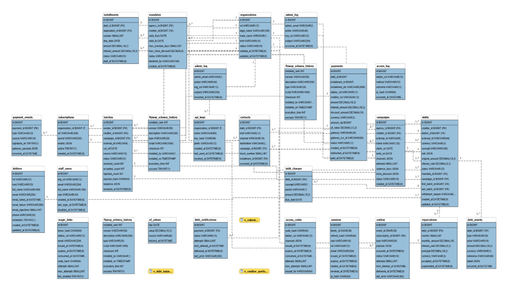

> **Alineación entre el diagrama ER y las migraciones vigentes:**
> - **Tablas por instancia:** Las tres cajas `flyway_schema_history` y las dos `admin_log` corresponden a las bases separadas `tb_auth`, `tb_debt` y `tb_payments`.
> - **Uniones entre bases vs. llaves foráneas:** En MySQL solo existen las **26 llaves foráneas físicas** dentro de `tb_debt` (24) y `tb_payments` (2). Las líneas punteadas que en la vista consolidada cruzan de una base a otra (`payments` hacia `debts`, `organizations` o `debtors`; y `staff_users`, `access_codes`, `magic_links`, `sessions`, `access_log` o `admin_log` entre `tb_auth` y `tb_debt`) son **relaciones lógicas por RUT o por ID** mantenidas por los servicios en código, como detalla la tabla siguiente.
> - **CAE en `repactations`:** Con las migraciones `V9` y `V10` de `ms-debt`, la tabla `repactations` incorpora además la columna `cae DECIMAL(6,2)` (`ck_repactation_cae`) para conservar la Carga Anual Equivalente informada al aceptar el convenio.

Todas las tablas de DataBridge en un solo diagrama, cada una con el nombre de su base. Las **líneas
continuas** son llaves foráneas dentro de una base. Las **punteadas** cruzan de una base a otra: no
hay llave foránea, se unen por el RUT o por el id de la deuda, y esa unión la mantiene el código.

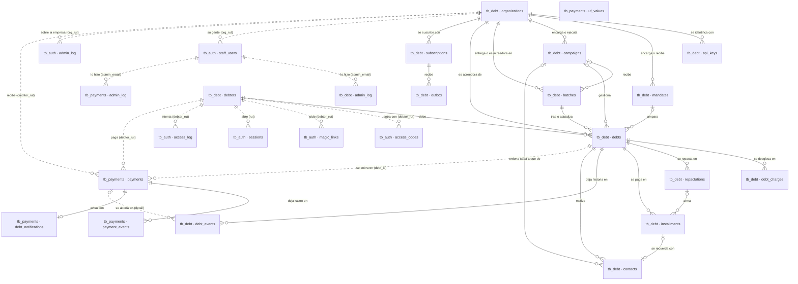

| Desde | Hacia | Con qué | Quién la mantiene |
| --- | --- | --- | --- |
| `tb_auth.staff_users.org_rut` | `tb_debt.organizations.rut` | El RUT de la empresa | ms-auth lo pone en el JWT, y ms-debt busca la empresa por ese RUT |
| Los `debtor_rut` de `tb_auth` | `tb_debt.debtors.rut` | El RUT del deudor | ms-debt pide el código para ese RUT; ms-auth le pregunta a ms-debt el correo registrado |
| `tb_payments.payments.debt_id` e `installment_ids` | `tb_debt.debts.id` e `installments.id` | Los id de la deuda y de sus cuotas | ms-payments se los pide a ms-debt al abrir el cobro, junto con el monto |
| `tb_payments.payments.debtor_rut` y `creditor_rut` | `tb_debt.debtors.rut` y `organizations.rut` | El RUT de quien paga y de a quién | Vienen en la misma respuesta de ms-debt |
| `tb_debt.debt_events.detail` | `tb_payments.payments.id` | El id del pago aplicado | Lo trae el aviso `pago.confirmado` |
| `admin_log`, en las tres bases | `tb_auth.staff_users.email` y, en `tb_auth` y `tb_debt`, `tb_debt.organizations.rut` | Quién lo hizo y sobre qué empresa | Sale del JWT de la sesión del `admin`, no del cuerpo de la petición |

#### `tb_debt` — la cartera

Quince tablas y dos vistas (`v_debt_balance`, `v_creditor_portfolio`). Lo que conviene mirar:

- **`organizations`** guarda a los acreedores y a las agencias, con un `kind` que dice cuál es
  cuál. Un **`mandates`** las une, y sin mandato vigente una cartera se rechaza.
- **El saldo y la mora no se guardan, se calculan** con los `debt_charges`, las cuotas y la tasa
  que pactó el acreedor. Queda escrito solo lo que ya se fijó: el interés de cada cuota, lo
  repactado con su tasa y su CAE (`repactations`), y lo cobrado en cada pago.
- **`contacts`** es el registro de gestiones que pide la ley: de ahí se cuenta el límite de dos por
  semana, y la base impide repetir un toque de campaña o recordar dos veces una cuota.
- **`outbox`** es la bandeja de salida de los eventos, escrita en la misma transacción que el hecho
  que los provoca, y **`subscriptions.secret`** va cifrado ([§9](#9-requisitos-no-funcionales)).

#### `tb_auth` — quién entra

Seis tablas, sin llaves foráneas entre sí. **El deudor no tiene cuenta:** se guarda el hash del
código, nunca el código; el de la llave de renovación, nunca la llave; y en `access_log`, el de la
IP, nunca la IP. `staff_users` guarda a la gente de las empresas (`usuario`) y a los `admin`, y
`admin_log` lo que un `admin` hizo con ellas.

#### `tb_payments` — la plata

Cuatro tablas y la vista `v_collection` (lo recaudado por acreedor y por mes). Un pago se crea al
abrir el cobro, y cada cambio queda en `payment_events`, que solo se agrega, con lo que respondió
la pasarela. `UNIQUE (gateway, gateway_txn_id)` impide cobrar dos veces la misma transacción, y
`debt_notifications` es el aviso a ms-debt con sus reintentos.

Cada tabla con todas sus columnas, y las reglas `CHECK` de cada base, están en
[`docs/diagramas/entidad-relacion.md`](docs/diagramas/entidad-relacion.md).

### 7.3 Casos de uso

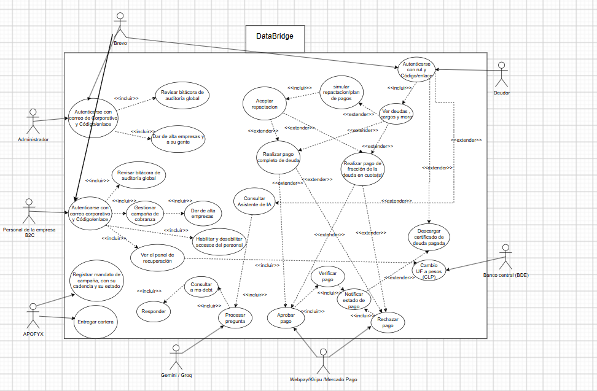

**Qué está hecho en el código para cada actor del diagrama:**

- **Deudor:** entra con su RUT y el código de 6 caracteres o el enlace enviado por **Brevo**/SMTP (`ms-auth`); ve sus deudas, cargos y mora (`ms-debt`); simula y acepta planes de repactación de 3 a 24 cuotas con su CAE y costo total; paga el total de la deuda o cuotas en orden de vencimiento mediante **Webpay, Khipu o Mercado Pago** (`ms-payments`); descarga el certificado de deuda pagada y los comprobantes en PDF; y consulta al asistente (`ms-ai`).
- **Personal de la empresa (`CREDITOR`):** entra con su correo corporativo y código/enlace; gestiona sus campañas de cobranza (crear, pausar, terminar, cargar cartera en planilla y reenviar códigos); resuelve reclamos y revisa el panel de recuperación y los pagos recibidos.
- **Administrador de DataBridge (`ADMIN`):** entra a `/admin` con correo y código/enlace; da de alta empresas usuarias y a su gente; habilita y deshabilita accesos del personal; y revisa el estado de los servicios, las reglas vigentes y la bitácora de auditoría (`admin_log` y `access_log`). *(En el código actual, dar de alta empresas, habilitar/deshabilitar accesos del personal y revisar la bitácora global son exclusivos del rol `ADMIN` en `/api/admin/**`).*
- **APOFYX y sistemas externos:** APOFYX registra mandatos, campañas y entrega cartera por `/api/v1` (cuando `INTEGRACION_API=true`); el **Banco Central (BDE)** provee el valor diario de la UF a `ms-payments` para convertir los cobros en UF a pesos chilenos (CLP); **Webpay, Khipu y Mercado Pago** procesan el cobro y `ms-payments` verifica el estado servidor a servidor antes de aprobar o rechazar y notificar por RabbitMQ; y el proveedor LLM (**Grok / Groq / Gemini** vía `LlmService`, o `MotorLocal` sin llave) procesa las consultas del asistente leyendo las deudas del deudor en `ms-debt`.

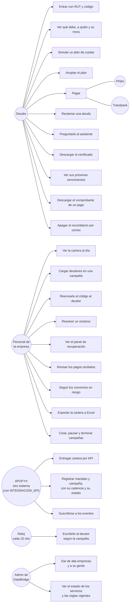

El certificado (`U7`) solo se emite si la deuda está **pagada**: una deuda retirada también queda
en saldo cero, y certificar eso sería decir algo falso.

Los casos de uso **de cada actor** (el deudor, el usuario de una empresa, el `admin`, el sistema de
una empresa y lo que corre solo), con el endpoint de cada uno, están en
[`docs/diagramas/casos-de-uso.md`](docs/diagramas/casos-de-uso.md).

#### Los escenarios que recorren los diagramas

| Escenario | Lo dispara | Clases | Dónde se ve | Servicios |
| --- | --- | --- | --- | --- |
| **E1. Cargar la cartera** | La empresa, en una campaña | `Batch`, `Debt`, `DebtCharge`, `Campaign` | [Secuencia de ms-debt](#75-secuencias) | portal → gateway → ms-debt |
| **E2. Invitar y recordar** | La deuda que entra, y el reloj | `Campaign`, `Contact` | [Actividad de la campaña](docs/diagramas/procesos.md#actividad-cómo-databridge-ejecuta-una-campaña) | ms-debt → ms-auth → correo |
| **E3. Pagar** | El deudor | `Payment`, `Installment` | [Secuencia del pago](#el-pago-con-khipu-la-funcionalidad-principal) | portal → gateway → ms-payments ↔ pasarela, RabbitMQ → ms-debt |
| **E4. Repactar** | El deudor | `Repactation`, `Installment` | [Secuencia del convenio](docs/diagramas/secuencia.md#5-simular-y-aceptar-un-convenio) | portal → gateway → ms-debt |
| **E5. Reclamar** | El deudor; la empresa resuelve | `Debt` en `disputed`, `DebtEvent` | [Estados de una deuda](docs/diagramas/estados.md#una-deuda) | portal → gateway → ms-debt |

### 7.4 Clases

El cálculo de la comisión mensual y sus dependencias se detallan en
[El modelo de negocio](docs/diagramas/clases.md#el-modelo-de-negocio).

#### El dominio

Los conceptos de la cartera viven en ms-debt; el pago, en ms-payments, que nombra la deuda por su
id porque cada servicio tiene su base. El acceso (códigos y sesiones) vive en ms-auth y se
describe en el [modelo de datos](#tb_auth--quién-entra).

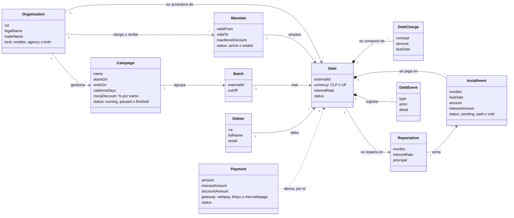

Lo que se guarda y lo que se calcula: el **saldo** y la **mora** no son atributos, se calculan con
los cargos, las cuotas y la tasa ([§7.2](#72-entidad-relación)). Lo que sí queda escrito es lo que ya se
fijó: el interés de cada cuota del convenio, y el interés y el descuento de cada pago. El descuento
de una campaña nunca pasa del máximo que el acreedor autorizó en el mandato.

Las clases **de cada servicio** (ms-auth, ms-debt, ms-payments, ms-ai y gateway), de la petición a
la base, están en [`docs/diagramas/clases.md`](docs/diagramas/clases.md).

### 7.5 Secuencias

#### El pago con Khipu, la funcionalidad principal

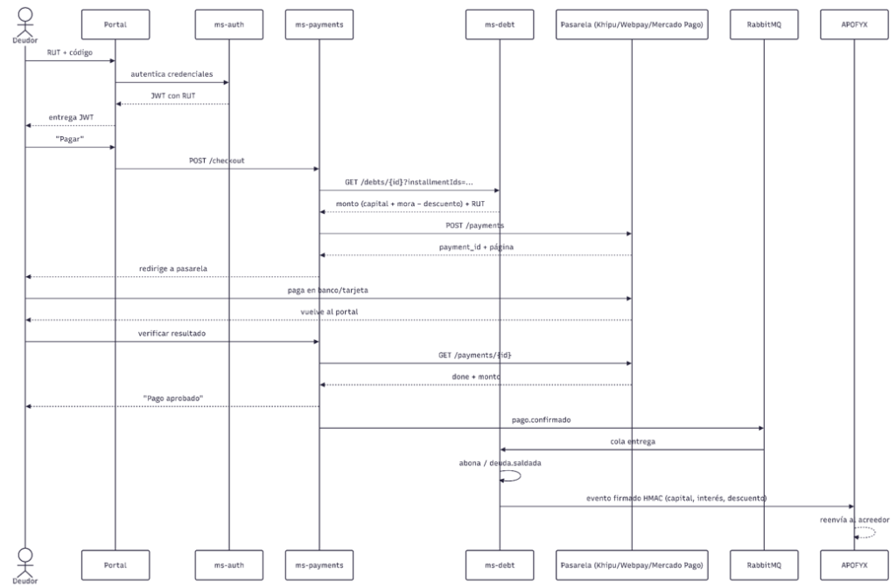

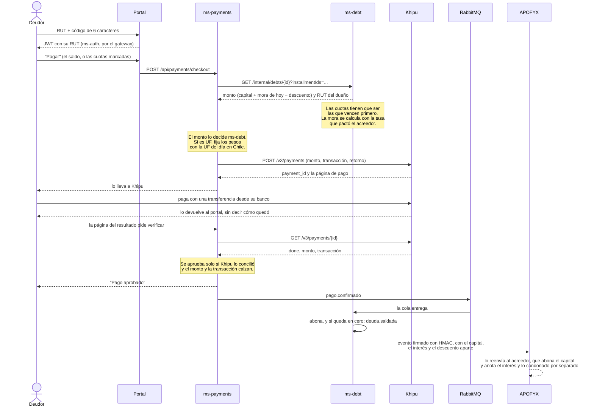

**El navegador nunca dice cuánto hay que pagar ni si el pago salió bien.** El monto lo pregunta
ms-payments a ms-debt, y la aprobación la confirma ms-payments con Khipu, de servidor a servidor.
Si el deudor cierra la ventana antes de volver, el pago igual se registra: ms-payments le pregunta
a Khipu por los cobros abiertos cada 10 segundos.

<details>
<summary><b>Mientras la pasarela verifica</b>, nadie paga dos veces ni se pierde un pago; y cómo es con Webpay</summary>

Entre que el deudor
transfiere y que Khipu lo confirma pasa un rato, y en ese rato la cuota todavía se ve pendiente.

- **Un pago a la vez por deuda.** Al abrir un pago, ms-payments mira los otros pagos abiertos de esa
  deuda. Si uno está en verificación (Khipu `verifying`, Mercado Pago `in_process` o `pending`), el
  nuevo se rechaza: *Tienes un pago en verificación*. Si uno quedó abierto sin pagar, se anula en
  la pasarela (Khipu lo borra y la preferencia de Mercado Pago vence en el acto) y queda vencido.
- **Cada pago guarda las cuotas que cubre**, tal como las cobró ms-debt. Una cuota ya pagada que
  ms-debt todavía no abona no se vuelve a cobrar.
- **Si igual se paga dos veces** (Webpay no se puede anular: solo cobra si ms-payments confirma la
  transacción al volver el deudor), el segundo pago queda `duplicated`. No se abona, y la empresa
  lo ve en *Pagos recibidos*, en *Pagos para devolver*, con el RUT del deudor y la referencia de la
  pasarela para devolverlo. Cuando ya lo devolvió allá, toca *Ya lo devolví* y anota la referencia que le
  dio la pasarela: el pago queda `refunded`, pasa a *Pagos devueltos* con su fecha, y el deudor lo ve en
  su historial. DataBridge no mueve plata: solo deja constancia, con quién lo registró.
- **No se vence lo que se está verificando.** Si el plazo se cumple mientras la pasarela verifica,
  el pago sigue abierto hasta que se confirme. Un cobro que vence sin pagarse se anula en Khipu.
- **Los vencidos se revisan un día más.** Cada 5 minutos, ms-payments pregunta por los cobros que
  vencieron en las últimas 24 horas. En Khipu, un intento empezado justo antes del vencimiento
  tiene hasta 3 horas para terminar: si alguno aparece pagado, se registra igual. El aviso de
  Khipu también lo registra.

**Con Webpay es igual, con otra forma:** ms-payments abre la transacción en Transbank y lleva al
deudor a Webpay con un formulario POST. Cuando Webpay lo devuelve, ms-payments confirma la
transacción con Transbank (`PUT /transactions/{token}`) antes de mostrarle el resultado. Se aprueba
solo con `AUTHORIZED`, código de respuesta 0, el monto cobrado y la orden de compra de ese pago. El
aviso de vuelta tampoco pasa por el navegador.

</details>

Las secuencias **de cada servicio** (entrar con RUT y código, cargar deudores en una campaña, pagar
con Webpay o Mercado Pago, preguntarle al asistente) y las 16 del sistema están en
[`docs/diagramas/secuencia.md`](docs/diagramas/secuencia.md).

### 7.6 Componentes

#### El repositorio y las capas

Un solo repositorio con dos lenguajes: Java en los servicios y JavaScript en el portal. **Cada
servicio es un proyecto de Maven aparte**, con Spring Boot como padre: no hay un pom padre del
repositorio ni una librería compartida. Lo único que comparten es lo publicado: el contrato y el
aviso de pago.

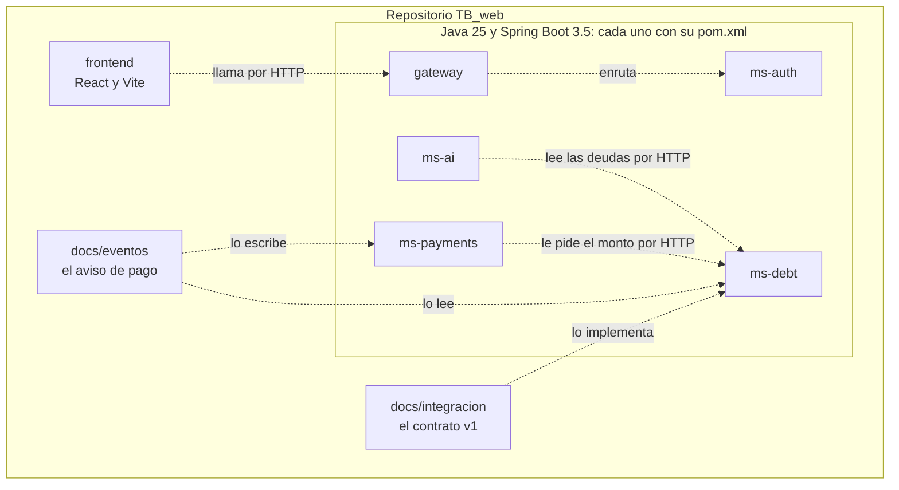

Dentro de cada servicio, las mismas capas, de afuera hacia adentro (el detalle de cada carpeta está
en [§6](#cómo-está-organizado-cada-servicio)):

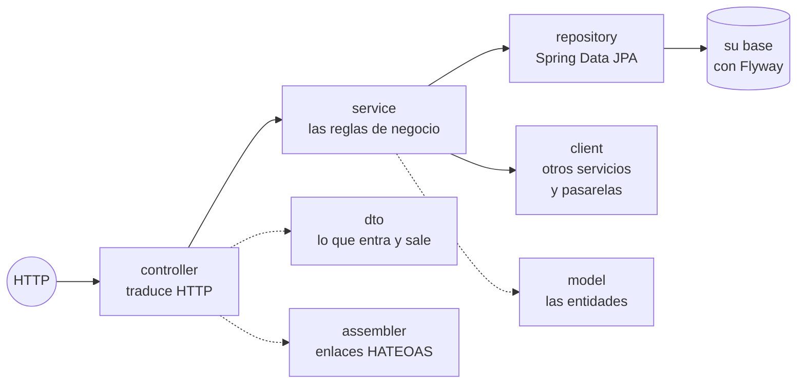

Una regla las ordena: **el controller traduce y delega, y las reglas viven en el service**. Por eso
las reglas se prueban sin levantar el servidor web, con los repositorios simulados, y la capa web
se prueba sin base de datos ([§11](#11-pruebas)).

Cada servicio y el portal **por dentro**, con lo que hay en cada paquete, están en
[`docs/diagramas/componentes.md`](docs/diagramas/componentes.md).

---

## 8. Reglas del negocio

Lo que DataBridge exige a una cartera, cómo cobra los intereses que pactó el acreedor, y cómo cumple una
campaña dentro de lo que permite la ley.

### El modelo de negocio

DataBridge calcula una comisión mensual por empresa usuaria sobre lo que recupera con la plataforma.
La paga quien cargó la deuda: la agencia de cobranza o el acreedor que cobra directamente. El deudor
no paga esta comisión y un mismo pago no se atribuye a dos empresas.

`G` es la suma en pesos de los pagos abonados durante el mes calendario, con la hora de Chile,
en todas las campañas de esa empresa. En UF cuentan los pesos cobrados por la pasarela, no una
conversión con la UF de hoy. Los pagos fallidos, anulados o duplicados no se abonan y no suman.

Al aplicar un pago se guardan la empresa que cargó la deuda y su campaña en el detalle del evento.
Recargar después esa deuda con otra empresa o campaña no reasigna ese pago. Para eventos antiguos
sin esa atribución se usan la empresa y campaña actuales: no se puede reconstruir con certeza un
historial que no se guardó. El detalle real usa `monto_clp` y `valor_uf`; también se admiten los nombres
anteriores en camelCase.

| Recuperado por la empresa en el mes (G) | Porcentaje p(G) |
| --- | --- |
| Más de $0 y hasta $1.000.000 | 6 % |
| Más de $1.000.000 y hasta $5.000.000 | 10 % |
| Más de $5.000.000 y hasta $10.000.000 | 12 % |
| Más de $10.000.000 | 15 % |

**Comisión de DataBridge:** `P(G) = G × p(G) / 100`, con `p(G)` expresado como 6, 10, 12 o 15.
**Para la empresa:** `G − P(G)`. La comisión se redondea al peso más cercano; medio peso sube.
Sin recuperación, ambos montos y el porcentaje son cero y no hay tramo vigente.

| Recuperado | Porcentaje | Comisión | Para la empresa |
| --- | --- | --- | --- |
| $800.000 | 6 % | $48.000 | $752.000 |
| $1.000.001 | 10 % | $100.000 | $900.001 |
| $12.000.000 | 15 % | $1.800.000 | $10.200.000 |

**El porcentaje va sobre todo G, no por tramos escalonados.** Al pasar un corte aumenta la comisión
sobre el total: con $1.000.000 quedan $940.000 para la empresa y con $1.000.001 quedan $900.001.
Es el modelo acordado por el equipo y se conserva ese salto.

La empresa ve el mes en *Campañas*, puede consultar uno anterior y ve lo recuperado por cada campaña.
El admin ve la comisión por empresa en *Empresas*. El tramo depende del total de la empresa,
no de cada campaña por separado. Esto calcula y muestra la comisión: no emite una factura ni
descuenta dinero automáticamente de los pagos de las pasarelas.

| Consulta | Quién la usa | Respuesta |
| --- | --- | --- |
| `GET /api/analytics/comision?mes=2026-10` | Empresa autenticada | Solo su recuperación, comisión, tramos y campañas |
| `GET /api/admin/debt/comisiones?mes=2026-10` | Admin de DataBridge | Las empresas con pagos en el mes y los totales |

Sin `mes` se consulta el actual en Chile. En el JSON el mes es una fecha (su primer día), los
montos son números enteros en pesos y los porcentajes son números. El detalle del cálculo está en
[las clases del modelo de negocio](docs/diagramas/clases.md#el-modelo-de-negocio).

### Las reglas de la cartera

**El alcance son los deudores morosos.** Una deuda entra a cobranza cuando su cargo impago más
antiguo lleva al menos **30 días vencido** (`MIN_DIAS_MORA`). Con menos todavía no es mora, y se
rechaza al recibir la cartera con el código `bajo_umbral_mora`. Se mide en días, y no en meses
impagos, para que sirva en cualquier rubro: un arriendo con dos meses atrasados y un tratamiento
dental de un solo cargo vencido hace 75 días son igual de morosos.

**Una empresa suspendida congela lo suyo** ([#152](https://github.com/TechnicalBridge/DataBridge/issues/152)). El admin de DataBridge la suspende desde su
ficha en el panel, y se corta todo sin borrar nada:
- su gente no entra, no recibe códigos y pierde la sesión al renovarla;
- sus claves de API dejan de servir;
- las deudas que cobra (como acreedor, o como agencia de la campaña o del mandato) quedan en pausa:
  no se les escribe a sus deudores (ni invitación, ni toques de campaña, ni recordatorios, ni el
  código que reenvía otra empresa), y no se pueden pagar ni repactar. El portal del deudor dice que la cobranza está en pausa, y sí se puede
  reclamar.

Un cobro que ya estaba abierto en una pasarela se registra igual si el deudor ya pagó: esa plata ya
se movió. Al reactivarla, todo sigue donde quedó. Si al renovar la sesión ms-debt no responde, la
sesión se renueva igual, y la suspensión se nota apenas vuelve.

**Llegan todos los clientes, deban o no.** El acreedor entrega cada mes a todos sus clientes con
contrato, y DataBridge detecta al moroso. El que está al día viene con `cargos: []`:

| La deuda | Qué pasa |
| --- | --- |
| Es nueva | Resultado `al_dia`: no se guarda nada |
| Estaba en cobranza | Se cierra como retirada, motivo `pago_directo`: pagó directo al acreedor |
| Ya estaba pagada o retirada | Nada |

**El mes siguiente no deshace lo acordado.**

- Un convenio sigue en pie: el mes nuevo se agrega como una cuota aparte, que el portal marca
  *Fuera del convenio*.
- Una deuda pagada se reabre si el deudor se vuelve a atrasar, con el mismo mínimo de 30 días.
- La que pasa los 120 días de mora, APOFYX la devuelve al acreedor y DataBridge deja de cobrarla
  (`fuera_de_mandato`).

**La invitación sale sola.** Cuando una deuda entra o se reabre, DataBridge le manda al deudor su
código por correo, sin monto ni enlace. Si el envío falla, la cartera entra igual, y desde el
portal se reenvía.

El detalle está en las [reglas del contrato](docs/integracion/README.md#64-reglas-de-validación).

### Los intereses

**Solo generan interés las deudas en que el acreedor lo pactó.** El acreedor manda la tasa en cada
deuda (`tasa_interes_mensual`, en porcentaje mensual), por ejemplo porque su contrato de arriendo
comercial la incluye. Ni la agencia ni DataBridge ponen una tasa: cobran la que el acreedor pactó.
Sin tasa, la deuda vale lo que mandó el acreedor y el convenio es sin interés, como siempre.

**Hay un tope legal.** Ningún interés puede superar la tasa máxima convencional, que publica la CMF
cada mes (`INTERES_TASA_MAXIMA_MENSUAL`, hoy 3% mensual). Una deuda con una tasa mayor se rechaza al
entrar, con `tasa_sobre_maxima`.

**La mora: cada cargo atrasado crece todos los días**, desde el día siguiente a su vencimiento:

> interés de un día = monto atrasado × tasa mensual ÷ 30

Es interés simple: el interés no genera más interés, porque la ley (Ley 18.010) no lo permite.

**El pago fija el interés y lo devuelve aparte.** El monto se fija al abrir el cobro: si la pasarela
confirma días después, no se cobra la diferencia. El aviso del pago (`pago.confirmado`) dice cuánto
fue capital y cuánto interés, y el acreedor abona el capital a sus cargos y anota el interés por
separado: Patrimonio deja los tres arriendos pagados y *$18.800 de intereses cobrados*. El recorrido
completo está en la [secuencia del pago](#el-pago-con-khipu-la-funcionalidad-principal).

**El convenio: se repacta lo que debe más la mora de ese día**, en cuotas iguales (sistema francés):
cada cuota paga el interés del mes sobre lo que falta y el resto baja la deuda. Por eso al principio
se paga más interés y al final menos. Antes de aceptar, el portal muestra la tasa, la
cuota, el costo total (la suma de las cuotas) y la **CAE**, la Carga Anual Equivalente que exigen la
Ley 20.555 y el D.S. 43 de 2012 ([#46](https://github.com/TechnicalBridge/TB_web/issues/46)): la tasa
mensual que iguala lo repactado con el valor presente de las cuotas, por 12 y con dos decimales. Sin
tasa, la CAE es 0,00%. La CAE queda guardada con el convenio, así que lo informado al aceptar no
cambia, y viaja en el aviso `repactacion.aceptada`. Si una cuota del convenio se atrasa, genera mora
solo sobre la parte que baja la deuda, no sobre su interés.

<details>
<summary><b>Los ejemplos, probados en vivo</b>: la mora de tres arriendos y un convenio en 6 cuotas</summary>

**La mora.** Tres arriendos de $300.000 al 2% mensual, pagados el 6 de octubre. Cada
uno crece $300.000 × 2% ÷ 30 = **$200 por día**:

| Arriendo | Venció el | Días de atraso | Interés |
| --- | --- | --- | --- |
| Agosto | 5 de agosto | 62 | $12.400 |
| Septiembre | 5 de septiembre | 31 | $6.200 |
| Octubre | 5 de octubre | 1 | $200 |
| **Total** | | | **$18.800** |

El deudor ve **$918.800**, con la línea *Incluye $18.800 de intereses por mora (2% mensual)*, y al
pagar, el desglose: *$900.000 de capital y $18.800 de intereses por mora*.

**El convenio.** Otro contrato, al 1,5% mensual, con tres arriendos de $300.000
y $14.100 de mora (94 días × $150), repactó **$914.100** en 6 cuotas:

| Cuota | Deuda al empezar el mes | Interés del mes | Baja la deuda en | Cuota |
| --- | --- | --- | --- | --- |
| 1 | $914.100 | $13.712 | $146.736 | $160.448 |
| 2 | $767.364 | $11.510 | $148.938 | $160.448 |
| 3 | $618.426 | $9.276 | $151.172 | $160.448 |
| 4 | $467.254 | $7.009 | $153.439 | $160.448 |
| 5 | $313.815 | $4.707 | $155.741 | $160.448 |
| 6 | $158.074 | $2.371 | $158.074 | $160.445 |
| **Total** | | **$48.585** | **$914.100** | **$962.685** |

La última cuota absorbe el redondeo de los pesos.

</details>

| Otros casos | Qué pasa con el interés |
| --- | --- |
| La deuda no trae tasa | Nada cambia: se cobra lo que mandó el acreedor, y el convenio es sin interés |
| El deudor reclama | La mora **sigue corriendo**. Si la empresa le da la razón, la deuda se retira y no se cobra nada; si no, se cobra con los días que pasaron |
| La deuda está en UF | Igual, con dos decimales |

### Cómo crear una campaña con descuento por pronto pago

El descuento beneficia al deudor y se aplica sobre los intereses de mora; es independiente de la
comisión que la empresa paga a DataBridge. Para configurarlo desde el portal:

1. Entra como usuario de la empresa y abre *Campañas*.
2. En *Nueva campaña*, escribe el nombre y elige el acreedor si tienes más de uno.
3. Define inicio, fin, número de contactos y días de contacto. El canal actual es correo.
4. En los descuentos por mora, indica un porcentaje de 0 a 100 para cada tramo: *1 a 30 días*,
   *31 a 90 días* y *Más de 90 días*. Por ejemplo, 0, 50 y 100. Vacío equivale a no ofrecer descuento.
5. Guarda. Si cobras como agencia, ningún porcentaje puede superar el máximo que el acreedor
   autorizó en su mandato; si cobras tu propia cartera, el máximo es 100 %.
6. Usa *Cargar deudores* en esa campaña, sube la planilla y revisa lo que entraría antes de confirmar.
7. El deudor ve la oferta vigente al consultar su deuda. Solo se ofrece en una campaña en curso,
   dentro de sus fechas, al pagar la deuda completa: no al pagar una parte ni una cuota de convenio.

Por ejemplo, sobre $900.000 de capital y $18.800 de mora, un descuento del 50 % de esa mora
rebaja $9.400: el deudor paga $909.400. Lo que se descuenta no es el 50 % del capital. Si la empresa
recuperó solo ese pago en el mes, la comisión de DataBridge es el 6 % de $909.400: $54.564.

### Las campañas

**Quien cobra decide la estrategia y DataBridge la cumple.** Una campaña es el plan para
recordarles a los deudores de una cartera que deben: por qué medio, cuántas veces y cada cuántos
días. La crea quien cobra, en el portal de empresas, en *Campañas*: una empresa de cobranza con
mandato sobre el acreedor, o **el mismo acreedor cuando cobra sin agencia**, sin mandato. Ahí
mismo la cambia, la pausa y la termina, y en ella carga a sus deudores. Con la entrega por API
encendida, un sistema también la registra por `/api/v1/campanas` (en la demo de la cadena, APOFYX
desde su panel), con las mismas reglas. DataBridge manda cada recordatorio, que es el mismo correo
de la invitación: un código para entrar, sin el monto ni un enlace. Si alguien reenvía o roba el correo, no le sirve de
nada, y no hay un enlace que se pueda imitar.

| Dato de la campaña | Qué hace DataBridge |
| --- | --- |
| **Cadencia** (por ejemplo, días 1, 4, 11, 25, 45) | El recordatorio *n* sale ese día, contado desde que la deuda entró a la campaña |
| **Intentos** | Cuántos recordatorios recibe cada deudor como máximo |
| **Inicio y fin** | Fuera de esas fechas no se contacta |
| **Estado** | Solo una campaña en curso contacta. Si quien cobra la pausa o la termina, en el portal (o por la API, si está encendida), DataBridge deja de contactar al instante |
| **Canales** | Hoy solo correo. WhatsApp y SMS se suman cuando estén conectados |

Una deuda que se paga, se repacta, se reclama o se retira deja de recibir recordatorios de la
campaña. La repactada sigue con el recordatorio de cada cuota.

**La ley manda sobre la cadencia** (Ley 19.496, art. 37, con los cambios de la Ley 21.320):

| Regla | Qué exige |
| --- | --- |
| Días | De lunes a sábado. Nunca un domingo ni un feriado: los nacionales se calculan para cualquier año con las reglas de la ley, y `CONTACTO_FERIADOS` suma los que se decretan |
| Horario | De 8:00 a 20:00 |
| Cantidad | Como máximo **dos correos por semana** a una misma persona: los últimos siete días, hoy incluido |
| Separación | Al menos **dos días** entre un correo y el siguiente |
| Registro | Cada correo queda en la historia de la deuda |

Las reglas valen para todos los correos: la invitación, los de la campaña, el recordatorio de una
cuota y el código que reenvía la empresa. Un correo que cae en un momento prohibido no se pierde:
sale en la primera oportunidad permitida.

**Para una demo se pueden apagar** las dos, solo para probar: `CONTACTO_SIN_HORARIO=true` deja escribir a
cualquier hora y `CONTACTO_SIN_LIMITE=true` sin el tope de dos por semana. *Reglas* lo muestra a gritos, y
en producción van en `false` ([§10](#variables-de-entorno)).

- **La invitación** de una cartera que llega de noche, un domingo o un feriado sale con la primera
  pasada de contacto dentro del horario.
- **El recordatorio de cuota** no sale un domingo ni un feriado. Lo manda la pasada del día
  siguiente en que se puede, que avisa las cuotas que vencen en los próximos tres días.
- **El código que reenvía la empresa** fuera de horario no sale, y la empresa ve el aviso *La ley
  solo deja escribirle a un deudor de lunes a sábado, de 8:00 a 20:00*. Si ya se le escribió lo
  que permite la semana, ve *Ya se le escribió lo que permite la ley*. Cómo decide DataBridge si escribe
  está en el [diagrama de actividad](docs/diagramas/procesos.md#actividad-cómo-databridge-ejecuta-una-campaña).

<details>
<summary><b>Un ejemplo, día por día</b>: una campaña de cadencia 1, 4, 11 frente a la ley</summary>

**Un ejemplo, día por día**, probado con una campaña de cadencia 1, 4, 11 y 3 intentos, para una
deuda que entró el martes 6 de octubre:

| Día | Qué pasó | Por qué |
| --- | --- | --- |
| Martes 6 | **Sale la invitación** | La deuda entró |
| Miércoles 7 | Nada | Tocaba el correo 1 (día 1), pero la invitación salió ayer: no hay dos días entre uno y otro |
| Jueves 8 | **Sale el correo 1** | Ya pasaron dos días |
| Sábado 10 | Nada | Tocaba el correo 2 (día 4), pero ya van dos correos en la semana |
| Domingo 11 | Nada | Domingo |
| Lunes 12 | Nada | Feriado |
| Martes 13, 7:30 | Nada | Antes de las 8:00 |
| Martes 13, 10:00 | **Sale el correo 2** | La invitación del 6 ya quedó fuera de los últimos siete días |
| Martes 20 | Nada | El correo 3 tocaba el sábado 17 (día 11), pero la agencia pausó la campaña en APOFYX |

Tres correos en total, todos dentro de la ley, aunque la cadencia pedía más seguido. Si la agencia
reanuda la campaña, sigue donde quedó, sin repetir los correos que ya salieron.

</details>

DataBridge revisa las campañas cada 15 minutos.

<details>
<summary><b>Para probar una cadencia</b> sin esperar semanas</summary>

Para probar una cadencia sin esperar semanas:

```powershell
docker compose --profile app exec -T ms-debt sh -c 'curl -s -X POST http://127.0.0.1:8083/internal/campanas/contactos?ahora=2026-10-08T10:00:00\&campana=APX-CMP-8 -H X-Internal-Key:$INTERNAL_KEY'
```

La clave interna no se escribe: el contenedor la tiene en su entorno (`$INTERNAL_KEY`), sacada del
`.env`.

`ahora` es la hora de Chile que se simula y `campana` limita la pasada a una sola campaña. Cada
correo queda fechado a esa hora.

</details>

---

## 9. Requisitos no funcionales

**Seguridad**

| Requisito | Cómo se cumple | Dónde está |
| --- | --- | --- |
| **Autenticación** | Los tres portales entran por código: RUT del deudor o correo del personal. Un solo uso, 5 intentos; 15 min si se solicita en el portal y 24 h si viene de campaña. El alfabeto excluye `0 O 1 I L`. Usar el código o el enlace del respaldo consume ambos, incluso con solicitudes simultáneas | `ms-auth/AuthService`, `V6__codigo_y_enlace_del_mismo_acceso.sql` |
| **Sesión** | El JWT dura **15 minutos** y vive en la memoria de la pestaña, no en `localStorage`. Mantiene a la persona adentro una llave de renovación de 256 bits en una cookie `HttpOnly` y `SameSite=Strict`, que ningún script puede leer. Cada uso la cambia por otra; cerrar sesión la revoca **en el servidor**, y si una llave usada reaparece, se revoca toda la sesión | `ms-auth/SessionService`, `V2__sesiones.sql` |
| **Origen** | Cada freno cuenta por IP, así que la IP no se puede inventar: nginx sobrescribe `X-Forwarded-For`, y el gateway solo les cree a sus proxies (`TRUSTED_PROXIES`). CORS acepta solo los orígenes del portal (`CORS_ORIGINS`), no `*` | `frontend/nginx.conf.template`, `gateway/ClienteReal` |
| **Secretos** | Lo que solo se compara se guarda como hash: códigos, tokens de enlace, llaves de renovación y claves de API. Lo que hay que leer de vuelta —el secreto con que se firman los avisos— va **cifrado con AES-256-GCM**, con una llave fuera de la base (`CIFRADO_LLAVE`). Un secreto en claro de antes se cifra solo al arrancar. **Ninguna clave llega al repositorio**: GitHub bloquea el push de los proveedores que conoce, y gitleaks revisa los commits nuevos de cada PR con las reglas de DataBridge | `ms-debt/config/Cifrado`, `V3__secretos_cifrados.sql`, `.gitleaks.toml`, [`docs/seguridad/secretos.md`](docs/seguridad/secretos.md) |
| **Pagos** | Nada de lo que traiga el navegador se aplica: ms-payments le pregunta a la pasarela. Un pago de Webpay se aprueba solo si Transbank confirma `AUTHORIZED` con código 0 **y** el monto y la orden calzan; un retorno repetido no se vuelve a confirmar. Uno de Khipu, solo si Khipu dice que está conciliado (`done`, sin reversa) **y** el monto y la transacción calzan; su aviso se verifica con firma HMAC. Un pago real no se puede confirmar por el camino de la simulación | `ms-payments/PaymentService`, `WebpayClient`, `KhipuClient`, `FirmaDeKhipu` |
| **Enlace** | El respaldo reúne código y enlace en un único correo, **solo al correo registrado por el acreedor** para ese RUT; el deudor nunca elige otro destino. Al personal le llega solo si está habilitado. Un acceso pedido con RUT abre solo la sesión de ese deudor; `sent` indica que se agendó el envío, no que se entregó | `AuthService.pedirEnlace`, `DeudasClient`, `V6__codigo_y_enlace_del_mismo_acceso.sql` |
| **Enumeración** | Los pedidos de código y respaldo responden el mismo `202` exista o no la identidad. El envío es asíncrono y la respuesta no contiene credenciales. No se garantiza tiempo constante: resolver el destinatario requiere consultar ms-debt o la base local, según la identidad | `AuthService.pedirCodigo`, `AuthService.pedirEnlace` |
| **Autorización** | Cada sesión se identifica por RUT. Un deudor ve, paga y reclama solo lo suyo; una agencia ve y resuelve solo la cartera de su mandato | `DebtService`, `DisputaService` |
| **Integridad** | Los eventos van firmados con HMAC-SHA256, caducan a los 5 minutos y se descartan si llegan repetidos | `docs/integracion/README.md` §8 |
| **Superficie** | De la aplicación, **solo el portal publica un puerto**. Las tres bases, RabbitMQ y el buzón publican el suyo **a propósito**, para revisarlos en desarrollo; en un despliegue real esas líneas `ports:` se borran | `docker-compose.yml` |
| **Contenedores** | Ninguna imagen corre como root: los servicios usan el usuario `10001` y el portal la nginx sin privilegios. Las imágenes de Java llevan solo el JRE, sin compilador ni código fuente | `*/Dockerfile` |
| **Entradas** | Cada petición entra como un tipo con sus reglas (`@NotBlank`, `@Size`, `@Pattern`...), y lo que no cumple se responde con `400` y un mensaje para la persona. Un JSON mal escrito o una ruta que no existe responden `400` y `404`, no `500` | `dto/request/`, `exception/ApiExceptionHandler` de cada servicio |

**Rendimiento**

| Requisito | Cómo se cumple | Dónde está |
| --- | --- | --- |
| **Medido** | Con 100 personas a la vez, **cero errores** en unas 32.000 peticiones y un p95 de 7 a 12 ms según el día. En estrés, holgado hasta 1.000 peticiones por segundo; **toca techo en unas 1.800**, donde se pone lento pero no falla. Mediciones del 23 y 24 de septiembre, con máquina y detalle en [`docs/rendimiento`](docs/rendimiento/README.md) | `rendimiento/` |
| **Límite de peticiones** | Dos capas: el gateway deja 10 por minuto en `/api/auth/**` y 120 globales por IP, y `ms-auth` bloquea diez minutos al origen que falla diez códigos | `gateway/RateLimitFilter`, `AuthService` |
| **Consultas** | Índices para los caminos que se usan: `ix_debt_creditor_status` (la cartera de un acreedor), `ix_debt_debtor` (lo que debe una persona). `uq_payment_gateway` evita cobrar dos veces la misma transacción y además es el índice con que se busca el retorno de Webpay y el aviso de Khipu | `V1__esquema_inicial.sql` |
| **Memoria** | La JVM lee el límite del contenedor (`MaxRAMPercentage=75`), y cada servicio tiene su tope declarado | `*/Dockerfile` |
| **Portal** | La página de la empresa, la de los gráficos, se carga de forma diferida: el JS principal pesa 364 kB y el de esa página 420 kB, antes de gzip (115 kB cada uno con gzip) | `frontend/src/App.jsx` |

**Privacidad, disponibilidad, escalabilidad y mantención**

| Requisito | Cómo se cumple | Dónde está |
| --- | --- | --- |
| **Privacidad** | Ningún evento lleva datos personales del deudor. El texto que escribe al reclamar se queda en DataBridge: a la cadena viaja solo el motivo | `EventosService`, decisión I5 del contrato |
| **Usabilidad** | Tema claro (crema y verde bosque) y oscuro (carbón y morado), que sigue al del sistema hasta que la persona elige. Quien pidió menos movimiento no ve animaciones. La barra de estado se anuncia como barra de progreso a los lectores de pantalla | `frontend/src/index.css` |
| **Disponibilidad** | Los once contenedores declaran `healthcheck`, y ninguno arranca antes que aquel del que depende. La salud la da Actuator, que incluye la conexión a la base. `restart: unless-stopped` los repone si se caen | `docker-compose.yml` |
| **Disponibilidad** · entrega | Todo lo que sale hacia otro sistema pasa por una bandeja con reintentos (1 min, 5 min, 30 min, 2 h, 6 h, 24 h). Si APOFYX está caído, el aviso se entrega cuando vuelve | `outbox`, `EventDispatcher` |
| **Escalabilidad** | La identidad viaja en JWT y las sesiones se guardan en `tb_auth`. Para varias réplicas falta coordinar dos cosas: los límites del gateway viven en la memoria de cada instancia, y las tareas programadas (recordatorios, despachadores, vencimiento de pagos) correrían en cada una. No se validó con varias instancias | `RateLimitFilter`, `EventDispatcher`, `ConciliacionPasarelas`, `WebpayVencidos` |
| **Portabilidad** | Una orden levanta el sistema entero en cualquier máquina con Docker | `docker-compose.yml` |
| **Mantenibilidad** | Los tres servicios tienen la misma estructura de paquetes. `ddl-auto: validate` se niega a arrancar si las entidades y las tablas no calzan | `application.properties` |
| **Documentación** | Todos los endpoints en Swagger, con sus respuestas posibles y ejemplos reales | http://localhost:8080/swagger-ui.html |

---

## 10. Docker

### Qué se construye

| Imagen | Con qué |
| --- | --- |
| `tbridge/ms-auth` · `tbridge/ms-debt` · `tbridge/ms-payments` · `tbridge/ms-ai` · `tbridge/gateway` | Un Dockerfile por servicio: [`ms-auth`](ms-auth/Dockerfile), [`ms-debt`](ms-debt/Dockerfile), [`ms-payments`](ms-payments/Dockerfile), [`ms-ai`](ms-ai/Dockerfile), [`gateway`](gateway/Dockerfile) |
| `tbridge/portal` | [`frontend/Dockerfile`](frontend/Dockerfile): compila con Node y sirve con nginx |

Cada servicio de Java se construye desde su propia carpeta, con su `pom.xml` y su código, sin
nada de los demás:

```powershell
docker build -t tbridge/ms-debt ms-debt
```

Son **dos etapas**: la primera compila con Maven y el JDK, y la segunda se queda solo con el JRE y
el `.jar`. Las dependencias de Maven quedan en su propia capa, que se reutiliza mientras no cambie
el `pom.xml`.

El [`docker-compose.yml`](docker-compose.yml) orquesta los once contenedores. Sin perfil levanta
solo la infraestructura (las tres bases, RabbitMQ y el buzón); con `--profile app`, el sistema entero.

### Los contenedores y sus puertos

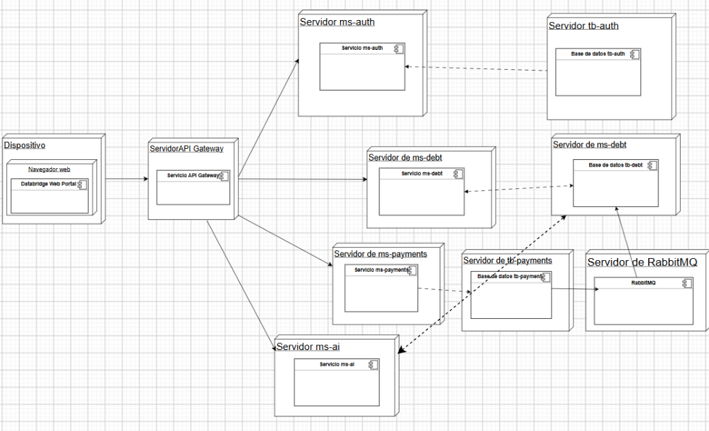

En el código y en [`docker-compose.yml`](docker-compose.yml), el navegador (`Dispositivo`) entra únicamente al **Databridge Web Portal** (`nginx`), que reenvía `/api` al **API Gateway** y este reparte el tráfico a `ms-auth`, `ms-debt`, `ms-payments` y `ms-ai`. Cada servicio con persistencia habla solo con su propio servidor MySQL (`tb-auth`, `tb-debt`, `tb-payments`); `ms-payments` publica el evento `pago.confirmado` en `RabbitMQ` (que entrega a `ms-debt`), y `ms-ai` no se conecta directo a la base `tb-debt`, sino que consulta a `ms-debt` por HTTP con el JWT del deudor.

| Contenedor | Puerto interno | Publicado en el equipo | Para qué |
| --- | --- | --- | --- |
| `portal` | 8080 | **8080** | La única puerta: el portal y `/api` hacia el gateway |
| `gateway` | 8082 | — | Enruta, limita peticiones y revisa CORS |
| `ms-auth` · `ms-debt` · `ms-payments` · `ms-ai` | 8081 · 8083 · 8084 · 8085 | — | Solo los ve el gateway y entre ellos |
| `db-auth` · `db-debt` · `db-payments` | 3306 | 3308 · 3309 · 3310 | Una base por servicio, cada una en su MySQL, con su volumen y sus claves. Se publican para revisarlas desde el equipo |
| `rabbitmq` | 5672 · 15672 | 5672 · 15672 | La cola y su consola |
| `mailpit` | 1025 · 8025 | 1025 · 8025 | El buzón de prueba y su página |

Los puertos publicados se cambian desde `.env` ([§3](#si-algo-falla-en-un-equipo-nuevo)). En un
despliegue real, cada servicio puede ir en su propio nodo detrás del gateway, con las salvedades de
[§9](#9-requisitos-no-funcionales).

### En un servidor

La demo corre en un VPS de Namecheap, en `https://technicalbridge.site`, hasta diciembre (#172, #173):

| Pieza | Qué hace |
| --- | --- |
| [`docker-compose.prod.yml`](docker-compose.prod.yml) | Se suma al compose de siempre. Caddy va delante y es lo único que publica puertos (80 y 443); las tres bases, RabbitMQ y el portal quedan cerrados; el buzón de prueba no se levanta, y los servicios usan las imágenes de GHCR |
| [`deploy/Caddyfile`](deploy/Caddyfile) | El HTTPS del dominio con Let's Encrypt, que Caddy renueva solo, y la IP del visitante hacia nginx |
| [`deploy/preparar-servidor.sh`](deploy/preparar-servidor.sh) | Prepara el VPS una vez: Docker, firewall, swap, el usuario que despliega y un `.env` con claves nuevas |
| [`deploy/respaldar.sh`](deploy/respaldar.sh) | Un respaldo de cada base, en su propio archivo, cada madrugada: los últimos 7 días |
| [`.github/workflows/desplegar.yml`](.github/workflows/desplegar.yml) | Compila las seis imágenes, las publica en GHCR y, por SSH, el servidor las descarga y se actualiza. **Apagado hasta que exista la variable `DESPLIEGUE_HOST`** |

La guía completa está en [`docs/despliegue`](docs/despliegue/README.md).

### Variables de entorno

Van en un archivo `.env` al lado del `docker-compose.yml`, que no se sube al repositorio.
[`.env.example`](.env.example) las trae todas, comentadas, y `preparar-env.ps1` crea el `.env`
desde él. El mismo `.env` lo leen los servicios cuando se corren con Maven.

**Los secretos no tienen valor por omisión** (los marcados *el `.env`*): el repositorio es
público, y un valor escrito aquí lo podría leer cualquiera. El script los genera al azar. Lo que
no es secreto sí tiene un valor de desarrollo.

<details>
<summary><b>Puertos y dirección pública</b> (2)</summary>

| Variable | Por omisión | Para qué |
| --- | --- | --- |
| `PORTAL_PORT`, `DB_AUTH_PORT`, `DB_DEBT_PORT`, `DB_PAYMENTS_PORT`, `RABBIT_PORT`, `RABBIT_ADMIN_PORT`, `MAILPIT_SMTP_PORT`, `MAILPIT_PORT` | `8080`, `3308`, `3309`, `3310`, `5672`, `15672`, `1025`, `8025` | Los puertos que se publican en el equipo. Se cambian si alguno ya está ocupado |
| `PUBLIC_URL` | `http://localhost:8080` | La dirección del portal que va en los correos y en el retorno de Webpay y de Khipu |

</details>

<details>
<summary><b>La base y la cola</b> (5)</summary>

| Variable | Por omisión | Para qué |
| --- | --- | --- |
| `MYSQL_USER` | `tbridge` | El usuario de la aplicación en las tres bases: el mismo nombre, con otra clave en cada una |
| `DB_AUTH_ROOT_PASSWORD`, `DB_AUTH_PASSWORD`, y lo mismo con `DB_DEBT_` y `DB_PAYMENTS_` | el `.env` | Las claves de root y de la aplicación de cada base: con las de una no se entra a las otras. Una vez creada la base, se cambian con `preparar-env.ps1 -Cambiar NOMBRE`, que las cambia también dentro de ella |
| `RABBIT_USER` | `guest` | El usuario de RabbitMQ |
| `RABBIT_PASSWORD` | el `.env` | Su clave |
| `EVENTS_RABBIT` | `true` en Docker, `false` con Maven | Si el aviso de pago va por RabbitMQ o por HTTP. En Docker está fijo en `true` |

</details>

<details>
<summary><b>Secretos, sesión y acceso</b> (11)</summary>

| Variable | Por omisión | Para qué |
| --- | --- | --- |
| `JWT_KEY_DIRECTORY` | obligatoria | Ruta absoluta a PKCS#8/SPKI y publicas de rotacion, montada solo en auth |
| `AUTH_JWKS_URI` | local con Maven, interna en Compose | JWKS publico de auth para verificar ES256 |
| `INTERNAL_KEY` | el `.env` | Autentica las llamadas entre servicios |
| `CIFRADO_LLAVE` | el `.env` | Cifra en la base el secreto de las suscripciones. Se cambia sin perderlos, como dice [Cambiar `CIFRADO_LLAVE`](#cambiar-cifrado_llave) |
| `CIFRADO_LLAVE_ANTERIOR` | vacía | Solo mientras se cambia `CIFRADO_LLAVE`: la de antes, con la que ms-debt abre los secretos guardados para volver a cifrarlos con la nueva al arrancar. Después se vacía |
| `ADMIN_CORREO` | vacía | El correo del primer `admin` de DataBridge, que entra al panel de administración. Vacía, no hay `admin`. No puede ser el de una persona de una empresa |
| `JWT_TTL_MINUTES` | `15` | Cuánto dura el JWT. Corto a propósito: no se puede revocar |
| `REFRESH_TTL_HOURS` | `168` | Cuánto dura una sesión desde que se entra. Renovar no la alarga |
| `COOKIE_SECURE` | `false` | **Encender detrás de HTTPS.** Una cookie `Secure` sobre HTTP el navegador la descarta sin avisar |
| `CODE_TTL_HOURS`, `MAGIC_TTL_MINUTES` | `24`, `15` | Horas del código de campaña; minutos del código solicitado y su enlace opcional de respaldo |
| `INVITACION_TTL_HORAS` | `24` | Cuánto dura el enlace de la invitación que le llega a una persona recién dada de alta desde el panel |

</details>

<details>
<summary><b>El correo</b> (6)</summary>

| Variable | Por omisión | Para qué |
| --- | --- | --- |
| `SMTP_HOST`, `SMTP_PORT`, `SMTP_USER`, `SMTP_PASSWORD`, `SMTP_AUTH`, `SMTP_STARTTLS`, `SMTP_SSL` | vacía, `587`, vacías, `true`, `true`, `false` | El servidor de correo ([cómo](#para-mandar-correos-de-verdad)). Sin `SMTP_HOST`, en Docker los correos van al buzón de prueba y lo demás se ignora |
| `BREVO_API_KEY` | vacía | Con ella, los correos salen por la API de Brevo y no por SMTP ([cómo](#para-mandar-correos-de-verdad)). Es la de producción |
| `BREVO_URL` | `https://api.brevo.com/v3/smtp/email` | La dirección de la API de Brevo. Solo se cambia para probar contra un servidor falso |
| `SMTP_TIMEOUT_MS` | `10000` | Cuánto se espera al servidor de correo, o a Brevo, antes de darlo por caído |
| `MAIL_FROM`, `MAIL_FROM_NAME`, `MAIL_REPLY_TO` | `noreply@technicalbridge.local`, `DataBridge`, vacía | El remitente, el nombre que muestra el buzón a su lado, y a quién se le responde si no es al remitente. Con Gmail, el remitente tiene que ser la propia cuenta |
| `CORREO_SOLO_A`, `CORREO_DESVIAR_A` | vacías | El modo de prueba: a quién se le escribe directo, y adónde se desvía lo demás. Vacías, se le escribe a cualquier dirección |
| `CORREO_DESVIO_MAXIMO_POR_DIA` | `100` | Hasta cuántos correos desvía el modo de prueba en un día de Chile: el desvío gasta el cupo del proveedor. `0`, sin tope (#236) |

</details>

<details>
<summary><b>El gateway</b> (3)</summary>

| Variable | Por omisión | Para qué |
| --- | --- | --- |
| `CORS_ORIGINS` | los del portal | Qué orígenes pueden hacer peticiones con credenciales al gateway |
| `TRUSTED_PROXIES` | local y las redes privadas (`10.x`, `172.16–31`, `192.168.x` y las de IPv6, `fc00::/7`) | En qué proxies confía el gateway para saber la IP del cliente. No puede quedar vacía |
| `RATE_AUTH_CAPACITY`, `RATE_GLOBAL_CAPACITY` | `10` / `120` | Peticiones por minuto |

</details>

<details>
<summary><b>Pagos y UF</b> (12)</summary>

| Variable | Por omisión | Para qué |
| --- | --- | --- |
| `WEBHOOK_SECRET` | el `.env` | Firma los enlaces de pago y verifica los avisos de las pasarelas simuladas |
| `TRANSBANK_ENVIRONMENT` | `TEST` | `TEST` cobra contra el ambiente de integración de Transbank; `SIMULADA`, sin internet, vuelve a la pasarela simulada |
| `TRANSBANK_API_URL`, `TRANSBANK_COMMERCE_CODE`, `TRANSBANK_API_KEY` | los públicos de integración | Los únicos con un valor escrito: Transbank los publica para todos en su documentación, para probar. En producción, los del comercio van solo en el `.env` |
| `TRANSBANK_VENCE_EN` | según el ambiente | Cuánto vale un cobro de Webpay. Vacía, lo que da Transbank: 15 minutos en integración (5 de token y 10 de formulario) y 9 en producción |
| `KHIPU_LLAVE` | vacía | La llave de API de una cuenta de cobro de Khipu. Con ella, Khipu cobra de verdad; vacía, es simulada. **Es un secreto: solo en el `.env`** |
| `KHIPU_URL_AVISOS`, `KHIPU_SECRETO` | vacías | Con una dirección pública de DataBridge: dónde avisa Khipu, y el secreto con que se verifica su firma |
| `KHIPU_VENCE_EN` | `30m` | Cuándo se vence un cobro de Khipu que nadie pagó |
| `KHIPU_URL` | `https://payment-api.khipu.com` | La dirección de la API de Khipu. Solo se cambia para probar contra un servidor falso |
| `MERCADOPAGO_ACCESS_TOKEN`, `MERCADOPAGO_PUBLIC_KEY` | vacías | Las credenciales de una cuenta de Mercado Pago. Con ellas, Mercado Pago cobra de verdad; vacías, es simulada. **El token es un secreto: solo en el `.env`** |
| `MERCADOPAGO_ENVIRONMENT`, `MERCADOPAGO_URL` | `TEST`, `https://api.mercadopago.com` | `TEST` con credenciales de prueba, `PRODUCCION` con las reales, `SIMULADA` sin internet |
| `MERCADOPAGO_VENCE_EN` | `30m` | Cuándo vence un cobro de Mercado Pago que nadie pagó: la preferencia expira a esa hora y el pago queda vencido |
| `BCENTRAL_USER`, `BCENTRAL_PASS` | vacías | La UF del Banco Central. Sin ellas, se carga a mano |

</details>

<details>
<summary><b>Las reglas de la cartera y las campañas</b> (7)</summary>

| Variable | Por omisión | Para qué |
| --- | --- | --- |
| `MIN_DIAS_MORA` | `30` | Desde cuántos días de mora del cargo impago más antiguo entra una deuda a cobranza |
| `RECORDATORIO_DIAS_ANTES` | `3` | Cuántos días antes de cada cuota llega el recordatorio. Nunca se repite para la misma cuota |
| `INTERES_TASA_MAXIMA_MENSUAL` | `3.0` | El tope de la tasa que pacta el acreedor, en % mensual: la tasa máxima convencional vigente. Una deuda con una tasa mayor se rechaza (`tasa_sobre_maxima`) |
| `CONTACTO_FERIADOS` | vacía | Los feriados que se decretan y no se pueden calcular (una elección, un plebiscito, un feriado especial), separados por coma. Se suman a los nacionales, que se calculan solos para cualquier año. Las campañas no contactan esos días |
| `CONTACTO_SIN_HORARIO` | `false` | **Solo para probar.** Con `true` se le escribe al deudor a cualquier hora, también de noche, los domingos y los feriados: sirve para probar la invitación o el reenvío del código fuera del horario. **Nunca en producción.** Al arrancar, ms-debt lo avisa en su registro. El límite de dos por semana sigue igual |
| `CONTACTO_SIN_LIMITE` | `false` | **Solo para probar.** Con `true` se le escribe al deudor cuantas veces se pida, sin el tope de dos correos por semana: sirve para pedir códigos en una demo con *Reenviar código*. Cada correo se sigue anotando. **Nunca en producción.** Al arrancar, ms-debt lo avisa en su registro, y *Reglas* lo muestra |
| `INVITACIONES_POR_CUARTO_DE_HORA` | `100` | Cuántas invitaciones salen como máximo cada 15 minutos, entre las de una carga y las de la pasada de contacto. Lo que pasa del tope sale en las pasadas siguientes (#236). `0`, sin tope |
| `INTEGRACION_API` | `false` | La entrega por API (`/api/v1`, con clave) y las claves (`/api/claves`). Apagada, responden `404` y los deudores entran solo por campaña, desde el portal. `true` la enciende, por si una empresa necesita automatizar |
| `DEMO_DATOS` | `false` | Con `true`, instala una empresa que cobra directo, dos campañas y seis deudas de ejemplo en una base vacía. No convierte, completa ni borra datos existentes. También habilita su persona de ejemplo en ms-auth si todavía no hay personal de empresas |

</details>

<details>
<summary><b>El asistente y la documentación</b> (3)</summary>

| Variable | Por omisión | Para qué |
| --- | --- | --- |
| `XAI_API_KEY` | vacía | El LLM del asistente. Sin ella, responde con reglas |
| `XAI_BASE_URL`, `XAI_MODEL` | `https://api.x.ai/v1`, `grok-4.5` | El proveedor y el modelo del LLM |
| `SWAGGER_ENABLED` | `true` | Apagar la documentación, por ejemplo en producción |

</details>

**Los valores por omisión son de desarrollo y están escritos en un archivo público: no sirven
para nada que no sea una demostración.**

### Cambiar `CIFRADO_LLAVE`

`CIFRADO_LLAVE` cifra en `tb_debt` el secreto con que ms-debt firma los avisos a cada sistema suscrito. Se
cambia sin que ninguno tenga que volver a suscribirse ([#258](https://github.com/TechnicalBridge/DataBridge/issues/258)), desde la carpeta del repositorio:

1. **Un respaldo de `tb_debt`**, fuera del repositorio:

   ```powershell
   $env:MYSQL_PWD = ((Select-String -Path .env -Pattern '^DB_DEBT_ROOT_PASSWORD=').Line -split '=', 2)[1]
   docker exec -e MYSQL_PWD tbridge-db-debt sh -c "mysqldump -uroot --single-transaction --databases tb_debt > /tmp/tb_debt.sql"
   docker cp tbridge-db-debt:/tmp/tb_debt.sql ..\tb_debt-antes-de-cambiar-la-llave.sql
   docker exec tbridge-db-debt rm /tmp/tb_debt.sql
   Remove-Item Env:MYSQL_PWD
   ```

2. **La llave nueva:** `powershell -ExecutionPolicy Bypass -File .\preparar-env.ps1 -Cambiar CIFRADO_LLAVE`.
   La de antes queda en `CIFRADO_LLAVE_ANTERIOR`. Si ya hay un cambio sin terminar, no hace otro.
3. **`docker compose --profile app up -d --wait ms-debt`.** Al arrancar, ms-debt abre cada secreto con la
   llave anterior y lo vuelve a cifrar con la nueva, todo en una transacción. Su registro dice cuántos y que
   ya se puede sacar la anterior: `docker compose --profile app logs ms-debt | Select-String CIFRADO_LLAVE_ANTERIOR`.
4. **Sacar la anterior:** se deja vacía `CIFRADO_LLAVE_ANTERIOR=` en el `.env`, y otra vez el paso 3.

Si algún secreto no se abre con ninguna de las dos llaves, **no se cambia ninguno** y ms-debt no arranca: su
registro dice qué suscripción es. Para volver atrás, la llave de `CIFRADO_LLAVE_ANTERIOR` vuelve a
`CIFRADO_LLAVE` y la anterior se vacía: la base quedó como estaba. En el servidor no hay PowerShell: el paso 2
se hace a mano en `/opt/databridge/.env`, con una llave nueva de `openssl rand -base64 48`.

---

## 11. Pruebas

```powershell
.\mvnw.cmd -f ms-debt\pom.xml clean test                        # un servicio (lo mismo con gateway, ms-auth, ms-payments o ms-ai)
foreach ($s in "gateway","ms-auth","ms-debt","ms-payments","ms-ai") { .\mvnw.cmd -q -f "$s\pom.xml" clean test }   # los cinco
```

En GitHub cada módulo tiene su propio workflow (`gateway`, `ms-auth`, `ms-debt`, `ms-payments`,
`frontend`, `ms-ai`), que prueba solo si cambió su carpeta y deja en el resumen cuántas pruebas
pasaron, clase por clase. Los de Java comparten [`java.yml`](.github/workflows/java.yml). Todos
con permisos de solo lectura y con cada acción externa fijada a un commit exacto.

**`main` está protegida.** Nadie sube directo: todo entra por un PR, se mergea con squash y solo si
pasan los seis checks `CI de <módulo>`. En un PR cada workflow corre siempre, pero si su carpeta no
cambió se salta las pruebas y su check pasa en segundos. Así un PR que solo cambia el README no
espera pruebas que nunca van a correr.

Cada servicio tiene sus pruebas en `src/test/java`, con la misma estructura de paquetes que el
código. **Ninguna necesita base de datos ni internet**, así que corren en segundos en cualquier
equipo: Transbank, Khipu, Mercado Pago, Brevo y el LLM se reemplazan por un servidor HTTP local.

> Usa `clean`. El editor de VS Code compila por su cuenta dentro de `target/`, y sin `clean`
> Maven puede dar por buena una clase vieja.

**1259 pruebas**, todas en Java y sin fallos (suites completas con JDK 25 para #221):

| Módulo | Pruebas |
| --- | --- |
| `gateway` | 20 |
| `ms-auth` | 315 |
| `ms-debt` | 513 |
| `ms-payments` | 281 |
| `ms-ai` | 130 |

En #221 se ejecutaron las cinco suites Java: ms-ai 130, gateway 20, ms-auth 315,
ms-debt 513 y ms-payments 281; cero fallos, errores u omisiones, contados desde
Surefire. El portal también compiló con `npm ci` y `npm run build`. La integración
HTTP local usa JWT/JWKS efímeros y dependencias ficticias, sin proveedor LLM real.
El E2E Docker de #221 está pendiente: daemon local no disponible; no se declara PASS.

El asistente valida su sesión ES256 mediante `AUTH_JWKS_URI` antes de consultar
ms-debt. Solo `ROLE_DEBTOR` puede usar `POST /api/ai/chat`; health y documentación
conservan acceso público según su configuración. Reenvía el token validado original
para una segunda verificación independiente en deuda, sin claves privadas ni clave interna.
El fallback local solo ocurre después de obtener contexto autorizado y válido.

| Resultado del asistente | HTTP |
| --- | --- |
| Sesión ausente, inválida o caducada | 401 |
| Rol no autorizado o rechazo de permisos de deuda | 403 |
| Identidad no registrada, reconocida por el contrato de deuda | 404 |
| Colección de deudas vacía legítima | 200 |
| Protocolo de deuda inválido o ruta upstream desconocida | 502 |
| Deuda o verificación JWKS temporalmente indisponible | 503 |
| Proveedor LLM ausente o fallido, con contexto ya autorizado | 200 mediante motor local |

Los errores son `ApiError`, nunca una respuesta financiera vacía. No se registran
bodies upstream, credenciales ni contexto conversacional en los errores de AI.

Además, `pruebas/secretos.test.cjs` (Node, 25 pruebas) comprueba que las reglas de gitleaks detecten
cada tipo de clave y dejen pasar los valores públicos ([`docs/seguridad/secretos.md`](docs/seguridad/secretos.md)).
La cadena completa con los tres sistemas se prueba de punta a punta con un script que
vive fuera de este repositorio, en la carpeta que reúne a los tres
([estado](#14-estado-al-19-de-octubre-de-2026)).

<details>
<summary><b>Qué cubre cada tipo de prueba</b></summary>

| Tipo | Qué cubre |
| --- | --- |
| **Del modelo de negocio** | Los cuatro tramos, los límites y el redondeo en pesos; el total mensual de todas las campañas, con la zona horaria de Chile; los pagos en UF con sus pesos guardados; los meses vacíos, el aislamiento de la empresa y la vista del admin. Un detalle antiguo nulo o mal formado no impide calcular un pago en pesos |
| **Unitarias** (JUnit 5 + Mockito) | Las reglas de cada servicio con los repositorios simulados. Que cada quien vea solo lo suyo; que el monto salga de ms-debt y no del navegador; que un pago avisado dos veces se abone una; que las cuotas se paguen en orden; que solo entren deudores morosos; que un cliente al día cierre lo que estaba en cobranza; que el mandato registre al acreedor nuevo; que un convenio sobreviva al mes siguiente; el reclamo y sus dos resoluciones; el cifrado y que un secreto viejo se cifre al arrancar; la sesión revocable, el código de acceso, la UF, la firma de los eventos y el recordatorio |
| **De Webpay** | El cliente contra un Transbank falso: crear, confirmar, consultar y sus errores, sin que el detalle de Transbank ni la llave lleguen a la persona; el plazo según el ambiente. El retorno aprobado; rechazado, sin código, con otro monto o con otra orden; anulado, con error de formulario y por tiempo; repetido; con Transbank caído; con un token ajeno. La página que manda el token una sola vez. La consulta periódica: el pago sin confirmar que se confirma, el confirmado que se registra, el fallido, reversado o anulado, el que sigue abierto, el que vence pasado el plazo y el que vence si Transbank no contesta en un día. Al abrir otro cobro, el anterior pagado se registra y frena el nuevo, y el anterior sin pagar se vence |
| **De seguridad de las pasarelas** | La página de Webpay escapa lo que muestra; con la firma de otro pago no se abre ni se gasta el token; una vuelta por tiempo con una sesión inventada no hace fallar el cobro de otro; la respuesta del cobro no muestra el token; un cobro vencido que se pagó no se confirma (para no cobrar dos veces); la consulta no acepta otro monto ni otra orden; la vuelta, la página y la consulta bloquean la fila del pago, y entre la consulta y la vuelta se confirma una sola vez |
| **De las pasarelas lentas o caídas** | Webpay, Khipu, Mercado Pago y ms-debt, contra un servidor que tarda más que el tiempo máximo y contra un puerto donde no escucha nadie: cada cliente corta en menos de dos segundos, sin mostrar el detalle técnico |
| **De Mercado Pago** | El cliente contra un Mercado Pago falso: la preferencia con el token, la vuelta (con `auto_return` solo si es https) y el `init_point`, y sus errores; la preferencia vence a la hora pedida. La conciliación por las órdenes de la preferencia, también la periódica que vence lo abandonado: sin pagos, con un pago aprobado (también después de una tarjeta rechazada), con una tarjeta rechazada que deja el cobro abierto para reintentar, con Mercado Pago caído o con una preferencia que no existe; la vuelta y el aviso, sin sesión |
| **De la confirmación de Mercado Pago** | Retorno firmado; sin firma no revela el enlace ni cambia el cobro. Retorno y aviso rechazan monto, moneda, referencia, identificador o pasarela ajenos. Solo abona el pago de la preferencia guardada; admite reintentos, avisos repetidos y aprobaciones posteriores al vencimiento. Una caída no aprueba pagos y el aviso devuelve error para reintentarlo |
| **De Khipu** | El cliente contra un Khipu falso: crear el cobro, preguntar en qué va y sus errores. El pago conciliado, el que sigue en verificación, el rechazado, el revertido y el arrepentido (con el cobro anulado en Khipu, o pagado justo antes de anularlo); que otro monto u otra transacción no se aprueben; que un pago real no se confirme por la simulación; la consulta periódica que cierra lo pagado y vence lo abandonado, y la firma de los avisos |
| **Del doble pago** | Un segundo pago mientras otro se verifica se rechaza; el abierto sin pagar se anula (Khipu lo borra, la preferencia de Mercado Pago vence en el acto) y queda vencido; una cuota pagada que ms-debt todavía no abona no se cobra de nuevo; el cobro guarda las cuotas que cubre, y ms-debt las informa en orden. Si igual se paga dos veces, el segundo queda `duplicated`, sin abonar y con la referencia y el RUT para devolverlo; pagar otras cuotas de la misma deuda no es duplicado. La consulta periódica no vence lo que Khipu o Mercado Pago están verificando y anula en Khipu lo que vence; un vencido que se paga después se registra, por la revisión de vencidos o por el aviso de Khipu |
| **De los intereses** | La mora de cada cargo atrasado desde el día siguiente a su vencimiento, con lo pagado imputado a lo más antiguo; la cuota del convenio que crece solo sobre su capital; el redondeo en pesos y en UF; el convenio en sistema francés, con la última cuota que absorbe el redondeo; que sin tasa todo quede como antes; que el cobro fije el capital y el interés y el aviso los lleve separados; la tasa que no es un número o que supera el tope |
| **De las campañas** | Que cada recordatorio salga el día que dice la cadencia y no antes; los intentos, las fechas y el estado de la campaña; que pare con el pago, el convenio, el reclamo o el retiro; el horario, el domingo y el feriado; los feriados calculados contra los publicados (2023, 2026 y 2027 completos, y cada regla contra un año real: el 2 de enero, el 17 y el 20 de septiembre, los que se corren al lunes, el 31 de octubre y el solsticio al minuto); el límite de dos por semana con dos días entre uno y otro, y el horario de la ley, que frenan también la invitación, el recordatorio de cuota y el reenvío del código; el estado que manda APOFYX; el acreedor que cobra sin agencia: registra, pausa y termina su campaña sin mandato, no puede registrar la de otro, sus carteras (JSON y planilla) la nombran en el lote, y el avance le llega a él; desde el portal, solo una empresa ve y cambia sus campañas, sin un id DataBridge le pone uno, cambiar el estado no pisa el nombre ni el inicio, y se rechazan la cadencia que no crece o trae ceros, los intentos fuera de 1 a 10, el fin antes del inicio y un id de más de 64 caracteres |
| **Del descuento por pronto pago** | El tramo por los días del cargo impago más antiguo (30, 31, 62, 100 y 150 días); el % de la campaña recortado al máximo vigente del mandato, que baja si el acreedor lo baja; sin máximo, con el mandato vencido, con la campaña pausada o fuera de sus fechas, nada; el acreedor sin agencia se autoriza hasta 100. El mandato guarda su máximo y lo cambia al reenviarse; la campaña rechaza un tramo que no existe o un valor fuera de 0 a 100 (`descuento_invalido`) y uno sobre el máximo (`descuento_sobre_tope`), y `{}` le quita el descuento. Al cobrar: el ejemplo del contrato ($900.000 + $18.800 − $9.400 = $909.400), sin descuento en un pago de parte de la deuda ni en convenio, la oferta que ve el deudor con su fecha, el descuento fijo en ms-payments desde que se abre el cobro, y el aviso que lo lleva hasta el acreedor, también cuando se condona toda la mora |
| **Del asistente** | Las reglas: los montos en pesos y en UF sin sumarlos entre sí, el ánimo (la desconfianza pesa más que la cortesía) y el tono de cada respuesta. Lo que dice de la plata, igual que el portal: el total de hoy con la mora, la tasa que pactó el acreedor (también en las cuotas), que sin tasa no hay interés, y el descuento por pronto pago con su fecha. El LLM contra un servidor falso con la forma de la API de xAI: responde con la API de Responses, usa la de chat si no la hay, y si falla o contesta en blanco responde con las reglas; viajan los últimos doce mensajes. Las deudas se piden con la sesión del deudor, y si ms-debt dice que no o no responde, el asistente sigue sin deudas. Arranca solo y publica su salud y su Swagger |
| **De los roles** | El `admin` de DataBridge entra con su propio rol y sin empresa, y el usuario de una empresa sigue entrando como antes; una llave de empresa no renueva como `admin`. El primer `admin` sale de `ADMIN_CORREO` una sola vez, y a una persona de una empresa no se le da ese rol. En los tres servicios, el panel responde al `admin`, `403` a una empresa y a un deudor, y `401` sin sesión, también en una ruta que todavía no existe; y el `admin` recibe `403` en las deudas y en los pagos. En el gateway, cada tramo del panel llega a su servicio y `/internal` sigue sin puerta |
| **Del alta de empresas y personas** | Los totales de una empresa cuentan lo suyo como acreedora y lo que entregó como agencia, sin mezclar pesos con UF y sin leer una deuda. Una empresa nueva pide un RUT válido y que no exista. Una persona creada bajo una empresa queda como `usuario`, aunque el cuerpo pida otro rol, y un correo de una empresa no puede pasar a `admin`. Sin la empresa en ms-debt, o si ms-debt no responde, no se crea a nadie. Quitar el acceso cierra las sesiones de esa persona y anula sus enlaces sin abrir, y un `admin` no se lo puede quitar a sí mismo. Cada alta y cada cambio quedan anotados con quién los hizo |
| **Del correo** | Brevo contra un servidor falso: lo que pide su API, con la clave en su cabecera y nunca en un error. De quién es la culpa de un correo que no sale: la dirección (rechazada o mal escrita) o el servicio (una clave mala, el cupo, una IP bloqueada, un servidor que no responde, un remitente mal configurado). El modo de prueba: lo que se desvía, el alias de la cuenta del equipo, y que lo que no deja salir no es un fallo. Cada correo en texto y en HTML; el del deudor trae el código y el acreedor pero ningún enlace, ni el monto; el nombre del acreedor no mete HTML; el adelanto del buzón no trae el código. El correo de prueba dice adónde llegó o por qué no |
| **De la carga por campaña** | Sin campaña no entra nada ni se revisa; en una campaña terminada tampoco. La planilla entra en su campaña, con el lote y el corte armados solos o con los que manda el portal. La revisión deshace siempre lo que hizo y dice cuánto entraría por moneda, también cuando la ingesta rechaza el lote |
| **De la planilla de Excel** | Sobre la plantilla de verdad, con celdas de su tipo: una persona que debe tres meses es una deuda con tres cargos; el RUT con o sin puntos; UF con decimales y CLP entero, exactos; el cliente al día sin cargos y el retiro con su motivo; meses, fechas y montos escritos como texto (`jul-2026`, `350.000`). Cada problema con su hoja, fila y columna, y todos juntos: un RUT que no está en *Deudores*, un mes, una fecha o un monto mal escritos, una deuda que cambia de moneda entre meses, un mes repetido, un CLP con decimales, un monto en cero, un al día con meses, un retiro sin motivo, un deudor repetido o sin correo. La plantilla trae sus tres hojas, las listas, los tipos y la mora mínima vigente; solo una empresa la descarga, y los problemas salen en `error.detalles` |
| **De la entrega por API apagada** | Sin `INTEGRACION_API`, `/api/v1` y `/api/claves` responden `404` sin mirar la clave, y Swagger muestra el contrato vacío y por qué. Con `INTEGRACION_API=true`, el contrato y las claves funcionan como antes |
| **De Swagger** | Cada grupo ofrece en *Authorize* solo la llave que usan sus operaciones, sin quitársela a los otros grupos; lo público se llama por la dirección desde la que se abrió Swagger, y lo interno dice que con Docker no se alcanza desde el navegador y cómo llamarlo. ms-ai solo publica rutas que el gateway le manda (`/api/ai/**`) |
| **De las reglas del panel** | Cada regla dice cuánto vale y de qué variable sale, o que la fija la ley; cómo entran los deudores; el horario apagado para probar, a gritos; y los feriados, los mismos que usan las campañas |
| **De la capa web** (`@WebMvcTest` + MockMvc) | Cada controlador con su seguridad, su validación y su JSON: `401` sin sesión, `403` con la deuda de otro, `400` con datos malos, los `_links` según quién mira, la cookie de la sesión y los nombres del contrato v1 intactos. El aviso de Khipu llega con el cuerpo tal como vino, porque sobre ese texto va la firma. En el gateway, que el retorno de Webpay pase sin `Origin` y nada más |
| **Del contrato del aviso de pago** | ms-payments manda exactamente el ejemplo del contrato ([`docs/eventos`](docs/eventos/README.md); cada uno guarda una copia en sus pruebas, y la CI revisa que sean iguales), por el exchange y la clave que dice; ms-debt escucha en esa cola y entiende cada campo; un mensaje no puede elegir qué clase se crea al leerlo |
| **De seguridad** | **CodeQL** (Java y JavaScript) en cada pull request y cada semana; la auditoría de dependencias del portal, que rompe su workflow ante una vulnerabilidad alta; Dependabot por módulo, también para las acciones de GitHub; y el escaneo de secretos de GitHub con protección de push, que rechaza un push que traiga un token conocido |
| **De rendimiento** (k6) | Cómo lo siente una persona, dónde está el techo y cuánto aguanta abrir cobros (`pagos.js`, solo con las pasarelas simuladas). Se corren a mano, con el sistema arriba ([`docs/rendimiento`](docs/rendimiento/README.md)) |

</details>

---

## 12. Innovación

**¿Qué problema resuelve?** Está en [§1](#qué-problema-resuelve): cobrar deudas chicas cuesta más
que la deuda, y el deudor que quiere pagar se topa con un horario de oficina.

**¿Qué hace diferente a la solución?**

1. **Se entra sin cuenta.** El deudor no crea un usuario ni inventa una contraseña: escribe su RUT
   y el código que le llegó. Una cuenta más es una razón más para no pagar, y una base de
   contraseñas más que se puede filtrar.
2. **Una empresa empieza sin integrar nada.** Un `admin` la da de alta, y su gente crea una
   campaña y carga a sus deudores con una planilla, viendo antes qué entraría y qué no. No hace
   falta un sistema propio ni tocar código. La que sí tiene uno puede, con la entrega por API
   encendida, hablarle a DataBridge por un contrato versionado, sin una base compartida: así se
   probó la cadena completa con APOFYX y Patrimonio.
3. **La empresa ve todo lo que pasa.** Lo difícil de la cobranza tercerizada no es cobrar: es que
   el que encargó la cobranza se entere. Cada pago, convenio y reclamo queda a la vista en el
   portal de la empresa; un reclamo frena la cobranza mientras se revisa, para que nadie le siga
   cobrando a quien dice que ya pagó. Con la API encendida, además viaja firmado hasta el sistema
   del acreedor y deja la deuda en $0 allá.

**¿Qué valor agrega?** Al acreedor, cobranza de montos bajos que antes no era rentable, y certeza
de que su cartera está al día. Al deudor, pagar a cualquier hora, ver el detalle de lo que debe,
repactar en cuotas y reclamar sin llamar a nadie. A la empresa que cobra, una cartera
que se carga con una planilla, revisada antes de confirmar, y una campaña que se cumple sola dentro
de lo que permite la ley, sin que nadie lleve la cuenta.

---

## 13. Recorrido de demostración

1. **La empresa entra.** Con la demo encendida (`DEMO_DATOS=true`) en una base nueva, en *Soy de
   una empresa*, `camila.reyes@example.com` pide su código, que llega al buzón, y ve las dos
   campañas de Servicios Horizonte.
2. **Carga a sus deudores en una campaña.** En *Cargar cartera* elige una campaña o la crea, descarga
   la plantilla de Excel, la llena (una hoja de deudores y otra de deudas, una fila por mes) y la sube.
   Ve qué entraría y qué no, con su motivo; si la planilla tiene problemas, cada uno con su hoja, fila
   y columna. Recién al confirmar entran. Cómo probarla está en
   [`docs/cartera`](docs/cartera/README.md).
3. **El deudor recibe su código solo.** Al entrar la deuda, la invitación sale a su correo, y la
   cartera muestra *Invitado el …*. La pantalla no muestra el código: quien lo viera podría entrar
   en su lugar.
4. **El deudor entra** con su RUT y ese código. Puede simular un plan, aceptarlo y pagar una o
   varias cuotas, en orden.
5. **O reclama.** *No reconozco esta deuda*, con un motivo y, si quiere, un detalle. La deuda queda
   **En revisión**. La empresa la ve con el filtro del mismo nombre, y toca **Reanudar cobro** o
   **Retirar**.
6. **Paga con Webpay**, con la [tarjeta de prueba](#para-pagar-con-webpay), en la página real de
   Transbank; o con Khipu, con el banco de prueba ([cómo activarlo](#para-pagar-con-khipu-de-verdad)).
7. **El pago llega a la empresa.** ms-payments avisa a ms-debt, que abona la deuda. Con la
   entrega por API encendida y suscripciones configuradas, los sistemas conectados pueden recibir
   sus eventos. La demo independiente no necesita esa integración.
8. **Queda el rastro.** El deudor ve el pago en su historial, con qué cuotas cubrió, y descarga el
   comprobante. La empresa lo ve en *Pagos recibidos*.

**Las marcas de las pasarelas.** Webpay, Mercado Pago y Khipu aparecen con su logo oficial, tal
como Transbank, Mercado Pago y Khipu los publican para los comercios, porque es lo que el deudor
reconoce. Los logos son marcas de sus dueños. Las simuladas lo dicen en pantalla: *Simulación*.

**Pagos en UF.** Usan la UF de ese día exacto, del **Banco Central**. Como la publica con un mes
de adelanto, ms-payments la carga al arrancar y cada mañana a las 9:30. Sin credenciales, se carga
a mano:

```powershell
$cuerpo = @{ dia = "2026-10-03"; valor = "39876.54" } | ConvertTo-Json
$cuerpo | docker compose --profile app exec -T ms-payments sh -c 'curl -s -X POST http://127.0.0.1:8084/internal/uf -H X-Internal-Key:$INTERNAL_KEY -H Content-Type:application/json --data-binary @-'
```

---

## 14. Estado al 19 de octubre de 2026

**1171 pruebas Java sin fallos**, y el portal compila (766 módulos). El acceso por código de los tres portales se comprobó por el gateway y en Edge, usando solo el proyecto Docker `tb_web`, cuentas ficticias y Mailpit sin salida externa. Las verificaciones de otros recorridos de la tabla son anteriores; no se repitieron para este cambio de acceso.

En la revisión de #222 se corrigió el consumo prematuro de un acceso correcto cuando ms-debt no
responde al comprobar la empresa: código y enlace se consumen solo después de abrir la sesión. Las
dos regresiones simulan la caída y recuperan el mismo acceso sin crear sesiones durante el rechazo.
No se repitió una caída de ms-debt en Docker ni se enviaron correos reales para esa corrección.

La demo por campaña ([#192](https://github.com/TechnicalBridge/TB_web/issues/192)) se comprobó en un
proyecto de Docker aparte, con su propia base vacía y el correo solo al buzón de prueba: se repitieron
las suites completas de ms-auth y ms-debt, y el recorrido de la empresa en Edge. Las demás
verificaciones de la tabla son anteriores y no se repitieron para estos cambios.

La confirmación de Mercado Pago (GHSA-c9xr) se verificó con clientes simulados y pruebas HTTP del
controlador: solo se abona el pago de la preferencia guardada, con su identificador, referencia, monto en
pesos y moneda. No se repitió un cobro contra la pasarela real para este cambio.

<details>
<summary><b>Cada verificación</b>, con su resultado</summary>

| Verificación | Resultado |
| --- | --- |
| Pruebas Java (cada servicio con su `mvnw -f <servicio>\pom.xml clean test`, JDK 25) | **1171**, sin fallos ([§11](#11-pruebas)); ms-auth y ms-debt se repitieron con #152, ms-debt y ms-payments sobre `main` con #139 y #258 juntos, ms-auth con #141; ms-auth, ms-debt y ms-payments con #238, ya con las sesiones ES256 de #256; ms-debt con #46, ms-auth con #236, ms-payments con la confirmación de Mercado Pago, ms-debt con #154 y ms-auth con #192, el resto conserva la ejecución anterior. En Windows se usó `-DargLine=-Djdk.net.hosts.file=C:\Windows\System32\drivers\etc\hosts` para evitar una demora del DNS en los correos simulados |
| Tres bases ([#238](https://github.com/TechnicalBridge/TB_web/issues/238)) | En un proyecto de Docker aparte, desde cero: cada MySQL tiene solo su base y sus migraciones, la clave de la aplicación de un servicio no entra a la base de otro, y con `db-debt` apagada siguen ms-auth, ms-payments y el portal (ms-debt se recupera solo al volver). Cada instancia usa unos 200 MB. En este equipo, con respaldo previo, el script de entonces pasó los datos (1.238, 1.677 y 346 filas, iguales tabla por tabla) y todo quedó sano: por el gateway y en Edge se ve lo de siempre. Con Maven, ms-debt arranca contra su base con el mismo `.env` |
| Código primero ([#222](https://github.com/TechnicalBridge/TB_web/issues/222)) | Migración V6 sobre MySQL con datos, con respaldo previo. Deudor, empresa y admin solicitan solo código y entran por el gateway desde Edge. El respaldo entrega código y enlace en un único mensaje de Mailpit. Canjeados simultáneamente, solo uno abre sesión; un intento incorrecto persiste después del `401`. Las tres entradas se revisaron a 1360 y 390 px, en ambos temas. Sin correos externos ni carga de la planilla del equipo. El 19 de octubre, la empresa pidió su código por el gateway y el correo salió por Brevo, desviado por el modo de prueba |
| Demo por campaña ([#192](https://github.com/TechnicalBridge/TB_web/issues/192)) | En un proyecto de Docker aparte, con MySQL vacío y `DEMO_DATOS=true`: ms-debt instala una empresa acreedora, dos campañas y seis deudas, sin agencias ni mandatos. En Edge, `camila.reyes@example.com` pide su código, lo recibe en el buzón de prueba y entra; ve `DEMO-PESOS` y `DEMO-UF`, **crea una campaña nueva** (`200`) y ve a los seis deudores en su cartera. *Campañas* a 1360 y 390 px, en ambos temas, sin salirse del ancho y sin errores de consola. Apagada no crea nada; con datos propios no completa nada; reiniciar no duplica (pruebas de `DataSeeder`) |
| Devolución de un pago duplicado ([#153](https://github.com/TechnicalBridge/TB_web/issues/153)) | Con todo Docker reconstruido desde la rama, en Edge, sobre el pago duplicado real de la base (y dejándolo después como estaba): la empresa toca *Ya lo devolví*, anota una referencia con comillas y el pago pasa a *Un pago devuelto* con su fecha; el libro guarda un JSON válido con la referencia intacta, la empresa y la persona. Marcarlo otra vez por la API responde `200` sin cambiar nada. El deudor lo ve en su historial. A 390 px, en ambos temas, sin desbordes ni errores de consola |
| Modelo de negocio ([#200](https://github.com/TechnicalBridge/TB_web/issues/200)) | Por el gateway, empresa y admin coinciden en cinco meses de prueba, con los cortes de $800.000, $1.000.001 y $12.000.000, un pago en UF con sus pesos guardados y un mes vacío. Una segunda empresa no ve los pagos de la primera; deudor, empresa y admin respetan sus permisos. Reasignar una deuda conserva la atribución de los pagos nuevos. En Edge, a 1360 y 390 px y en ambos temas, Campañas y Empresas no se salen del ancho. Cambiar de mes limpia las cifras anteriores, incluso con una respuesta fallida. Los ocho diagramas afectados se dibujaron con Mermaid 11 |
| Asistente en Java | Antes de borrar la versión en Python se compararon las dos: 1148 comparaciones de las reglas, sin diferencias. En vivo, por el gateway y con la sesión de tres deudores, 30 de 30 respuestas iguales. En Edge, el deudor conversa con el asistente en tema claro y oscuro, en escritorio y en celular |
| Webpay | Contra el ambiente de integración de Transbank, con los contenedores reconstruidos y en Edge: el deudor anula en Webpay y el portal dice *El pago no se completó*; paga con la tarjeta de prueba y vuelve con *Pago aprobado*, el pago queda `paid` con la respuesta `AUTHORIZED` guardada, y el contrato de Patrimonio queda con lo que corresponde |
| Build del portal | Correcto, 766 módulos |
| Cadena completa, sobre los contenedores reconstruidos | **16 de 16** comprobaciones: el cliente moroso nuevo llega desde Patrimonio, DataBridge registra al acreedor y lo invita, el deudor reclama y la disputa llega al acreedor, la agencia reanuda, el pago vuelve hasta el contrato y un lote repetido no se procesa dos veces |
| Khipu | Contra un Khipu falso con la forma de la API v3, con los contenedores reconstruidos y en Edge: el deudor se arrepiente y el portal dice *El pago no se completó*; paga y dice *Pago aprobado*; paga y cierra la ventana sin volver, y la consulta periódica lo registra sola. En los tres casos el contrato de Patrimonio queda con lo que corresponde. Y contra **Khipu real**, con una cuenta en modo desarrollador: se pagó con DemoBank, Khipu lo concilió (4 min 20 s desde que se abrió el cobro, contando lo que tarda la persona en Khipu) y ms-payments lo registró 21 s después, cuando todavía revisaba cada 30 s Al cancelar, el cobro se anula en Khipu: probado contra Khipu real, donde queda `deleted` y ya no se puede pagar |
| Mercado Pago | Contra el Mercado Pago real con credenciales de prueba, con ms-payments reconstruido y en Edge: la preferencia se crea con vencimiento a 30 minutos; el deudor paga con la tarjeta de prueba y no vuelve al portal, y la consulta periódica registra el pago en unos 10 s: queda `paid` y la deuda del contrato en Patrimonio baja a $0 |
| Doble pago | Contra las pasarelas reales, con la migración `V2` aplicada sobre la base con datos: mientras Khipu verifica, otro pago por la misma cuota se rechaza (*Tienes un pago en verificación*); recién pagada la cuota, antes de que ms-debt la abone, también; un cobro de Khipu abierto sin pagar queda `deleted` en Khipu y vencido aquí al abrir otro, y la preferencia de Mercado Pago vence en el acto. Pagados a la vez un cobro de Webpay y uno de Khipu por la misma cuota, el primero se abona y el segundo queda `duplicated`: la deuda baja una sola vez, el deudor ve *Estas cuotas ya estaban pagadas* y la empresa lo ve en *Pagos para devolver* con la referencia de Khipu |
| Webpay según Transbank ([#75](https://github.com/TechnicalBridge/TB_web/issues/75)) | En Edge contra el ambiente de integración, con ms-payments y el portal reconstruidos: 11 de 11 comprobaciones. La página abierta dos veces dice *Webpay ya se abrió* en vez del Error 21, y la primera ventana paga igual; una vuelta por tiempo con una sesión inventada responde 400 y no toca el cobro; *Abrirla de nuevo* abre un cobro nuevo y vence el anterior; **pagado y sin volver al portal, ms-payments lo confirmó solo en 7 segundos**, y la Mastercard de prueba queda rechazada. El cobro que había quedado abierto por el Error 21 se venció solo, después de consultarlo |
| Carga de pagos (`rendimiento/pagos.js`) | Con las pasarelas simuladas, hasta 100 deudores abriendo cobros a la vez: 5.817 peticiones sin una falla, abrir un cobro en 30 ms y consultarlo en 7 ms (p95) |
| Reclamo en pantalla | Recorrido en Edge: el deudor reclama, la empresa lo ve con su detalle y lo retira, y el acreedor ve *Disputa aceptada* |
| Interés por mora | Con los tres sistemas reconstruidos y Khipu real: un contrato de Patrimonio al 2% mensual, con tres arriendos de $300.000 atrasados 62, 31 y 1 día, llegó por APOFYX con su tasa. El portal mostró $18.800 de mora, se pagaron $918.800 con Khipu, y Patrimonio dejó los cargos en $0 y anotó $18.800 de intereses |
| Convenio con interés | Otro contrato, al 1,5%, repactó $914.100 (capital más mora) en 6 cuotas de $160.448, la última de $160.445: $962.685 en total, $48.585 de intereses del convenio |
| Campaña | Creada en APOFYX con la cadencia 1, 4, 11 y 3 intentos, y avanzada día por día con la pasada de prueba. Salieron la invitación el martes 6 de octubre, el primer recordatorio el 8 y el segundo el 13. No salió nada el 7 ni el 10 (el límite de la ley), el domingo 11, el feriado del 12 ni el 13 a las 7:30. Pausada en APOFYX, el 20 no salió nada. Tres correos en total, en Mailpit |
| Pantallas de intereses y campañas | En Edge: el formulario de campaña de APOFYX pide la cadencia y ofrece solo correo, y pausar o reanudar llega a DataBridge; el deudor ve su mora y a qué tasa, el convenio con su interés y el pago desglosado; Patrimonio muestra la tasa del contrato, el interés cobrado y el campo al firmar |
| Campañas en el portal ([#78](https://github.com/TechnicalBridge/TB_web/issues/78)) | En Edge como la empresa, con ms-debt y el portal reconstruidos: 31 de 31 comprobaciones. Una campaña para Patrimonio, creada sin id, recibe uno de DataBridge; la cadencia que no crece o trae ceros y los intentos fuera de 1 a 10 no dejan crear, y la de 1, 2, 5 muestra la advertencia de la ley. La campaña aparece en *Cargar* y una deuda de prueba entra con ella: pausada, la pasada no le envía nada, y reanudada le escribe. Cambiarla no pisa el inicio ni el estado, y terminada ya no ofrece nada ni contacta. La campaña de otra empresa responde 404. En los dos temas, a 1440, 390 y 360 px, sin scroll horizontal |
| `main` protegida | En los tres repositorios, un push directo a `main` se rechaza (*GH013: Changes must be made through a pull request*): solo entra un PR, con squash y con la CI en verde. En TB_web, un PR que solo cambia el README pasa los seis checks `CI de <módulo>` sin correr las pruebas |
| Descuento por pronto pago ([#45](https://github.com/TechnicalBridge/TB_web/issues/45)) | En Edge, con ms-debt, ms-payments y el portal reconstruidos y las migraciones `V5` aplicadas en las dos bases: el acreedor autoriza hasta 100% en el mandato, la empresa crea en el portal una campaña con 0/50/100 y carga tres arriendos de $300.000 al 2% atrasados 62, 31 y 1 día. El deudor ve *te descontamos $9.400… Pagarías $909.400 en vez de $918.800*, paga $909.400 con Webpay (tarjeta de prueba) y queda registrado en todos lados: el pago con $9.400 de interés y $9.400 de descuento, la deuda saldada, `pago.confirmado` con su desglose, el historial, *Pagos recibidos* y el comprobante en PDF. En los dos temas, a 1440, 390 y 360 px |
| Migraciones sobre una base con datos | `V3` aplicada y el secreto existente cifrado al arrancar |
| Roles y panel ([#137](https://github.com/TechnicalBridge/TB_web/issues/137), [#138](https://github.com/TechnicalBridge/TB_web/issues/138)) | `V4` de `tb_auth` probada en una base aparte y aplicada sobre la real. En vivo, 34 de 34 comprobaciones de los roles; en Edge, 18 de 18. El `admin` da de alta empresas y personas desde el panel, y la invitación llega con su enlace de un solo uso |
| Correos de verdad ([#62](https://github.com/TechnicalBridge/TB_web/issues/62)) | Los cinco correos (código, recordatorio, enlace, invitación y prueba) salieron por la API de Brevo y llegaron a un Gmail del equipo, en HTML y en texto. Un correo que no sale no cuenta como contacto, y la empresa ve el motivo en su cartera |
| Horario de la ley en todos los correos ([#187](https://github.com/TechnicalBridge/TB_web/issues/187)) | Con los tres sistemas en Docker, un miércoles a las 22:30: cuatro deudas nuevas llegaron por la cadena y quedaron en cobranza sin ningún contacto, con el aviso *se invita en la próxima pasada*. Las invitaciones salieron con la pasada de las 8:00 |
| Operación en el panel ([#139](https://github.com/TechnicalBridge/DataBridge/issues/139)) | Con Docker reconstruido desde la rama y las migraciones `V11` de `tb_debt` y `V6` de `tb_payments` aplicadas, con respaldo previo. Por el gateway, 24 de 24: los 21 avisos fallidos a APOFYX salen por destinatario, con sus intentos y su último error y sin su contenido; con un receptor de prueba en su puerto, uno reintentado se entrega y queda anotado sobre la empresa, y reintentarlo otra vez responde `409`; sin receptor, los 20 restantes vuelven a fallidos tras su intento extra. Los totales de pagos calzan con la base; una UF cargada a mano queda como la de ese día, con quién la cargó, y una negativa responde `400`. Un aviso de pago reintentado llega a ms-debt sin abonar dos veces. Una empresa recibe `403`. En Edge, a 1360 y 390 px y en los dos temas: reintentar desde el botón, la pantalla que se actualiza sola, la UF escrita como en Chile, y con ms-payments detenido sus bloques dicen *No responde* mientras los avisos a las empresas se siguen viendo. Al terminar, los avisos quedaron como estaban y sin la UF de prueba |
| Cambiar `CIFRADO_LLAVE` ([#258](https://github.com/TechnicalBridge/DataBridge/issues/258)) | En este equipo, con respaldo previo del `.env` y de las tres bases y Docker reconstruido entero desde la rama, 18 de 18: `preparar-env.ps1 -Cambiar CIFRADO_LLAVE` dejó la de antes en `CIFRADO_LLAVE_ANTERIOR` sin mostrar ninguna; al arrancar, ms-debt pasó el secreto de la suscripción de APOFYX a la llave nueva, que ya no se abre con la vieja y es el mismo secreto, y un aviso entregado después lleva la firma hecha con él. Con un secreto que no abre con ninguna llave, ms-debt no arrancó, dijo qué suscripción era y la base quedó idéntica; sacado ese, pasó las demás. Ningún registro muestra una llave ni un secreto |
| Accesos en el panel ([#141](https://github.com/TechnicalBridge/DataBridge/issues/141)) | Por el gateway: tres códigos equivocados contra el mismo RUT salen juntos al filtrar por resultado, como `21.***.***-K`; un enlace pedido para un correo sin cuenta sale como rechazado; recorriendo las 9 páginas están las 411 filas de la bitácora, y ninguna trae un RUT completo, un correo, una IP ni su huella; los totales de hoy calzan con la base, y una empresa recibe `403`. En Edge, a 1360 y 390 px y en los dos temas: los filtros, las páginas y la tabla entera sin desplazarse de lado |
| Suspender una empresa ([#152](https://github.com/TechnicalBridge/DataBridge/issues/152)) | Con respaldo previo de las tres bases y Docker reconstruido entero desde la rama (`V12` aplicada), por el gateway 30 de 30, suspendiendo APOFYX: con su JWT vigente su persona recibe `403`, al renovar recibe `401` y toda la familia de la sesión queda revocada, pedir un código responde `202` como siempre pero no crea ninguno, y un enlace suyo ya no abre sesión; el deudor de una deuda que cobra APOFYX la ve `enPausa`, y pagarla o repactarla responde `409` sin crear ningún pago. Suspender o reactivar dos veces no anota dos veces. Reactivada, su persona entra, ve su cartera y renueva, y la deuda se puede pagar de nuevo. En Edge, a 1360 y 390 px y en los dos temas, 37 de 37: la confirmación dice lo que se congela, la ficha y la lista dicen *Suspendida* y el historial anota quién; al recargar, su persona queda fuera; el deudor ve *Por ahora no se puede pagar*, sin *Pagar* ni *Pagar en cuotas* pero con *No reconozco esta deuda*, y entrar directo a pagar o repactar muestra la pausa; al reactivarla vuelve *Pagar*. Sin errores de consola. Después de la revisión, 8 de 8 por el gateway: con Patrimonio suspendida, APOFYX (activa) ve su deuda en pausa y reenviarle el código al deudor responde `409` sin dejar ningún contacto; y en Edge, 10 de 10: la ficha suspendida lo dice con una nota y sin el formulario para dar acceso. APOFYX y Patrimonio quedaron activas |
| Reglas en el panel ([#140](https://github.com/TechnicalBridge/TB_web/issues/140)) | En Edge, a 1360 y 390 px y en los dos temas: las tres tarjetas con sus reglas, los feriados desplegables, ninguna clave a la vista y, con ms-payments detenido, su tarjeta dice *No responde* |
| Carga en una campaña ([#190](https://github.com/TechnicalBridge/TB_web/issues/190)) | En vivo, con una planilla de 6 deudas: sin campaña, `400`; la revisión dijo que entrarían 4 por $2.800.000 y que 2 no (`bajo_umbral_mora` y `rut_invalido`), y la base quedó igual antes y después de revisar. Al confirmar entró exactamente eso, confirmar otra vez no cargó nada, y las 4 invitaciones llegaron. En Edge, 44 de 44 comprobaciones |
| La entrega por API apagada ([#191](https://github.com/TechnicalBridge/TB_web/issues/191)) | Apagada, 10 de 10: `/api/v1` y `/api/claves` responden `404`, Swagger muestra el contrato vacío y la carga por campaña sigue. Encendida, 9 de 9: la empresa emite una clave, entra con ella, la revoca y ya no entra. En Edge, 40 de 40: el portal no ofrece claves ni habla de la API |
| La planilla en Excel ([#201](https://github.com/TechnicalBridge/TB_web/issues/201)) | En vivo, por el portal: la plantilla se descarga con sus tres hojas, las listas, las fechas y los números; una planilla correcta de ejemplo revisa con 3 deudas que entrarían por $1.420.000 y 25 UF y una al día, y la de errores responde sus 11 problemas con hoja, fila y columna. La de la demo, con las cuatro cuentas del equipo, entraría sin rechazos. En Edge, 12 de 12: descargar, subir, revisar y ver los problemas, en escritorio y teléfono |

</details>

**Lo que no está:**

- **Mercado Pago, la vuelta al portal:** Mercado Pago descarta las direcciones de vuelta que no
  son https, así que en local el deudor no vuelve solo al portal. El pago se registra igual, por la
  consulta periódica. La vuelta automática con un túnel https no se probó.
- **WhatsApp y SMS:** el contrato admite los canales, pero los códigos y las campañas salen solo
  por correo, y APOFYX ya no los ofrece al crear una campaña.
- **La tasa máxima convencional se pone a mano** (`INTERES_TASA_MAXIMA_MENSUAL`): la CMF la publica
  cada mes y no se trae sola.
- **Los feriados que se decretan se suman a mano** (`CONTACTO_FERIADOS`): una elección, un
  plebiscito o un feriado especial no se pueden calcular. Los nacionales se calculan solos para
  cualquier año. Los regionales (el 7 de junio en Arica y Parinacota, el 20 de agosto en Chillán y
  Chillán Viejo) no están, porque DataBridge no sabe en qué región vive el deudor.
- **Que el deudor pida que no lo contacten más**, y los gastos de cobranza que permite el art. 37,
  no están.
- **Varias réplicas:** ver *Escalabilidad* en [§9](#9-requisitos-no-funcionales).
- **Retención de datos** (decisión I12 del contrato): cuánto se guarda una deuda saldada antes de
  anonimizarla.
- **El frontend no tiene una suite automática:** se prueba compilando y recorriendo en el
  navegador.
- **Los avisos al sistema del acreedor, con la API apagada:** nadie se puede suscribir, porque la
  suscripción se hace por `/api/v1/suscripciones`. La empresa ve todo en su portal.
- **El correo en Outlook:** las plantillas se probaron en Gmail; en un buzón de Outlook no se
  vieron. Y un rebote que Brevo recibe después de aceptar un correo no llega a DataBridge, así que
  no cuenta para *correo con problemas*.

---

Este repositorio es una de tres piezas:
[**Patrimonio Inmuebles**](https://github.com/TechnicalBridge/patrimonioinmuebles) →
[**APOFYX**](https://github.com/TechnicalBridge/APOFYX) → **DataBridge**.
