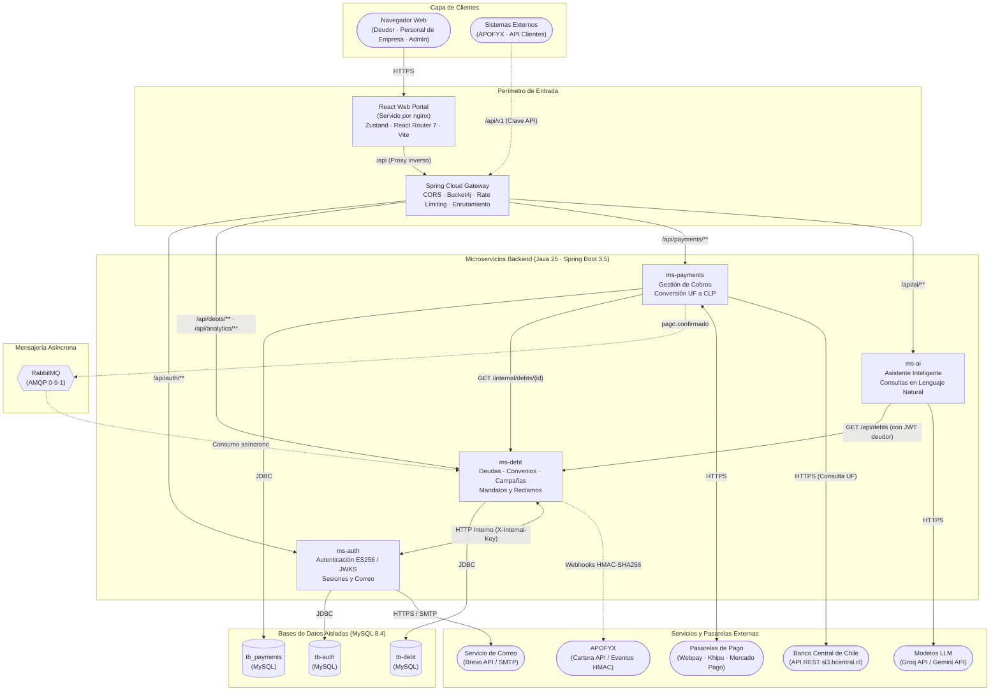
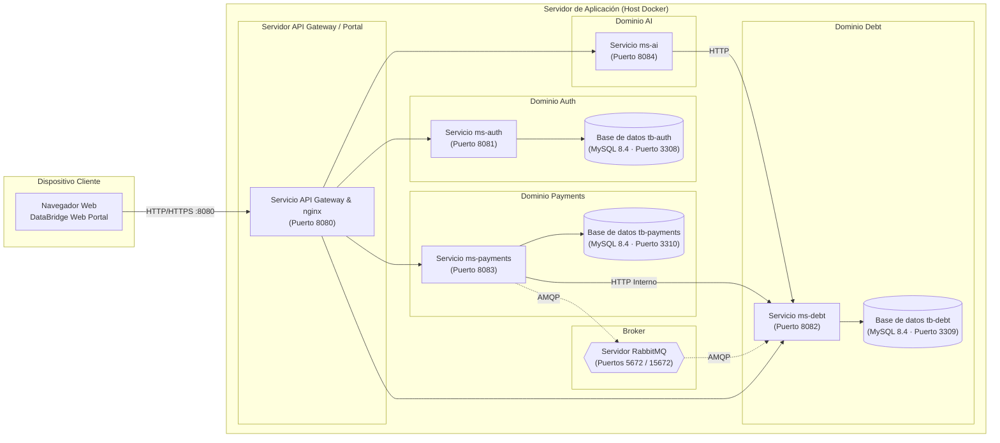
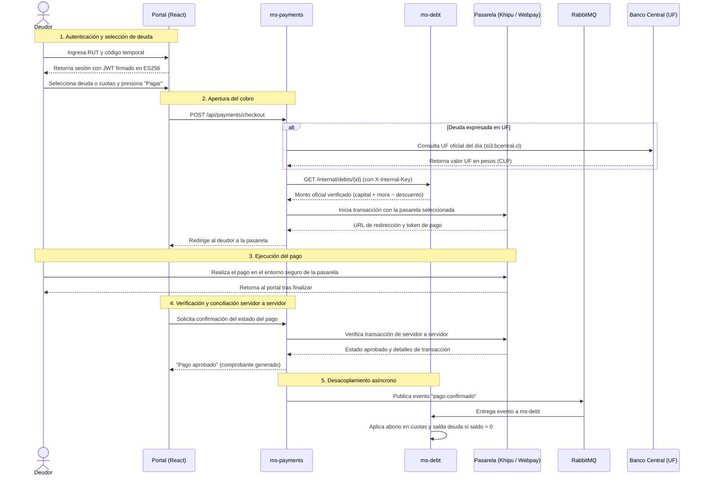

# <picture><source media="(prefers-color-scheme: dark)" srcset="frontend/public/marca/simbolo-oscuro.svg"></picture> DataBridge

[](https://github.com/TechnicalBridge/TB_web/actions/workflows/gateway.yml) [](https://github.com/TechnicalBridge/TB_web/actions/workflows/ms-auth.yml) [](https://github.com/TechnicalBridge/TB_web/actions/workflows/ms-debt.yml) [](https://github.com/TechnicalBridge/TB_web/actions/workflows/ms-payments.yml) [](https://github.com/TechnicalBridge/TB_web/actions/workflows/frontend.yml) [](https://github.com/TechnicalBridge/TB_web/actions/workflows/ms-ai.yml) [](https://github.com/TechnicalBridge/TB_web/actions/workflows/codeql.yml)

**La plataforma donde el deudor en cobranza paga, repacta o reclama su deuda, sin llamar a nadie**, sea del rubro que sea: arriendos, aranceles, tratamientos, planes mensuales. Proyecto de Capstone del equipo **Technical Bridge**; las empresas, las personas y los RUT son ficticios.

---

## Índice

- [1. Descripción](#1-descripción)
  - [Qué hace](#qué-hace)
  - [A quién va dirigido](#a-quién-va-dirigido)
  - [Qué problema resuelve](#qué-problema-resuelve)
- [2. Tecnologías utilizadas](#2-tecnologías-utilizadas)
  - [Lenguajes](#lenguajes)
  - [Frameworks y librerías](#frameworks-y-librerías)
  - [Base de datos](#base-de-datos)
  - [Cloud y servicios externos](#cloud-y-servicios-externos)
- [3. Instrucciones para ejecutar el proyecto localmente](#3-instrucciones-para-ejecutar-el-proyecto-localmente)
  - [Requisitos previos](#requisitos-previos)
  - [Paso a paso en Docker](#paso-a-paso-en-docker)
  - [Servicios y URLs principales](#servicios-y-urls-principales)
  - [Cuentas de prueba y demostración](#cuentas-de-prueba-y-demostración)
- [4. Integrantes del equipo](#4-integrantes-del-equipo)
- [5. Metodología de trabajo del equipo: Scrumban](#5-metodología-de-trabajo-del-equipo-scrumban)
- [6. Arquitectura de solución](#6-arquitectura-de-solución)
  - [Descripción de la arquitectura](#descripción-de-la-arquitectura)
  - [Diagrama general de componentes y comunicación](#diagrama-general-de-componentes-y-comunicación)
  - [Diagrama de despliegue físico](#diagrama-de-despliegue-físico)
  - [Diagrama de secuencia del flujo principal: pago y conciliación](#diagrama-de-secuencia-del-flujo-principal-pago-y-conciliación)
  - [Detalle de arquitectura en vistas 4+1](#detalle-de-arquitectura-en-vistas-41)

---

## 1. Descripción

### Qué hace

**DataBridge es una plataforma de autoservicio para la gestión y regularización de deudas morosas.** Permite al deudor acceder sin contraseñas convencionales utilizando su RUT y un código de seis caracteres enviado a su correo electrónico. Desde la plataforma puede:

- **Pagar de una vez**: mediante pasarelas de pago digitales integradas (Webpay Plus de Transbank, Mercado Pago Checkout Pro o Khipu).
- **Repactar en cuotas**: simular y pactar convenios de 3 a 24 cuotas, con cálculo transparente del costo total y Carga Anual Equivalente (CAE), pudiendo pagar cuotas de forma individual o agrupada desde la que vence primero.
- **Reclamar cobros no correspondientes**: impugnar una deuda si no la reconoce, ya fue pagada o presenta inconsistencias. Mientras la empresa revisa la situación, la cobranza y los recordatorios quedan suspendidos.
- **Consultar a un asistente inteligente**: resolver dudas mediante un asistente que consulta su deuda en tiempo real con su propia sesión autenticada.
- **Descargar comprobantes y certificados**: emitir certificados de deuda pagada (deuda cero) y comprobantes de pago individuales en PDF.

Para las **empresas que gestionan la cartera** (agencias de cobranza como APOFYX o acreedores directos), el portal ofrece:

- **Carga de cartera por campañas**: ingesta masiva mediante planilla Excel con validación previa de inconsistencias antes de confirmar.
- **Cumplimiento legal de contacto**: ejecución automatizada de contactos respetando los límites de frecuencia y horarios que estipula la ley chilena (Ley 19.496).
- **Gestión integral**: resolución de reclamos, seguimiento de convenios en riesgo (con cuotas vencidas), reenvío de códigos de acceso y panel analítico de recuperación y cálculo de comisiones.

### A quién va dirigido

| Actor | Rol en DataBridge |
| :--- | :--- |
| **La persona que debe (Deudor)** | Usuario principal del portal público. Accede con su RUT y código temporal para consultar sus montos, repactar, pagar en línea o reclamar. |
| **La empresa que cobra (Agencia o Acreedor directo)** | Gestiona sus campañas de cobranza, carga carteras masivas, reenvía códigos de acceso, resuelve impugnaciones y analiza la recaudación en el portal de empresas. |
| **El acreedor final (Inmobiliaria, instituto, clínica, etc.)** | Cuando delega la cobranza en una agencia, puede recibir en su sistema notificaciones firmadas vía webhook (`/api/v1`) ante cada pago o convenio si la integración API está activa. |
| **Equipo de administración DataBridge (`admin`)** | Habilita empresas usuarias y sus colaboradores, supervisa la bitácora de auditoría global (`admin_log`, `access_log`) y monitorea la salud de los servicios. |

### Qué problema resuelve

- **Costo desproporcionado de la cobranza tradicional**: La gestión de deudas menores mediante canales telefónicos o cartas postales suele tener un costo operativo superior al margen recuperable, provocando abandono o castigo de cartera.
- **Barreras para el deudor que desea ponerse al día**: La cobranza convencional impone esperas telefónicas en horarios de oficina restrictivos y carece de mecanismos transparentes para simular pagos accesibles o impugnar cobros erróneos.
- **Solución integral**: DataBridge digitaliza el proceso en ambas direcciones: el deudor opera 24/7 con autonomía, mientras la empresa recauda y concilia automáticamente sin intervención manual.

---

## 2. Tecnologías utilizadas

### Lenguajes

| Lenguaje | Versión | Uso en la solución |
| :--- | :--- | :--- |
| **Java** | 25 | Backend completo: gateway y los microservicios ms-auth, ms-debt, ms-payments y ms-ai. |
| **JavaScript** | ES2022 con JSX | Frontend React del portal (deudor, empresas y panel de administración). |
| **SQL** | MySQL 8.4 | Definición de esquemas relacionales, vistas y migraciones versionadas. |

### Frameworks y librerías

| Capa / Componente | Tecnología | Propósito |
| :--- | :--- | :--- |
| **Backend** | Spring Boot 3.5 · Spring Security · Spring Data JPA · Bean Validation | Microservicios de negocio modulares y APIs REST seguras. |
| **Gateway & Resiliencia** | Spring Cloud Gateway · Bucket4j | Puerta de entrada única: enrutamiento, validación CORS y rate limiting distribuido por IP. |
| **Frontend** | React 18 · React Router 7 · Vite · Zustand · Recharts | SPA responsiva con diseño CSS nativo modular. |
| **Seguridad & Autenticación** | JWT con **ES256 (ECDSA P-256)** · JJWT · JWKS | Sesiones sin contraseñas; firmas criptográficas asimétricas y verificación distribuida vía `/.well-known/jwks.json`. |
| **Cifrado & Hashing** | SHA-256 · AES-256-GCM (JCA) | Almacenamiento seguro de hashes para credenciales efímeras e IPs; cifrado en reposo para secretos de suscripción. |
| **Mensajería Asíncrona** | RabbitMQ 3.13 (AMQP 0-9-1) | Propagación asíncrona desacoplada de avisos de pago (`pago.confirmado`). |
| **Asistente Inteligente** | SDK oficial OpenAI para Java (`openai-java`) | Consultas LLM compatibles con Groq y Gemini, con fallback automático a motor de reglas local (`MotorLocal`). |
| **Documentación & Hipermedios** | springdoc-openapi (Swagger) · Spring HATEOAS | Documentación interactiva OpenAPI 3 y enlaces hipermedia en respuestas REST. |
| **Plantillas y Correo** | Jakarta Mail · Thymeleaf | Renderizado de correos transaccionales en HTML responsivo y texto plano. |

### Base de datos

- **MySQL 8.4 (*Database-per-service*)**: Aislamiento estricto de datos con tres bases independientes:
  - `tb_auth`: Códigos de acceso hasheados, enlaces mágicos, sesiones, usuarios de personal y bitácora de accesos.
  - `tb_debt`: Empresas, mandatos, campañas, deudores, deudas, cargos, convenios, contactos y outbox de eventos.
  - `tb_payments`: Transacciones de pago, eventos de pasarelas, avisos de conciliación y valores históricos de la UF.
- **Flyway**: Versionamiento ordenado de esquemas relacionales con validación automática al inicio (`ddl-auto: validate`).

### Cloud y servicios externos

| Servicio / Proveedor | Propósito | Alternativa / Modo local |
| :--- | :--- | :--- |
| **Docker & Docker Compose** | Orquestación local y de despliegue en servidor VPS (Namecheap / Let's Encrypt). | Despliegue en contenedores locales aislados. |
| **Transbank (Webpay Plus REST v1.2)** | Pagos con tarjeta de débito, crédito y prepago. | Modo simulación local (`TRANSBANK_ENVIRONMENT=SIMULADA`). |
| **Khipu (API v3)** | Cobro directo vía transferencia electrónica bancaria. | Simulación automática sin credenciales configuradas. |
| **Mercado Pago (Checkout Pro)** | Cobros con billetera digital y tarjetas. | Simulación automática sin token configurado. |
| **Banco Central de Chile (`si3.bcentral.cl`)** | Obtención en línea del valor diario oficial de la UF. | Carga estática manual de UF en base de datos. |
| **Brevo API / Servidores SMTP** | Despacho de correos electrónicos transaccionales. | Buzón de correo local Mailpit (http://localhost:8025). |
| **Groq / Google Gemini** | Modelos de lenguaje natural para el asistente de deudas. | Motor local de reglas (`MotorLocal`) sin requerir API keys. |

---

## 3. Instrucciones para ejecutar el proyecto localmente

### Requisitos previos

- **Docker Desktop** en ejecución con al menos 4 GB de memoria RAM asignados.
- Conexión a internet la primera vez para la descarga de dependencias e imágenes base.

### Paso a paso en Docker

```powershell
# 1. Clonar el repositorio
git clone https://github.com/TechnicalBridge/TB_web.git
cd TB_web

# 2. Generar el par de claves criptográficas JWT ES256 (una sola vez)
powershell -ExecutionPolicy Bypass -File .\scripts\generar-claves-jwt.ps1

# 3. Generar el archivo .env con contraseñas seguras aleatorias (una sola vez)
powershell -ExecutionPolicy Bypass -File .\preparar-env.ps1

# 4. (Opcional) Para cargar datos de demostración en una base nueva:
# Asegurar DEMO_DATOS=true en el archivo .env

# 5. Levantar todos los contenedores y esperar a que estén en estado saludable
docker compose --profile app up -d --build --wait
```

> **Nota:** La bandera `--wait` retorna el control a la terminal únicamente cuando los once contenedores están completamente inicializados y saludables (*healthy*).

### Servicios y URLs principales

| Servicio | URL | Descripción y Credenciales |
| :--- | :--- | :--- |
| **Portal Web** | [http://localhost:8080](http://localhost:8080) | Interfaz unificada de deudores, empresas y administración. |
| **Documentación OpenAPI / Swagger** | [http://localhost:8080/swagger-ui.html](http://localhost:8080/swagger-ui.html) | Catálogo interactivo de endpoints de los microservicios. |
| **Buzón de prueba (Mailpit)** | [http://localhost:8025](http://localhost:8025) | Interfaz web para consultar los correos y códigos de acceso emitidos. |
| **Consola RabbitMQ** | [http://localhost:15672](http://localhost:15672) | Usuario: `guest`, contraseña: valor de `RABBIT_PASSWORD` en `.env`. |
| **Bases de datos MySQL** | `127.0.0.1:3308` (`tb_auth`)<br>`127.0.0.1:3309` (`tb_debt`)<br>`127.0.0.1:3310` (`tb_payments`) | Usuario: `tbridge`, contraseñas configuradas en `.env`. |

Para apagar el entorno:
```powershell
docker compose --profile app down
# Para detener y reiniciar con base de datos limpia:
docker compose --profile app down -v
```

### Cuentas de prueba y demostración

Con `DEMO_DATOS=true`:
- **Acceso Empresa**: Ingresar a *Soy de una empresa* con el correo `camila.reyes@example.com`. El código de acceso de un solo uso llegará al buzón Mailpit (http://localhost:8025).
- **Acceso Deudor**: Ingresar en *Tengo un código de acceso* o mediante solicitud de código con RUTs de ejemplo:
  - `16.482.337-7`: Deudor en convenio de 6 cuotas (3 pagadas).
  - `19.230.418-0`: Deudor con totalidad de deuda saldada.
  - `14.583.206-3`: Deudor con reclamo ingresado por monto disputado.
  - `76.991.245-2`: Empresa deudora con deuda pactada en UF.

---

## 4. Integrantes del equipo

| Integrante | Rol |
| :--- | :--- |
| **Flavio Henríquez** | Product Owner |
| **Martín Gutiérrez** | Scrum Master |
| **Esteban Maino** | Desarrollador fullstack y Project Coordinator |
| **Pedro Campos** | Desarrollador fullstack y QA Tester |

---

## 5. Metodología de trabajo: Scrumban

**Scrumban.** Usamos los **roles de Scrum**, pero el trabajo fluye como en **Kanban**: sin sprints, cada
tarjeta pasa por el tablero hasta quedar hecha. Para entregar, sumamos algunas prácticas ligeras de **DevOps**.

- **Roles (Scrum).**
  - **Flavio Henríquez, Product Owner:** prioriza el backlog, escribe los criterios de aceptación y decide qué
    pasa a *Ready*.
  - **Martín Gutiérrez, Scrum Master:** cuida que el trabajo fluya, que nadie tenga más de dos tarjetas en
    curso, y abre las retrospectivas.
  - **Esteban Maino, desarrollador fullstack y Project Coordinator:** programa en el backend y el portal, y
    coordina el proyecto.
  - **Pedro Campos, desarrollador fullstack y QA Tester:** programa en el backend y el portal, y prueba lo
    que se entrega.
- **Revisión.** Cada autor elige quién revisa su PR. En los de Flavio, las dos cuentas se reparten
  el trabajo:
  1. **`4mnesia` hace:** el issue, la rama, los commits y el PR, a nombre de Flavio.
  2. **`H4desDevs` revisa.** Si algo está mal o la CI falla, pide cambios en el PR y dice
     exactamente qué corregir.
  3. **`4mnesia` corrige**, responde nombrando el commit, y se repite hasta que la CI pasa en verde.
  4. **`H4desDevs` aprueba**, y recién ahí se mergea, en orden si los PRs van apilados.
- **Flujo (Kanban).** Sin sprints: cada persona toma la siguiente tarjeta de *Ready* cuando termina
  la que tiene. Las columnas del [tablero](https://github.com/orgs/TechnicalBridge/projects/3) son
  Backlog, Ready, In progress, In review y Done, y el tablero reúne los tres repositorios.
- **Issues.** Cada repositorio trae formularios en `.github/ISSUE_TEMPLATE/`, y todo issue entra solo
  al tablero. Para el producto: historia de usuario (con su criterio de aceptación), épica, error e
  investigación. Para el equipo: tarea técnica, decisión, versión mayor de una dependencia y, en este
  repositorio, la retrospectiva.
  Un issue nuevo sin responsable se reparte por turnos entre Pedro, Esteban, Martín y Flavio
  ([`repartir-por-turnos.yml`](.github/workflows/repartir-por-turnos.yml)), salvo las decisiones, las
  retrospectivas y las épicas. Si no corresponde, se reasigna a mano. Tener un issue asignado no es
  tenerlo en curso: el límite de dos tarjetas es para *In progress*.
- **Ramas (trunk-based).** Todo entra a `main` por PRs chicos y bien descritos. Cada rama vive uno o
  dos días, sale de `main` y se llama `tipo/número-qué`, por ejemplo `feat/45-descuento-contrato`. Un
  issue grande se entrega en varios PRs: los intermedios dicen *Parte de #45* y el último *Closes #45*.
  Lo que todavía no está terminado entra apagado, detrás de una configuración, en vez de esperar en
  una rama larga. Cada PR pasa la CI y se mergea con squash.
- **PRs.** La plantilla pide qué cambia, cómo se probó y cómo se deshace, y trae la **Definition of
  Done** como checklist. Es la del informe de la fase 2: cumplimiento funcional, verificación,
  validación de interfaz, seguridad, integración, documentación, y revisión y entrega. Lo que queda
  pendiente se deja identificado y no se presenta como terminado.

El trabajo se organizó en un tablero con cinco épicas —autenticación, gestión de deudas,
pagos, asistente y reportes— y un backlog de tareas que se fueron tomando de a una. El
seguimiento tarea por tarea hasta el 2 de octubre, con **en qué nos apartamos del plan original y
por qué**, está en [`docs/metodologia/plan-kanban.md`](docs/metodologia/plan-kanban.md). Desde ahí, el trabajo vive en el
tablero, en épicas como el panel de administración (#136) y la entrada por campaña (#193).

De DevOps se tomaron tres prácticas, cada una porque resolvía un problema concreto:

| Práctica | Qué resuelve |
| --- | --- |
| **Integración continua** (GitHub Actions) | Las pruebas corren en cada push, en un equipo limpio. Lo que funciona "en mi máquina" no cuenta |
| **Infraestructura como código** (Docker Compose) | Levantar el sistema es una orden, y no una página de instrucciones que alguien sigue mal |
| **Esquema versionado** (Flyway) | Cambiar la base es un archivo con número, revisable, y no un `ALTER TABLE` que alguien corrió una vez |

---

## 6. Arquitectura de la solución

DataBridge es una **arquitectura de microservicios**: cuatro servicios de negocio, cada uno con su
base, detrás de un **API Gateway**. El navegador solo habla con el portal; el portal manda todo lo
que empiece con `/api` al gateway, y el gateway decide a qué servicio le toca. Ningún servicio
queda expuesto hacia afuera.

El equipo adopta **Scrumban**, combinando la estructura de gobierno y roles de **Scrum** con la entrega de valor continua y control de flujo de **Kanban**, complementado con prácticas fundamentales de **DevOps**:

- **Roles Scrum definidos**:
  - **Product Owner (Flavio Henríquez)**: Prioriza el backlog, redacta historias de usuario con criterios de aceptación explícitos y aprueba el paso a *Ready*.
  - **Scrum Master (Martín Gutiérrez)**: Vela por el flujo de trabajo continuo, la eliminación de bloqueos, el cumplimiento del límite de trabajo en curso y la facilitación de retrospectivas.
  - **Project Coordinator y Desarrollador Fullstack (Esteban Maino)**: Desarrollo de microservicios y frontend, y coordinación de la arquitectura técnica.
  - **QA Tester y Desarrollador Fullstack (Pedro Campos)**: Implementación de pruebas automatizadas, control de calidad y desarrollo integral.
- **Flujo Kanban sin Sprints cerrados**: Las tareas se extraen progresivamente de acuerdo a la capacidad del equipo a través de un tablero unificado (*Backlog → Ready → In Progress → In Review → Done*).
- **Control de WIP (Work In Progress)**: Límite estricto de máximo 2 tareas simultáneas por integrante para reducir cambios de contexto y optimizar el tiempo de ciclo (*lead time*).
- **Trunk-Based Development y Ramas Efímeras**: Estrategia de ramas cortas (`tipo/numero-descripcion`) con una vida útil promedio de 1 a 2 días, fusionadas hacia `main` mediante Pull Requests atómicos acompañados de la *Definition of Done* (DoD).
- **Prácticas DevOps integradas**:
  - **Integración Continua (GitHub Actions)**: Pipeline automatizado de pruebas unitarias, análisis estático de vulnerabilidades (CodeQL) y auditoría de credenciales (Gitleaks).
  - **Infraestructura como Código (Docker Compose)**: Configuración reproducible y parametrizada de todo el entorno productivo y de prueba.
  - **Evolución Controlada de Base de Datos (Flyway)**: Migraciones versionadas en código que garantizan consistencia y reproducibilidad en todos los entornos.

---

## 6. Arquitectura de solución

### Descripción de la arquitectura

DataBridge está estructurado bajo una **arquitectura de microservicios orientada al dominio**, caracterizada por:

1. **Perímetro y Puerta de Entrada Única**:
   El cliente web interactúa exclusivamente con el servidor **nginx** del portal (en puerto `8080`), el cual delega las peticiones `/api` al **API Gateway** (**Spring Cloud Gateway**). El gateway centraliza las directivas CORS, aplica políticas de limitación de tasa (*rate limiting*) mediante **Bucket4j** y enruta el tráfico hacia los microservicios internos. Ningún servicio backend expone puertos directamente hacia redes no confiables.
2. **Microservicios de Backend Desacoplados (Java 25 / Spring Boot 3.5)**:
   - **`ms-auth`**: Autenticación sin contraseñas, emisión y rotación de tokens JWT firmados con **ES256 (ECDSA P-256)**, publicación del conjunto de claves públicas en `/.well-known/jwks.json` y despacho de correos transaccionales (Brevo/SMTP).
   - **`ms-debt`**: Gestión integral de la cartera: organizaciones, deudas, cargos, convenios de repactación en cuotas con cálculo de CAE, ejecución legal de contactos en campañas, atención de reclamos y generación de certificados PDF.
   - **`ms-payments`**: Pasarela de pagos unificada (Webpay Plus, Khipu y Mercado Pago). Valida montos directamente con `ms-debt` (evitando manipulación en el cliente), consulta el valor de la UF al **Banco Central de Chile** y realiza conciliación idempotente servidor a servidor.
   - **`ms-ai`**: Asistente conversacional de solo lectura que consulta las deudas en `ms-debt` utilizando el token JWT del deudor autenticado, integrándose con modelos LLM externos (Groq/Gemini) o resolviendo con su motor de reglas local.
3. **Persistencia Aislada (*Database-per-service*)**:
   Cada microservicio dispone de su propia base de datos física en **MySQL 8.4** (`tb_auth`, `tb_debt`, `tb_payments`). No existen llaves foráneas entre bases distintas; las relaciones entre dominios se mantienen a nivel de aplicación mediante identificadores de negocio (RUT, identificadores de deuda).
4. **Comunicación y Mensajería Asíncrona**:
   El aviso de pago completado se propaga desde `ms-payments` hacia `ms-debt` mediante una cola dedicada en **RabbitMQ** (`ms-debt.pagos-confirmados`), garantizando persistencia y reintentos automáticos en caso de indisponibilidad temporal.

---

### Diagrama general de componentes y comunicación



---

### Diagrama de despliegue físico



---

### Diagrama de secuencia del flujo principal: pago y conciliación



---

### Detalle de arquitectura en vistas 4+1

La documentación arquitectónica técnica exhaustiva del sistema se organiza siguiendo el **modelo de vistas 4+1 de Kruchten** en la carpeta [`docs/diagramas/`](docs/diagramas/README.md):

| Vista 4+1 | Contenido y Especificación | Documento de Detalle |
| :--- | :--- | :--- |
| **Escenarios (+1)** | Casos de uso completos de cada actor (Deudor, Empresa, Admin, Sistemas y Reloj) y detalle de endpoints. | [docs/diagramas/casos-de-uso.md](docs/diagramas/casos-de-uso.md) |
| **Vista Lógica** | Diagrama Entidad-Relación de las tres bases (`tb_auth`, `tb_debt`, `tb_payments`), modelo de clases y máquinas de estados. | [docs/diagramas/entidad-relacion.md](docs/diagramas/entidad-relacion.md)<br>[docs/diagramas/clases.md](docs/diagramas/clases.md)<br>[docs/diagramas/estados.md](docs/diagramas/estados.md) |
| **Vista de Procesos** | Secuencias de interacción detalladas (pagos, autenticación, campañas, reclamos) y flujos BPMN de negocio. | [docs/diagramas/secuencia.md](docs/diagramas/secuencia.md)<br>[docs/diagramas/procesos.md](docs/diagramas/procesos.md) |
| **Vista de Desarrollo** | Paquetes internos de cada microservicio, interfaces HATEOAS, DTOs y módulos del frontend. | [docs/diagramas/componentes.md](docs/diagramas/componentes.md) |
| **Vista Física** | Topología de contenedores Docker, orden de arranque, puertos expuestos y perfiles de configuración. | [docs/diagramas/despliegue.md](docs/diagramas/despliegue.md) |
