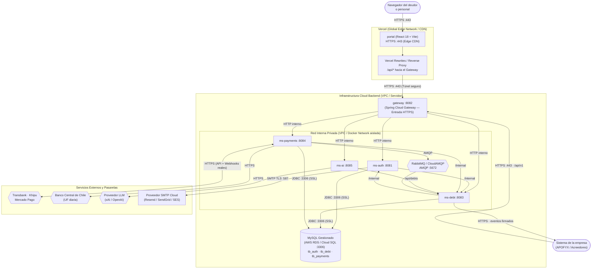
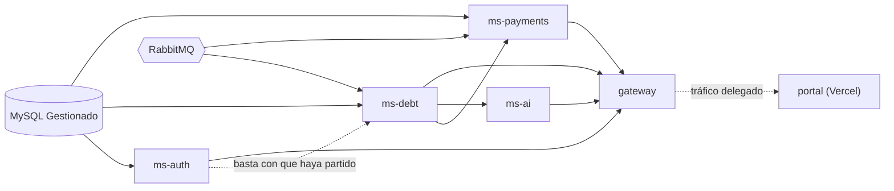

# Diagrama de despliegue — Producción (Vercel + Cloud)

Vista física del [modelo 4+1](README.md): **dónde corre cada pieza** en un entorno de producción real,
con el portal web alojado en la red global de **Vercel** y los microservicios desplegados en infraestructura
en la nube (VPS, AWS ECS/EKS, GCP Cloud Run o clúster Docker con red privada).

**Cómo leerlo.** El recuadro superior representa la red de borde (Edge CDN) de Vercel. El recuadro inferior
es la infraestructura Cloud Backend dentro de una red privada (VPC). Cada caja es un servicio o contenedor
con su puerto/protocolo. El cilindro es la base de datos gestionada. Las flechas representan conexiones de red,
en el sentido de quien inicia la petición.

---

## Los componentes y servicios

El frontend corre desacoplado en la plataforma de Vercel para máxima velocidad de entrega y alta disponibilidad.
El backend corre en un entorno Cloud privado; **solo el Gateway está expuesto a Internet** para recibir peticiones
del portal y webhooks de pasarelas. Los microservicios de negocio no tienen puertos públicos.



| Componente | Dónde corre / Runtime | Puerto interno | Publicado a Internet | Memoria / Recursos | Para qué |
| --- | --- | --- | --- | --- | --- |
| `portal` | **Vercel Edge Network** (React 18 + Vite) | 443 | **HTTPS público** (`tudominio.cl` o `.vercel.app`) | Autoescalable | Sirve la SPA estática, distribuye los assets en CDN mundial y redirige `/api` al gateway mediante rewrites |
| `gateway` | Cloud (Spring Boot / Temurin 25 JRE) | 8082 | **HTTPS público** (`api.tudominio.cl`) | 512 MB – 1 GB | La única puerta del backend: enruta hacia microservicios, limita peticiones por IP y valida CORS |
| `ms-auth` | Red privada VPC | 8081 | — | 640 MB | Autenticación sin contraseña (códigos OTP), tokens de sesión y despacho de correos |
| `ms-debt` | Red privada VPC | 8083 | — | 640 MB | Cartera de deudores, intereses legales (Ley 18.010), convenios y campañas de cobranza |
| `ms-payments` | Red privada VPC | 8084 | — | 640 MB | Cobros con Webpay, Khipu y Mercado Pago, recepción de webhooks y valor UF del Banco Central |
| `ms-ai` | Red privada VPC | 8085 | — | 640 MB | Asistente conversacional de cobranza con LLM |
| `mysql` | Managed DB (RDS / Cloud SQL) | 3306 | — (Solo accesible desde la VPC) | Ajustable según carga | Las tres bases (`tb_auth`, `tb_debt`, `tb_payments`) con replicación y backups automáticos |
| `rabbitmq` | CloudAMQP / Clúster privado | 5672 | — (Solo accesible desde la VPC) | Clúster gestionado | La cola durable para la confirmación asíncrona de pagos hacia ms-debt |
| `SMTP` | SaaS (Resend / SendGrid / SES) | 587 (TLS) | SaaS externo | Confiabilidad de entrega | Reemplaza a Mailpit: envía correos reales a los deudores y personal con sus códigos de acceso |

---

## Configuración de Vercel (`vercel.json`)

Para evitar problemas de CORS y asegurar que las cookies de sesión con `HttpOnly` y `SameSite` viajen
correctamente bajo el mismo dominio principal, Vercel actúa como reverse proxy delegando las rutas de API
hacia el Gateway:

```json
{
  "rewrites": [
    {
      "source": "/api/:match*",
      "destination": "https://api.tudominio.cl/api/:match*"
    },
    {
      "source": "/swagger-ui/:match*",
      "destination": "https://api.tudominio.cl/swagger-ui/:match*"
    },
    {
      "source": "/v3/api-docs/:match*",
      "destination": "https://api.tudominio.cl/v3/api-docs/:match*"
    },
    {
      "source": "/((?!api/|swagger-ui|v3/api-docs).*)",
      "destination": "/index.html"
    }
  ],
  "headers": [
    {
      "source": "/assets/(.*)",
      "headers": [
        {
          "key": "Cache-Control",
          "value": "public, max-age=31536000, immutable"
        }
      ]
    }
  ]
}
```

---

## En qué orden arrancan y cómo se despliegan

1. **Frontend (Vercel CI/CD):**
   - Cada *push* a la rama `main` en GitHub dispara una compilación automática en Vercel (`npm run build`).
   - Los artefactos optimizados se distribuyen en milisegundos a todos los puntos de presencia (PoP) de Vercel.
   - Los *Pull Requests* generan ambientes de previsualización (*Preview Deployments*) automáticos con su propia URL.

2. **Backend (Infraestructura Cloud):**
   - La base de datos MySQL gestionada está permanentemente activa.
   - Cada microservicio con base migra su esquema con **Flyway** al iniciar (`V1`, `V2`, etc.) antes de recibir tráfico.
   - Docker o el orquestador valida la salud de cada servicio vía `/actuator/health` antes de registrarlo en el Gateway.
   - El Gateway inicia y queda listo para recibir tráfico seguro HTTPS desde Vercel y clientes externos.



---

## Qué queda guardado (Persistencia en la nube)

| Qué | Dónde | Sobrevive a |
| --- | --- | --- |
| **Las tres bases de datos** | Instancia gestionada MySQL (AWS RDS / Cloud SQL) | Caídas del servidor, reinicios y fallas de disco (copias automáticas y Point-in-Time Recovery). |
| **La cola de RabbitMQ** | Volumen persistente del broker / CloudAMQP | Reinicios del servicio, ya que la cola y los mensajes de confirmación de pago son durables. |
| **Las sesiones** | Tabla `tb_auth.sesiones` y llaves de renovación | Reinicio de cualquiera de los microservicios (el JWT es stateless y la llave de refresco vive en base de datos). |
| **El portal web** | Red de almacenamiento distribuido de Vercel | Inmune a caídas del backend: la interfaz carga siempre y muestra estados de reconexión si el API no responde. |

---

## Con qué se configura

### 1. Variables en el panel de Vercel (Project Settings)

| Variable | Tipo | Para qué |
| --- | --- | --- |
| `VITE_API_BASE_URL` | Pública | URL base del Gateway (si se usa conexión directa sin rewrites). Con `vercel.json` se usa `/api` relativo |

### 2. Secretos y variables en el Backend (Secret Manager / `.env` Cloud)

| Secreto / Variable | Quién lo usa | Para qué |
| --- | --- | --- |
| `MYSQL_URL`, `MYSQL_USER`, `MYSQL_PASSWORD` | ms-auth, ms-debt y ms-payments | Conexión segura JDBC a la base de datos gestionada |
| `JWT_SECRET` | ms-auth, ms-debt y ms-payments | Firma y validación de tokens de acceso (debe ser idéntico en los tres) |
| `INTERNAL_KEY` | ms-auth, ms-debt y ms-payments | Cabecera `X-Internal-Key` para llamadas privadas `/internal` |
| `RABBIT_HOST`, `RABBIT_USER`, `RABBIT_PASSWORD` | ms-debt y ms-payments | Autenticación con el broker RabbitMQ / CloudAMQP |
| `WEBHOOK_SECRET` | ms-payments | Verificación de firmas criptográficas de webhooks de pago |
| `CIFRADO_LLAVE` | ms-debt | Llave AES-256-GCM para cifrar secretos de suscripciones en base de datos |
| `SMTP_HOST`, `SMTP_PORT`, `SMTP_USER`, `SMTP_PASSWORD` | ms-auth | Conexión TLS al proveedor de correo transaccional (SES / SendGrid / Resend) |
| `TRANSBANK_*`, `KHIPU_*`, `MERCADOPAGO_*` | ms-payments | Credenciales oficiales de pasarelas de pago |
| `BCENTRAL_USER`, `BCENTRAL_PASS` | ms-payments | Consulta automatizada del valor diario de la UF |
| `XAI_API_KEY` o `OPENAI_API_KEY` | ms-ai | Conexión con el modelo de lenguaje del asistente |

---

## Los sistemas de afuera: Webhooks reales vs. Sondeo

En un equipo local, DataBridge no tiene IP pública, por lo que dependía de preguntar a las pasarelas cada 10 segundos.
**En producción con Vercel y dominio Cloud público, el flujo cambia radicalmente:**

| Sistema | Cómo se comunica | Flujo en producción | Qué pasa si no responde |
| --- | --- | --- | --- |
| **Khipu** | HTTPS | **Webhook instantáneo:** Khipu llama directamente a `https://api.tudominio.cl/api/v1/payments/webhooks/khipu`. El pago se concilia en el segundo exacto en que se realiza. | Si el webhook falla, el sondeo periódico de respaldo (cada 10 s) consulta el estado y lo concilia igualmente. |
| **Mercado Pago** | HTTPS | **IPN / Webhook directo:** Notificación a `POST /api/v1/payments/webhooks/mercadopago` con verificación de firma HMAC. | El sondeo periódico de respaldo asegura la conciliación. |
| **Transbank (Webpay)** | HTTPS | El deudor es redirigido por Transbank de regreso a la URL pública del portal (`https://tudominio.cl/pago/exito`), donde el frontend confirma con el backend. | Si la persona cierra la ventana antes de volver, el cobro vence al expirar el tiempo límite. |
| **Banco Central** | HTTPS | ms-payments consulta la UF diaria vía API REST oficial. | Se puede fijar manual; si no está disponible, cobros en UF responden `503`, en pesos operan normalmente. |
| **Servicio de correo** | SMTP TLS | ms-auth envía correos reales a las bandejas de entrada de los deudores mediante proveedor SaaS. | Si el proveedor SMTP rechaza el envío, se registra en bitácora sin tumbar el servicio. |
| **Sistema de la empresa (APOFYX)** | HTTPS | ms-debt despacha eventos firmados (`pago.confirmado`, `convenio.creado`) hacia los webhooks de la empresa. | Los eventos pendientes quedan en la bandeja de salida (`outbox`) y se reintentan automáticamente. |
