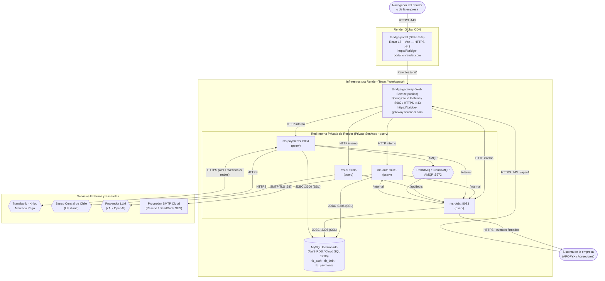

# Diagrama de despliegue — Producción en Render

Vista física del [modelo 4+1](README.md): **dónde corre cada pieza** en un entorno de producción real
desplegado en **Render** (https://render.com), utilizando su modelo de **Static Sites**, **Web Services**
y **Private Services** orquestados mediante el Blueprint [`render.yaml`](render.yaml).

**Cómo leerlo.** El recuadro superior es la red de Render (CDN global para el portal). El recuadro inferior
es la red privada interna de Render. Cada caja es un servicio o contenedor. El cilindro es la base de datos.
Las flechas representan conexiones de red en el sentido de quien inicia la petición.

---

## 1. Topología de Servicios en Render

Render ofrece aislamiento de red nativo: el **portal** se sirve en su CDN estático, el **gateway** es el único
servicio público hacia Internet (recibe tráfico del navegador y webhooks de pasarelas), y los microservicios
(`ms-auth`, `ms-debt`, `ms-payments`, `ms-ai`) corren como **Private Services (`pserv`)**, comunicándose
únicamente a través del DNS interno privado de Render (`http://ms-debt:8083`, etc.).



---

## 2. Los componentes en Render

| Componente | Tipo en Render | Runtime / Dockerfile | ¿Público a Internet? | URL / Host | Para qué |
| --- | --- | --- | :---: | --- | --- |
| `tbridge-portal` | **Static Site** (`type: web`) | Node / Vite build | **Sí** | `https://tbridge-portal.onrender.com` | Sirve la SPA estática, distribuye los assets en CDN mundial y redirige `/api` al gateway mediante `routes` de Render |
| `tbridge-gateway` | **Web Service** (`type: web`) | Docker (`./gateway/Dockerfile`) | **Sí** | `https://tbridge-gateway.onrender.com` | Única puerta de entrada del backend: enruta hacia microservicios, limita peticiones y valida CORS |
| `ms-auth` | **Private Service** (`type: pserv`) | Docker (`./ms-auth/Dockerfile`) | **No** (Solo red interna) | `http://ms-auth:8081` | Gestión de acceso, tokens de sesión y despacho de correos |
| `ms-debt` | **Private Service** (`type: pserv`) | Docker (`./ms-debt/Dockerfile`) | **No** (Solo red interna) | `http://ms-debt:8083` | Cartera de deudores, intereses legales (Ley 18.010), convenios y campañas |
| `ms-payments` | **Private Service** (`type: pserv`) | Docker (`./ms-payments/Dockerfile`) | **No** (Solo red interna) | `http://ms-payments:8084` | Cobros con Webpay, Khipu y Mercado Pago, recepción de webhooks y valor UF |
| `ms-ai` | **Private Service** (`type: pserv`) | Docker (`./ms-ai/Dockerfile`) | **No** (Solo red interna) | `http://ms-ai:8085` | Asistente de cobranza con LLM |
| `mysql` | Managed DB | MySQL 8.4 (Cloud SQL / RDS / Managed) | **No** (Acceso privado) | `tbridge-db:3306` | Las 3 bases (`tb_auth`, `tb_debt`, `tb_payments`) con migraciones Flyway |
| `rabbitmq` | CloudAMQP | AMQP 5672 | **No** (Acceso privado) | Host CloudAMQP | Cola durable para avisos de pagos confirmados |

---

## 3. Infraestructura como Código: Blueprint `render.yaml`

El archivo [`render.yaml`](render.yaml) en la raíz define toda la infraestructura de DataBridge.
Al conectar el repositorio con Render, la plataforma detecta automáticamente los servicios, sus dependencias
y sus variables de entorno compartidas (como `JWT_SECRET` e `INTERNAL_KEY`).

---

## 4. Gestión local con Render API (`render.ps1`)

Se incluye el script [`render.ps1`](render.ps1) para interactuar con la API REST de Render desde la terminal local:

```powershell
# 1. Consultar el estado del workspace y los servicios
.\render.ps1 -Estado

# 2. Validar la configuración del Blueprint render.yaml
.\render.ps1 -Validar

# 3. Ver los últimos despliegues de un servicio
.\render.ps1 -Despliegues <servicioId>

# 4. Disparar un despliegue manual
.\render.ps1 -Desplegar <servicioId>
```
