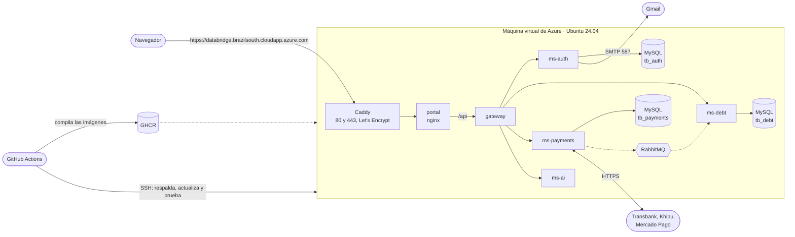

# DataBridge en un servidor

Cómo dejar DataBridge en línea en una máquina virtual de **Azure for Students** (el crédito de estudiante de la cuenta
de Duoc), prendiéndola solo cuando se usa para cuidar el crédito. Hoy corre en
**`https://databridge.brazilsouth.cloudapp.azure.com`** (#468, #470).

El plan anterior era un VPS de Namecheap con `technicalbridge.site`
([#173](https://github.com/TechnicalBridge/DataBridge/issues/173),
[#172](https://github.com/TechnicalBridge/DataBridge/issues/172)). Los pasos 2 a 7 sirven igual en cualquier servidor
con Ubuntu 24.04: solo cambia cómo se crea la máquina y el DNS.

## Cómo queda



- **Es el mismo `docker compose` de local**, más [`docker-compose.prod.yml`](../../docker-compose.prod.yml):
  - Caddy va delante y es lo único que publica puertos;
  - las tres bases (una por servicio, cada una en su MySQL), RabbitMQ y el portal quedan cerrados;
  - el buzón de prueba no se levanta.
- **El servidor no compila nada.** GitHub Actions ([`desplegar.yml`](../../.github/workflows/desplegar.yml)) compila
  las seis imágenes y las publica en GHCR. El servidor solo las descarga.
- **Cada merge a `main` se despliega solo** (paso 6), con respaldo antes, prueba de humo después y vuelta atrás si
  algo falla. Un cambio solo de documentación no despliega.

| Qué | Cuánto |
| --- | --- |
| Máquina **D2s_v4** (2 vCPU, 8 GB), mientras está prendida | ~US$0,153 la hora |
| Disco SSD de 30 GB e IP fija, también apagada | ~US$7 al mes |
| Por ejemplo, prendida 4 horas al día | ~US$25 al mes |

Azure for Students da US$100 por un año, sin tarjeta. Si el crédito se acaba, Azure apaga la máquina: nunca cobra.
DataBridge usa unos 2,5 GB de memoria con todo corriendo; la máquina tiene 8 GB y el servidor suma 2 GB de swap.

## 1. Crear la máquina en Azure

1. **Activar el crédito:** en [portal.azure.com](https://portal.azure.com), con la cuenta `@duocuc.cl`, **Azure for
   Students → Inicio**. Queda una suscripción «Azure for Students».
2. **Azure CLI**, en PowerShell: `winget install -e --id Microsoft.AzureCLI`, y en una PowerShell nueva, `az login`.
3. **La región: Brasil Sur.** Hay dos políticas, y la máquina tiene que cumplir las dos:

   | Política | Regiones que permite |
   | --- | --- |
   | Azure for Students | Chile Central, Brasil Sur, Canadá Central, Nueva Zelanda Norte, Sudáfrica Norte |
   | Duoc («Ubicaciones permitidas») | Brasil Sur y Sudeste, varias de EE. UU. |

4. **El tamaño: D2s_v4.** En Brasil Sur, la suscripción de estudiante no tiene cuota para las familias B ni D v7
   (`az vm create` responde `QuotaExceeded`); la familia D v4 sí. Para ver la cuota: `az vm list-usage -l brazilsouth`.
5. **Crearla**, con la llave de administración (si no existe:
   `ssh-keygen -t ed25519 -N '""' -f $env:USERPROFILE\.ssh\databridge_vps`):

   ```powershell
   az group create -n rg-databridge -l brazilsouth
   az vm create -g rg-databridge -n vm-databridge -l brazilsouth `
     --image Canonical:ubuntu-24_04-lts:server:latest --size Standard_D2s_v4 `
     --admin-username azureuser --ssh-key-values $env:USERPROFILE\.ssh\databridge_vps.pub `
     --os-disk-size-gb 30 --storage-sku StandardSSD_LRS `
     --public-ip-sku Standard --public-ip-address-allocation static --public-ip-address-dns-name databridge `
     --nsg-rule NONE
   $nsg = az network nsg list -g rg-databridge --query "[0].name" -o tsv
   az network nsg rule create -g rg-databridge --nsg-name $nsg -n web --priority 1010 `
     --access Allow --protocol Tcp --destination-port-ranges 80 443 --source-address-prefixes Internet
   az network nsg rule create -g rg-databridge --nsg-name $nsg -n ssh-solo-llaves --priority 1000 `
     --access Allow --protocol Tcp --destination-port-ranges 22 --source-address-prefixes Internet
   ```

   El 22 queda abierto a internet porque GitHub Actions despliega por SSH desde direcciones que cambian. Solo entra
   quien tenga una de las llaves: `preparar-servidor.sh` apaga la entrada con contraseña
   (`/etc/ssh/sshd_config.d/00-databridge.conf`) y suma fail2ban.

6. **El nombre** queda en `databridge.brazilsouth.cloudapp.azure.com`, y no cambia al apagar y prender (la IP es
   fija). Si se cambia la etiqueta DNS de la IP, hay que cambiar también `DOMINIO`, `PUBLIC_URL`, `CORS_ORIGINS` y
   `KHIPU_URL_AVISOS` en el `.env` del servidor, y `DESPLIEGUE_HOST`, `DESPLIEGUE_DOMINIO` y
   `DESPLIEGUE_KNOWN_HOSTS` en GitHub (paso 6).
7. **El acceso del equipo**, en la máquina → *Control de acceso (IAM)* → *Agregar asignación de roles*:
   «Colaborador de la máquina virtual» (prender, apagar y cambiarla), o un rol a medida con solo `read`, `start`,
   `deallocate` y `restart`. Todo lo que se prenda se descuenta del crédito de la cuenta dueña.

## 2. Entrar al servidor

En Azure la llave de administración queda puesta al crear la máquina:

```powershell
ssh -i $env:USERPROFILE\.ssh\databridge_vps azureuser@databridge.brazilsouth.cloudapp.azure.com
```

`azureuser` tiene `sudo`; `root` no entra. En otro proveedor que entregue la clave de `root`, la primera vez se deja la
llave con
`type $env:USERPROFILE\.ssh\databridge_vps.pub | ssh root@<IP> "mkdir -p ~/.ssh && cat >> ~/.ssh/authorized_keys"`;
`preparar-servidor.sh` apaga después la entrada con clave.

Para que otra persona entre, se agrega su llave pública a `~/.ssh/authorized_keys` de `azureuser`, o en el portal
con *Restablecer contraseña* → *Agregar clave pública SSH*. **No se elige ahí la opción de contraseña:** Azure le pone
contraseña a `azureuser` y enciende la entrada con contraseña en el SSH, que está abierto a internet (pasó el 18 de
noviembre, y a los minutos ya había bots probando). `00-databridge.conf` la deja apagada igual, pero si se usó, se
bloquea con `sudo passwd -l azureuser` (`sudo` no la pide).

## 3. La llave con que GitHub despliega

Una llave aparte, solo para GitHub Actions, que entra como el usuario `databridge` (sin root):

```powershell
ssh-keygen -t ed25519 -N '""' -C "databridge-despliegue (GitHub Actions)" -f $env:USERPROFILE\.ssh\databridge_despliegue
```

La parte pública (`databridge_despliegue.pub`) va al paso 4; la privada, al paso 6.

## 4. Preparar el servidor

Con el nombre y la llave pública del paso 3:

```bash
curl -fsSL https://raw.githubusercontent.com/TechnicalBridge/DataBridge/main/deploy/preparar-servidor.sh \
  | sudo bash -s -- databridge.brazilsouth.cloudapp.azure.com "ssh-ed25519 AAAA... databridge-despliegue (GitHub Actions)"
```

[`preparar-servidor.sh`](../../deploy/preparar-servidor.sh) deja:

- Docker y su plugin de compose;
- el firewall del servidor abierto solo en 22, 80 y 443, el SSH solo con llave y fail2ban vigilándolo;
- las actualizaciones de seguridad automáticas y 2 GB de swap;
- el usuario `databridge`, que despliega;
- el repositorio en `/opt/databridge`;
- la pareja P-256 con que ms-auth firma las sesiones, en `/opt/databridge/.secrets/jwt`, del usuario del contenedor
  (UID 10001), si no existía ([`docs/seguridad/jwt.md`](../seguridad/jwt.md));
- un respaldo de cada base cada madrugada ([`respaldar.sh`](../../deploy/respaldar.sh), un archivo por base y
  los últimos 7 días en `/var/backups/databridge`);
- el servicio `databridge-actualizar`, que al prender la máquina la pone al día con `main` (paso 6);
- un `.env` con **claves nuevas al azar** y los valores de producción: `PUBLIC_URL`, `COOKIE_SECURE`,
  `CORS_ORIGINS`, `KHIPU_URL_AVISOS`, y para la demo `DEMO_DATOS`, `CONTACTO_SIN_HORARIO` y `CONTACTO_SIN_LIMITE`.
  Con un nombre de Azure, además `CADDYFILE=./deploy/Caddyfile.sin-www`: ese nombre no tiene `www`, y con el otro
  Caddyfile Caddy intentaría sacarle un certificado sin parar.

Se puede volver a correr: no pisa lo que ya existe.

Con `DEMO_DATOS=true` y una base de negocio vacía, el primer arranque instala la demo independiente:
Servicios Horizonte cobra directamente, con dos campañas y seis deudas ficticias. Su persona entra
con `camila.reyes@example.com`. Los correos van a Mailpit o, con un proveedor real, al desvío de prueba
obligatorio. Las bases existentes, incluida la demo anterior, no se convierten ni se completan;
no se debe borrar su volumen para intentar activar esta siembra.

## 5. El correo, las pasarelas y el DNS

**Las claves del correo, de las pasarelas y del asistente** se copian del `.env` del equipo al del servidor, sin que se
vean en la pantalla:

```powershell
Select-String -Path .env -Pattern '^(MAIL_TRANSPORT|SMTP_HOST|SMTP_PORT|SMTP_USER|SMTP_PASSWORD|SMTP_AUTH|SMTP_STARTTLS|SMTP_SSL|MAIL_FROM|MAIL_FROM_NAME|CORREO_SOLO_A|CORREO_DESVIAR_A|ADMIN_CORREO|KHIPU_LLAVE|KHIPU_SECRETO|MERCADOPAGO_ACCESS_TOKEN|MERCADOPAGO_PUBLIC_KEY|BCENTRAL_USER|BCENTRAL_PASS|LLM_PROVIDER|GROQ_API_KEY|GEMINI_API_KEY)=.+' |
  ForEach-Object { $_.Line } |
  ssh -i $env:USERPROFILE\.ssh\databridge_vps azureuser@databridge.brazilsouth.cloudapp.azure.com "sudo tee -a /opt/databridge/.env >/dev/null"
```

Si una variable ya estaba en el `.env` del servidor, se borra la línea vieja: cada una tiene que aparecer una sola vez.

**El correo sale por el SMTP de Gmail** (`MAIL_TRANSPORT=smtp`, `smtp.gmail.com`, puerto 587 con STARTTLS), con una
contraseña de aplicación de la cuenta remitente, que necesita la verificación en dos pasos. No pide IP autorizadas,
como Brevo, así que sirve desde cualquier máquina. Azure bloquea el puerto 25, pero no el 587. Gmail deja unos 500
correos al día. El `.env.example` explica las demás opciones (`brevo`, `resend`).

**El modo de prueba**, con los datos de la demo, no es opcional: los deudores de ejemplo tienen correos inventados.

- `CORREO_SOLO_A` dice a quién se le escribe directo, separado por comas. Acepta direcciones y dominios: con
  `@gmail.com,@duocuc.cl,@outlook.com,@hotmail.com`, una cartera de prueba con correos reales del equipo les llega a
  ellos.
- `CORREO_DESVIAR_A` recibe todo lo demás, con el destinatario original en el asunto.
- Lo que va a un dominio reservado, como el código de `camila.reyes@example.com`, **siempre** va al desvío: en el
  servidor no hay Mailpit (`docker-compose.prod.yml` deja `CORREO_BUZON_DE_PRUEBA` vacío). El desvío tiene un tope de
  `CORREO_DESVIO_MAXIMO_POR_DIA` correos por día (100, por omisión).
- En el servidor, el horario y los límites de la ley están apagados para la demo: a esos correos reales les pueden
  llegar avisos a cualquier hora.

**El DNS:** con el nombre de Azure no hay nada que hacer. Con un dominio propio, en el proveedor del dominio:

| Tipo | Host | Valor |
| --- | --- | --- |
| `A` | `@` | la IP de la máquina |
| `A` | `www` | la IP de la máquina |

y en el `.env` del servidor, `CADDYFILE` vacía, para que Caddy también redirija `www`. Caddy saca el certificado apenas
el DNS apunta al servidor, y lo renueva solo.

## 6. Encender el despliegue automático

En GitHub, **Settings → Environments → New environment → `produccion`**, y ahí:

| Tipo | Nombre | Valor |
| --- | --- | --- |
| Secreto | `DESPLIEGUE_LLAVE` | La llave **privada** del paso 3 (`databridge_despliegue`, el archivo sin `.pub`) |
| Secreto | `DESPLIEGUE_KNOWN_HOSTS` | La huella del servidor: `ssh-keyscan databridge.brazilsouth.cloudapp.azure.com` |

Y en **Settings → Secrets and variables → Actions → Variables**, del repositorio:

| Variable | Valor |
| --- | --- |
| `DESPLIEGUE_HOST` | `databridge.brazilsouth.cloudapp.azure.com`. **Esta es la que enciende el despliegue** |
| `DESPLIEGUE_DOMINIO` | `databridge.brazilsouth.cloudapp.azure.com` |

El primer despliegue se lanza en **Actions → Desplegar → Run workflow**, con *Solo compilar* sin marcar. Desde ahí,
cada merge a `main` se despliega solo.

### Qué pasa en cada merge a `main`

| Paso | Qué hace |
| --- | --- |
| Imágenes | GitHub Actions compila las seis imágenes y las publica en GHCR con el commit como etiqueta, y también como `main`. Pasa aunque el servidor esté apagado. |
| ¿Está prendido? | Si el servidor no responde por SSH, el despliegue queda **omitido**, con un aviso, y no en rojo. Al prender la máquina se pone al día solo (abajo). |
| Respaldo | [`deploy/actualizar.sh`](../../deploy/actualizar.sh) respalda las tres bases antes de arrancar la versión nueva, porque las migraciones corren al arrancar. El respaldo queda en `/var/backups/databridge` con la versión en el nombre, por ejemplo `2026-11-18-0130-antes-de-1a2b3c4-tb_debt.sql.gz`. |
| Actualizar | Baja las imágenes del commit y levanta todo con `--wait`. Si algo no queda sano, vuelve solo a la versión que estaba y el workflow falla. |
| Prueba de humo | Desde GitHub, por HTTPS, servicio por servicio: el portal (`/`, `200` con su página), ms-auth (`/api/me`), ms-debt (`/api/debts`) y ms-payments (`/api/payments`), que sin sesión responden su propio `401` en JSON (caídos, el gateway da `500`), y ms-ai (`/api/ai/salud`, `200`). No basta mirar el estado: nginx responde `200` con su página a cualquier ruta que no conoce. Si algo falla, vuelve a la versión anterior (`actualizar.sh --volver`) y el workflow falla. |

**Al prender la máquina**, el servicio `databridge-actualizar` (systemd, lo instala
[`preparar-servidor.sh`](../../deploy/preparar-servidor.sh)) corre `actualizar.sh` sin versión: busca el commit más nuevo
de `main` que ya tenga sus imágenes publicadas y, si es distinto del que corre, lo despliega con el mismo respaldo y la
misma vuelta atrás. Un cambio solo de documentación no compila imágenes, así que se salta.

Para eso las seis imágenes de GHCR tienen que ser **públicas**: el servidor las baja sin token. No traen secretos, solo
el código compilado, que ya es público en el repositorio. Se cambia una vez por imagen, en
**github.com/orgs/TechnicalBridge/packages → `databridge-<servicio>` → *Package settings* → *Change visibility* →
*Public***. Mientras sigan privadas, el despliegue desde GitHub funciona igual (entra con su token), pero el servidor no
se pone al día solo al prender.

Para hacerlo a mano en el servidor, como `databridge` (`sudo -iu databridge`):

```bash
bash /opt/databridge/deploy/actualizar.sh            # la última versión de main con imágenes
bash /opt/databridge/deploy/actualizar.sh <commit>   # una versión en particular
bash /opt/databridge/deploy/actualizar.sh --volver   # la versión que corría antes del último despliegue
journalctl -u databridge-actualizar                  # qué hizo al arrancar
```

La vuelta atrás no deshace las migraciones: si una versión nueva cambió el esquema y hay que volver, se restaura el
respaldo de ese despliegue (ver [`respaldar.sh`](../../deploy/respaldar.sh)).

## 7. Comprobar que funciona

- `https://databridge.brazilsouth.cloudapp.azure.com` abre el portal, con el candado. Con un dominio propio,
  `www` redirige.
- `/swagger-ui.html` muestra la documentación, si `SWAGGER_ENABLED` no está apagado.
- El correo de prueba sale por el SMTP configurado:

  ```bash
  cd /opt/databridge
  sudo docker compose -f docker-compose.yml -f docker-compose.prod.yml exec -T ms-auth \
    sh -c 'curl -s -X POST "http://127.0.0.1:8081/internal/correo/prueba?para=tucuenta@gmail.com" -H X-Internal-Key:$INTERNAL_KEY'
  ```

  Responde con `enviado`, a dónde llegó de verdad (`llegaA`) y el servidor usado; nunca la clave.
- Un deudor entra con su código, paga con Webpay (tarjeta de prueba) y la empresa ve el pago.
- En los tres portales, **Enviar código** manda solo código; **¿No te llegó?** manda código y
  enlace en un único mensaje. El acceso solicitado dura `MAGIC_TTL_MINUTES` (15 por omisión), y
  usar una opción invalida ambas. Las invitaciones iniciales del personal conservan su enlace.
  Probar solo con destinatarios autorizados y el modo de prueba activo.
- Si comprobar la empresa responde `503` porque ms-debt no está disponible, no debe abrirse sesión
  ni consumirse el código o enlace correcto. Al recuperarse el servicio, se puede reintentar el
  mismo acceso mientras siga vigente. Los intentos incorrectos sí siguen contando.
- Antes de desplegar este cambio de acceso, respaldar `tb_auth`: Flyway aplica V6 sobre
  `magic_links` sin borrar registros. Para revertir la aplicación, volver al código anterior
  conservando los archivos de migración hasta V6; no borrar columnas ni modificar su historial.
  Antes de arrancar la versión anterior, invalidar solo los pedidos nuevos aún pendientes, tras
  el respaldo y con autorización de quien opera la base:

  ```sql
  UPDATE tb_auth.magic_links
  SET consumed_at = UTC_TIMESTAMP(6)
  WHERE code_hash IS NOT NULL AND consumed_at IS NULL;
  ```
- En *Reglas*, el horario y el límite de la ley salen **apagados para probar**.

## 8. Prender y apagar la máquina

Para cuidar el crédito, la máquina se prende solo cuando se usa. Apagarla es **desasignarla**: Azure deja de cobrar la
máquina y solo cobra el disco y la IP. Apagarla desde adentro (`sudo shutdown`) **no** la desasigna, y sigue cobrando.

- **El interruptor:** [`deploy/azure/servidor.ps1`](../../deploy/azure/servidor.ps1), desde la raíz del repositorio:
  `powershell -ExecutionPolicy Bypass -File deploy\azure\servidor.ps1`. Dice si está prendida o apagada, pregunta, y
  al prenderla espera a que el sitio responda.
- **Lo mismo a mano:** `az vm start -g rg-databridge -n vm-databridge` y
  `az vm deallocate -g rg-databridge -n vm-databridge`, o *Iniciar* y *Detener* en el portal de Azure.
- **Al prenderla**, Docker levanta solo los contenedores (`restart: unless-stopped`) y el servicio
  `databridge-actualizar` la pone al día con `main` (paso 6). En 2 a 3 minutos el sitio responde.
- **Mientras está apagada**, los merges a `main` igual publican sus imágenes y el despliegue queda omitido.

## 9. Al terminar: apagarlo

1. En GitHub se borra la variable `DESPLIEGUE_HOST`: el despliegue se apaga.
2. Si hay que guardar algo, se copia el último respaldo de `/var/backups/databridge`
   (`scp -i $env:USERPROFILE\.ssh\databridge_vps azureuser@databridge.brazilsouth.cloudapp.azure.com:/var/backups/databridge/*.gz .`,
   después de dejarlos legibles con `sudo`).
3. Se borra todo en Azure: `az group delete -n rg-databridge` (la máquina, el disco, la IP y el firewall).
4. Con un dominio propio, se deja vencer sin renovar.

**Si DataBridge fuera a cobrar de verdad,** antes se apagan `CONTACTO_SIN_HORARIO` y `CONTACTO_SIN_LIMITE`, y
`DEMO_DATOS`, `CORREO_SOLO_A` y `CORREO_DESVIAR_A` se dejan vacías.
