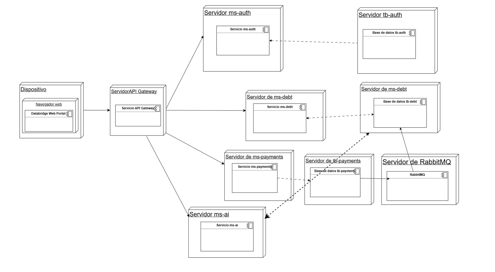

## 10. Docker

### Qué se construye

| Imagen | Con qué |
| --- | --- |
| `tbridge/ms-auth` · `tbridge/ms-debt` · `tbridge/ms-payments` · `tbridge/ms-ai` · `tbridge/gateway` | Un Dockerfile por servicio: [`ms-auth`](../../ms-auth/Dockerfile), [`ms-debt`](../../ms-debt/Dockerfile), [`ms-payments`](../../ms-payments/Dockerfile), [`ms-ai`](../../ms-ai/Dockerfile), [`gateway`](../../gateway/Dockerfile) |
| `tbridge/portal` | [`frontend/Dockerfile`](../../frontend/Dockerfile): compila con Node y sirve con nginx |

Cada servicio de Java se construye desde su propia carpeta, con su `pom.xml` y su código, sin
nada de los demás:

```powershell
docker build -t tbridge/ms-debt ms-debt
```

Son **dos etapas**: la primera compila con Maven y el JDK, y la segunda se queda solo con el JRE y
el `.jar`. Las dependencias de Maven quedan en su propia capa, que se reutiliza mientras no cambie
el `pom.xml`.

El [`docker-compose.yml`](../../docker-compose.yml) orquesta los once contenedores. Sin perfil levanta
solo la infraestructura (las tres bases, RabbitMQ y el buzón); con `--profile app`, el sistema entero.

### Los contenedores y sus puertos



En el código y en [`docker-compose.yml`](../../docker-compose.yml), el navegador (`Dispositivo`) entra únicamente al **Databridge Web Portal** (`nginx`), que reenvía `/api` al **API Gateway** y este reparte el tráfico a `ms-auth`, `ms-debt`, `ms-payments` y `ms-ai`. Cada servicio con persistencia habla solo con su propio servidor MySQL (`tb-auth`, `tb-debt`, `tb-payments`); `ms-payments` publica el evento `pago.confirmado` en `RabbitMQ` (que entrega a `ms-debt`), y `ms-ai` no se conecta directo a la base `tb-debt`, sino que consulta a `ms-debt` por HTTP con el JWT del deudor.

| Contenedor | Puerto interno | Publicado en el equipo | Para qué |
| --- | --- | --- | --- |
| `portal` | 8080 | **8080** | La única puerta: el portal y `/api` hacia el gateway |
| `gateway` | 8082 | — | Enruta, limita peticiones y revisa CORS |
| `ms-auth` · `ms-debt` · `ms-payments` · `ms-ai` | 8081 · 8083 · 8084 · 8085 | — | Solo los ve el gateway y entre ellos |
| `db-auth` · `db-debt` · `db-payments` | 3306 | 3308 · 3309 · 3310 | Una base por servicio, cada una en su MySQL, con su volumen y sus claves. Se publican para revisarlas desde el equipo |
| `rabbitmq` | 5672 · 15672 | 5672 · 15672 | La cola y su consola |
| `mailpit` | 1025 · 8025 | 1025 · 8025 | El buzón de prueba y su página |

Los puertos publicados se cambian desde `.env` ([§3](../../README.md#4-instrucciones-para-ejecutar-el-proyecto-localmente)). En un
despliegue real, cada servicio puede ir en su propio nodo detrás del gateway, con las salvedades de
[§9](../arquitectura/requisitos-no-funcionales.md).

### En un servidor

La demo corre en un VPS de Namecheap, en `https://technicalbridge.site`, hasta diciembre (#172, #173):

| Pieza | Qué hace |
| --- | --- |
| [`docker-compose.prod.yml`](../../docker-compose.prod.yml) | Se suma al compose de siempre. Caddy va delante y es lo único que publica puertos (80 y 443); las tres bases, RabbitMQ y el portal quedan cerrados; el buzón de prueba no se levanta, y los servicios usan las imágenes de GHCR |
| [`deploy/Caddyfile`](../../deploy/Caddyfile) | El HTTPS del dominio con Let's Encrypt, que Caddy renueva solo, y la IP del visitante hacia nginx |
| [`deploy/preparar-servidor.sh`](../../deploy/preparar-servidor.sh) | Prepara el VPS una vez: Docker, firewall, swap, el usuario que despliega y un `.env` con claves nuevas |
| [`deploy/respaldar.sh`](../../deploy/respaldar.sh) | Un respaldo de cada base, en su propio archivo, cada madrugada: los últimos 7 días |
| [`.github/workflows/desplegar.yml`](../../.github/workflows/desplegar.yml) | Compila las seis imágenes, las publica en GHCR y, por SSH, el servidor las descarga y se actualiza. **Apagado hasta que exista la variable `DESPLIEGUE_HOST`** |

La guía completa está en [`docs/despliegue`](README.md).

### Variables de entorno

Van en un archivo `.env` al lado del `docker-compose.yml`, que no se sube al repositorio.
[`.env.example`](../../.env.example) las trae todas, comentadas, y `preparar-env.ps1` crea el `.env`
desde él. El mismo `.env` lo leen los servicios cuando se corren con Maven.

**Los secretos no tienen valor por omisión** (los marcados *el `.env`*): el repositorio es
público, y un valor escrito aquí lo podría leer cualquiera. El script los genera al azar. Lo que
no es secreto sí tiene un valor de desarrollo.

<details>
<summary><b>Puertos y dirección pública</b> (2)</summary>

| Variable | Por omisión | Para qué |
| --- | --- | --- |
| `PORTAL_PORT`, `DB_AUTH_PORT`, `DB_DEBT_PORT`, `DB_PAYMENTS_PORT`, `RABBIT_PORT`, `RABBIT_ADMIN_PORT`, `MAILPIT_SMTP_PORT`, `MAILPIT_PORT` | `8080`, `3308`, `3309`, `3310`, `5672`, `15672`, `1025`, `8025` | Los puertos que se publican en el equipo. Se cambian si alguno ya está ocupado |
| `PUBLIC_URL` | `http://localhost:8080` | La dirección del portal que va en los correos y en el retorno de Webpay y de Khipu |

</details>

<details>
<summary><b>La base y la cola</b> (5)</summary>

| Variable | Por omisión | Para qué |
| --- | --- | --- |
| `MYSQL_USER` | `tbridge` | El usuario de la aplicación en las tres bases: el mismo nombre, con otra clave en cada una |
| `DB_AUTH_ROOT_PASSWORD`, `DB_AUTH_PASSWORD`, y lo mismo con `DB_DEBT_` y `DB_PAYMENTS_` | el `.env` | Las claves de root y de la aplicación de cada base: con las de una no se entra a las otras. Una vez creada la base, se cambian con `preparar-env.ps1 -Cambiar NOMBRE`, que las cambia también dentro de ella |
| `RABBIT_USER` | `guest` | El usuario de RabbitMQ |
| `RABBIT_PASSWORD` | el `.env` | Su clave |
| `EVENTS_RABBIT` | `true` en Docker, `false` con Maven | Si el aviso de pago va por RabbitMQ o por HTTP. En Docker está fijo en `true` |

</details>

<details>
<summary><b>Secretos, sesión y acceso</b> (11)</summary>

| Variable | Por omisión | Para qué |
| --- | --- | --- |
| `JWT_KEY_DIRECTORY` | obligatoria | Ruta absoluta a PKCS#8/SPKI y publicas de rotacion, montada solo en auth |
| `AUTH_JWKS_URI` | local con Maven, interna en Compose | JWKS publico de auth para verificar ES256 |
| `INTERNAL_KEY` | el `.env` | Autentica las llamadas entre servicios |
| `CIFRADO_LLAVE` | el `.env` | Cifra en la base el secreto de las suscripciones. Se cambia sin perderlos, como dice [Cambiar `CIFRADO_LLAVE`](#cambiar-cifrado_llave) |
| `CIFRADO_LLAVE_ANTERIOR` | vacía | Solo mientras se cambia `CIFRADO_LLAVE`: la de antes, con la que ms-debt abre los secretos guardados para volver a cifrarlos con la nueva al arrancar. Después se vacía |
| `ADMIN_CORREO` | vacía | El correo del primer `admin` de DataBridge, que entra al panel de administración. Vacía, no hay `admin`. No puede ser el de una persona de una empresa |
| `JWT_TTL_MINUTES` | `15` | Cuánto dura el JWT. Corto a propósito: no se puede revocar |
| `REFRESH_TTL_HOURS` | `168` | Cuánto dura una sesión desde que se entra. Renovar no la alarga |
| `COOKIE_SECURE` | `false` | **Encender detrás de HTTPS.** Una cookie `Secure` sobre HTTP el navegador la descarta sin avisar |
| `CODE_TTL_HOURS`, `MAGIC_TTL_MINUTES` | `24`, `15` | Horas del código de campaña; minutos del código solicitado y su enlace opcional de respaldo |
| `INVITACION_TTL_HORAS` | `24` | Cuánto dura el enlace de la invitación que le llega a una persona recién dada de alta desde el panel |

</details>

<details>
<summary><b>El correo</b> (6)</summary>

| Variable | Por omisión | Para qué |
| --- | --- | --- |
| `SMTP_HOST`, `SMTP_PORT`, `SMTP_USER`, `SMTP_PASSWORD`, `SMTP_AUTH`, `SMTP_STARTTLS`, `SMTP_SSL` | vacía, `587`, vacías, `true`, `true`, `false` | El servidor de correo ([cómo](../../README.md#cloud-y-servicios-externos)). Sin `SMTP_HOST`, en Docker los correos van al buzón de prueba y lo demás se ignora |
| `BREVO_API_KEY` | vacía | Con ella, los correos salen por la API de Brevo y no por SMTP ([cómo](../../README.md#cloud-y-servicios-externos)). Es la de producción |
| `BREVO_URL` | `https://api.brevo.com/v3/smtp/email` | La dirección de la API de Brevo. Solo se cambia para probar contra un servidor falso |
| `SMTP_TIMEOUT_MS` | `10000` | Cuánto se espera al servidor de correo, o a Brevo, antes de darlo por caído |
| `MAIL_FROM`, `MAIL_FROM_NAME`, `MAIL_REPLY_TO` | `noreply@technicalbridge.local`, `DataBridge`, vacía | El remitente, el nombre que muestra el buzón a su lado, y a quién se le responde si no es al remitente. Con Gmail, el remitente tiene que ser la propia cuenta |
| `CORREO_SOLO_A`, `CORREO_DESVIAR_A` | vacías | El modo de prueba: a quién se le escribe directo, y adónde se desvía lo demás. Vacías, se le escribe a cualquier dirección |
| `CORREO_DESVIO_MAXIMO_POR_DIA` | `100` | Hasta cuántos correos desvía el modo de prueba en un día de Chile: el desvío gasta el cupo del proveedor. `0`, sin tope (#236) |

</details>

<details>
<summary><b>El gateway</b> (3)</summary>

| Variable | Por omisión | Para qué |
| --- | --- | --- |
| `CORS_ORIGINS` | los del portal | Qué orígenes pueden hacer peticiones con credenciales al gateway |
| `TRUSTED_PROXIES` | local y las redes privadas (`10.x`, `172.16–31`, `192.168.x` y las de IPv6, `fc00::/7`) | En qué proxies confía el gateway para saber la IP del cliente. No puede quedar vacía |
| `RATE_AUTH_CAPACITY`, `RATE_GLOBAL_CAPACITY` | `10` / `120` | Peticiones por minuto |

</details>

<details>
<summary><b>Pagos y UF</b> (12)</summary>

| Variable | Por omisión | Para qué |
| --- | --- | --- |
| `WEBHOOK_SECRET` | el `.env` | Firma los enlaces de pago y verifica los avisos de las pasarelas simuladas |
| `TRANSBANK_ENVIRONMENT` | `TEST` | `TEST` cobra contra el ambiente de integración de Transbank; `SIMULADA`, sin internet, vuelve a la pasarela simulada |
| `TRANSBANK_API_URL`, `TRANSBANK_COMMERCE_CODE`, `TRANSBANK_API_KEY` | los públicos de integración | Los únicos con un valor escrito: Transbank los publica para todos en su documentación, para probar. En producción, los del comercio van solo en el `.env` |
| `TRANSBANK_VENCE_EN` | según el ambiente | Cuánto vale un cobro de Webpay. Vacía, lo que da Transbank: 15 minutos en integración (5 de token y 10 de formulario) y 9 en producción |
| `KHIPU_LLAVE` | vacía | La llave de API de una cuenta de cobro de Khipu. Con ella, Khipu cobra de verdad; vacía, es simulada. **Es un secreto: solo en el `.env`** |
| `KHIPU_URL_AVISOS`, `KHIPU_SECRETO` | vacías | Con una dirección pública de DataBridge: dónde avisa Khipu, y el secreto con que se verifica su firma |
| `KHIPU_VENCE_EN` | `30m` | Cuándo se vence un cobro de Khipu que nadie pagó |
| `KHIPU_URL` | `https://payment-api.khipu.com` | La dirección de la API de Khipu. Solo se cambia para probar contra un servidor falso |
| `MERCADOPAGO_ACCESS_TOKEN`, `MERCADOPAGO_PUBLIC_KEY` | vacías | Las credenciales de una cuenta de Mercado Pago. Con ellas, Mercado Pago cobra de verdad; vacías, es simulada. **El token es un secreto: solo en el `.env`** |
| `MERCADOPAGO_ENVIRONMENT`, `MERCADOPAGO_URL` | `TEST`, `https://api.mercadopago.com` | `TEST` con credenciales de prueba, `PRODUCCION` con las reales, `SIMULADA` sin internet |
| `MERCADOPAGO_VENCE_EN` | `30m` | Cuándo vence un cobro de Mercado Pago que nadie pagó: la preferencia expira a esa hora y el pago queda vencido |
| `BCENTRAL_USER`, `BCENTRAL_PASS` | vacías | La UF del Banco Central. Sin ellas, se carga a mano |

</details>

<details>
<summary><b>Las reglas de la cartera y las campañas</b> (7)</summary>

| Variable | Por omisión | Para qué |
| --- | --- | --- |
| `MIN_DIAS_MORA` | `30` | Desde cuántos días de mora del cargo impago más antiguo entra una deuda a cobranza |
| `RECORDATORIO_DIAS_ANTES` | `3` | Cuántos días antes de cada cuota llega el recordatorio. Nunca se repite para la misma cuota |
| `INTERES_TASA_MAXIMA_MENSUAL` | `3.0` | El tope de la tasa que pacta el acreedor, en % mensual: la tasa máxima convencional vigente. Una deuda con una tasa mayor se rechaza (`tasa_sobre_maxima`) |
| `CONTACTO_FERIADOS` | vacía | Los feriados que se decretan y no se pueden calcular (una elección, un plebiscito, un feriado especial), separados por coma. Se suman a los nacionales, que se calculan solos para cualquier año. Las campañas no contactan esos días |
| `CONTACTO_SIN_HORARIO` | `false` | **Solo para probar.** Con `true` se le escribe al deudor a cualquier hora, también de noche, los domingos y los feriados: sirve para probar la invitación o el reenvío del código fuera del horario. **Nunca en producción.** Al arrancar, ms-debt lo avisa en su registro. El límite de dos por semana sigue igual |
| `CONTACTO_SIN_LIMITE` | `false` | **Solo para probar.** Con `true` se le escribe al deudor cuantas veces se pida, sin el tope de dos correos por semana: sirve para pedir códigos en una demo con *Reenviar código*. Cada correo se sigue anotando. **Nunca en producción.** Al arrancar, ms-debt lo avisa en su registro, y *Reglas* lo muestra |
| `INVITACIONES_POR_CUARTO_DE_HORA` | `100` | Cuántas invitaciones salen como máximo cada 15 minutos, entre las de una carga y las de la pasada de contacto. Lo que pasa del tope sale en las pasadas siguientes (#236). `0`, sin tope |
| `INTEGRACION_API` | `false` | La entrega por API (`/api/v1`, con clave) y las claves (`/api/claves`). Apagada, responden `404` y los deudores entran solo por campaña, desde el portal. `true` la enciende, por si una empresa necesita automatizar |
| `DEMO_DATOS` | `false` | Con `true`, instala una empresa que cobra directo, dos campañas y seis deudas de ejemplo en una base vacía. No convierte, completa ni borra datos existentes. También habilita su persona de ejemplo en ms-auth si todavía no hay personal de empresas |

</details>

<details>
<summary><b>El asistente y la documentación</b> (3)</summary>

| Variable | Por omisión | Para qué |
| --- | --- | --- |
| `LLM_PROVIDER` | `local` | Selección determinista: `local`, `groq` o `gemini`; cualquier otro valor impide arrancar |
| `GROQ_API_KEY`, `GROQ_MODEL` | vacía, `openai/gpt-oss-120b` | Clave y modelo de Groq (`openai/gpt-oss-120b` por omisión) |
| `GROQ_BASE_URL` | `https://api.groq.com/openai/v1` | Endpoint compatible de Groq |
| `GEMINI_API_KEY`, `GEMINI_MODEL` | vacía, `gemma-4-26b-a4b-it` | Clave y modelo de Gemini / Gemma 4B (`gemma-4-26b-a4b-it` por omisión) |
| `GEMINI_BASE_URL` | `https://generativelanguage.googleapis.com/v1beta/openai` | Compatibilidad OpenAI de Gemini |
| `LLM_TIMEOUT` | `30s` | Plazo por solicitud, mayor que cero y hasta dos minutos; sin reintentos automáticos |
| `SWAGGER_ENABLED` | `true` | Apagar la documentación, por ejemplo en producción |

</details>

**Los valores por omisión son de desarrollo y están escritos en un archivo público: no sirven
para nada que no sea una demostración.**

### Cambiar `CIFRADO_LLAVE`

`CIFRADO_LLAVE` cifra en `tb_debt` el secreto con que ms-debt firma los avisos a cada sistema suscrito. Se
cambia sin que ninguno tenga que volver a suscribirse ([#258](https://github.com/TechnicalBridge/DataBridge/issues/258)), desde la carpeta del repositorio:

1. **Un respaldo de `tb_debt`**, fuera del repositorio:

   ```powershell
   $env:MYSQL_PWD = ((Select-String -Path .env -Pattern '^DB_DEBT_ROOT_PASSWORD=').Line -split '=', 2)[1]
   docker exec -e MYSQL_PWD tbridge-db-debt sh -c "mysqldump -uroot --single-transaction --databases tb_debt > /tmp/tb_debt.sql"
   docker cp tbridge-db-debt:/tmp/tb_debt.sql ..\tb_debt-antes-de-cambiar-la-llave.sql
   docker exec tbridge-db-debt rm /tmp/tb_debt.sql
   Remove-Item Env:MYSQL_PWD
   ```

2. **La llave nueva:** `powershell -ExecutionPolicy Bypass -File .\preparar-env.ps1 -Cambiar CIFRADO_LLAVE`.
   La de antes queda en `CIFRADO_LLAVE_ANTERIOR`. Si ya hay un cambio sin terminar, no hace otro.
3. **`docker compose --profile app up -d --wait ms-debt`.** Al arrancar, ms-debt abre cada secreto con la
   llave anterior y lo vuelve a cifrar con la nueva, todo en una transacción. Su registro dice cuántos y que
   ya se puede sacar la anterior: `docker compose --profile app logs ms-debt | Select-String CIFRADO_LLAVE_ANTERIOR`.
4. **Sacar la anterior:** se deja vacía `CIFRADO_LLAVE_ANTERIOR=` en el `.env`, y otra vez el paso 3.

Si algún secreto no se abre con ninguna de las dos llaves, **no se cambia ninguno** y ms-debt no arranca: su
registro dice qué suscripción es. Para volver atrás, la llave de `CIFRADO_LLAVE_ANTERIOR` vuelve a
`CIFRADO_LLAVE` y la anterior se vacía: la base quedó como estaba. En el servidor no hay PowerShell: el paso 2
se hace a mano en `/opt/databridge/.env`, con una llave nueva de `openssl rand -base64 48`.

---

### Configurar y comprobar el proveedor del asistente (#228)

El valor por defecto es `LLM_PROVIDER=local`. No se selecciona proveedor porque aparezca
una clave. Para habilitar Groq, define `LLM_PROVIDER=groq`, `GROQ_API_KEY` por el mecanismo
local de secretos y `GROQ_MODEL` con un ID vigente de su catálogo. Para Gemini usa
`LLM_PROVIDER=gemini`, `GEMINI_API_KEY` y `GEMINI_MODEL`. `.env.example` incluye todas
las variables sin claves y con un modelo para cada proveedor; si el proveedor lo retira,
se cambia en `GROQ_MODEL` o `GEMINI_MODEL`. Con `LLM_PROVIDER=xai`, que ya no existe
(#312), ms-ai no arranca: hay que cambiarlo en el `.env`.
Cambiar de proveedor requiere recrear ms-ai en el entorno que administra el equipo;
una variable en la terminal no cambia un contenedor que ya está ejecutándose.

Los dos adaptadores usan una solicitud a `/chat/completions`; no prueban `/responses`
y luego otro endpoint como parte normal de cada mensaje. Se conserva el mismo SDK,
sin SDK adicionales. Contratos oficiales comprobados:
[Groq](https://console.groq.com/docs/openai) y
[Gemini](https://ai.google.dev/gemini-api/docs/openai).

`GET /api/ai/salud` permite comprobar `provider`, `model`, `configured` y
`fallbackAvailable`. Conserva `llm` como alias de configuración para consumidores
anteriores. No llama al proveedor: `configured=true` indica clave y modelo presentes,
no disponibilidad ni validez de la credencial. Nunca expone la clave ni la base URL.
Si faltan clave o modelo, el servicio arranca, informa `configured=false` y responde
con MotorLocal. Un proveedor desconocido o URL inválida es un error de configuración.

La respuesta de `POST /api/ai/chat` identifica quién respondió: `source=groq`,
`gemini` o `local-nlp`. La salud mantiene el proveedor seleccionado aun si una
respuesta concreta degrada a local. Los logs diferencian `NOT_CONFIGURED`, `AUTH`,
`RATE_LIMIT`, `TIMEOUT`, `SERVER_ERROR`, `PROTOCOL` y `NETWORK`; solo contienen
metadatos seguros, sin claves, encabezados, prompts ni cuerpos upstream.

Se preserva #221: autenticación ES256/JWKS y rol DEBTOR antes de consultar deuda;
solo un contexto de deuda válido permite invocar el proveedor o MotorLocal.
Esta documentación acompaña #228; no cierra automáticamente el alcance de #229.
