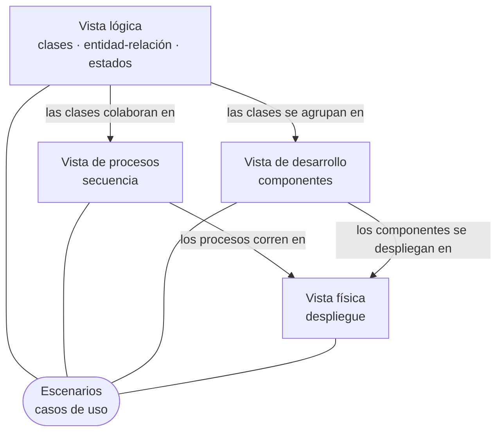

# Diagramas de TB_web: las vistas 4+1

La arquitectura de DataBridge, descrita con el **modelo 4+1** de Kruchten: cuatro vistas, cada una responde una
pregunta distinta para un lector distinto, y un conjunto de escenarios que las recorre a todas y las amarra.

Cada tipo de diagrama está en su propio archivo:

| Vista | Qué responde | Para quién | Archivo |
| --- | --- | --- | --- |
| **Escenarios** (el +1) | Quién usa el sistema y para qué | Todos | [Casos de uso](casos-de-uso.md) |
| **Lógica** | Qué clases hay, qué sabe y qué hace cada una | Quien define el negocio y quien programa | [Clases](clases.md) |
| | Qué se guarda y cómo se relaciona | | [Entidad-relación](entidad-relacion.md) |
| | Por qué estados pasa cada cosa | | [Estados](estados.md) |
| **De procesos** | Qué pasa en el tiempo: quién le habla a quién, y qué corre solo | Quien opera y depura | [Secuencia](secuencia.md) |
| **De desarrollo** | Cómo está partido el software y organizado el código | Quien programa | [Componentes](componentes.md) |
| **Física** | Dónde corre cada pieza | Quien despliega | [Despliegue](despliegue.md) |

## Qué cubren

Todo TB_web: los cinco servicios (gateway, ms-auth, ms-debt, ms-payments y ms-ai), el portal, las tres bases de
datos y lo que los conecta.

| Archivo | Diagramas | Qué trae |
| --- | --- | --- |
| [casos-de-uso.md](casos-de-uso.md) | 6 | Los actores y lo que hace cada uno: el deudor, el usuario de una empresa, el admin de DataBridge, el sistema de una empresa, la operación y el reloj. Al final, los 84 endpoints con quién los usa |
| [clases.md](clases.md) | 17 | Los 288 tipos de Java, por servicio: el modelo, las capas de controlador a repositorio, el panel de administración, las pasarelas y lo que rodea a las reglas |
| [entidad-relacion.md](entidad-relacion.md) | 5 | Las 25 tablas de las tres bases, con todas sus columnas y llaves, las 3 vistas, las 67 reglas que exige la base y cómo se unen las bases entre sí |
| [estados.md](estados.md) | 8 | La deuda, la cuota, el pago, la campaña, el aviso por entregar, el código de acceso, la llave de renovación y la persona con cuenta |
| [secuencia.md](secuencia.md) | 16 | Entrar, renovar la sesión, entregar una cartera, repactar, pagar con cada pasarela, el aviso del pago, la campaña, el reclamo, el asistente, el panel, la UF y el alta de una empresa con su gente |
| [componentes.md](componentes.md) | 8 | Los componentes y lo que se dicen, las rutas del gateway, los paquetes de cada servicio, el portal por dentro y el repositorio |
| [despliegue.md](despliegue.md) | 3 | Los contenedores, sus puertos, el orden de arranque, lo que queda guardado, con qué se configura y cómo queda en Railway |

## Cómo seguir un escenario por las cuatro vistas

Los escenarios son el hilo. Por ejemplo, **pagar una deuda**:

1. En [casos de uso](casos-de-uso.md#el-deudor): el deudor paga la deuda o sus cuotas, y participa una pasarela.
2. En [clases](clases.md#ms-payments--los-cobros): `PaymentController` delega en `PaymentService`, que usa a
   `DebtClient` y al cliente de la pasarela, y guarda un `Payment` con su `PaymentEvent`.
3. En [entidad-relación](entidad-relacion.md#tb_payments--los-cobros): `payments`, `payment_events` y
   `debt_notifications`, y cómo `payments.debt_id` apunta a una deuda que vive en otra base.
4. En [estados](estados.md#un-pago): el pago va de `created` a `paid`, y la deuda, de `open` a `paid`.
5. En [secuencia](secuencia.md#6-pagar-con-khipu): el orden exacto de las llamadas, y después
   [el aviso del pago](secuencia.md#9-el-aviso-del-pago-de-ms-payments-a-quien-entregó-la-cartera) hasta el
   sistema de la empresa.
6. En [componentes](componentes.md#los-componentes-y-lo-que-se-dicen): el portal, el gateway, ms-payments,
   RabbitMQ y ms-debt, y por qué interfaz se habla cada par.
7. En [despliegue](despliegue.md#los-contenedores): en qué contenedor corre cada uno, y que ms-payments es el
   único que sale a internet a hablar con la pasarela.

Los cinco escenarios que recorren todas las vistas están al final de [casos de uso](casos-de-uso.md#los-escenarios-que-recorren-las-cuatro-vistas).

## De dónde salen, y cómo se mantienen

Los diagramas describen el proyecto **tal como está en el código**, no como se planeó:

| Diagrama | De dónde sale |
| --- | --- |
| Clases | De las clases de `src/main/java` de cada servicio: sus campos, sus métodos públicos, lo que reciben en el constructor y las anotaciones de JPA |
| Entidad-relación | Del esquema que dejan las migraciones de Flyway (`ms-*/src/main/resources/db/migration`) al aplicarse sobre MySQL |
| Casos de uso | De las pantallas del portal (`frontend/src/pages`) y de los endpoints de cada controlador |
| Estados | De cada lugar donde un servicio cambia un estado |
| Secuencia | De los métodos de los servicios y de las llamadas de sus `client` |
| Componentes | De `RutasConfig` del gateway, de los `import` entre paquetes y de los de `frontend/src` |
| Despliegue | De `docker-compose.yml` y de cada `Dockerfile` |

Están escritos en [Mermaid](https://mermaid.js.org), dentro de Markdown: GitHub los dibuja solos, y en VS Code
se ven con una extensión de vista previa de Mermaid. Como son texto, se revisan en un PR igual que el código.

**Un cambio que mueve la arquitectura cambia su diagrama en el mismo PR.** Una tabla nueva va a
[entidad-relación](entidad-relacion.md), un endpoint nuevo a [casos de uso](casos-de-uso.md), un servicio o una
cola a [componentes](componentes.md) y [despliegue](despliegue.md). Un diagrama que no calza con el código es
peor que no tenerlo.
