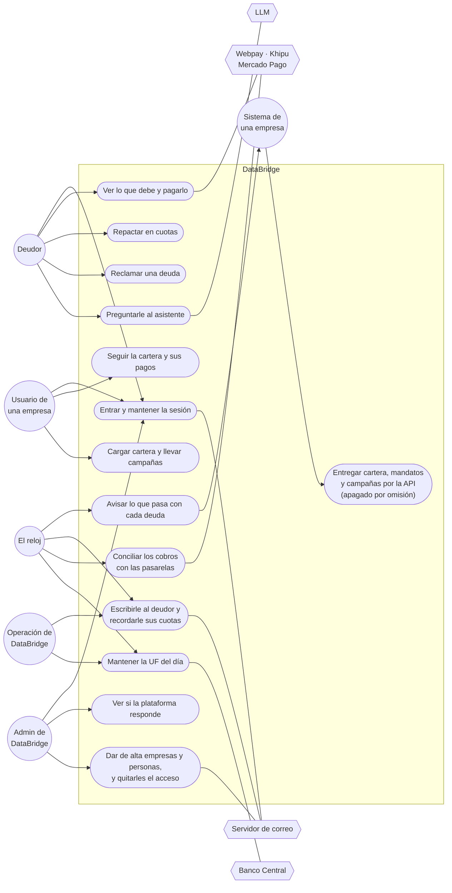
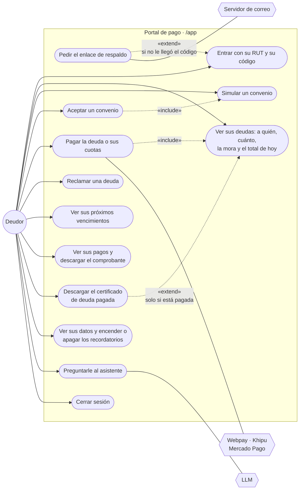
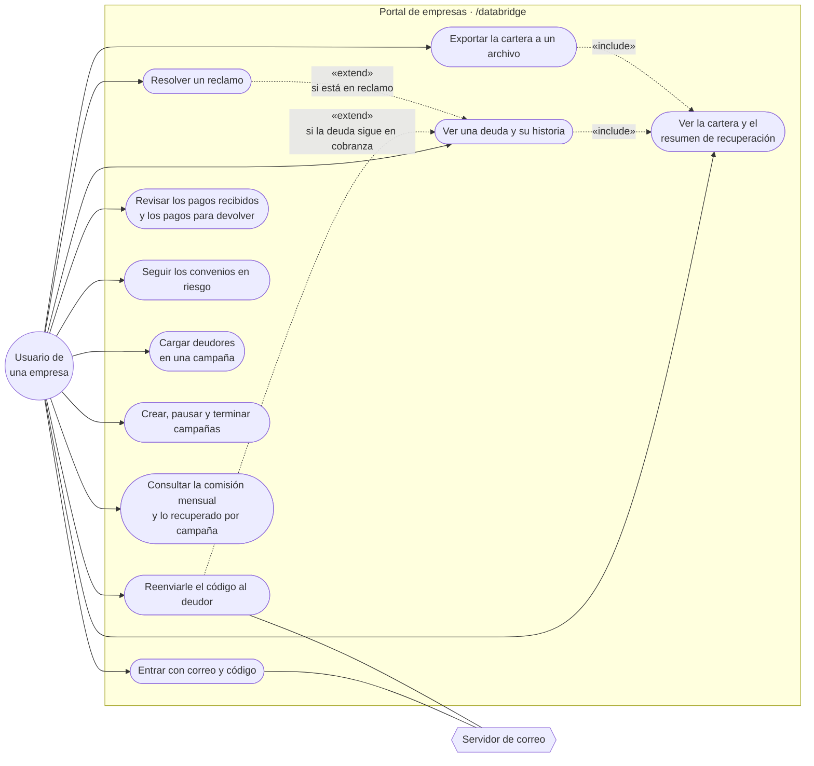
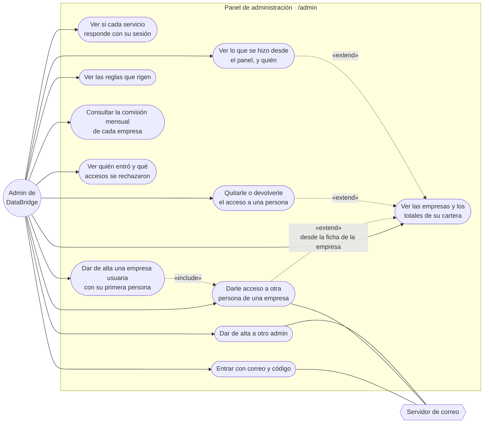
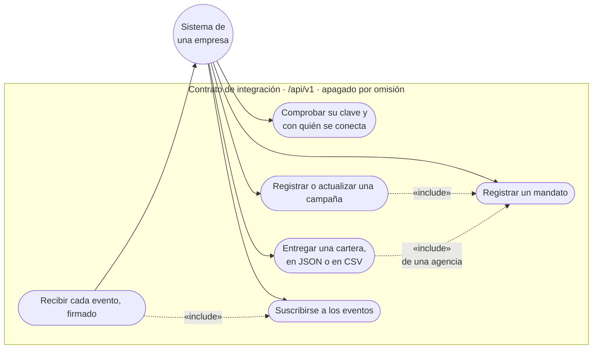
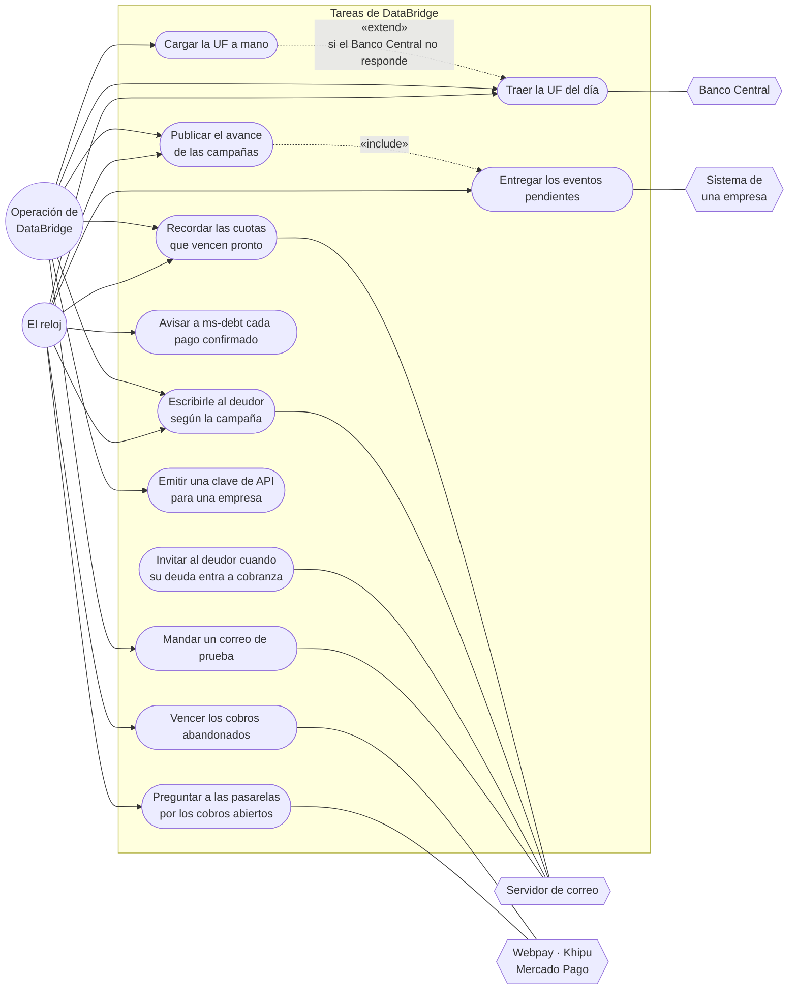

# Casos de uso

Los escenarios: el «+1» del [modelo 4+1](README.md). Dicen **quién usa DataBridge y para qué**, y son lo que
amarra a las otras cuatro vistas: cada caso de uso se puede seguir hasta sus clases, su secuencia, su
componente y el contenedor donde corre.

**Cómo leerlos.** El círculo es un actor: alguien o algo de afuera que usa el sistema. El recuadro es el
sistema, y cada óvalo adentro, un caso de uso: algo que el actor logra de principio a fin. El hexágono es otro
sistema que participa. Una flecha punteada con `«include»` es un caso que siempre pasa por otro, y con
`«extend»`, uno que lo amplía solo a veces.

Todo sale del proyecto: los casos, de las pantallas del portal (`frontend/src/pages`) y de los endpoints de cada
controlador; las reglas, de los servicios que los atienden.

## Los actores

| Actor | Quién es | Cómo se identifica | Por dónde entra |
| --- | --- | --- | --- |
| **Deudor** | El cliente de una empresa usuaria, con una deuda en cobranza. No tiene cuenta ni contraseña | Su RUT y un código de 6 caracteres, de un solo uso, que le llega por correo. De respaldo, un enlace a su correo registrado | El portal de pago, `/app` |
| **Usuario de una empresa** | Una persona de una empresa usuaria: una agencia de cobranza, o un acreedor que cobra directo | Correo y código. De respaldo, código y enlace juntos en un correo. Rol `usuario`; su sesión lleva `CREDITOR` y el RUT de su empresa | El portal de empresas, `/databridge` |
| **Admin de DataBridge** | El equipo de DataBridge. Ninguna otra empresa puede tener uno | Correo y código. De respaldo, código y enlace juntos en un correo. Rol `admin`; su sesión lleva `ADMIN` y ningún RUT | El panel de administración, `/admin` |
| **Sistema de una empresa** | El software de la agencia o del acreedor, que entrega la cartera y recibe los avisos. Solo con la entrega por API encendida: por omisión está apagada (`INTEGRACION_API`) | Una clave de API (`tbk_…`) | El contrato de integración, `/api/v1` |
| **Operación de DataBridge** | Quien opera la plataforma desde dentro de la red de los servicios | La clave interna (`X-Internal-Key`) | `/internal`, que el gateway no publica |
| **El reloj** | Las tareas programadas de ms-debt y ms-payments | — | Corren solas |

Y los sistemas de afuera con los que DataBridge habla: **Transbank (Webpay)**, **Khipu** y **Mercado Pago** para
cobrar, el **Banco Central** para la UF, un **servidor de correo** para escribirle a las personas y un **LLM**
para el asistente.

## El sistema completo

Los casos de uso agrupados, para ver quién hace qué. Cada grupo se abre en los diagramas que siguen.

---

## El deudor

Entra sin cuenta, ve todo lo que debe aunque sea a varias empresas, y decide: pagar, repactar o reclamar.

| Caso de uso | Pantalla | Endpoint | La regla que importa |
| --- | --- | --- | --- |
| Entrar con su RUT y su código | `Login` | `POST /api/auth/codigo`, `POST /api/auth/acceso` | Enviar código entrega solo el código, de un uso y 5 intentos. El solicitado dura 15 min; el de campaña, 24 h. Con 10 registros no concedidos desde un origen en 10 min, ese origen queda frenado |
| Pedir el enlace de respaldo | `Login`, `Magic` | `POST /api/auth/enlace`, `POST /api/auth/verify` | Un único correo con código nuevo y enlace, solo al correo que registró el acreedor. Comparten uso, 15 minutos y 5 intentos; usar cualquiera invalida ambos. La respuesta no revela si existe el RUT |
| Ver sus deudas | `Debts` | `GET /api/debts`, `GET /api/debts/{id}` | Solo las de su RUT. La mora se calcula al día con la tasa que pactó el acreedor |
| Simular un convenio | `Repact` | `GET /api/debts/{id}/simulate` | De 3 a 24 cuotas. Lo repactado es el capital más la mora de hoy |
| Aceptar un convenio | `Repact` | `POST /api/debts/{id}/repact` | Las cuotas pendientes se anulan y se emiten las del convenio. El anterior queda marcado como reemplazado |
| Pagar la deuda o sus cuotas | `Pay`, `Pasarela` | `POST /api/payments/checkout`, y `/api/payments/public/**` | El monto lo decide ms-debt, nunca el navegador. Las cuotas se pagan en orden, y hay un pago abierto a la vez por deuda |
| Reclamar una deuda | `Debts` | `POST /api/debts/{id}/disputa` | La deuda queda en revisión y se le deja de escribir. Lo que el deudor escribe no sale de DataBridge |
| Ver sus próximos vencimientos | `Vencimientos` | `GET /api/debts/vencimientos` | Las cuotas pendientes, por fecha |
| Ver sus pagos y el comprobante | `Historial` | `GET /api/debts/pagos`, `GET /api/debts/pagos/{id}/comprobante` | El comprobante es un PDF con el capital, el interés y el descuento |
| Descargar el certificado | `Debts` | `GET /api/debts/{id}/certificate` | Solo si la deuda está **pagada**. Una retirada también queda en cero, y certificarla sería decir algo falso |
| Ver sus datos y los recordatorios | `MisDatos` | `GET` y `PATCH /api/debts/mis-datos` | Lo único que el deudor decide es si quiere el recordatorio de sus cuotas |
| Preguntarle al asistente | `Chatbot` | `POST /api/ai/chat` | El asistente lee las deudas con la sesión del deudor: no ve nada que él no vea |
| Cerrar sesión | Todas | `POST /api/auth/logout` | Se revoca en el servidor, no solo en el navegador |

---

## El usuario de una empresa

Ve **solo la cartera de su empresa**: las deudas donde es la acreedora y las que ella misma entregó como
agencia.

| Caso de uso | Pantalla | Endpoint | La regla que importa |
| --- | --- | --- | --- |
| Entrar con correo y código | `Login`, `Magic` | `POST /api/auth/codigo`, `/api/auth/acceso`; respaldo: `/api/auth/enlace`, `/api/auth/verify` | Solo personal habilitado. El código solicitado dura 15 min. El respaldo manda código y enlace juntos, de un solo uso compartido. Al entrar se exige empresa activa; al renovar se vuelve a revisar la habilitación del personal |
| Ver la cartera y el resumen | `DataBridge` | `GET /api/debts`, `GET /api/analytics/summary` | Nunca «todas las deudas»: siempre las de la empresa de la sesión |
| Ver una deuda y su historia | `DataBridge` | `GET /api/debts/{id}` | Si la deuda no es de su cartera, no la ve |
| Reenviarle el código al deudor | `DataBridge` | `POST /api/debts/{id}/codigo` | Dentro de lo que deja la ley: 2 gestiones por semana y 2 días entre una y otra. Si no se puede, responde `409`. Queda como un contacto de la deuda (`contacts`) |
| Resolver un reclamo | `DataBridge` | `POST /api/debts/{id}/disputa/resolucion` | Se **reanuda** el cobro o se **retira** la deuda. Las dos salidas se avisan al sistema de la empresa |
| Revisar los pagos | `PagosRecibidos` | `GET /api/debts/pagos`, `GET /api/payments/para-devolver`, `GET /api/payments/devueltos` | Un pago duplicado no se abona: queda para devolver, con su referencia en la pasarela |
| Registrar que ya devolvió un pago duplicado | `PagosRecibidos` | `POST /api/payments/{id}/devolucion` | Con la referencia que dio la pasarela (obligatoria, hasta 100 caracteres). El pago queda `refunded` y su libro guarda quién lo registró. Solo los de su cartera (`403`); registrarlo de nuevo no cambia nada |
| Seguir los convenios en riesgo | `EnRiesgo` | `GET /api/debts/en-riesgo` | Los convenios con cuotas vencidas |
| Cargar deudores en una campaña | `Cargar`, `Campanas` | `GET /api/debts/cartera/opciones`, `GET /api/debts/cartera/plantilla`, `POST /api/debts/cartera/revision`, `POST /api/debts/cartera` | Siempre en una campaña, que se elige o se crea en el primer paso. Antes de confirmar, la revisión dice qué entraría, qué se rechazaría y por qué, sin guardar nada. Es la única entrada de deudores mientras la entrega por API esté apagada |
| Crear, pausar y terminar campañas | `Campanas` | `GET` y `POST /api/debts/campanas`, `POST /api/debts/campanas/{idExterno}/estado` | El descuento que ofrece no puede pasar del tope que el acreedor autorizó en el mandato |
| Exportar la cartera | `DataBridge` | — | Se arma en el navegador con lo que ya está en pantalla |
| Consultar su comisión mensual | `Campanas` | `GET /api/analytics/comision?mes=2026-10` | Solo la empresa de la sesión. El porcentaje sale del recuperado de todas sus campañas en el mes de Chile; la comisión se aplica sobre el total |

---

## El admin de DataBridge

El panel de administración es de DataBridge y de nadie más. Desde ahí se da de alta a las empresas que van a
usar DataBridge y a su gente. Lo que falta del panel está en
[#136](https://github.com/TechnicalBridge/TB_web/issues/136), y sus casos de uso se agregan aquí cuando lleguen.

| Caso de uso | Pantalla | Endpoint | La regla que importa |
| --- | --- | --- | --- |
| Entrar con correo y código | `Login` (`/admin/login`), `Magic` | `POST /api/auth/codigo`, `/api/auth/acceso`; respaldo: `/api/auth/enlace`, `/api/auth/verify` | Mismo flujo de código primero y respaldo combinado, con el rol que existe en la base. El primer admin nace de `ADMIN_CORREO` al arrancar |
| Ver si cada servicio responde | `AdminInicio` | `GET /api/admin/auth/estado`, `/api/admin/debt/estado`, `/api/admin/payments/estado` | Todo `/api/admin/**` exige una sesión `ADMIN`: a un usuario o a un deudor les responde `403`. Y al revés: el admin no entra a los otros portales |
| Ver las empresas y sus totales | `AdminEmpresas`, `AdminEmpresa` | `GET /api/admin/debt/empresas`, `GET /api/admin/debt/empresas/{rut}` | De cada empresa se ven totales: cuántas deudas y cuánto falta por cobrar. Nunca una deuda ni un deudor |
| Consultar las comisiones por empresa | `AdminEmpresas` | `GET /api/admin/debt/comisiones?mes=2026-10` | Solo el admin. Cada pago se atribuye a quien cargó la deuda, sin contar dos veces al acreedor y su agencia |
| Dar de alta una empresa usuaria | `AdminEmpresas` | `POST /api/admin/debt/empresas`, y después `POST /api/admin/auth/empresas/{rut}/personal` | Una agencia, o un acreedor que cobra directo. El RUT tiene que ser válido y no existir. Son dos pasos, uno en cada servicio: si el segundo falla, la empresa ya quedó y la persona se agrega desde su ficha |
| Darle acceso a una persona de una empresa | `AdminEmpresa` | `POST /api/admin/auth/empresas/{rut}/personal` | Queda como `usuario` de esa empresa: el rol lo decide la ruta, no un campo. Le llega una invitación con un enlace de un solo uso, que dura 24 horas |
| Quitarle o devolverle el acceso | `AdminEmpresa`, `AdminEquipo` | `POST /api/admin/auth/personal/{id}/deshabilitar` y `/habilitar` | Al quitarlo no le llegan más enlaces, los que tenía sin abrir dejan de servir y sus sesiones se cierran. Un admin no se lo puede quitar a sí mismo |
| Dar de alta a otro admin | `AdminEquipo` | `GET` y `POST /api/admin/auth/admins` | Un admin no tiene empresa, y un correo que ya es de una empresa no puede pasar a ser admin |
| Ver lo que se hizo desde el panel | `AdminEmpresa`, `AdminEquipo` | `GET /api/admin/debt/empresas/{rut}/historial`, `GET /api/admin/auth/empresas/{rut}/historial`, `GET /api/admin/auth/admins/historial` | Cada alta y cada cambio quedan anotados con el admin que los hizo y cuándo. Quién lo hizo sale de su sesión, no de lo que mande |
| Ver quién entró y qué accesos se rechazaron | `AdminAccesos` | `GET /api/admin/auth/accesos`, `GET /api/admin/auth/accesos/hoy` | La bitácora de acceso por páginas, lo más reciente primero, con filtros por fecha, por código o enlace y por resultado ([#141](https://github.com/TechnicalBridge/DataBridge/issues/141)). El RUT va a medias y no salen correos ni IP |
| Ver las reglas que rigen | `AdminReglas` | `GET /api/admin/auth/reglas`, `/api/admin/debt/reglas`, `/api/admin/payments/reglas` | De solo lectura. Cada servicio arma las suyas con su configuración, y cada una dice de qué variable sale. Ninguna clave: de las pasarelas y del correo dice solo si están. Los feriados son los mismos que usan las campañas |

---

## El sistema de una empresa

De sistema a sistema, con una clave de API. Es el contrato de integración, publicado en
[`docs/integracion`](../integracion/README.md).

**Apagado por omisión.** Los deudores entran por campaña, desde el portal. Mientras `INTEGRACION_API` no sea
`true`, todo `/api/v1` y `/api/claves` responde `404`. Encendido funciona como se describe aquí; la clave se
emite con `POST /api/claves`, con la sesión de la empresa, o por dentro con `POST /internal/claves`, porque el
portal ya no tiene la pantalla.

| Caso de uso | Endpoint | La regla que importa |
| --- | --- | --- |
| Comprobar su clave | `GET /api/v1/cuenta` | Quién es el dueño de la clave sale de la clave, nunca del cuerpo |
| Registrar un mandato | `POST /api/v1/mandatos` | Si DataBridge no conoce al acreedor, el mandato lo registra, con su RUT y su razón social |
| Registrar o actualizar una campaña | `POST /api/v1/campanas` | Trae la cadencia, los intentos, el estado y el descuento por tramo de mora |
| Entregar una cartera | `POST /api/v1/carteras` | Una cartera repetida recibe la misma respuesta; el mismo id con otro contenido se rechaza. Cada deuda se acepta o se rechaza con su motivo: sin mandato vigente, con menos de 30 días de mora o con una tasa sobre el tope, no entra |
| Suscribirse a los eventos | `POST /api/v1/suscripciones` | Recibe un secreto, una sola vez. En la base queda cifrado |
| Recibir cada evento | DataBridge llama a la dirección suscrita | `lote.procesado`, `repactacion.aceptada`, `pago.confirmado`, `deuda.saldada`, `deuda.disputada`, `deuda.reanudada`, `deuda.retirada` y `campana.avance`. Cada uno va firmado con HMAC-SHA256, y si la entrega falla se reintenta, cada vez más espaciado |

---

## Lo que corre solo, y la operación

Nadie lo pide desde una pantalla: lo dispara el reloj, o un hecho (una deuda que entra, un pago que se
confirma). La operación de DataBridge puede forzar algunas de estas tareas con la clave interna.

| Caso de uso | Cuándo | Quién lo hace | La regla que importa |
| --- | --- | --- | --- |
| Invitar al deudor | Cuando una deuda entra, o vuelve, a cobranza | `InvitacionService`, ms-debt | Un correo con su código, sin monto ni enlace. Sale después de guardar la cartera, solo dentro del horario de la ley y si la ley lo deja esa semana; si no, la manda la primera pasada de contacto que pueda. Con un servidor de correo real, el modo de prueba decide si le llega a él o al buzón del equipo |
| Escribirle según la campaña | Cada 15 minutos | `ContactoService`, ms-debt | De lunes a sábado, de 8:00 a 20:00, sin feriados. Según la cadencia de la campaña (por omisión, los días 1, 4, 11, 25 y 45) y hasta sus intentos |
| Recordar las cuotas | Todos los días, 9:00 | `RecordatorioService`, ms-debt | Las que vencen en los próximos 3 días, si el deudor no apagó el recordatorio. Una cuota se recuerda una sola vez: la base no deja que tenga dos contactos |
| Publicar el avance de las campañas | Todos los días, 8:00 | `CampanaAvanceService`, ms-debt | Deja el evento `campana.avance` en la bandeja de salida |
| Entregar los eventos pendientes | Cada 15 segundos | `EventDispatcher`, ms-debt | Firmados, hasta 100 por pasada. Lo que falla se reintenta: al minuto, a los 5 y a los 30 minutos, a las 2 y a las 6 horas. Después queda para reenviarlo a mano |
| Preguntar por los cobros abiertos | Cada 10 segundos | `ConciliacionPasarelas`, ms-payments | Así un pago se registra aunque el deudor cierre la ventana antes de volver |
| Vencer los cobros abandonados | Cada 5 minutos | `ConciliacionPasarelas`, ms-payments | No se vence lo que la pasarela está verificando. Lo vencido se revisa un día más |
| Avisar cada pago confirmado | Cada 15 segundos | `NotificationDispatcher`, ms-payments | Por RabbitMQ, o por HTTP si no está. El aviso se guardó junto con el pago, así que no se pierde |
| Traer la UF del día | Al arrancar y todos los días, 9:30 | `UfLoader`, ms-payments | Desde el Banco Central. Se guarda, para que un pago se pueda reconstruir después |
| Cargar la UF a mano | Cuando haga falta | `POST /internal/uf` | Para que el cobro en UF no se detenga si la fuente está caída |
| Emitir una clave de API | Cuando haga falta | `POST /internal/claves` | Solo sirve con la entrega por API encendida. El portal ya no tiene *Claves de API* |
| Mandar un correo de prueba | Al cambiar el servidor de correo | `POST /internal/correo/prueba` | Dice si salió, adónde llegó de verdad y con qué remitente, o lo que respondió el servidor. Nunca muestra la clave |

---

## Los escenarios que recorren las cuatro vistas

Cinco recorridos de punta a punta. Cada uno toca las cuatro vistas, y por eso sirven para comprobar que la
arquitectura calza:

| Escenario | Lo dispara | [Clases](clases.md) | [Secuencia](secuencia.md) | [Componentes](componentes.md) y [despliegue](despliegue.md) |
| --- | --- | --- | --- | --- |
| **E1. Entregar la cartera** | El sistema de una empresa | `Batch`, `Debt`, `DebtCharge`, `Mandate`, `Campaign`, `Contact` | [Entregar una cartera](secuencia.md#4-entregar-una-cartera-por-la-api) | portal → gateway → ms-debt → ms-auth → correo |
| **E2. Entrar al portal** | El deudor | `AccessCode`, `Session`, `AccessLog` | [Entrar con RUT y código](secuencia.md#1-el-deudor-entra-con-su-rut-y-su-código) | portal → gateway → ms-auth |
| **E3. Pagar** | El deudor | `Payment`, `PaymentEvent`, `Installment`, `DebtEvent` | [Pagar con Khipu](secuencia.md#6-pagar-con-khipu) y [el aviso del pago](secuencia.md#9-el-aviso-del-pago-de-ms-payments-a-quien-entregó-la-cartera) | portal → gateway → ms-payments ↔ pasarela; RabbitMQ → ms-debt → sistema de la empresa |
| **E4. Repactar** | El deudor | `Repactation`, `Installment` | [Simular y aceptar un convenio](secuencia.md#5-simular-y-aceptar-un-convenio) | portal → gateway → ms-debt |
| **E5. Reclamar** | El deudor; lo resuelve la empresa | `Debt` en `disputed`, `DebtEvent` | [Reclamar y resolver](secuencia.md#11-reclamar-una-deuda-y-resolver-el-reclamo) | portal → gateway → ms-debt → sistema de la empresa |

---

## Todos los endpoints, y quién los usa

Cada caso de uso de arriba termina en uno o más de estos **85 endpoints**. La lista sale del código: de las anotaciones `@GetMapping`, `@PostMapping` y las demás de cada controlador. Los que el gateway no publica solo se alcanzan desde dentro de la red de los servicios. La entrega por API (`/api/v1`) y las claves (`/api/claves`) están apagadas por omisión y responden `404`.

### ms-auth

| Endpoint | Qué hace | Quién | Con qué entra | Por el gateway | Clase |
| --- | --- | --- | --- | --- | --- |
| `GET /api/admin/auth/estado` | Si ms-auth responde | Admin de DataBridge | JWT | Sí | `AdminController.estado` |
| `GET /api/admin/auth/reglas` | Las reglas de acceso y de correo que rigen | Admin de DataBridge | JWT | Sí | `AdminController.reglas` |
| `GET /api/admin/auth/empresas/{rut}/personal` | Las personas de una empresa | Admin de DataBridge | JWT | Sí | `AdminController.personalDeEmpresa` |
| `POST /api/admin/auth/empresas/{rut}/personal` | Dar de alta a una persona de una empresa | Admin de DataBridge | JWT | Sí | `AdminController.crearUsuario` |
| `GET /api/admin/auth/empresas/{rut}/historial` | Lo que se hizo con las personas de una empresa | Admin de DataBridge | JWT | Sí | `AdminController.historialDeEmpresa` |
| `GET /api/admin/auth/admins` | Los admin de DataBridge | Admin de DataBridge | JWT | Sí | `AdminController.admins` |
| `POST /api/admin/auth/admins` | Dar de alta a otro admin de DataBridge | Admin de DataBridge | JWT | Sí | `AdminController.crearAdmin` |
| `GET /api/admin/auth/admins/historial` | Lo que se hizo con los admin de DataBridge | Admin de DataBridge | JWT | Sí | `AdminController.historialDeAdmins` |
| `POST /api/admin/auth/personal/{id}/deshabilitar` | Quitarle el acceso a una persona | Admin de DataBridge | JWT | Sí | `AdminController.deshabilitar` |
| `POST /api/admin/auth/personal/{id}/habilitar` | Devolverle el acceso a una persona | Admin de DataBridge | JWT | Sí | `AdminController.habilitar` |
| `POST /api/auth/codigo` | Pedir solo código al correo registrado | Deudor, usuario o admin | Ninguna | Sí | `AuthController.codigo` |
| `POST /api/auth/acceso` | Entrar con código y RUT o correo | Deudor, usuario o admin | Ninguna | Sí | `AuthController.acceso` |
| `POST /api/auth/enlace` | Pedir código y enlace en un único correo | Deudor, usuario o admin | Ninguna | Sí | `AuthController.enlace` |
| `POST /api/auth/verify` | Canjear el enlace del correo por una sesión | Deudor, usuario o admin | Ninguna | Sí | `AuthController.verify` |
| `POST /api/auth/refresh` | Renovar la sesión | Quien tenga sesión | La cookie de renovación | Sí | `AuthController.refresh` |
| `POST /api/auth/logout` | Cerrar sesión | Quien tenga sesión | La cookie de renovación | Sí | `AuthController.logout` |
| `GET /api/me` | Quién soy | Quien tenga sesión | JWT | Sí | `AuthController.me` |
| `POST /internal/codigos` | Emitir un código de acceso | ms-debt | Clave interna | No | `InternalController.emitir` |
| `POST /internal/correo/prueba` | Mandar un correo de prueba | Operación de DataBridge | Clave interna | No | `InternalController.probarCorreo` |

### ms-debt

| Endpoint | Qué hace | Quién | Con qué entra | Por el gateway | Clase |
| --- | --- | --- | --- | --- | --- |
| `GET /api/admin/debt/estado` | Si ms-debt responde | Admin de DataBridge | JWT | Sí | `AdminController.estado` |
| `GET /api/admin/debt/reglas` | Las reglas de cobranza y de contacto que rigen | Admin de DataBridge | JWT | Sí | `AdminController.reglas` |
| `GET /api/admin/debt/empresas` | Las empresas registradas | Admin de DataBridge | JWT | Sí | `AdminController.empresas` |
| `GET /api/admin/debt/empresas/{rut}` | Una empresa | Admin de DataBridge | JWT | Sí | `AdminController.empresa` |
| `POST /api/admin/debt/empresas` | Dar de alta una empresa usuaria | Admin de DataBridge | JWT | Sí | `AdminController.crear` |
| `GET /api/admin/debt/empresas/{rut}/historial` | Lo que se hizo sobre una empresa desde el panel | Admin de DataBridge | JWT | Sí | `AdminController.historial` |
| `GET /api/analytics/summary` | El resumen de mi cartera | Usuario de una empresa | JWT | Sí | `AnalyticsController.summary` |
| `GET /api/analytics/comision` | Lo recuperado y la comisión de mi empresa en un mes | Usuario de una empresa | JWT | Sí | `AnalyticsController.comision` |
| `GET /api/admin/debt/comisiones` | La comisión mensual por empresa y el total | Admin de DataBridge | JWT | Sí | `AdminController.comisiones` |
| `GET /api/debts/campanas` | Las campañas de la empresa | Usuario de una empresa | JWT | Sí | `CampanaController.listar` |
| `POST /api/debts/campanas` | Crear o cambiar una campaña | Usuario de una empresa | JWT | Sí | `CampanaController.guardar` |
| `POST /api/debts/campanas/{idExterno}/estado` | Pausar, reanudar o terminar una campaña | Usuario de una empresa | JWT | Sí | `CampanaController.estado` |
| `GET /api/debts/cartera/opciones` | Por cuenta de quién puedo cargar | Usuario de una empresa | JWT | Sí | `CargaController.opciones` |
| `GET /api/debts/cartera/plantilla` | Descargar la plantilla de la cartera en Excel | Usuario de una empresa | JWT | Sí | `CargaController.plantilla` |
| `POST /api/debts/cartera` | Cargar una cartera, en Excel o en CSV, en una campaña | Usuario de una empresa | JWT | Sí | `CargaController.subir` |
| `POST /api/debts/cartera/revision` | Revisar una planilla antes de cargarla | Usuario de una empresa | JWT | Sí | `CargaController.revisar` |
| `GET /api/claves` | Las claves de la empresa | Usuario de una empresa | JWT | Solo con `INTEGRACION_API=true` | `ClaveController.listar` |
| `POST /api/claves` | Emitir una clave | Usuario de una empresa | JWT | Solo con `INTEGRACION_API=true` | `ClaveController.emitir` |
| `DELETE /api/claves/{id}` | Revocar una clave | Usuario de una empresa | JWT | Solo con `INTEGRACION_API=true` | `ClaveController.revocar` |
| `GET /api/debts/vencimientos` | Las cuotas por pagar del deudor, por fecha | Deudor | JWT | Sí | `CuotaController.vencimientos` |
| `GET /api/debts/en-riesgo` | Los convenios con cuotas vencidas | Usuario de una empresa | JWT | Sí | `CuotaController.enRiesgo` |
| `GET /api/debts` | Las deudas de quién pregunta | Deudor y usuario de una empresa | JWT | Sí | `DebtController.list` |
| `GET /api/debts/{id}` | Una deuda completa | Deudor y usuario de una empresa | JWT | Sí | `DebtController.one` |
| `GET /api/debts/{id}/simulate` | Simular un plan de cuotas | Deudor | JWT | Sí | `DebtController.simulate` |
| `POST /api/debts/{id}/repact` | Aceptar un plan de cuotas | Deudor | JWT | Sí | `DebtController.repact` |
| `POST /api/debts/{id}/disputa` | No reconozco esta deuda | Deudor | JWT | Sí | `DebtController.disputar` |
| `POST /api/debts/{id}/disputa/resolucion` | Resolver una disputa | Usuario de una empresa | JWT | Sí | `DebtController.resolverDisputa` |
| `POST /api/debts/{id}/codigo` | Hacerle llegar al deudor su código de acceso | Usuario de una empresa | JWT | Sí | `DebtController.codigo` |
| `GET /api/debts/{id}/certificate` | Certificado de deuda pagada (PDF) | Deudor y usuario de una empresa | JWT | Sí | `DebtController.certificate` |
| `GET /api/debts/pagos` | Los pagos de quién pregunta | Deudor y usuario de una empresa | JWT | Sí | `HistorialController.pagos` |
| `GET /api/debts/pagos/{id}/comprobante` | El comprobante de un pago (PDF) | Deudor y usuario de una empresa | JWT | Sí | `HistorialController.comprobante` |
| `POST /api/v1/carteras` | Entregar una cartera, en JSON | Sistema de una empresa | Clave de API | Solo con `INTEGRACION_API=true` | `IntegracionController.carteras` |
| `POST /api/v1/carteras` | Entregar una cartera, en CSV | Sistema de una empresa | Clave de API | Solo con `INTEGRACION_API=true` | `IntegracionController.carterasCsv` |
| `GET /api/v1/cuenta` | Quién es el dueño de la clave | Sistema de una empresa | Clave de API | Solo con `INTEGRACION_API=true` | `IntegracionController.cuenta` |
| `POST /api/v1/mandatos` | Registrar un mandato | Sistema de una empresa | Clave de API | Solo con `INTEGRACION_API=true` | `IntegracionController.mandatos` |
| `POST /api/v1/campanas` | Registrar o actualizar una campaña | Sistema de una empresa | Clave de API | Solo con `INTEGRACION_API=true` | `IntegracionController.campanas` |
| `POST /api/v1/suscripciones` | Suscribirse a los eventos (contrato 3) | Sistema de una empresa | Clave de API | Solo con `INTEGRACION_API=true` | `IntegracionController.suscripciones` |
| `GET /internal/debts/{id}` | Cuánto se debe y a quién (para ms-payments) | ms-payments | Clave interna | No | `InternalController.deuda` |
| `GET /internal/deudores/{rut}/correo` | El correo registrado de un deudor (para ms-auth) | ms-auth | Clave interna | No | `InternalController.correoDelDeudor` |
| `GET /internal/cartera/{rut}` | Las deudas de la cartera de una empresa (para ms-payments) | ms-payments | Clave interna | No | `InternalController.cartera` |
| `POST /internal/claves` | Emitir una clave de API | Operación de DataBridge | Clave interna | No | `InternalController.clave` |
| `POST /internal/campanas/avance` | Publicar ahora el avance de las campañas | Operación de DataBridge | Clave interna | No | `InternalController.avance` |
| `POST /internal/campanas/contactos` | Mandar ahora los toques de las campañas | Operación de DataBridge | Clave interna | No | `InternalController.contactar` |
| `POST /internal/recordatorios` | Mandar ahora los recordatorios de cuota | Operación de DataBridge | Clave interna | No | `InternalController.recordar` |
| `POST /internal/events/pago-confirmado` | El aviso de un pago concretado (desde ms-payments) | ms-payments | Clave interna | No | `InternalController.pagoConfirmado` |
| `GET /internal/organizaciones/{rut}` | Si hay una empresa con ese RUT (para ms-auth) | ms-auth | Clave interna | No | `InternalController.organizacion` |
| `GET /api/debts/mis-datos` | Los datos del deudor | Deudor | JWT | Sí | `MisDatosController.ver` |
| `PATCH /api/debts/mis-datos` | Encender o apagar los recordatorios | Deudor | JWT | Sí | `MisDatosController.cambiar` |

### ms-payments

| Endpoint | Qué hace | Quién | Con qué entra | Por el gateway | Clase |
| --- | --- | --- | --- | --- | --- |
| `GET /api/admin/payments/reglas` | Las reglas de pago que rigen | Admin de DataBridge | JWT | Sí | `AdminController.reglas` |
| `GET /api/admin/payments/estado` | Si ms-payments responde | Admin de DataBridge | JWT | Sí | `AdminController.estado` |
| `POST /internal/uf` | Cargar a mano la UF de un día | Operación de DataBridge | Clave interna | No | `InternalController.cargarAMano` |
| `POST /internal/uf/cargar` | Cargar ahora la UF desde el Banco Central | Operación de DataBridge | Clave interna | No | `InternalController.cargarAhora` |
| `POST /api/payments/checkout` | Abrir el cobro de una deuda o de una cuota | Deudor | JWT | Sí | `PaymentController.checkout` |
| `GET /api/payments` | Mis pagos | Deudor y usuario de una empresa | JWT | Sí | `PaymentController.list` |
| `GET /api/payments/para-devolver` | Los pagos para devolver | Usuario de una empresa | JWT | Sí | `PaymentController.paraDevolver` |
| `POST /api/payments/{id}/devolucion` | Registrar la devolución de un pago duplicado | Usuario de una empresa | JWT | Sí | `PaymentController.registrarDevolucion` |
| `GET /api/payments/devueltos` | Los pagos devueltos | Usuario de una empresa, o el deudor (los suyos) | JWT | Sí | `PaymentController.devueltos` |
| `GET /api/payments/{id}` | Un pago | Deudor y usuario de una empresa | JWT | Sí | `PaymentController.one` |
| `GET /api/payments/{id}/historia` | El libro de un pago | Deudor y usuario de una empresa | JWT | Sí | `PaymentController.historia` |
| `GET /api/payments/public/{id}` | El pago visto desde la pasarela | La página de pago | La firma del enlace de pago | Sí | `PaymentController.pub` |
| `POST /api/payments/public/{id}/confirm` | Confirmar el pago desde la pasarela simulada | La página de pago | La firma del enlace de pago | Sí | `PaymentController.confirm` |
| `GET /api/payments/public/{id}/webpay` | Ir a pagar a Webpay | La página de pago | La firma del enlace de pago | Sí | `PaymentController.webpay` |
| `GET/POST /api/payments/public/webpay/retorno` | La vuelta desde Webpay | El navegador, al volver de Webpay | El token de la pasarela | Sí | `PaymentController.retornoWebpay` |
| `GET/POST /api/payments/public/mercadopago/retorno` | La vuelta desde Mercado Pago | El navegador, al volver de Mercado Pago | `pago` y `sig`; se consulta la preferencia guardada. Sin firma vuelve al portal | Sí | `PaymentController.retornoMercadoPago` |
| `GET/POST /api/payments/public/mercadopago/aviso` | El aviso de Mercado Pago (Webhook) | Mercado Pago | Se consulta el pago a la pasarela y se concilia la preferencia guardada; el cuerpo no autoriza abonos | Sí | `PaymentController.avisoDeMercadoPago` |
| `POST /api/payments/public/{id}/verificar` | Preguntarle a Khipu en qué va el pago | La página de pago | La firma del enlace de pago | Sí | `PaymentController.verificar` |
| `POST /api/payments/public/{id}/cancelar` | El deudor se arrepintió en Khipu | La página de pago | La firma del enlace de pago | Sí | `PaymentController.cancelar` |
| `POST /api/payments/public/khipu/aviso` | El aviso de Khipu | Khipu | La firma de la pasarela, y se le vuelve a preguntar | Sí | `PaymentController.avisoDeKhipu` |
| `POST /api/payments/webhooks/{gateway}` | Aviso de pago de una pasarela | La pasarela simulada | Firma HMAC | Sí | `WebhookController.webhook` |

### ms-ai

| Endpoint | Qué hace | Quién | Con qué entra | Por el gateway | Clase |
| --- | --- | --- | --- | --- | --- |
| `POST /api/ai/chat` | Preguntarle al asistente | Deudor | JWT | Sí | `ChatController.chat` |
| `GET /api/ai/salud` | Estado del asistente | Monitoreo | Ninguna | Sí | `SaludController.salud` |

