# Diagramas de clases

Vista lógica del [modelo 4+1](README.md): qué clases hay en cada servicio, qué sabe y qué hace cada una, y de quién depende.

TB_web tiene **279 tipos de Java** repartidos en cinco servicios que no comparten código: cada uno tiene su propio `pom.xml` y sus propias clases, y se hablan por HTTP o por la cola. Por eso hay un grupo de diagramas por servicio.

| Servicio | Tipos | Qué hace | Diagramas |
| --- | --- | --- | --- |
| [ms-auth](#ms-auth--el-acceso) | 55 | El acceso: códigos, enlaces, sesiones y las personas con cuenta | 3 |
| [ms-debt](#ms-debt--la-cartera) | 152 | La cartera: empresas, deudas, convenios, campañas y eventos | 7 |
| [ms-payments](#ms-payments--los-cobros) | 51 | Los cobros: pasarelas, conciliación, UF y el aviso de pago | 4 |
| [ms-ai](#ms-ai--el-asistente) | 15 | El asistente del deudor, de solo lectura | 1 |
| [gateway](#gateway--la-puerta) | 6 | La única puerta: rutas, límite de peticiones y CORS | 1 |

**Cómo leerlos.** Cada caja es una clase y el texto entre `«»` dice qué papel cumple: `entity` (una tabla), `controller` (los endpoints), `service` (las reglas), `repository` (el acceso a la base), `client` (la llamada a otro sistema), `record` (un dato sin comportamiento) o `enumeration` (los valores posibles). `-` es un atributo privado y `+` un método público; los `get` y `set` de las entidades no se dibujan. Una flecha continua `A --> B` es *A tiene a B*: lo recibe en su constructor, o es una relación entre entidades, con su cardinalidad. Una punteada `A ..> B` es *A usa a B*. Los recuadros grandes son los paquetes. Una clase que aparece solo con su nombre está detallada en otro diagrama del mismo servicio.

Los diagramas salen del código: de las clases de `src/main/java` de cada servicio. Los objetos que entran y salen por la API (los `dto`) no se dibujan, porque son datos sin comportamiento y los documenta Swagger; van en una tabla al final de cada servicio.

---

## El dominio, de un vistazo

Las entidades de los tres servicios con base de datos, sin atributos. Dentro de un servicio se relacionan con llaves; entre servicios, solo por el RUT o por el id (las flechas punteadas), porque cada uno tiene su base.

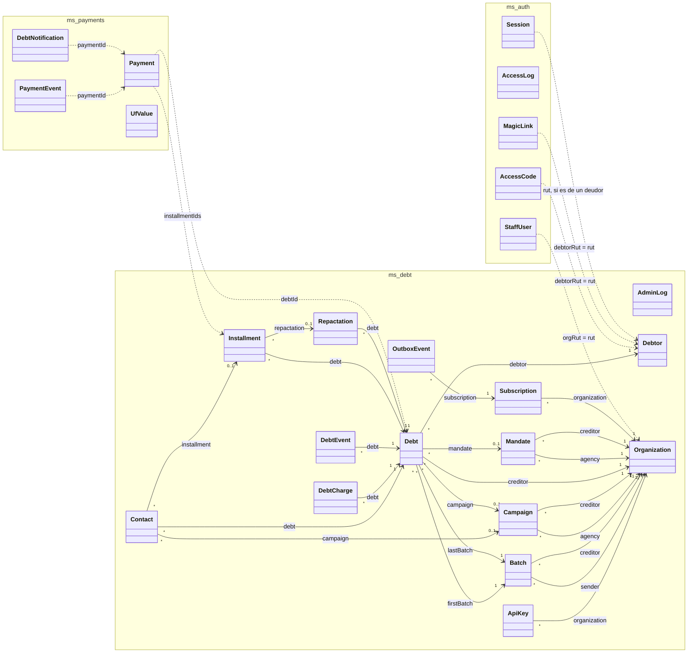

---

## ms-auth — el acceso

Quién entra y cómo. El deudor no tiene cuenta: entra con su RUT y un código. Las personas de las empresas y los admin de DataBridge sí la tienen, y entran con un enlace a su correo, sin contraseña.

### El modelo

Seis entidades que no se apuntan entre sí: cada una se busca por su huella, por un RUT o por un correo.

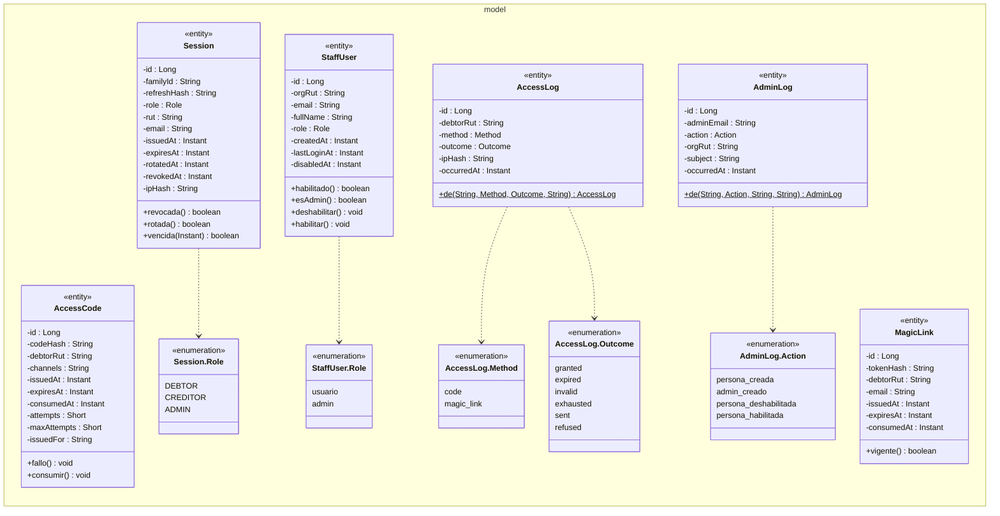

| Clase | Paquete | Qué es |
| --- | --- | --- |
| `AccessCode` | `model` | El código que abre el portal del deudor. Se guarda su huella, no el código. |
| `MagicLink` | `model` | El enlace de un solo uso al correo: para el personal y el admin, y de respaldo para el deudor. |
| `Session` | `model` | Una llave de renovación de la sesión. Cada uso la jubila y deja otra en la misma familia. |
| `StaffUser` | `model` | Una persona con cuenta: `usuario` de una empresa o `admin` de DataBridge. |
| `AccessLog` | `model` | Quién intentó entrar, cómo le fue y desde qué origen. |
| `AdminLog` | `model` | Lo que un admin hizo con una persona desde el panel: qué, a quién, quién y cuándo. |

### De la petición a la base

Los controladores traducen HTTP y delegan. Las reglas están en `AuthService` (códigos y enlaces), en `SessionService` (las llaves de renovación) y en `PersonalService` (las personas con cuenta, para el panel).

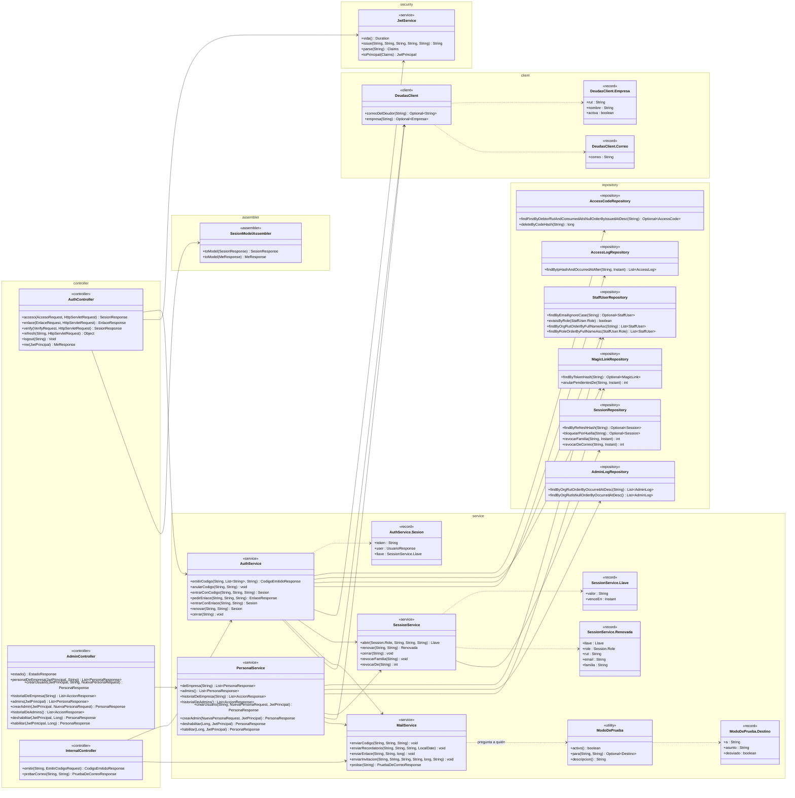

| Clase | Paquete | Qué es |
| --- | --- | --- |
| `AuthController` | `controller` | Las puertas del portal: entrar con código, pedir y canjear el enlace, renovar, cerrar y «quién soy». |
| `AdminController` | `controller` | Lo que el panel de administración le pide a ms-auth: las personas con cuenta. Solo para el admin. |
| `InternalController` | `controller` | Emitir un código de acceso, para ms-debt, y mandar un correo de prueba. Con la clave interna. |
| `SesionModelAssembler` | `assembler` | Los enlaces HATEOAS de la sesión. |
| `AuthService` | `service` | Cómo entra cada quien: emite y valida códigos y enlaces, y arma el JWT. |
| `PersonalService` | `service` | Las personas con cuenta: darlas de alta, y quitarles o devolverles el acceso. Anota cada cambio. |
| `SessionService` | `service` | Las llaves de renovación: abrir, renovar, cerrar y revocar la familia entera. |
| `MailService` | `service` | Los correos: el código, el recordatorio de cuota, el enlace y la invitación, por cualquier servidor SMTP. El del código y el del recordatorio dicen si no salieron. También manda el correo de prueba. |
| `ModoDePrueba` | `service` | A quién se le escribe de verdad con un servidor real: una lista de permitidos, y un buzón al que se desvía lo demás. |
| `DeudasClient` | `client` | Le pregunta a ms-debt el correo registrado de un deudor, y si una empresa existe. |
| `JwtService` | `security` | Firma y lee el JWT de la sesión. |
| `AccessCodeRepository` | `repository` | Los códigos. |
| `MagicLinkRepository` | `repository` | Los enlaces. |
| `StaffUserRepository` | `repository` | Las personas con cuenta. |
| `AccessLogRepository` | `repository` | La bitácora de acceso. |
| `SessionRepository` | `repository` | Las llaves de renovación, con bloqueo al renovar. |
| `AdminLogRepository` | `repository` | La bitácora del panel. |

### Seguridad, arranque y errores

Lo que rodea a las reglas: quién puede llamar a qué, cómo se valida el JWT en cada petición, cómo nace el primer admin y qué forma tienen los errores.

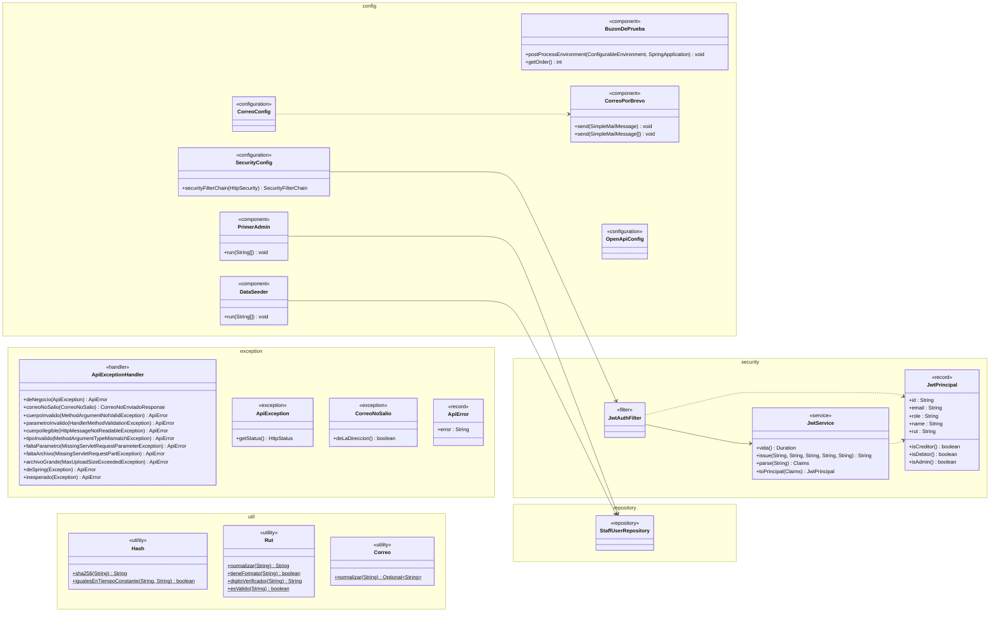

| Clase | Paquete | Qué es |
| --- | --- | --- |
| `SecurityConfig` | `config` | Quién puede llamar a qué: `/api/admin/**` solo el admin. |
| `JwtAuthFilter` | `security` | En cada petición, valida el JWT y deja a quien viene en el contexto de seguridad. |
| `JwtService` | `security` | Firma y lee el JWT de la sesión. |
| `JwtPrincipal` | `security` | Quién viene en el token: id, correo, rol, nombre y RUT. |
| `PrimerAdmin` | `config` | Al arrancar, crea el primer admin con `ADMIN_CORREO`, si todavía no hay ninguno. |
| `DataSeeder` | `config` | El personal de la demo. |
| `BuzonDePrueba` | `config` | Antes de arrancar: sin `SMTP_HOST`, deja configurado el buzón de prueba de Docker e ignora el resto de `SMTP_*`. |
| `CorreoConfig` | `config` | Por dónde salen los correos: con `BREVO_API_KEY`, por Brevo; sin ella, por SMTP o al buzón de prueba. |
| `CorreoPorBrevo` | `config` | Manda los correos por la API de Brevo (HTTPS), que es lo que funciona en Railway. Un destinatario rechazado es culpa de la dirección; lo demás, del servicio. |
| `OpenApiConfig` | `config` | La documentación de Swagger, en grupos: portal, panel e interno. |
| `ApiExceptionHandler` | `exception` | Todos los errores salen con la misma forma, `{"error": "..."}`, y su código. |
| `ApiException` | `exception` | Un error que se le puede explicar a quien llamó, con su código HTTP. |
| `CorreoNoSalio` | `exception` | El servidor de correo no aceptó el correo de un código: lo que dijo, y si la culpa es de la dirección o del servidor. |
| `ApiError` | `exception` | La forma de todo error. |
| `Hash` | `util` | SHA-256 y comparación en tiempo constante. |
| `Rut` | `util` | Normaliza el RUT y revisa su dígito verificador. |
| `Correo` | `util` | Normaliza un correo y descarta el que no puede recibir. |

| Paquete | Qué son | Clases |
| --- | --- | --- |
| `dto.request` | Lo que entra | `AccesoRequest`, `EmitirCodigoRequest`, `EnlaceRequest`, `NuevaPersonaRequest`, `VerifyRequest` |
| `dto.response` | Lo que sale | `AccionResponse`, `CodigoEmitidoResponse`, `CorreoNoEnviadoResponse`, `EnlaceResponse`, `EstadoResponse`, `MeResponse`, `PersonaResponse`, `PruebaDeCorreoResponse`, `SesionResponse`, `UsuarioResponse` |

---

## ms-debt — la cartera

El servicio más grande: las empresas, sus mandatos y campañas, las deudas con sus cargos, cuotas y convenios, y los eventos que vuelven a quien entregó la cartera.

### El modelo

Quince entidades. Todo cuelga de dos: `Organization` (de quién es) y `Debt` (qué se debe). El saldo y la mora no son atributos: se calculan con las cuotas y con la tasa. Lo que le pasa a una deuda queda en `DebtEvent`, y cada vez que se le escribe al deudor, en `Contact`. `AdminLog` va aparte: anota lo que se hace desde el panel de administración.

```mermaid
classDiagram
    direction TB
    namespace model {
        class Organization {
            <<entity>>
            -id : Long
            -rut : String
            -legalName : String
            -tradeName : String
            -kind : Kind
            -status : Status
            -createdAt : Instant
            -updatedAt : Instant
            +esAgencia() boolean
        }
        class Organization_Kind["Organization.Kind"] {
            <<enumeration>>
            creditor
            agency
            both
        }
        class Organization_Status["Organization.Status"] {
            <<enumeration>>
            active
            suspended
        }
        class ApiKey {
            <<entity>>
            -id : Long
            -organization : Organization
            -name : String
            -keyHash : String
            -prefix : String
            -createdAt : Instant
            -lastUsedAt : Instant
            -revokedAt : Instant
        }
        class Mandate {
            <<entity>>
            -id : Long
            -agency : Organization
            -creditor : Organization
            -validFrom : LocalDate
            -validTo : LocalDate
            -maxOverdueDays : Short
            -maxMoraDiscount : BigDecimal
            -status : Status
            -declaredBy : String
            -createdAt : Instant
            +vigenteAl(LocalDate) boolean
        }
        class Mandate_Status["Mandate.Status"] {
            <<enumeration>>
            active
            ended
        }
        class Campaign {
            <<entity>>
            -id : Long
            -agency : Organization
            -creditor : Organization
            -externalId : String
            -name : String
            -startsOn : LocalDate
            -endsOn : LocalDate
            -channels : String
            -attempts : Short
            -cadenceDays : String
            -moraDiscount : String
            -status : Status
            -createdAt : Instant
        }
        class Campaign_Status["Campaign.Status"] {
            <<enumeration>>
            running
            paused
            finished
        }
        class Batch {
            <<entity>>
            -id : Long
            -sender : Organization
            -creditor : Organization
            -externalId : String
            -cutOff : LocalDate
            -source : Source
            -status : Status
            -receivedCount : Integer
            -acceptedCount : Integer
            -rejectedCount : Integer
            -payloadHash : String
            -response : String
            -receivedAt : Instant
        }
        class Batch_Source["Batch.Source"] {
            <<enumeration>>
            api
            file
        }
        class Batch_Status["Batch.Status"] {
            <<enumeration>>
            processed
            rejected
        }
        class Debtor {
            <<entity>>
            -id : Long
            -rut : String
            -kind : Kind
            -fullName : String
            -email : String
            -emailFailedAt : Instant
            -emailFailure : String
            -emailRejections : short
            -phone : String
            -reminders : boolean
            -createdAt : Instant
            -updatedAt : Instant
            +correoNoSalio(String, boolean, Instant) void
            +correoSalio() void
            +correoConProblemas() boolean
        }
        class Debtor_Kind["Debtor.Kind"] {
            <<enumeration>>
            person
            company
        }
        class Debt {
            <<entity>>
            -id : Long
            -creditor : Organization
            -debtor : Debtor
            -externalId : String
            -currency : Currency
            -concept : String
            -refs : String
            -originalAmount : BigDecimal
            -interestRate : BigDecimal
            -status : Status
            -mandate : Mandate
            -campaign : Campaign
            -firstBatch : Batch
            -lastBatch : Batch
            -withdrawnReason : String
            -createdAt : Instant
            -updatedAt : Instant
        }
        class Debt_Currency["Debt.Currency"] {
            <<enumeration>>
            CLP
            UF
        }
        class Debt_Status["Debt.Status"] {
            <<enumeration>>
            open
            repacted
            paid
            withdrawn
            disputed
        }
        class DebtCharge {
            <<entity>>
            -id : Long
            -debt : Debt
            -concept : String
            -period : String
            -amount : BigDecimal
            -dueDate : LocalDate
        }
        class Repactation {
            <<entity>>
            -id : Long
            -debt : Debt
            -months : Short
            -monthlyAmount : BigDecimal
            -currency : Debt.Currency
            -interestRate : BigDecimal
            -principal : BigDecimal
            -acceptedAt : Instant
            -supersededAt : Instant
        }
        class Installment {
            <<entity>>
            -id : Long
            -debt : Debt
            -repactation : Repactation
            -number : Short
            -dueDate : LocalDate
            -amount : BigDecimal
            -interestAmount : BigDecimal
            -status : Status
            -paidAt : Instant
            +enConvenio() boolean
            +capital() BigDecimal
        }
        class Installment_Status["Installment.Status"] {
            <<enumeration>>
            pending
            paid
            void_
        }
        class DebtEvent {
            <<entity>>
            -id : Long
            -debt : Debt
            -type : Type
            -actor : Actor
            -amount : BigDecimal
            -currency : Debt.Currency
            -reference : String
            -detail : String
            -occurredAt : Instant
            +de(Debt, Type, Actor)$ DebtEvent
            +conMonto(BigDecimal, Debt.Currency) DebtEvent
            +conReferencia(String) DebtEvent
            +conDetalle(String) DebtEvent
        }
        class DebtEvent_Type["DebtEvent.Type"] {
            <<enumeration>>
            registered
            updated
            withdrawn
            portal_entered
            repacted
            payment_applied
            settled
            disputed
        }
        class DebtEvent_Actor["DebtEvent.Actor"] {
            <<enumeration>>
            debtor
            creditor
            agency
            system
        }
        class Contact {
            <<entity>>
            -id : Long
            -debt : Debt
            -kind : Kind
            -channel : Channel
            -destination : String
            -campaign : Campaign
            -touchNumber : Short
            -installment : Installment
            -occurredAt : Instant
            +invitacion(Debt, String)$ Contact
            +toque(Debt, Campaign, int, String)$ Contact
            +recordatorio(Installment, String)$ Contact
            +reenvio(Debt, String)$ Contact
            +el(Instant) Contact
            +deLaEmpresa() boolean
        }
        class Contact_Kind["Contact.Kind"] {
            <<enumeration>>
            invitation
            campaign
            reminder
            resend
        }
        class Contact_Channel["Contact.Channel"] {
            <<enumeration>>
            email
        }
        class DetallePago {
            <<record>>
            +pagoId : Long
            +montoClp : Long
            +valorUf : BigDecimal
            +pasarela : String
            +cuotas : List~Integer~
            +de : Integer
            +fuera : Integer
            +interes : BigDecimal
            +descuento : BigDecimal
        }
        class Subscription {
            <<entity>>
            -id : Long
            -organization : Organization
            -url : String
            -secret : String
            -events : String
            -active : Boolean
            -createdAt : Instant
        }
        class OutboxEvent {
            <<entity>>
            -id : Long
            -eventId : String
            -subscription : Subscription
            -type : String
            -payload : String
            -occurredAt : Instant
            -status : Status
            -attempts : Short
            -nextAttemptAt : Instant
            -deliveredAt : Instant
            -lastError : String
            +para(Subscription, String, String, String, Instant)$ OutboxEvent
            +entregado() void
            +fallo(String) void
        }
        class OutboxEvent_Status["OutboxEvent.Status"] {
            <<enumeration>>
            pending
            delivered
            failed
        }
        class AdminLog {
            <<entity>>
            -id : Long
            -adminEmail : String
            -action : Action
            -orgRut : String
            -subject : String
            -occurredAt : Instant
            +de(String, Action, String, String)$ AdminLog
        }
        class AdminLog_Action["AdminLog.Action"] {
            <<enumeration>>
            empresa_creada
        }
    }
    Organization ..> Organization_Kind
    Organization ..> Organization_Status
    Mandate ..> Mandate_Status
    Campaign ..> Campaign_Status
    Batch ..> Batch_Source
    Batch ..> Batch_Status
    Debtor ..> Debtor_Kind
    Debt ..> Debt_Currency
    Debt ..> Debt_Status
    Installment ..> Installment_Status
    DebtEvent ..> DebtEvent_Type
    DebtEvent ..> DebtEvent_Actor
    Contact ..> Contact_Kind
    Contact ..> Contact_Channel
    OutboxEvent ..> OutboxEvent_Status
    AdminLog ..> AdminLog_Action
    ApiKey "*" --> "1" Organization : organization
    Mandate "*" --> "1" Organization : agency
    Mandate "*" --> "1" Organization : creditor
    Campaign "*" --> "1" Organization : agency
    Campaign "*" --> "1" Organization : creditor
    Batch "*" --> "1" Organization : sender
    Batch "*" --> "1" Organization : creditor
    Debt "*" --> "1" Organization : creditor
    Debt "*" --> "1" Debtor : debtor
    Debt "*" --> "0..1" Mandate : mandate
    Debt "*" --> "0..1" Campaign : campaign
    Debt "*" --> "1" Batch : firstBatch
    Debt "*" --> "1" Batch : lastBatch
    DebtCharge "*" --> "1" Debt : debt
    Repactation "*" --> "1" Debt : debt
    Installment "*" --> "1" Debt : debt
    Installment "*" --> "0..1" Repactation : repactation
    DebtEvent "*" --> "1" Debt : debt
    Contact "*" --> "1" Debt : debt
    Contact "*" --> "0..1" Campaign : campaign
    Contact "*" --> "0..1" Installment : installment
    Subscription "*" --> "1" Organization : organization
    OutboxEvent "*" --> "1" Subscription : subscription
    DebtEvent ..> DetallePago : detail
    Repactation ..> Debt_Currency
    DebtEvent ..> Debt_Currency
```

| Clase | Paquete | Qué es |
| --- | --- | --- |
| `Organization` | `model` | Una empresa: acreedor, agencia o las dos cosas. |
| `ApiKey` | `model` | La clave de API con que una empresa entrega cartera. Se guarda su huella. |
| `Mandate` | `model` | Una agencia cobra por cuenta de un acreedor. |
| `Campaign` | `model` | La estrategia de contacto que define la agencia y ejecuta DataBridge. |
| `Batch` | `model` | Cada cartera recibida. |
| `Debtor` | `model` | Quien debe. Una fila por RUT. Si un correo a su dirección no sale, guarda por qué y cuántas veces seguidas la rechazaron. |
| `Debt` | `model` | Lo que un deudor le debe a un acreedor. |
| `DebtCharge` | `model` | El desglose con que llegó la deuda. |
| `Repactation` | `model` | Cada convenio que el deudor aceptó. |
| `Installment` | `model` | Las cuotas por pagar. |
| `DebtEvent` | `model` | La historia de la deuda, en columnas. |
| `Contact` | `model` | Una vez que DataBridge le escribió a un deudor: la invitación, un toque de campaña, un recordatorio o un reenvío. |
| `DetallePago` | `model` | Lo que un pago aplicado deja en `DebtEvent.detail`. |
| `Subscription` | `model` | A dónde se le avisan los eventos a una empresa. |
| `OutboxEvent` | `model` | Un evento por entregar a un suscriptor. |
| `AdminLog` | `model` | Lo que un admin hizo con una empresa desde el panel: qué, quién y cuándo. |

### Deudas, convenios, reclamos y pagos abonados

Lo que usan el portal del deudor y el de la empresa sobre una deuda que ya existe. `DebtService` es el centro: decide quién ve cada deuda y cuánto se debe hoy.

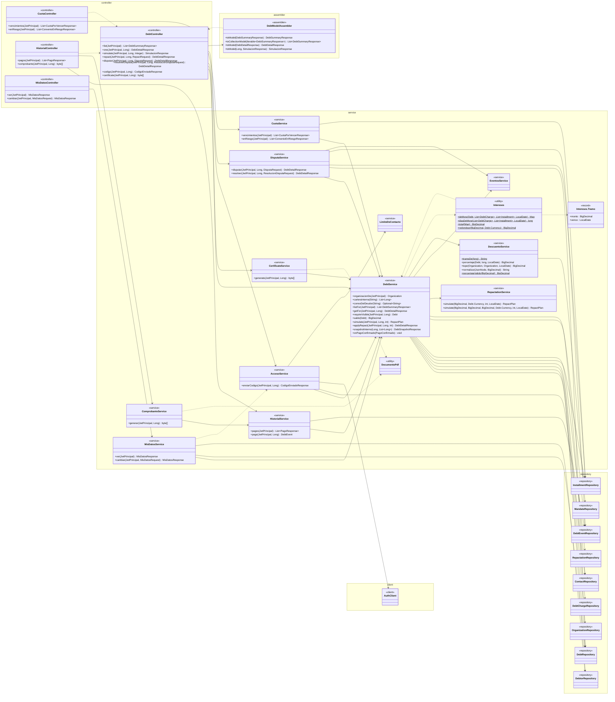

| Clase | Paquete | Qué es |
| --- | --- | --- |
| `DebtController` | `controller` | Las deudas del portal: ver, simular, repactar, reclamar, reenviar el código y el certificado. |
| `CuotaController` | `controller` | Las cuotas por fecha: los vencimientos del deudor y los convenios en riesgo de la empresa. |
| `HistorialController` | `controller` | Los pagos ya abonados y su comprobante en PDF. |
| `MisDatosController` | `controller` | Lo que DataBridge sabe del deudor, y sus recordatorios. |
| `DebtModelAssembler` | `assembler` | Los enlaces HATEOAS de una deuda, según su estado y quién mira. |
| `DebtService` | `service` | Las deudas: quién ve cuál, el saldo, el convenio, el monto a cobrar y el abono de un pago. |
| `RepactationService` | `service` | Arma el plan de cuotas, con o sin interés. |
| `Intereses` | `service` | Calcula el interés de mora de una deuda a una fecha. |
| `DescuentoService` | `service` | El descuento por pronto pago: lo que ofrece la campaña, hasta el tope del mandato. |
| `DisputaService` | `service` | El reclamo del deudor y su resolución por la empresa. |
| `AccesoService` | `service` | Reenviarle el código al deudor, dentro del límite legal. |
| `CuotaService` | `service` | Las cuotas mirando al calendario. |
| `HistorialService` | `service` | Los pagos abonados de quien pregunta. |
| `MisDatosService` | `service` | Los datos del deudor y sus recordatorios. |
| `CertificateService` | `service` | El certificado de deuda pagada, en PDF. |
| `ComprobanteService` | `service` | El comprobante de un pago, en PDF. |
| `DocumentoPdf` | `service` | El aspecto de los documentos que emite DataBridge. |

### Cartera, mandatos, campañas, claves y resumen

Por dónde entra la cartera (la API del contrato o un archivo), y lo que una empresa administra de la suya.

```mermaid
classDiagram
    direction LR
    namespace controller {
        class IntegracionController {
            <<controller>>
            +carteras(String, JsonNode) CarteraResponse
            +carterasCsv(String, MultipartFile, String, String, String, String, String) CarteraResponse
            +cuenta(String) CuentaResponse
            +mandatos(String, MandatoRequest) MandatoResponse
            +campanas(String, CampanaRequest) CampanaResponse
            +suscripciones(String, SuscripcionRequest) SuscripcionResponse
        }
        class CargaController {
            <<controller>>
            +opciones(JwtPrincipal) OpcionesCargaResponse
            +subir(JwtPrincipal, MultipartFile, String, String, String, String) CarteraResponse
        }
        class CampanaController {
            <<controller>>
            +listar(JwtPrincipal) List~CampanaPortalResponse~
            +guardar(JwtPrincipal, CampanaRequest) CampanaPortalResponse
            +estado(JwtPrincipal, String, EstadoCampanaRequest) CampanaPortalResponse
        }
        class ClaveController {
            <<controller>>
            +listar(JwtPrincipal) List~ClaveResponse~
            +emitir(JwtPrincipal, ClaveRequest) ClaveEmitidaResponse
            +revocar(JwtPrincipal, Long) ClaveResponse
        }
        class AnalyticsController {
            <<controller>>
            +summary(JwtPrincipal) ResumenResponse
        }
    }
    namespace service {
        class CarteraIntakeService {
            <<service>>
            +minDiasMora() int
            +recibir(Organization, JsonNode, Batch.Source) CarteraResponse
        }
        class CarteraIntakeService_CargoLeido["CarteraIntakeService.CargoLeido"] {
            <<record>>
            +concepto : String
            +periodo : String
            +monto : BigDecimal
            +vence : LocalDate
        }
        class CarteraCsv {
            <<utility>>
            +leer(byte[], Lote)$ ObjectNode
        }
        class CarteraCsv_Lote["CarteraCsv.Lote"] {
            <<record>>
            +idExterno : String
            +fechaCorte : String
            +acreedorRut : String
            +agenciaRut : String
            +campanaIdExterno : String
        }
        class CargaService {
            <<service>>
            +opciones(JwtPrincipal) OpcionesCargaResponse
            +subir(JwtPrincipal, byte[], String, String, String, String) CarteraResponse
        }
        class MandatoService {
            <<service>>
            +registrarMandato(Organization, MandatoRequest) MandatoResponse
            +registrarCampana(Organization, CampanaRequest) CampanaResponse
        }
        class CampanaService {
            <<service>>
            +listar(Organization) List~CampanaPortalResponse~
            +guardar(Organization, CampanaRequest) CampanaPortalResponse
            +cambiarEstado(Organization, String, String) CampanaPortalResponse
        }
        class CampanaAvanceService {
            <<service>>
            +deTodasLasCampanas() void
            +publicarTodas() AvanceResponse
            +avance(Campaign) CampanaAvanceDatos
        }
        class ApiKeyService {
            <<service>>
            +emitirPara(String, String) ClaveEmitidaResponse
            +listar(Organization) List~ClaveResponse~
            +revocar(Organization, Long) ClaveResponse
            +emitir(Organization, String) ClaveEmitidaResponse
            +autenticar(String) Organization
        }
        class AnalyticsService {
            <<service>>
            +resumenPara(JwtPrincipal) ResumenResponse
        }
        class EventosService {
            <<service>>
        }
        class DebtService {
            <<service>>
        }
        class DescuentoService {
            <<service>>
        }
    }
    namespace repository {
        class OrganizationRepository {
            <<repository>>
        }
        class MandateRepository {
            <<repository>>
        }
        class CampaignRepository {
            <<repository>>
        }
        class BatchRepository {
            <<repository>>
        }
        class DebtorRepository {
            <<repository>>
        }
        class DebtRepository {
            <<repository>>
        }
        class DebtChargeRepository {
            <<repository>>
        }
        class InstallmentRepository {
            <<repository>>
        }
        class DebtEventRepository {
            <<repository>>
        }
        class ContactRepository {
            <<repository>>
        }
        class ApiKeyRepository {
            <<repository>>
        }
    }
    CarteraIntakeService ..> CarteraIntakeService_CargoLeido
    CarteraCsv ..> CarteraCsv_Lote
    IntegracionController --> ApiKeyService
    IntegracionController --> CarteraIntakeService
    IntegracionController --> MandatoService
    IntegracionController --> EventosService
    IntegracionController ..> CarteraCsv
    CargaController --> CargaService
    CampanaController --> CampanaService
    CampanaController --> DebtService
    ClaveController --> ApiKeyService
    ClaveController --> DebtService
    AnalyticsController --> AnalyticsService
    CarteraIntakeService --> OrganizationRepository
    CarteraIntakeService --> MandateRepository
    CarteraIntakeService --> CampaignRepository
    CarteraIntakeService --> BatchRepository
    CarteraIntakeService --> DebtorRepository
    CarteraIntakeService --> DebtRepository
    CarteraIntakeService --> DebtChargeRepository
    CarteraIntakeService --> InstallmentRepository
    CarteraIntakeService --> DebtEventRepository
    CarteraIntakeService --> EventosService
    CargaService --> CarteraIntakeService
    CargaService --> DebtService
    CargaService --> MandateRepository
    CargaService --> CampaignRepository
    CargaService ..> CarteraCsv
    MandatoService --> OrganizationRepository
    MandatoService --> MandateRepository
    MandatoService --> CampaignRepository
    MandatoService --> DescuentoService
    CampanaService --> CampaignRepository
    CampanaService --> MandatoService
    CampanaService --> CampanaAvanceService
    CampanaAvanceService --> CampaignRepository
    CampanaAvanceService --> DebtRepository
    CampanaAvanceService --> DebtEventRepository
    CampanaAvanceService --> ContactRepository
    CampanaAvanceService --> EventosService
    ApiKeyService --> ApiKeyRepository
    ApiKeyService --> OrganizationRepository
    AnalyticsService --> DebtRepository
    AnalyticsService --> DebtEventRepository
    AnalyticsService --> DebtService
```

| Clase | Paquete | Qué es |
| --- | --- | --- |
| `IntegracionController` | `controller` | El contrato de integración v1: carteras, cuenta, mandatos, campañas y suscripciones. |
| `CargaController` | `controller` | Cargar una cartera en CSV desde el portal. |
| `CampanaController` | `controller` | Las campañas desde el portal de empresas. |
| `ClaveController` | `controller` | Las claves de API de la empresa: emitir, listar y revocar. |
| `AnalyticsController` | `controller` | El resumen de la cartera de una empresa. |
| `CarteraIntakeService` | `service` | Recibe una Cartera v1: la valida, la guarda y responde deuda por deuda. |
| `CarteraCsv` | `service` | Convierte la planilla CSV al JSON del contrato. |
| `CargaService` | `service` | La carga por archivo desde el portal. |
| `MandatoService` | `service` | Registra mandatos y campañas. |
| `CampanaService` | `service` | Las campañas desde el portal: crear, cambiar y pausar. |
| `CampanaAvanceService` | `service` | El avance de cada campaña, publicado una vez al día. |
| `ApiKeyService` | `service` | Emite, revoca y autentica las claves de API. |
| `AnalyticsService` | `service` | Los números de una cartera, y de ninguna otra. |

### Lo que corre solo y lo que se habla con otros servicios

Las tareas programadas (escribirle al deudor, recordar cuotas, entregar eventos) y los bordes con ms-auth y ms-payments. Todo lo que se le escribe al deudor pasa por `LimiteDeContacto` y queda en `ContactRepository`: de ahí salen el límite legal y los toques que lleva cada deuda (`ToquesHechos`).

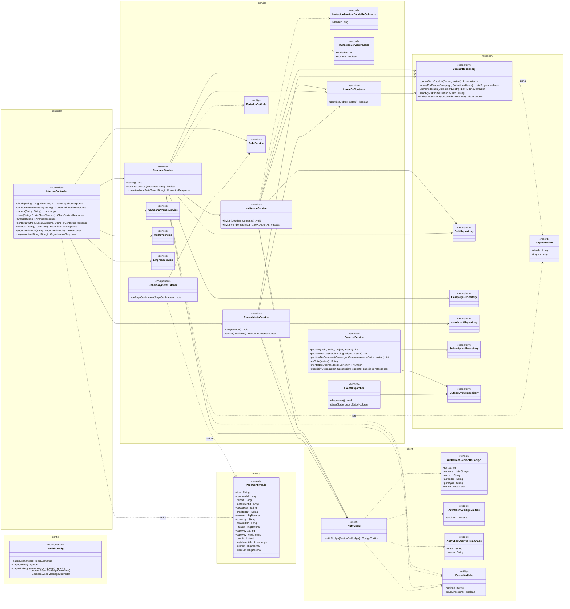

| Clase | Paquete | Qué es |
| --- | --- | --- |
| `InternalController` | `controller` | Lo que le piden o le avisan los otros servicios, con la clave interna. |
| `InvitacionService` | `service` | El primer correo al deudor, cuando su deuda entra a cobranza; y en cada pasada, el de las deudas que todavía no recibieron ninguno. |
| `ContactoService` | `service` | Ejecuta las campañas: decide a quién le toca un correo y lo manda. |
| `RecordatorioService` | `service` | Recuerda las cuotas que vencen pronto. |
| `LimiteDeContacto` | `service` | Cuántas veces se le puede escribir a un deudor según la ley. |
| `FeriadosDeChile` | `service` | Los feriados de Chile de cualquier año. |
| `ContactRepository` | `repository` | Los contactos al deudor: cuándo se le escribió, cuántos toques lleva cada deuda y el último de cada una. |
| `ToquesHechos` | `repository` | Cuántos toques de una campaña lleva una deuda. |
| `EventosService` | `service` | Deja en la bandeja de salida los eventos del contrato, y registra suscripciones. |
| `EventDispatcher` | `service` | Saca los eventos de la bandeja y los entrega firmados, con reintentos. |
| `RabbitPaymentListener` | `service` | Recibe los avisos de pago que llegan por RabbitMQ. |
| `AuthClient` | `client` | Le pide a ms-auth que emita y mande un código. Un `502` de ms-auth es un `CorreoNoSalio`. |
| `CorreoNoSalio` | `client` | El correo de un código no salió: el motivo para la empresa, con la dirección tapada, y si la culpa es de la dirección. Responde `502`. |
| `PagoConfirmado` | `events` | El aviso que manda ms-payments cuando un pago se concreta. |
| `RabbitConfig` | `config` | La cola de los avisos de pago. |

### El panel de administración

Lo que ve y hace el admin de DataBridge. Los totales de cada empresa salen de dos consultas que agrupan (`ConteoDeDeudas` y `SaldoPendiente`): aquí no se lee ninguna deuda ni ningún deudor.

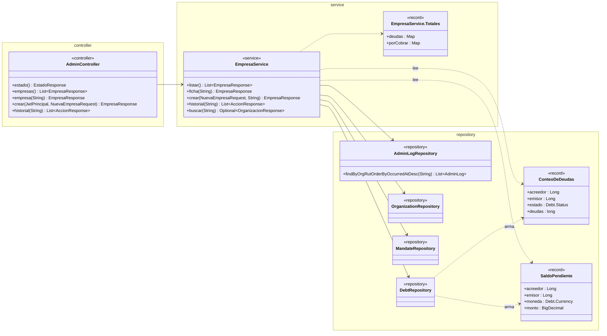

| Clase | Paquete | Qué es |
| --- | --- | --- |
| `AdminController` | `controller` | Lo que el panel de administración le pide a ms-debt: las empresas. Solo para el admin. |
| `EmpresaService` | `service` | Las empresas para el panel: verlas con los totales de su cartera, y dar de alta una empresa usuaria. |
| `ConteoDeDeudas` | `repository` | Cuántas deudas hay de un acreedor, entregadas por un emisor, en un estado. Un total, sin deudas. |
| `SaldoPendiente` | `repository` | Lo que falta por cobrar de un acreedor, entregado por un emisor, en una moneda. Un total. |
| `AdminLogRepository` | `repository` | La bitácora del panel. |

### Los repositorios

El acceso a la base, con Spring Data JPA. Cada uno guarda una entidad; aquí van solo las consultas propias, además de las que ya trae `JpaRepository`.

```mermaid
classDiagram
    direction LR
    namespace repository {
        class AdminLogRepository {
            <<repository>>
            +findByOrgRutOrderByOccurredAtDesc(String) List~AdminLog~
        }
        class ApiKeyRepository {
            <<repository>>
            +findByKeyHashAndRevokedAtIsNull(String) Optional~ApiKey~
            +findByOrganizationOrderByCreatedAtDesc(Organization) List~ApiKey~
        }
        class BatchRepository {
            <<repository>>
            +findBySenderAndExternalId(Organization, String) Optional~Batch~
        }
        class CampaignRepository {
            <<repository>>
            +findByAgencyAndExternalId(Organization, String) Optional~Campaign~
            +findByAgencyAndCreditorOrderByStartsOnDesc(Organization, Organization) List~Campaign~
            +findByStatus(Campaign.Status) List~Campaign~
            +findByAgencyOrderByStartsOnDesc(Organization) List~Campaign~
        }
        class ContactRepository {
            <<repository>>
            +cuandoSeLeEscribio(Debtor, Instant) List~Instant~
            +toquesPorDeuda(Campaign, Collection~Debt~) List~ToquesHechos~
            +ultimoPorDeuda(Collection~Debt~) List~UltimoContacto~
            +countByDebtIn(Collection~Debt~) long
            +findByDebtOrderByOccurredAtAsc(Debt) List~Contact~
        }
        class DebtChargeRepository {
            <<repository>>
            +findByDebtOrderByDueDateAsc(Debt) List~DebtCharge~
            +deleteByDebt(Debt) void
        }
        class DebtEventRepository {
            <<repository>>
            +findByDebtOrderByOccurredAtAsc(Debt) List~DebtEvent~
            +findByDebtInAndTypeAndOccurredAtAfter(Collection~Debt~, DebtEvent.Type, Instant) List~DebtEvent~
            +findByDebtIn(Collection~Debt~) List~DebtEvent~
            +findByDebtInAndType(Collection~Debt~, DebtEvent.Type) List~DebtEvent~
            +findTop300ByDebtInAndTypeOrderByOccurredAtDesc(Collection~Debt~, DebtEvent.Type) List~DebtEvent~
            +existsByDebtAndTypeAndOccurredAtAfter(Debt, DebtEvent.Type, Instant) boolean
        }
        class DebtRepository {
            <<repository>>
            +carteraDe(Organization) List~Debt~
            +contarPorEmpresa() List~ConteoDeDeudas~
            +saldoPorEmpresa() List~SaldoPendiente~
            +findByDebtorOrderByUpdatedAtDesc(Debtor) List~Debt~
            +findByCampaign(Campaign) List~Debt~
            +sinInvitar(int) List~Debt~
            +findByLastBatch(Batch) List~Debt~
            +findByCreditorAndExternalId(Organization, String) Optional~Debt~
        }
        class DebtorRepository {
            <<repository>>
            +findByRut(String) Optional~Debtor~
        }
        class InstallmentRepository {
            <<repository>>
            +findByDebtOrderByNumberAsc(Debt) List~Installment~
            +findByDebtAndStatus(Debt, Installment.Status) List~Installment~
            +porRecordar(Installment.Status, LocalDate, LocalDate, Collection~Debt.Status~) List~Installment~
        }
        class MandateRepository {
            <<repository>>
            +findByAgencyAndCreditorAndStatus(Organization, Organization, Mandate.Status) List~Mandate~
            +findByAgencyAndStatus(Organization, Mandate.Status) List~Mandate~
            +todosConSusEmpresas() List~Mandate~
        }
        class OrganizationRepository {
            <<repository>>
            +findByRut(String) Optional~Organization~
        }
        class OutboxEventRepository {
            <<repository>>
            +findTop100ByStatusAndNextAttemptAtBeforeOrderByIdAsc(OutboxEvent.Status, Instant) List~OutboxEvent~
        }
        class RepactationRepository {
            <<repository>>
            +findByDebtAndSupersededAtIsNull(Debt) List~Repactation~
        }
        class SubscriptionRepository {
            <<repository>>
            +findByOrganizationAndActiveTrue(Organization) List~Subscription~
            +findByOrganizationAndUrl(Organization, String) Optional~Subscription~
        }
    }
    namespace model {
        class AdminLog {
            <<entity>>
        }
        class ApiKey {
            <<entity>>
        }
        class Batch {
            <<entity>>
        }
        class Campaign {
            <<entity>>
        }
        class Contact {
            <<entity>>
        }
        class DebtCharge {
            <<entity>>
        }
        class DebtEvent {
            <<entity>>
        }
        class Debt {
            <<entity>>
        }
        class Debtor {
            <<entity>>
        }
        class Installment {
            <<entity>>
        }
        class Mandate {
            <<entity>>
        }
        class Organization {
            <<entity>>
        }
        class OutboxEvent {
            <<entity>>
        }
        class Repactation {
            <<entity>>
        }
        class Subscription {
            <<entity>>
        }
    }
    AdminLogRepository ..> AdminLog : guarda
    ApiKeyRepository ..> ApiKey : guarda
    BatchRepository ..> Batch : guarda
    CampaignRepository ..> Campaign : guarda
    ContactRepository ..> Contact : guarda
    DebtChargeRepository ..> DebtCharge : guarda
    DebtEventRepository ..> DebtEvent : guarda
    DebtRepository ..> Debt : guarda
    DebtorRepository ..> Debtor : guarda
    InstallmentRepository ..> Installment : guarda
    MandateRepository ..> Mandate : guarda
    OrganizationRepository ..> Organization : guarda
    OutboxEventRepository ..> OutboxEvent : guarda
    RepactationRepository ..> Repactation : guarda
    SubscriptionRepository ..> Subscription : guarda
```

| Clase | Paquete | Qué es |
| --- | --- | --- |
| `AdminLogRepository` | `repository` | La bitácora del panel. |
| `ApiKeyRepository` | `repository` |  |
| `BatchRepository` | `repository` |  |
| `CampaignRepository` | `repository` |  |
| `ContactRepository` | `repository` | Los contactos al deudor: cuándo se le escribió, cuántos toques lleva cada deuda y el último de cada una. |
| `DebtChargeRepository` | `repository` |  |
| `DebtEventRepository` | `repository` |  |
| `DebtRepository` | `repository` |  |
| `DebtorRepository` | `repository` |  |
| `InstallmentRepository` | `repository` |  |
| `MandateRepository` | `repository` |  |
| `OrganizationRepository` | `repository` |  |
| `OutboxEventRepository` | `repository` |  |
| `RepactationRepository` | `repository` |  |
| `SubscriptionRepository` | `repository` |  |

### Seguridad, cifrado, arranque y errores

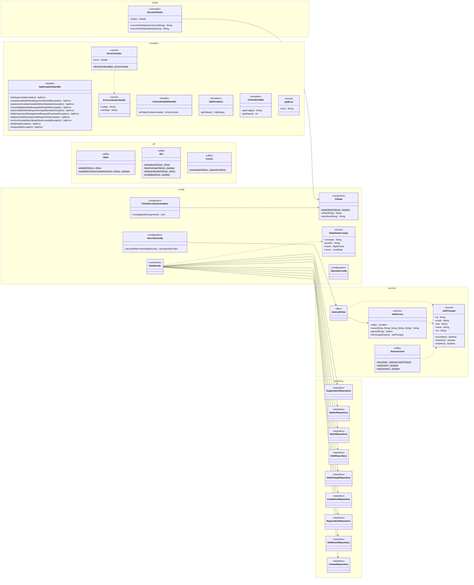

| Clase | Paquete | Qué es |
| --- | --- | --- |
| `SecurityConfig` | `config` | Quién puede llamar a qué. |
| `JwtAuthFilter` | `security` | Valida el JWT de cada petición. |
| `JwtService` | `security` | Lee el JWT que firmó ms-auth. |
| `JwtPrincipal` | `security` | Quién viene en el token. |
| `SesionActual` | `security` | Quién hizo la petición en curso. |
| `Cifrado` | `config` | Cifra lo que hay que poder leer de vuelta: el secreto de una suscripción. |
| `SecretoCifrado` | `model` | Convierte un texto a cifrado al guardarlo y a claro al leerlo. |
| `CifrarSecretosGuardados` | `config` | Al arrancar, cifra los secretos que quedaron en claro. |
| `DataSeeder` | `config` | Los datos de la demo. |
| `OpenApiConfig` | `config` | La documentación de Swagger, en grupos. |
| `ApiExceptionHandler` | `exception` | Los errores del portal, todos con la misma forma. |
| `CarteraInvalidaHandler` | `exception` | Los errores del contrato de integración, con su código propio. |
| `ApiException` | `exception` | Un error que se le puede explicar a quien llamó. |
| `CarteraInvalida` | `exception` | Una cartera que no cumple el contrato, con su código. |
| `ApiError` | `exception` | La forma de un error del portal. |
| `ErrorContrato` | `exception` | La forma de un error del contrato. |
| `Hash` | `util` | SHA-256 y comparación en tiempo constante. |
| `Rut` | `util` | Normaliza el RUT y revisa su dígito verificador. |
| `Correo` | `util` | Normaliza un correo y descarta el que no puede recibir. |

| Paquete | Qué son | Clases |
| --- | --- | --- |
| `dto.evento` | Los eventos del contrato | `CampanaAvanceDatos`, `DeudaDisputadaDatos`, `DeudaReanudadaDatos`, `DeudaRetiradaDatos`, `DeudaSaldadaDatos`, `EventoV1`, `LoteProcesadoDatos`, `PagoConfirmadoDatos`, `RepactacionAceptadaDatos` |
| `dto.request` | Lo que entra | `CampanaRequest`, `CarteraCsvForm`, `CarteraV1`, `ClaveRequest`, `DisputaRequest`, `EmitirClaveRequest`, `EstadoCampanaRequest`, `MandatoRequest`, `MisDatosRequest`, `NuevaEmpresaRequest`, `RepactRequest`, `ResolucionDisputaRequest`, `SuscripcionRequest` |
| `dto.response` | Lo que sale | `AccionResponse`, `AvanceResponse`, `CampanaPortalResponse`, `CampanaResponse`, `CarteraResponse`, `ClaveEmitidaResponse`, `ClaveResponse`, `CodigoEnviadoResponse`, `ContactosResponse`, `ConvenioEnRiesgoResponse`, `CorreoDelDeudorResponse`, `CuentaResponse`, `CuotaPorVencerResponse`, `DebtDetailResponse`, `DebtSnapshotResponse`, `DebtSummaryResponse`, `EmpresaResponse`, `EstadoResponse`, `InstallmentPreview`, `MandatoResponse`, `MisDatosResponse`, `OkResponse`, `OpcionesCargaResponse`, `OrganizacionResponse`, `PagoResponse`, `RecordatoriosResponse`, `RepactPlan`, `ResumenResponse`, `SimulacionResponse`, `SuscripcionResponse` |

---

## ms-payments — los cobros

Abre el cobro en la pasarela, confirma con ella de servidor a servidor y le avisa a ms-debt. El monto nunca viene del navegador: se lo pregunta a ms-debt.

### El modelo

Un `Payment` y su libro. `debtId` e `installmentIds` nombran cosas de otro servicio: no hay relación de clases, solo el id.

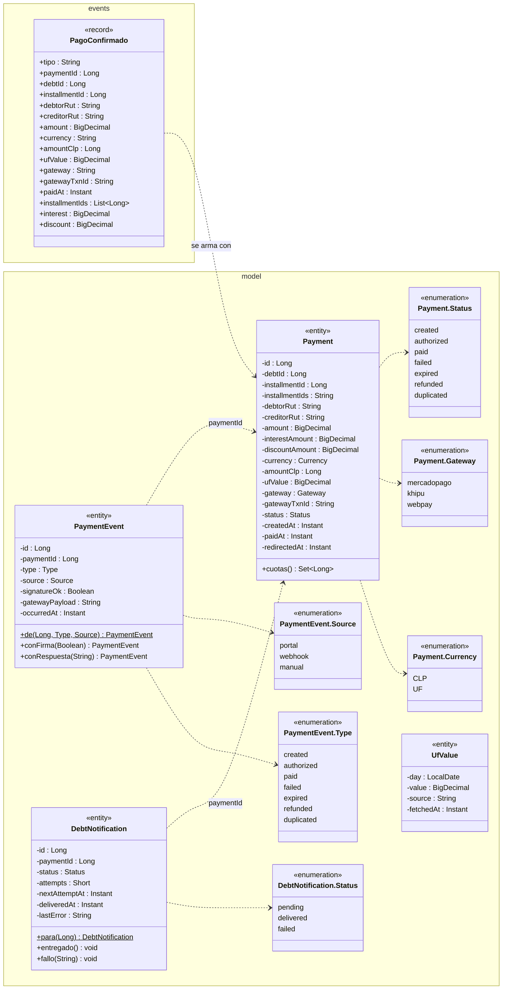

| Clase | Paquete | Qué es |
| --- | --- | --- |
| `Payment` | `model` | Un intento de pago en una pasarela. |
| `PaymentEvent` | `model` | El libro del pago: solo se agrega. |
| `DebtNotification` | `model` | El aviso pendiente hacia ms-debt. |
| `UfValue` | `model` | El valor de la UF de un día. |
| `PagoConfirmado` | `events` | El aviso que se le manda a ms-debt cuando un pago se concreta. |

### El cobro

`PaymentService` concentra las reglas del cobro. Dos tareas programadas lo llaman sin que nadie mire: `ConciliacionPasarelas` pregunta por los cobros abiertos y `NotificationDispatcher` entrega los avisos.

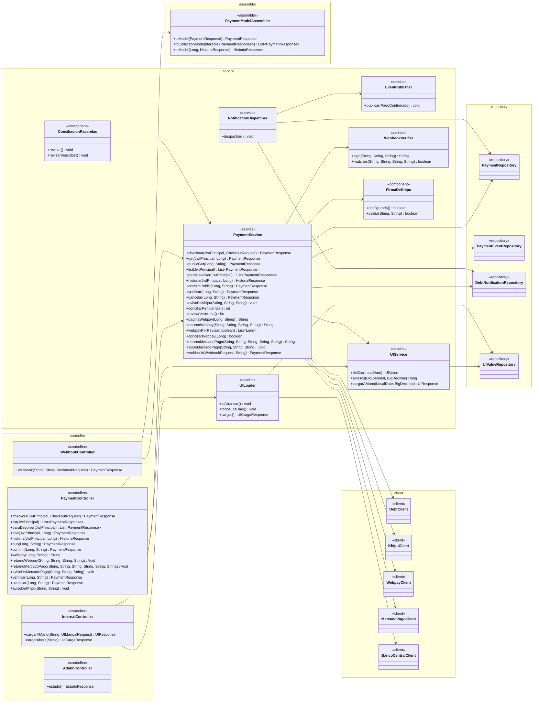

| Clase | Paquete | Qué es |
| --- | --- | --- |
| `PaymentController` | `controller` | Los pagos del portal, la página de la pasarela, la ida y vuelta de Webpay y Mercado Pago, y el aviso de Khipu. |
| `WebhookController` | `controller` | Donde avisa la pasarela simulada, con firma. |
| `InternalController` | `controller` | Cargar la UF a mano o desde el Banco Central. Con la clave interna. |
| `AdminController` | `controller` | Lo que el panel de administración le pide a ms-payments. Solo para el admin. |
| `PaymentModelAssembler` | `assembler` | Los enlaces HATEOAS de un pago. |
| `PaymentService` | `service` | El cobro: abrirlo, confirmarlo con la pasarela, vencerlo y dejar el aviso. |
| `ConciliacionPasarelas` | `service` | Cada 10 segundos pregunta a las pasarelas por los cobros abiertos, y cada 5 minutos por los vencidos. |
| `NotificationDispatcher` | `service` | Saca los avisos de pago de la bandeja y los entrega, con reintentos. |
| `EventPublisher` | `service` | Entrega un aviso a ms-debt: por RabbitMQ, o por HTTP si no está. |
| `UfService` | `service` | Convierte UF a pesos con el valor del día. |
| `UfLoader` | `service` | Mantiene cargada la UF. |
| `WebhookVerifier` | `service` | Firma los enlaces de pago y verifica los avisos. |
| `FirmaDeKhipu` | `service` | Verifica la firma de los avisos de Khipu. |

### Las pasarelas y los otros sistemas

Un cliente por cada sistema de afuera. Cada uno sabe si está configurado de verdad (`real()`); sin credenciales, el cobro se simula.

```mermaid
classDiagram
    direction LR
    namespace client {
        class DebtClient {
            <<client>>
            +obtener(Long, List~Long~) DebtSnapshot
            +cartera(String) List~Long~
        }
        class DebtClient_DebtSnapshot["DebtClient.DebtSnapshot"] {
            <<record>>
            +debtId : Long
            +creditorRut : String
            +debtorRut : String
            +currency : String
            +amount : BigDecimal
            +installmentId : Long
            +installmentIds : List~Long~
            +capital : BigDecimal
            +interes : BigDecimal
            +descuento : BigDecimal
        }
        class KhipuClient {
            <<client>>
            +real() boolean
            +crear(String, String, long, String, String, String, OffsetDateTime) Cobro
            +estado(String) Estado
            +anular(String) boolean
        }
        class KhipuClient_Cobro["KhipuClient.Cobro"] {
            <<record>>
            +paymentId : String
            +paymentUrl : String
        }
        class KhipuClient_Estado["KhipuClient.Estado"] {
            <<record>>
            +status : String
            +statusDetail : String
            +amount : BigDecimal
            +currency : String
            +transactionId : String
            +crudo : JsonNode
        }
        class KhipuClient_Crear["KhipuClient.Crear"] {
            <<record>>
            +amount : long
            +currency : String
            +subject : String
            +transactionId : String
            +returnUrl : String
            +cancelUrl : String
            +notifyUrl : String
            +notifyApiVersion : String
            +expiresDate : String
        }
        class WebpayClient {
            <<client>>
            +real() boolean
            +plazoDePago() Duration
            +paginaDePago() String
            +createTransaction(String, String, long, String) WebpayCreateResponse
            +commitTransaction(String) WebpayCommitResponse
            +estado(String) WebpayCommitResponse
        }
        class MercadoPagoClient {
            <<client>>
            +real() boolean
            +testMode() boolean
            +getPublicKey() String
            +crearPreferencia(String, String, long, String, String) Preferencia
            +crearPreferencia(String, String, long, String, String, OffsetDateTime) Preferencia
            +consultarPreferencia(String) EstadoPreferencia
            +vencerPreferencia(String) boolean
            +consultarPago(String) PagoInfo
        }
        class MercadoPagoClient_Preferencia["MercadoPagoClient.Preferencia"] {
            <<record>>
            +id : String
            +initPoint : String
            +sandboxInitPoint : String
        }
        class MercadoPagoClient_PagoInfo["MercadoPagoClient.PagoInfo"] {
            <<record>>
            +id : Long
            +status : String
            +statusDetail : String
            +transactionAmount : BigDecimal
            +currencyId : String
            +externalReference : String
            +crudo : JsonNode
        }
        class MercadoPagoClient_PagoDePreferencia["MercadoPagoClient.PagoDePreferencia"] {
            <<record>>
            +id : Long
            +status : String
            +crudo : JsonNode
        }
        class MercadoPagoClient_EstadoPreferencia["MercadoPagoClient.EstadoPreferencia"] {
            <<record>>
            +id : String
            +externalReference : String
            +totalAmount : Long
            +pago : PagoDePreferencia
        }
        class MercadoPagoClient_CrearPreferencia["MercadoPagoClient.CrearPreferencia"] {
            <<record>>
            +items : List~Item~
            +payer : Payer
            +backUrls : BackUrls
            +autoReturn : String
            +externalReference : String
            +statementDescriptor : String
            +expires : Boolean
            +expirationDateTo : String
        }
        class MercadoPagoClient_Item["MercadoPagoClient.Item"] {
            <<record>>
            +id : String
            +title : String
            +description : String
            +quantity : int
            +unitPrice : long
            +currencyId : String
        }
        class MercadoPagoClient_Payer["MercadoPagoClient.Payer"] {
            <<record>>
            +email : String
        }
        class MercadoPagoClient_BackUrls["MercadoPagoClient.BackUrls"] {
            <<record>>
            +success : String
            +failure : String
            +pending : String
        }
        class BancoCentralClient {
            <<client>>
            +configurado() boolean
            +obtener(LocalDate, LocalDate) List~UfValue~
        }
        class TiemposDePasarela {
            <<utility>>
            +fabrica()$ ClientHttpRequestFactory
            +fabrica(Duration, Duration)$ ClientHttpRequestFactory
        }
    }
    DebtClient ..> DebtClient_DebtSnapshot
    KhipuClient ..> KhipuClient_Cobro
    KhipuClient ..> KhipuClient_Estado
    KhipuClient ..> KhipuClient_Crear
    MercadoPagoClient ..> MercadoPagoClient_Preferencia
    MercadoPagoClient ..> MercadoPagoClient_PagoInfo
    MercadoPagoClient ..> MercadoPagoClient_PagoDePreferencia
    MercadoPagoClient ..> MercadoPagoClient_EstadoPreferencia
    MercadoPagoClient ..> MercadoPagoClient_CrearPreferencia
    MercadoPagoClient ..> MercadoPagoClient_Item
    MercadoPagoClient ..> MercadoPagoClient_Payer
    MercadoPagoClient ..> MercadoPagoClient_BackUrls
    DebtClient ..> TiemposDePasarela
    KhipuClient ..> TiemposDePasarela
    WebpayClient ..> TiemposDePasarela
    MercadoPagoClient ..> TiemposDePasarela
```

| Clase | Paquete | Qué es |
| --- | --- | --- |
| `DebtClient` | `client` | Le pregunta a ms-debt cuánto se debe y de quién es. |
| `KhipuClient` | `client` | Khipu, por su API de pagos v3. |
| `WebpayClient` | `client` | Transbank Webpay Plus. |
| `MercadoPagoClient` | `client` | Mercado Pago, Checkout Pro. |
| `BancoCentralClient` | `client` | La UF desde el Banco Central. |
| `TiemposDePasarela` | `client` | Los tiempos máximos de las llamadas hacia afuera. |

### Repositorios, seguridad, arranque y errores

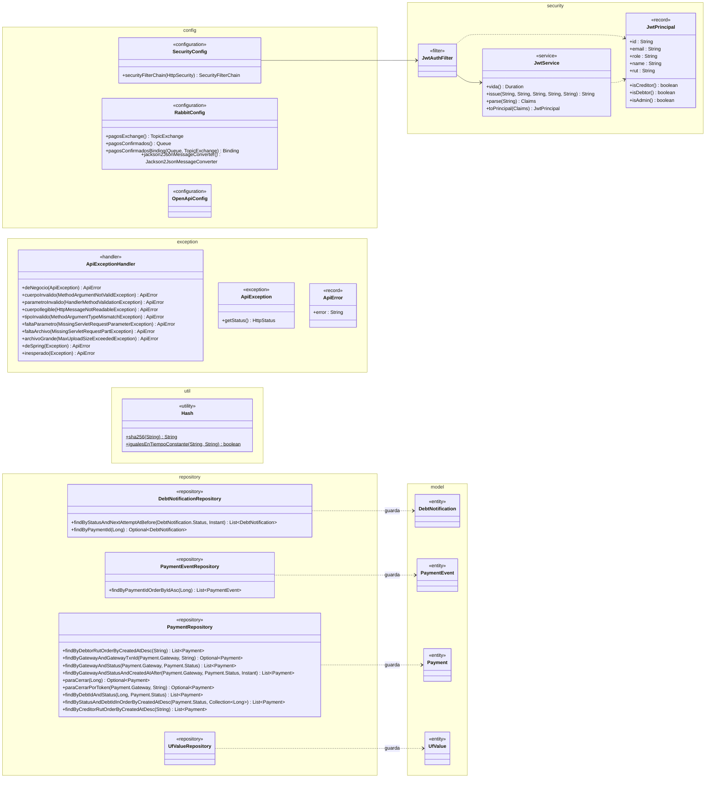

| Clase | Paquete | Qué es |
| --- | --- | --- |
| `DebtNotificationRepository` | `repository` |  |
| `PaymentEventRepository` | `repository` |  |
| `PaymentRepository` | `repository` |  |
| `UfValueRepository` | `repository` |  |
| `SecurityConfig` | `config` | Quién puede llamar a qué. |
| `JwtAuthFilter` | `security` | Valida el JWT de cada petición. |
| `JwtService` | `security` | Lee el JWT que firmó ms-auth. |
| `JwtPrincipal` | `security` | Quién viene en el token. |
| `RabbitConfig` | `config` | El intercambio y la cola de los avisos de pago. |
| `OpenApiConfig` | `config` | La documentación de Swagger, en grupos. |
| `ApiExceptionHandler` | `exception` | Los errores, todos con la misma forma. |
| `ApiException` | `exception` | Un error que se le puede explicar a quien llamó. |
| `ApiError` | `exception` | La forma de todo error. |
| `Hash` | `util` | SHA-256 y comparación en tiempo constante. |

| Paquete | Qué son | Clases |
| --- | --- | --- |
| `dto.gateway` | Lo que se habla con Transbank | `WebpayCommitResponse`, `WebpayCreateRequest`, `WebpayCreateResponse` |
| `dto.request` | Lo que entra | `CheckoutRequest`, `UfManualRequest`, `WebhookRequest` |
| `dto.response` | Lo que sale | `EstadoResponse`, `HistoriaResponse`, `PaymentEventResponse`, `PaymentResponse`, `UfCargaResponse`, `UfResponse` |

---

## ms-ai — el asistente

Sin base de datos. Lee las deudas del deudor pidiéndoselas a ms-debt con la sesión del propio deudor, así que no puede ver nada que él no vea. Responde con un LLM si hay uno configurado, y si no, o si falla, con reglas.

### Todo el servicio

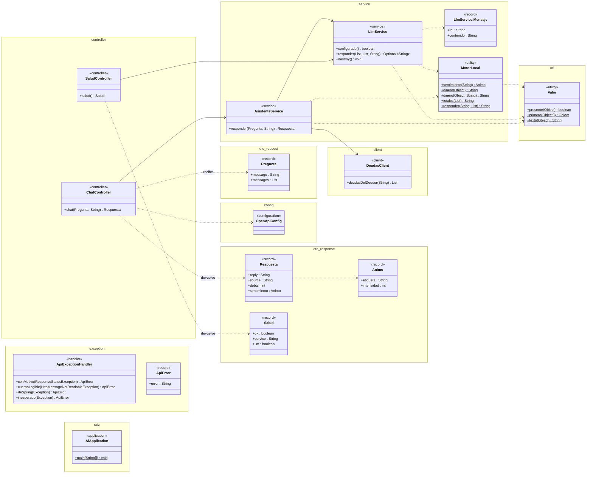

| Clase | Paquete | Qué es |
| --- | --- | --- |
| `ChatController` | `controller` | `POST /api/ai/chat`: una pregunta del deudor. |
| `SaludController` | `controller` | `GET /api/health`: si el asistente tiene un LLM configurado. |
| `AsistenteService` | `service` | Trae las deudas del deudor y responde: con el LLM si hay, con reglas si no. |
| `LlmService` | `service` | La respuesta con un LLM, por el SDK de OpenAI para Java. |
| `MotorLocal` | `service` | Las respuestas por reglas, y el ánimo del mensaje. |
| `DeudasClient` | `client` | Las deudas del deudor, pedidas a ms-debt con su propia sesión. |
| `Pregunta` | `dto.request` | Lo que manda el portal: el mensaje y la conversación. |
| `Respuesta` | `dto.response` | La respuesta, de dónde salió y el ánimo detectado. |
| `Animo` | `dto.response` | El ánimo del mensaje: su etiqueta y su puntaje. |
| `Salud` | `dto.response` | El estado del asistente. |
| `Valor` | `util` | Ayudas para leer el JSON de las deudas. |
| `OpenApiConfig` | `config` | La documentación de Swagger. |
| `ApiExceptionHandler` | `exception` | Los errores, con la misma forma que los demás servicios. |
| `ApiError` | `exception` | La forma de todo error. |
| `AiApplication` | `` | El arranque del servicio. |

---

## gateway — la puerta

Spring Cloud Gateway. No tiene reglas de negocio ni base: enruta, limita y registra.

### Todo el servicio

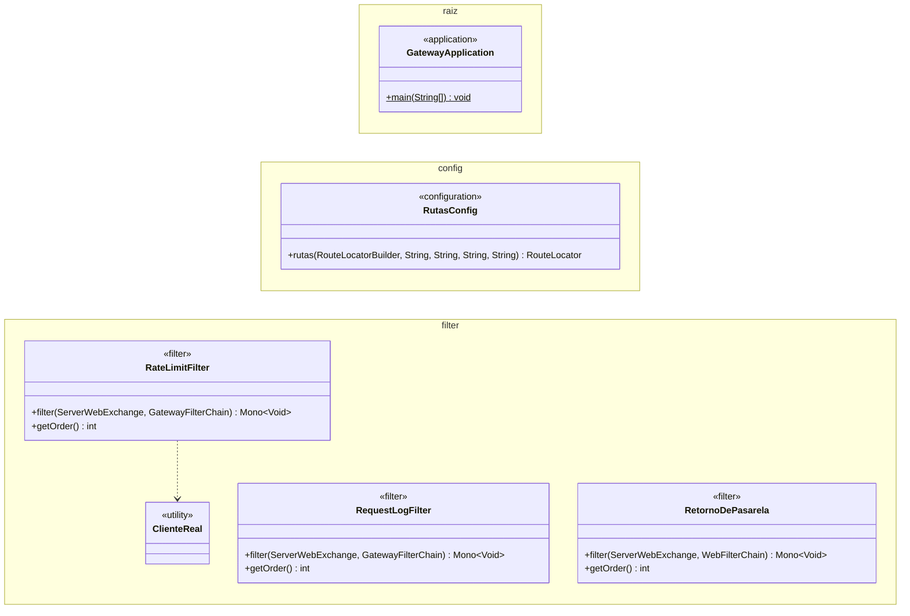

| Clase | Paquete | Qué es |
| --- | --- | --- |
| `GatewayApplication` | `` | El arranque del gateway. |
| `RutasConfig` | `config` | A qué servicio va cada ruta. |
| `RateLimitFilter` | `filter` | El límite de peticiones por origen: uno para `/api/auth` y otro general. |
| `RequestLogFilter` | `filter` | Anota cada petición y cuánto tardó. |
| `RetornoDePasarela` | `filter` | Le quita el `Origin` a la vuelta desde la pasarela, para que CORS no la rechace. |
| `ClienteReal` | `filter` | Decide cuál es la IP real del cliente detrás de los proxies de confianza. |
