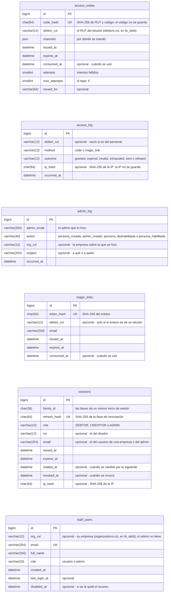
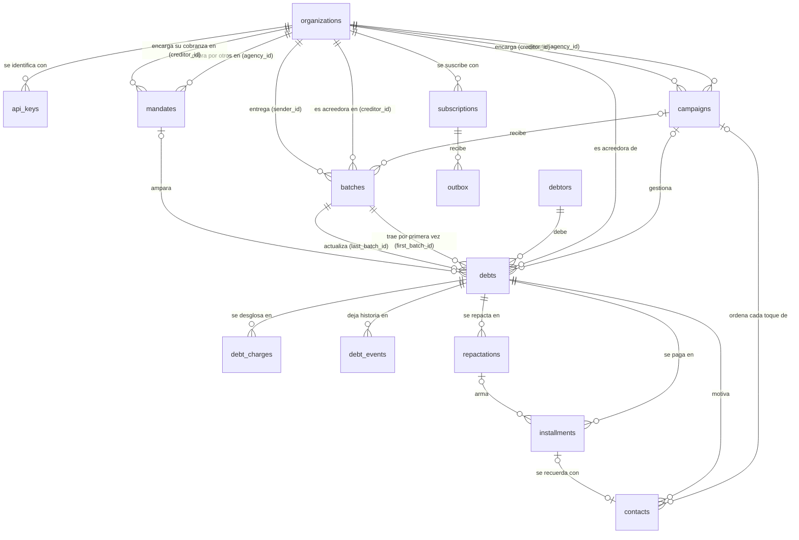
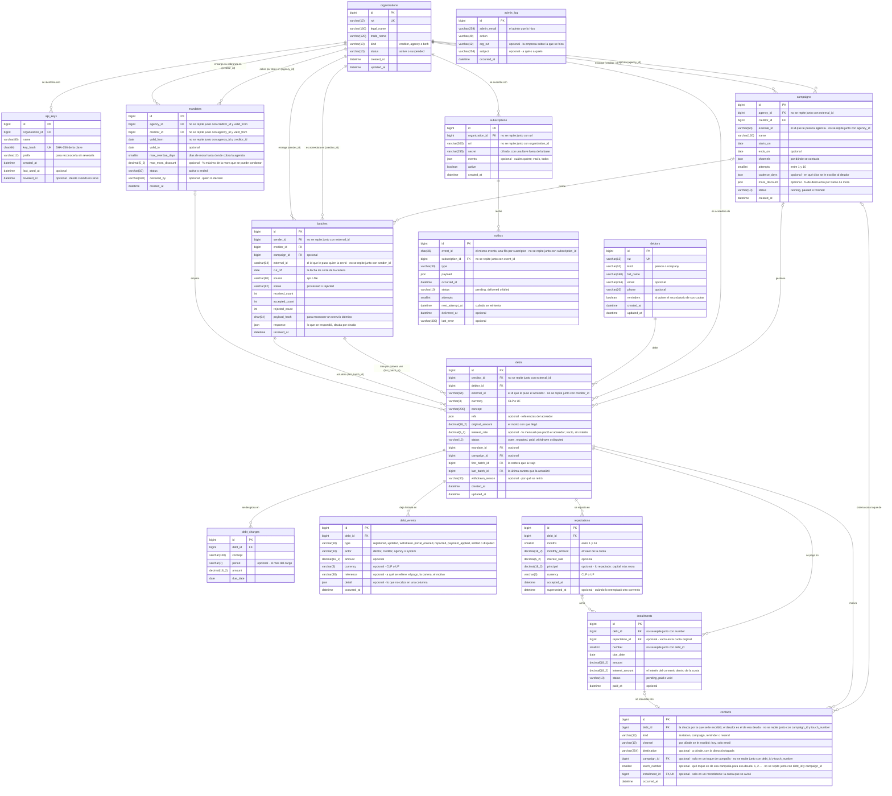
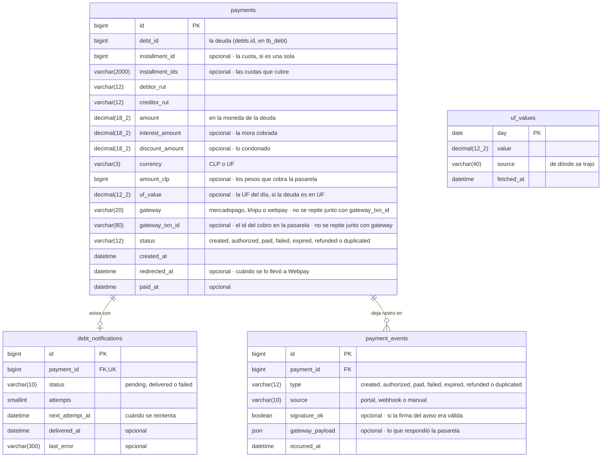
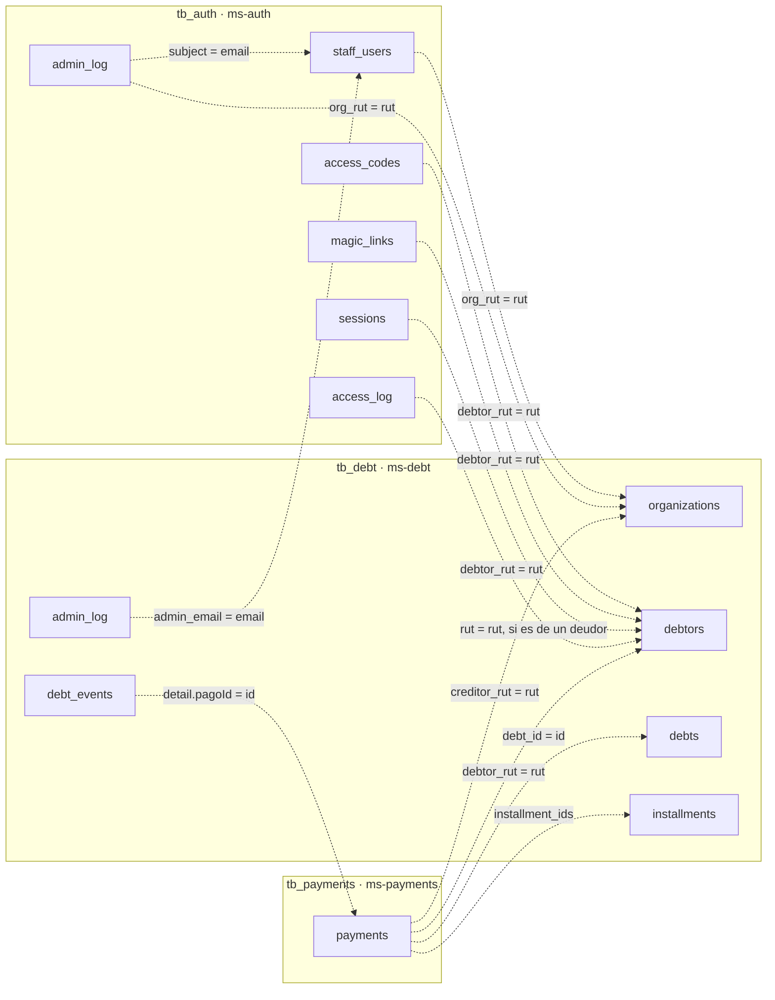

# Diagrama entidad-relación

Vista lógica del [modelo 4+1](README.md), por el lado de los datos: qué se guarda y cómo se relaciona.

DataBridge no tiene una base, tiene **tres, una por servicio**, en el mismo MySQL 8.4: 25 tablas, 3 vistas y 26 llaves foráneas en total. Cada servicio es dueño de la suya y ninguno lee la de otro: si ms-payments necesita saber cuánto se debe, se lo pregunta a ms-debt. Por eso **entre las tres no hay llaves foráneas**; se unen por el RUT y por el id de la deuda ([más abajo](#cómo-se-unen-las-tres-bases)).

| Base | Servicio | Qué guarda | Tablas | Migraciones de Flyway |
| --- | --- | --- | --- | --- |
| [`tb_auth`](#tb_auth--el-acceso) | ms-auth | El acceso | 6 | `V1` esquema inicial · `V2` sesiones · `V3` enlace pedido · `V4` roles admin y usuario · `V5` bitacora del panel |
| [`tb_debt`](#tb_debt--la-cartera) | ms-debt | La cartera | 15 | `V1` esquema inicial · `V2` recordatorios · `V3` secretos cifrados · `V4` intereses · `V5` descuento · `V6` bitacora del panel · `V7` contactos |
| [`tb_payments`](#tb_payments--los-cobros) | ms-payments | Los cobros | 4 | `V1` esquema inicial · `V2` pago duplicado · `V3` interes del pago · `V4` webpay una vez · `V5` descuento del pago |

**Cómo leerlos.** Cada caja es una tabla, con el tipo y el nombre de cada columna. `PK` es la llave primaria, `FK` una llave foránea y `UK` un valor que no se repite. Una columna es obligatoria salvo que diga *opcional*. `decimal(18_2)` es un número de 18 dígitos con 2 decimales. En las líneas, `||` es *uno*, `o{` es *cero o muchos* y `|o` es *cero o uno*.

Los diagramas salen del esquema real: el que dejan las migraciones de `ms-*/src/main/resources/db/migration` al aplicarse. Cada servicio arranca con `ddl-auto=validate`, así que si una entidad y su tabla dejan de calzar, el servicio no parte.

---

## `tb_auth` — el acceso

La base de **ms-auth**. Quién entra y cómo. **No hay tabla de deudores**: el deudor no tiene cuenta, entra con su RUT y un código. De nada sensible se guarda el original: del código, del enlace y de la llave de renovación queda solo su huella (SHA-256), y de la IP también.

Las 6 tablas no se relacionan entre sí con llaves foráneas: cada una se consulta por su propia huella, o por el RUT o el correo de alguien.

| Tabla | Qué guarda |
| --- | --- |
| `access_codes` | El código con que entra un deudor. Un solo uso, con vencimiento y con tope de intentos. |
| `access_log` | Cada intento de entrar y cada enlace pedido: por dónde, cómo resultó y desde qué origen. |
| `admin_log` | Lo que un admin de DataBridge hizo con las personas desde su panel: altas, y accesos quitados y devueltos. |
| `magic_links` | El enlace de un solo uso al correo: como entran el usuario de una empresa y el admin, y el respaldo del deudor. |
| `sessions` | Las llaves de renovación de cada sesión, en familias. Es lo único de una sesión que se puede revocar. |
| `staff_users` | Las personas con cuenta: los usuarios de las empresas y los admin de DataBridge. |

Las 14 reglas que exige la base (<code>CHECK</code>)

Lo que la aplicación valida, la base lo vuelve a exigir: aunque alguien escriba directo en ella, no puede dejar un dato que rompa estas reglas.

| Tabla | Regla | Qué exige |
| --- | --- | --- |
| `access_codes` | `ck_access_code_intentos` | `(attempts <= max_attempts)` |
| `access_codes` | `ck_access_code_rut` | `regexp_like(debtor_rut,'^[0-9]{7,8}-[0-9K]$')` |
| `access_codes` | `ck_access_code_vigencia` | `(expires_at > issued_at)` |
| `access_log` | `ck_access_log_method` | `(method in ('code','magic_link'))` |
| `access_log` | `ck_access_log_outcome` | `(outcome in ('granted','expired','invalid','exhausted','sent','refused'))` |
| `admin_log` | `ck_admin_log_action` | `(action in ('persona_creada','admin_creado','persona_deshabilitada','persona_habilitada'))` |
| `magic_links` | `ck_magic_link_vigencia` | `(expires_at > issued_at)` |
| `sessions` | `ck_session_identidad` | `(((role = 'DEBTOR') and (rut is not null)) or ((role in ('CREDITOR','ADMIN')) and (email is not null)))` |
| `sessions` | `ck_session_role` | `(role in ('DEBTOR','CREDITOR','ADMIN'))` |
| `sessions` | `ck_session_rut` | `((rut is null) or regexp_like(rut,'^[0-9]{7,8}-[0-9K]$'))` |
| `sessions` | `ck_session_vigencia` | `(expires_at > issued_at)` |
| `staff_users` | `ck_staff_user_admin_sin_empresa` | `(((role = 'admin') and (org_rut is null)) or ((role = 'usuario') and (org_rut is not null)))` |
| `staff_users` | `ck_staff_user_role` | `(role in ('usuario','admin'))` |
| `staff_users` | `ck_staff_user_rut` | `regexp_like(org_rut,'^[0-9]{7,8}-[0-9K]$')` |

---

## `tb_debt` — la cartera

La base de **ms-debt**. Las empresas, lo que se les debe y todo lo que pasa con cada deuda. El saldo y la mora **no se guardan, se calculan**: el saldo es la suma de las cuotas pendientes y la mora sale de la tasa de la deuda y de los días de atraso.

### Las tablas y sus relaciones

Primero sin columnas, para ver la forma:

### Con todas sus columnas

| Tabla | Qué guarda |
| --- | --- |
| `admin_log` | Lo que un admin de DataBridge hizo con las empresas desde su panel: las que dio de alta. |
| `api_keys` | Las claves de API con que el sistema de una empresa entrega cartera. |
| `batches` | Cada cartera recibida, por la API o por archivo, con su huella para no procesarla dos veces y la respuesta que se dio. |
| `campaigns` | La estrategia de contacto de una agencia para la cartera de un acreedor. La define la agencia y la ejecuta DataBridge. |
| `contacts` | Cada vez que DataBridge le escribió a un deudor: la invitación, un toque de campaña, el recordatorio de una cuota o el código que reenvía la empresa. Es el registro de gestiones de cobranza que pide la ley, y con él se cuenta el límite de dos por semana. |
| `debt_charges` | El desglose con que llegó la deuda: cada cargo con su monto y su vencimiento. |
| `debt_events` | La historia de cada deuda: qué pasó, quién lo hizo, cuánto y cuándo. Lo que se le escribe al deudor va aparte, en `contacts`. |
| `debtors` | Quien debe. Una fila por RUT, aunque le deba a varios acreedores. |
| `debts` | Lo que un deudor le debe a un acreedor. |
| `installments` | Las cuotas por pagar. Una deuda sin convenio tiene una sola; al repactar, las pendientes se anulan y se emiten las del convenio. |
| `mandates` | Una agencia cobra por cuenta de un acreedor: desde cuándo, hasta cuántos días de mora y con qué tope de descuento. |
| `organizations` | Las empresas: los acreedores y las agencias de cobranza. |
| `outbox` | La bandeja de salida: cada evento por entregar a cada suscriptor, con sus reintentos. |
| `repactations` | Cada convenio que el deudor aceptó. Uno nuevo no pisa al anterior: lo marca como reemplazado. |
| `subscriptions` | A qué dirección se le avisan los eventos a una empresa, y con qué secreto se firman. |

| Vista | Qué calcula |
| --- | --- |
| `v_creditor_portfolio` | Por acreedor: cuántas deudas tiene, cuántas activas y pagadas, y el saldo en pesos y en UF. |
| `v_debt_balance` | Por deuda: el saldo (cuotas pendientes), lo pagado y el próximo vencimiento. |

Las 39 reglas que exige la base (<code>CHECK</code>)

Lo que la aplicación valida, la base lo vuelve a exigir: aunque alguien escriba directo en ella, no puede dejar un dato que rompa estas reglas.

| Tabla | Regla | Qué exige |
| --- | --- | --- |
| `admin_log` | `ck_admin_log_action` | `(action = 'empresa_creada')` |
| `batches` | `ck_batch_source` | `(source in ('api','file'))` |
| `batches` | `ck_batch_status` | `(status in ('processed','rejected'))` |
| `campaigns` | `ck_campaign_attempts` | `(attempts between 1 and 10)` |
| `campaigns` | `ck_campaign_fechas` | `((ends_on is null) or (ends_on >= starts_on))` |
| `campaigns` | `ck_campaign_status` | `(status in ('running','paused','finished'))` |
| `contacts` | `ck_contact_campaign` | `(((kind = 'campaign') and (campaign_id is not null) and (touch_number is not null)) or ((kind <> 'campaign') and (campaign_id is null) and (touch_number is null)))` |
| `contacts` | `ck_contact_channel` | `(channel = 'email')` |
| `contacts` | `ck_contact_kind` | `(kind in ('invitation','campaign','reminder','resend'))` |
| `contacts` | `ck_contact_reminder` | `(((kind = 'reminder') and (installment_id is not null)) or ((kind <> 'reminder') and (installment_id is null)))` |
| `contacts` | `ck_contact_touch` | `((touch_number is null) or (touch_number >= 1))` |
| `debt_charges` | `ck_charge_amount` | `(amount > 0)` |
| `debt_events` | `ck_debt_event_actor` | `(actor in ('debtor','creditor','agency','system'))` |
| `debt_events` | `ck_debt_event_currency` | `((currency is null) or (currency in ('CLP','UF')))` |
| `debt_events` | `ck_debt_event_type` | `(type in ('registered','updated','withdrawn','portal_entered','repacted','payment_applied','settled','disputed'))` |
| `debtors` | `ck_debtor_canal` | `((email is not null) or (phone is not null))` |
| `debtors` | `ck_debtor_kind` | `(kind in ('person','company'))` |
| `debtors` | `ck_debtor_rut` | `regexp_like(rut,'^[0-9]{7,8}-[0-9K]$')` |
| `debts` | `ck_debt_amount` | `(original_amount > 0)` |
| `debts` | `ck_debt_clp_entero` | `((currency <> 'CLP') or (original_amount = round(original_amount,0)))` |
| `debts` | `ck_debt_currency` | `(currency in ('CLP','UF'))` |
| `debts` | `ck_debt_interest_rate` | `((interest_rate is null) or (interest_rate > 0))` |
| `debts` | `ck_debt_status` | `(status in ('open','repacted','paid','withdrawn','disputed'))` |
| `installments` | `ck_installment_amount` | `(amount > 0)` |
| `installments` | `ck_installment_interest` | `((interest_amount >= 0) and (interest_amount <= amount))` |
| `installments` | `ck_installment_paid` | `(((status = 'paid') and (paid_at is not null)) or ((status <> 'paid') and (paid_at is null)))` |
| `installments` | `ck_installment_status` | `(status in ('pending','paid','void'))` |
| `mandates` | `ck_mandate_fechas` | `((valid_to is null) or (valid_to >= valid_from))` |
| `mandates` | `ck_mandate_mora_discount` | `((max_mora_discount is null) or ((max_mora_discount >= 0) and (max_mora_discount <= 100)))` |
| `mandates` | `ck_mandate_partes` | `(agency_id <> creditor_id)` |
| `mandates` | `ck_mandate_status` | `(status in ('active','ended'))` |
| `organizations` | `ck_organization_kind` | `(kind in ('creditor','agency','both'))` |
| `organizations` | `ck_organization_rut` | `regexp_like(rut,'^[0-9]{7,8}-[0-9K]$')` |
| `organizations` | `ck_organization_status` | `(status in ('active','suspended'))` |
| `outbox` | `ck_outbox_status` | `(status in ('pending','delivered','failed'))` |
| `repactations` | `ck_repactation_amount` | `(monthly_amount > 0)` |
| `repactations` | `ck_repactation_currency` | `(currency in ('CLP','UF'))` |
| `repactations` | `ck_repactation_interest_rate` | `((interest_rate is null) or (interest_rate > 0))` |
| `repactations` | `ck_repactation_months` | `(months between 1 and 24)` |

---

## `tb_payments` — los cobros

La base de **ms-payments**. Cada intento de pago y su historia. Un pago nombra la deuda y las cuotas por su id, pero no hay llave foránea: viven en `tb_debt`, que es otra base, y quien los valida es ms-debt.

| Tabla | Qué guarda |
| --- | --- |
| `debt_notifications` | El aviso pendiente hacia ms-debt por cada pago confirmado, con sus reintentos. |
| `payment_events` | El libro de cada pago: solo se agrega. Guarda lo que respondió la pasarela, tal como llegó. |
| `payments` | Cada intento de pago en una pasarela. Se crea al abrir el cobro, no al confirmarlo. |
| `uf_values` | El valor de la UF de cada día. |

| Vista | Qué calcula |
| --- | --- |
| `v_collection` | Por acreedor y mes: cuántos pagos se confirmaron y cuánto se recaudó en pesos. |

Las 12 reglas que exige la base (<code>CHECK</code>)

Lo que la aplicación valida, la base lo vuelve a exigir: aunque alguien escriba directo en ella, no puede dejar un dato que rompa estas reglas.

| Tabla | Regla | Qué exige |
| --- | --- | --- |
| `debt_notifications` | `ck_debt_notification_status` | `(status in ('pending','delivered','failed'))` |
| `payment_events` | `ck_payment_event_source` | `(source in ('portal','webhook','manual'))` |
| `payment_events` | `ck_payment_event_type` | `(type in ('created','authorized','paid','failed','expired','refunded','duplicated'))` |
| `payments` | `ck_payment_amount` | `(amount > 0)` |
| `payments` | `ck_payment_currency` | `(currency in ('CLP','UF'))` |
| `payments` | `ck_payment_discount` | `((discount_amount is null) or (discount_amount > 0))` |
| `payments` | `ck_payment_gateway` | `(gateway in ('mercadopago','khipu','webpay'))` |
| `payments` | `ck_payment_interest` | `((interest_amount is null) or ((interest_amount >= 0) and (interest_amount <= amount)))` |
| `payments` | `ck_payment_paid` | `(((status = 'paid') and (paid_at is not null)) or ((status <> 'paid') and (paid_at is null)))` |
| `payments` | `ck_payment_status` | `(status in ('created','authorized','paid','failed','expired','refunded','duplicated'))` |
| `payments` | `ck_payment_uf` | `((currency <> 'UF') or (status <> 'paid') or ((uf_value is not null) and (amount_clp is not null)))` |
| `uf_values` | `ck_uf_value` | `(value > 0)` |

---

## Cómo se unen las tres bases

Sin llaves foráneas entre ellas, lo que las une son datos que significan lo mismo en todas: el **RUT** (de una empresa o de un deudor) y el **id de la deuda**. Las líneas punteadas son esas referencias: las mantiene el código, no la base.

| Desde | Hacia | Con qué | Quién la mantiene |
| --- | --- | --- | --- |
| `tb_auth.staff_users.org_rut` | `tb_debt.organizations.rut` | El RUT de la empresa | ms-auth lo pone en el JWT, y ms-debt busca la empresa por ese RUT |
| `tb_auth.access_codes.debtor_rut` y los demás `debtor_rut` | `tb_debt.debtors.rut` | El RUT del deudor | ms-debt pide el código para ese RUT; ms-auth le pregunta a ms-debt el correo registrado |
| `tb_payments.payments.debt_id` e `installment_ids` | `tb_debt.debts.id` e `installments.id` | Los id de la deuda y de sus cuotas | ms-payments se los pide a ms-debt al abrir el cobro, junto con el monto |
| `tb_payments.payments.debtor_rut` y `creditor_rut` | `tb_debt.debtors.rut` y `organizations.rut` | El RUT de quien paga y de a quién | Vienen en la misma respuesta de ms-debt |
| `tb_debt.debt_events.detail` | `tb_payments.payments.id` | El id del pago aplicado | Lo trae el aviso `pago.confirmado` |
| `admin_log.admin_email`, en las dos bases | `tb_auth.staff_users.email` | El correo del admin que hizo algo | Sale del JWT de su sesión, no del cuerpo de la petición |
| `tb_auth.admin_log.org_rut` | `tb_debt.organizations.rut` | El RUT de la empresa de la persona | ms-auth le pregunta a ms-debt si esa empresa existe antes de darle una persona |

Cómo viaja cada uno de esos datos está en los [diagramas de secuencia](secuencia.md).
