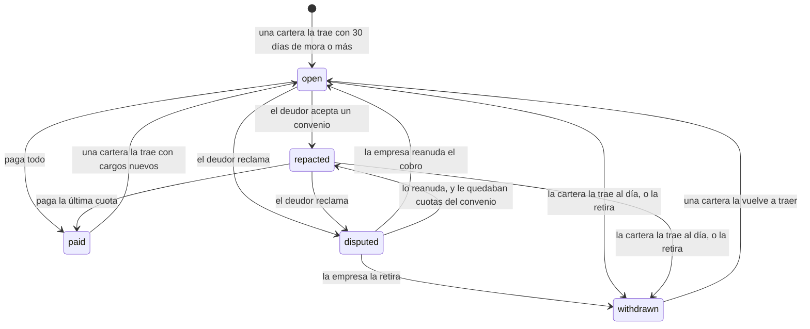
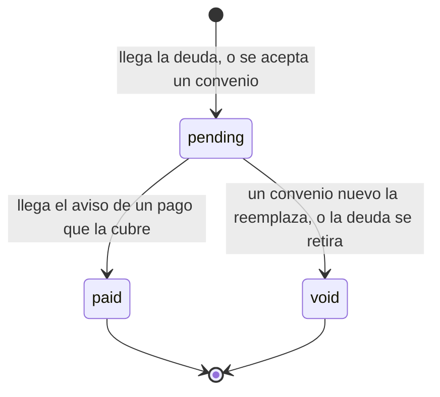
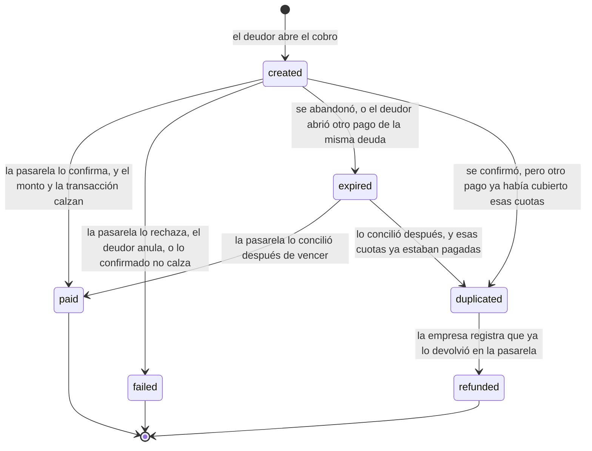
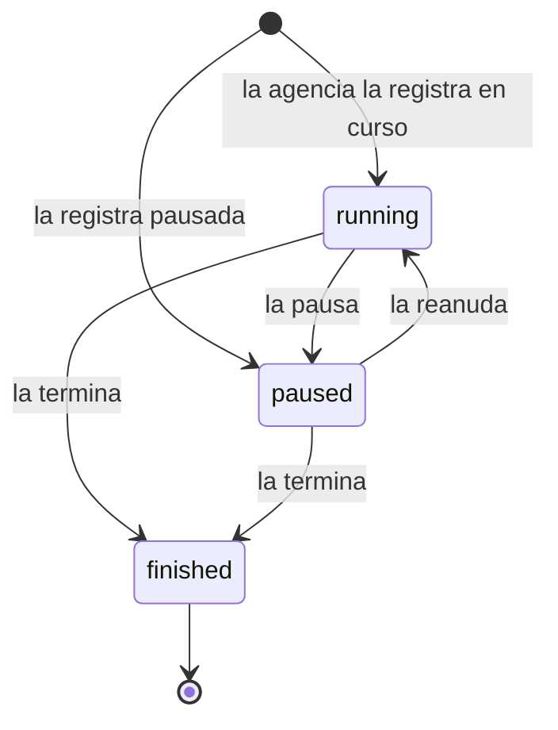
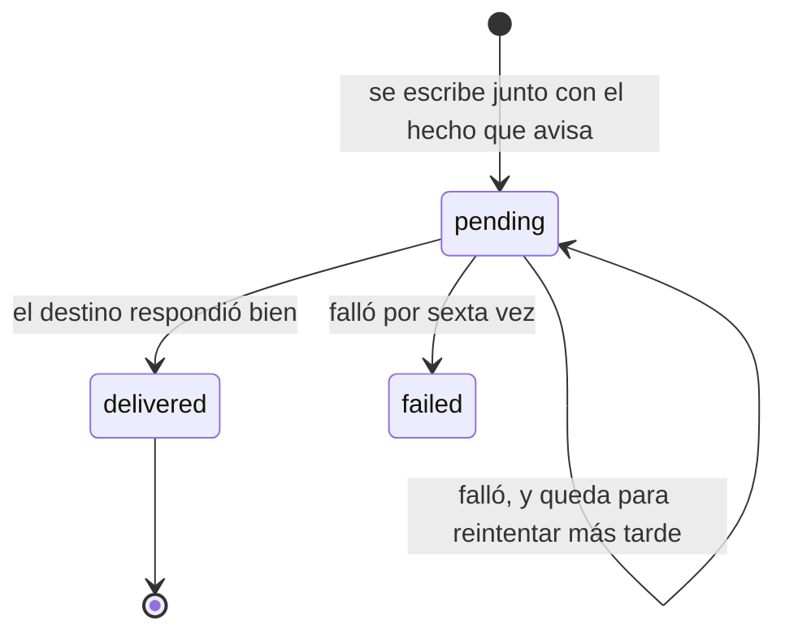
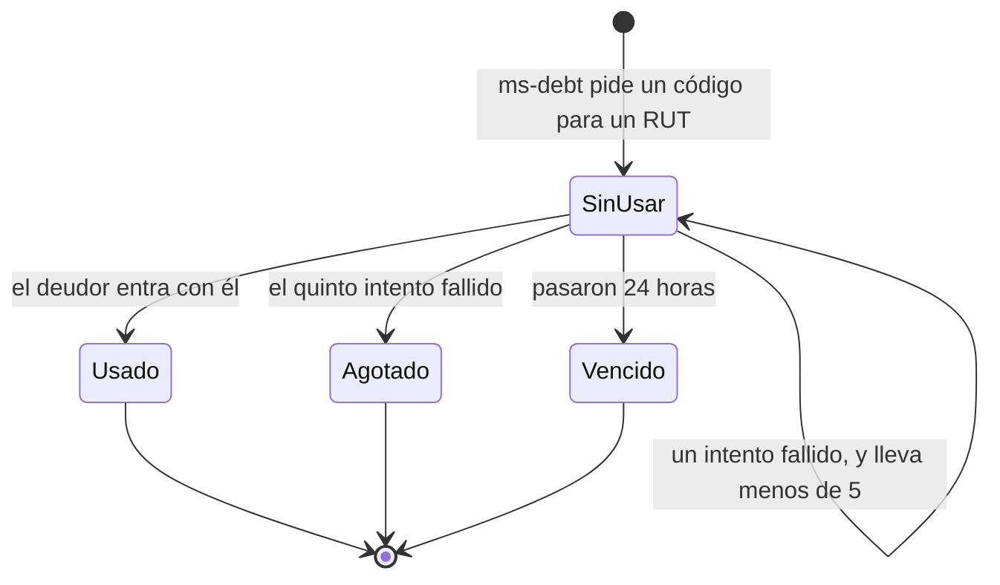
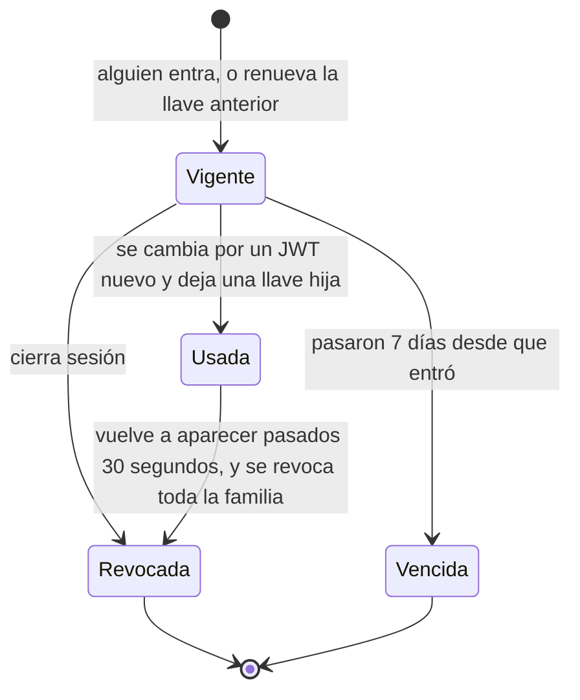
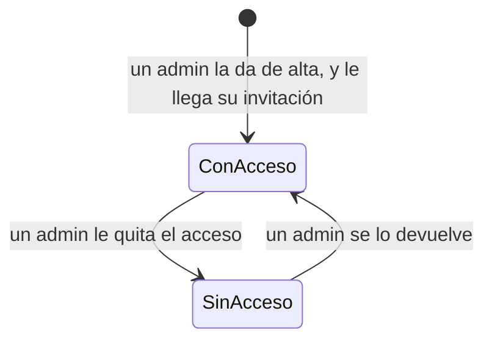

# Diagramas de estados

Vista lógica del [modelo 4+1](README.md), por el lado del comportamiento: **por qué estados pasa cada cosa, y
qué la hace cambiar**. Complementa a los [diagramas de clases](clases.md), que dicen qué estados existen pero
no cómo se llega de uno a otro.

**Cómo leerlos.** Cada caja es un estado y cada flecha, un cambio, con lo que lo provoca. El círculo negro es
el comienzo. Los nombres son los del código y los de la base: cada estado es un valor del `enum` de su clase,
y la base lo exige con un `CHECK`.

Salen del código: de cada lugar donde un servicio cambia un estado.

| Qué | Clase | Servicio | Estados |
| --- | --- | --- | --- |
| [Una deuda](#una-deuda) | `Debt.Status` | ms-debt | `open`, `repacted`, `disputed`, `paid`, `withdrawn` |
| [Una cuota](#una-cuota) | `Installment.Status` | ms-debt | `pending`, `paid`, `void` |
| [Un pago](#un-pago) | `Payment.Status` | ms-payments | `created`, `paid`, `failed`, `expired`, `duplicated`, `refunded` |
| [Una campaña](#una-campaña) | `Campaign.Status` | ms-debt | `running`, `paused`, `finished` |
| [Un aviso por entregar](#un-aviso-por-entregar) | `OutboxEvent.Status` y `DebtNotification.Status` | ms-debt y ms-payments | `pending`, `delivered`, `failed` |
| [Un código de acceso](#un-código-de-acceso) | `AccessCode` | ms-auth | Sin usar, usado, vencido, agotado |
| [Una llave de renovación](#una-llave-de-renovación) | `Session` | ms-auth | Vigente, usada, revocada, vencida |
| [Una persona con cuenta](#una-persona-con-cuenta) | `StaffUser` | ms-auth | Con acceso, sin acceso |

---

## Una deuda

El estado más importante del sistema: decide qué puede hacer el deudor, si la campaña le escribe y qué se le
avisa a quien entregó la cartera.

| Estado | Qué significa | Qué puede pasar ahí |
| --- | --- | --- |
| `open` | En cobranza, sin convenio | El deudor paga, repacta o reclama. La campaña le escribe |
| `repacted` | En cobranza, con un convenio | El deudor paga sus cuotas en orden, o repacta de nuevo: sigue en `repacted`, con un convenio que reemplaza al anterior. Le llega el recordatorio de cada cuota, no la campaña |
| `disputed` | El deudor la reclamó | No se le escribe. La empresa tiene que reanudarla o retirarla |
| `paid` | Pagada: el saldo quedó en cero | Se puede descargar el certificado. No se puede modificar; solo vuelve con cargos posteriores a los que se pagaron |
| `withdrawn` | Fuera de cobranza | Sus cuotas pendientes quedaron anuladas. Guarda el motivo: `pago_directo`, `acuerdo_directo`, `error`, `disputa_resuelta`, `fuera_de_mandato` u `otro` |

Cada cambio deja una línea en `debt_events` y sale como un evento del contrato hacia quien entregó la cartera:

| Cambio | Quién lo hace | Evento que sale |
| --- | --- | --- |
| A `repacted` | `DebtService.applyRepact` | `repactacion.aceptada` |
| A `paid` | `DebtService.onPagoConfirmado`, cuando el saldo queda en cero | `pago.confirmado` y `deuda.saldada` |
| A `disputed` | `DisputaService.disputar` | `deuda.disputada` |
| De `disputed` a `open` o `repacted` | `DisputaService.resolver`, con *reanudar* | `deuda.reanudada` |
| A `withdrawn` | `DisputaService.resolver`, con *retirar*, o `CarteraIntakeService` | `deuda.retirada` |
| De `withdrawn` o `paid` a `open` | `CarteraIntakeService` | `lote.procesado`, con el resultado de esa deuda |

Un pago que no deja el saldo en cero no cambia el estado de la deuda: marca sus cuotas y avisa
`pago.confirmado`.

---

## Una cuota

Lo que se debe hoy es la suma de las cuotas `pending`. Una deuda sin convenio tiene una sola; un convenio las
reemplaza por las suyas.

Una cuota no se borra: se anula. Borrarla perdería el rastro de por qué las cuotas son las que son. La base
exige que una cuota `paid` tenga la fecha en que se pagó, y que ninguna otra la tenga.

---

## Un pago

Un `Payment` es un **intento** de pago: se crea al abrir el cobro, no al confirmarlo. La columna guarda el
último estado, y la historia completa queda en `payment_events`, que solo se agrega.

| Estado | Qué significa | Qué pasa después |
| --- | --- | --- |
| `created` | El cobro está abierto en la pasarela | Se le pregunta a la pasarela cada 10 segundos. Vence a los 30 minutos en Khipu y Mercado Pago, y a los 15 en Webpay (9 en producción) |
| `paid` | Cobrado | Queda un aviso pendiente para ms-debt, escrito en la misma transacción |
| `failed` | No se cobró | Nada. El deudor puede abrir otro pago |
| `expired` | Nadie lo pagó a tiempo, o lo reemplazó otro | Se sigue revisando por 24 horas: si la pasarela lo cobró igual, se registra |
| `duplicated` | Se cobró dos veces lo mismo | No se abona. La empresa lo ve en *Pagos para devolver*, con su referencia en la pasarela |
| `refunded` | La empresa ya lo devolvió en la pasarela | Nada más: DataBridge no mueve plata, solo deja constancia. El libro (`payment_events`) guarda la referencia de la devolución, la empresa y la persona que la registró. La empresa lo ve en *Pagos devueltos* y el deudor en su historial. Registrarla de nuevo no cambia nada |

Mientras la pasarela está verificando un pago, ese cobro no se vence y no se puede abrir otro de la misma
deuda. Confirmar un pago ya confirmado no hace nada, así que un aviso repetido de la pasarela no cobra dos
veces.

`authorized` existe en `Payment.Status` y la base lo acepta, pero hoy ningún flujo deja un pago en ese estado:
las tres pasarelas pasan directo de `created` a `paid`. Las devoluciones se hacen en la pasarela, por fuera, y la
empresa las anota después (#153).

---

## Una campaña

La define la agencia, por su sistema o desde el portal. DataBridge solo ejecuta las que están en curso.

| Estado | En el contrato | Qué hace DataBridge |
| --- | --- | --- |
| `running` | `en_curso` | Le escribe a sus deudores según la cadencia, dentro de sus fechas. Ofrece su descuento por pronto pago |
| `paused` | `pausada` | No escribe ni ofrece descuento. Las deudas siguen en cobranza |
| `finished` | `terminada` | Lo mismo que pausada |

El estado se cambia con `POST /api/v1/campanas` o, desde el portal, con
`POST /api/debts/campanas/{idExterno}/estado`. Los dos terminan en `MandatoService.registrarCampana`.
**Terminada es final:** volver a ponerla en curso o pausarla responde `409` (`campana_terminada`), por
cualquiera de los dos caminos. Mandarla terminada de nuevo no cambia nada.

---

## Un aviso por entregar

Las dos bandejas de salida funcionan igual: la de ms-debt (`outbox`, los eventos hacia el sistema de cada
empresa) y la de ms-payments (`debt_notifications`, el aviso de pago hacia ms-debt).

Cada falla suma un intento y fija cuándo se vuelve a probar: al minuto, a los 5 minutos, a los 30, a las 2
horas y a las 6 horas. Si la sexta también falla, el aviso queda `failed` y ya no se reintenta solo: hay que
reenviarlo a mano. El último error queda guardado en la fila.

---

## Un código de acceso

`AccessCode` no tiene una columna de estado: su estado sale de tres datos.

| Estado | Cómo se sabe | Qué responde |
| --- | --- | --- |
| Sin usar | `consumed_at` vacío, `attempts` bajo el tope y `expires_at` en el futuro | Deja entrar si el código calza |
| Usado | `consumed_at` con fecha | `401`: ese código ya no sirve |
| Agotado | `attempts` llegó a `max_attempts`, que es 5 | `429`: pide uno nuevo |
| Vencido | `expires_at` ya pasó | `401`: pide uno nuevo |

El acceso solicitado (`MagicLink`) tiene los mismos estados: el código y el enlace opcional
comparten `consumed_at`, `expires_at` y el contador de cinco intentos. Dura 15 minutos por omisión;
usar cualquiera consume ambos. Solicitar otro marca como usado el pedido anterior. Los enlaces
antiguos y de invitación conservan `code_hash` vacío y su vencimiento original.

---

## Una llave de renovación

Cada fila de `sessions` es una llave. Tampoco tiene una columna de estado: sale de `rotated_at`, `revoked_at`
y `expires_at`.

| Estado | Cómo se sabe | Qué pasa si se presenta |
| --- | --- | --- |
| Vigente | Sin `rotated_at` ni `revoked_at`, y `expires_at` en el futuro | Se cambia por un JWT nuevo y por la llave siguiente |
| Usada | Con `rotated_at` | Dentro de 30 segundos es otra pestaña del mismo navegador: `409`, que reintente. Después de eso, alguien más la tiene: se revoca la familia entera |
| Revocada | Con `revoked_at` | `401` |
| Vencida | `expires_at` ya pasó | `401` |

Una familia son todas las llaves de un mismo inicio de sesión. Revocar la familia saca a todos los que tengan
una de sus llaves: al dueño y al que se la copió.

---

## Una persona con cuenta

El usuario de una empresa y el admin de DataBridge. `StaffUser` tampoco tiene una columna de estado: tiene
acceso mientras `disabled_at` esté vacío.

| Estado | Cómo se sabe | Qué puede hacer |
| --- | --- | --- |
| Con acceso | `disabled_at` vacío | Pedir su código o respaldo, entrar y renovar su sesión |
| Sin acceso | `disabled_at` con la fecha desde cuando | Nada: no le llegan enlaces, los que tenía sin abrir quedaron usados y sus sesiones, revocadas |

La cuenta nunca se borra: queda la persona y desde cuándo no entra. Cada cambio lo anota `admin_log`, con el
admin que lo hizo. Un admin no se puede quitar el acceso a sí mismo, así que siempre queda al menos uno que
puede entrar al panel. El **rol no cambia nunca**: quien se dio de alta bajo una empresa es `usuario` de esa
empresa, y un admin no pasa a ser de una empresa ni al revés.
