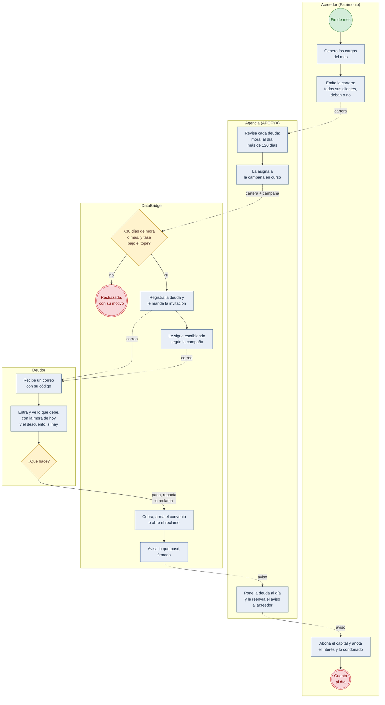
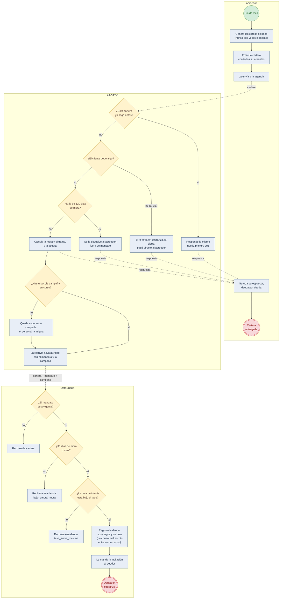
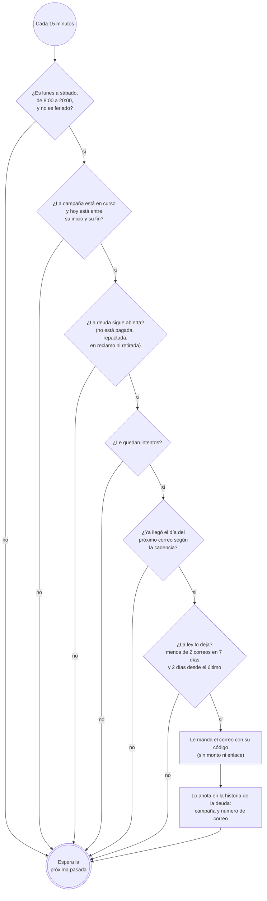
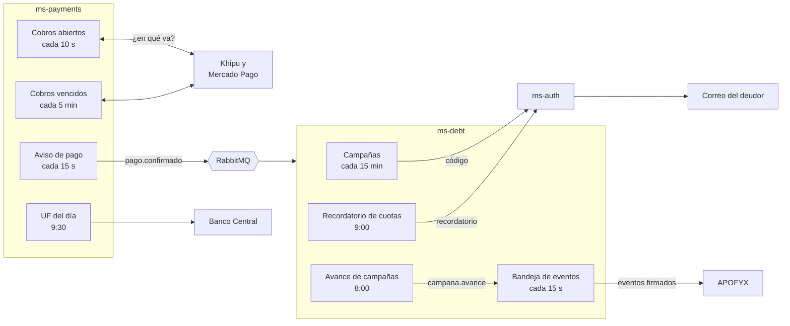

# Diagramas de procesos

Vista de procesos del [modelo 4+1](README.md), por el lado del negocio: **cómo va una deuda** desde que alguien
se atrasa hasta que la plata vuelve al acreedor, qué decide cada sistema cuando llega la cartera, cómo
DataBridge ejecuta una campaña, y qué corre solo. Los pasos de cada servicio, clase por clase, están en las
[secuencias](secuencia.md).

Los diagramas de proceso usan la notación de **BPMN**: cada carril es un participante, el círculo verde es el
inicio, el rojo doble el fin, el rombo una decisión, y la flecha punteada un mensaje de un sistema a otro.

**La cadena con APOFYX y Patrimonio** necesita la entrega por API encendida (`INTEGRACION_API=true`): por
omisión, los deudores entran por campaña desde el portal, como cuenta la
[secuencia de ms-debt del README](../../README.md#83-secuencias).

## El proceso completo, en BPMN (*to-be*)

Así va una deuda desde que alguien se atrasa hasta que la plata vuelve al acreedor, tal como
funciona hoy:

| Paso | Quién | Qué pasa |
| --- | --- | --- |
| 1 | Acreedor | A fin de mes genera los cargos y entrega la **cartera**: todos sus clientes con contrato, deban o no, con la tasa de interés de cada uno |
| 2 | APOFYX | Revisa cada deuda (mora, al día, más de 120 días), la asigna a la **campaña** en curso y se la pasa a DataBridge |
| 3 | DataBridge | Acepta las deudas con 30 días de mora o más y una tasa bajo el tope, y le manda al deudor una **invitación**: un código, sin monto ni enlace |
| 4 | DataBridge | Si el deudor no entra ni paga, **le sigue escribiendo** los días de la campaña, dentro de lo que permite la ley |
| 5 | Deudor | Entra con su RUT y el código, ve lo que debe con la mora del día (y el descuento, si la campaña lo trae y paga todo de una vez) y decide: **pagar**, **repactar** o **reclamar** |
| 6 | DataBridge | Cobra con la pasarela, arma el convenio o abre el reclamo, y **avisa** lo que pasó, firmado |
| 7 | APOFYX | Pone su cartera al día y le **reenvía el aviso** al acreedor, firmado por ella |
| 8 | Acreedor | Deja los cargos pagados y anota aparte el interés cobrado y el condonado, sin saber que detrás está DataBridge |

## Flujo: la cartera de cada mes

Las decisiones que toma cada sistema cuando llega la cartera (el escenario E1):

## Actividad: cómo DataBridge ejecuta una campaña

Cada 15 minutos, DataBridge recorre las campañas en curso y, para cada deuda, decide si le toca un
correo:

Un correo que esperó no se pierde: en la pasada siguiente se vuelve a preguntar, y sale en cuanto
la ley lo deja.

## Lo que corre solo

Además de responder peticiones, cada servicio tiene tareas programadas. Ninguna depende de que
haya alguien mirando, y las que avisan a otro sistema escriben primero en una bandeja de salida,
así que un sistema caído no pierde nada:

| Tarea | Servicio | Cuándo | Qué hace |
| --- | --- | --- | --- |
| Campañas | ms-debt | Cada 15 minutos | Manda los correos que tocan según la cadencia, dentro del horario y el límite de la ley |
| Recordatorio de cuotas | ms-debt | Todos los días, 9:00 | Avisa las cuotas que vencen en 3 días (`RECORDATORIO_DIAS_ANTES`) |
| Avance de campañas | ms-debt | Todos los días, 8:00 | Publica `campana.avance`: cuántos correos salieron, cuántos entraron al portal, repactaron, pagaron o reclamaron, y cuánto se recuperó |
| Bandeja de eventos | ms-debt | Cada 15 segundos | Entrega los eventos pendientes a cada suscriptor, firmados, con reintentos |
| Cobros abiertos | ms-payments | Cada 10 segundos | Pregunta a Khipu y a Mercado Pago en qué van los cobros abiertos |
| Cobros vencidos | ms-payments | Cada 5 minutos | Vence lo abandonado (también en Webpay) y revisa por 24 horas lo que venció |
| Aviso de pago | ms-payments | Cada 15 segundos | Lleva `pago.confirmado` a ms-debt por RabbitMQ, o por HTTP si RabbitMQ no está |
| UF del día | ms-payments | Todos los días, 9:30 | Trae la UF del Banco Central, para fijar los pesos de las deudas en UF |
