# Diagramas de secuencia

Vista de procesos del [modelo 4+1](README.md): **qué pasa en el tiempo**. Quién le habla a quién, en qué orden,
y qué corre solo aunque nadie esté mirando.

**Cómo leerlos.** Cada columna es un participante: una persona, una pantalla, una clase o un sistema. El tiempo
corre hacia abajo. Una flecha continua es una llamada y una punteada, su respuesta. Un recuadro `alt` separa
caminos que no ocurren juntos, `opt` es algo que pasa solo a veces, `loop` se repite y `par` ocurre a la vez.

Salen del código: los nombres de las columnas son las clases de cada servicio y las llamadas, sus métodos. Dónde
está cada clase lo dicen los [diagramas de clases](clases.md).

| # | Secuencia | Quién la dispara | Servicios que participan |
| --- | --- | --- | --- |
| 1 | [El deudor entra con su RUT y su código](#1-el-deudor-entra-con-su-rut-y-su-código) | El deudor | gateway, ms-auth |
| 2 | [Entrar con un enlace al correo](#2-entrar-con-un-enlace-al-correo) | Un usuario, un admin o un deudor | gateway, ms-auth, ms-debt |
| 3 | [Renovar y cerrar la sesión](#3-renovar-y-cerrar-la-sesión) | El portal | ms-auth |
| 4 | [Entregar una cartera por la API](#4-entregar-una-cartera-por-la-api) | El sistema de una empresa | ms-debt, ms-auth |
| 5 | [Simular y aceptar un convenio](#5-simular-y-aceptar-un-convenio) | El deudor | ms-debt |
| 6 | [Pagar con Khipu](#6-pagar-con-khipu) | El deudor | ms-payments, ms-debt |
| 7 | [Pagar con Webpay](#7-pagar-con-webpay) | El deudor | gateway, ms-payments, ms-debt |
| 8 | [Pagar con Mercado Pago](#8-pagar-con-mercado-pago) | El deudor | ms-payments, ms-debt |
| 9 | [El aviso del pago](#9-el-aviso-del-pago-de-ms-payments-a-quien-entregó-la-cartera) | El reloj | ms-payments, RabbitMQ, ms-debt |
| 10 | [La campaña le escribe al deudor](#10-la-campaña-le-escribe-al-deudor) | El reloj | ms-debt, ms-auth |
| 11 | [Reclamar una deuda y resolver el reclamo](#11-reclamar-una-deuda-y-resolver-el-reclamo) | El deudor y un usuario | ms-debt |
| 12 | [Preguntarle al asistente](#12-preguntarle-al-asistente) | El deudor | gateway, ms-ai, ms-debt |
| 13 | [El admin abre su panel](#13-el-admin-abre-su-panel) | El admin | gateway, ms-auth, ms-debt, ms-payments |
| 14 | [Una empresa conecta su sistema](#14-una-empresa-conecta-su-sistema) | Un usuario y su sistema | ms-debt |
| 15 | [La UF del día](#15-la-uf-del-día) | El reloj | ms-payments |
| 16 | [El admin da de alta una empresa y a su gente](#16-el-admin-da-de-alta-una-empresa-y-a-su-gente) | El admin | ms-debt, ms-auth |

En todos, el navegador solo habla con el **portal** (nginx), que manda lo que empieza con `/api` al **gateway**,
y el gateway lo enruta al servicio. Para no repetirlo en cada diagrama, esa parte se dibuja completa solo en
el primero.

---

## 1. El deudor entra con su RUT y su código

Sin cuenta y sin contraseña. El código le llegó antes por correo ([secuencia 4](#4-entregar-una-cartera-por-la-api)).

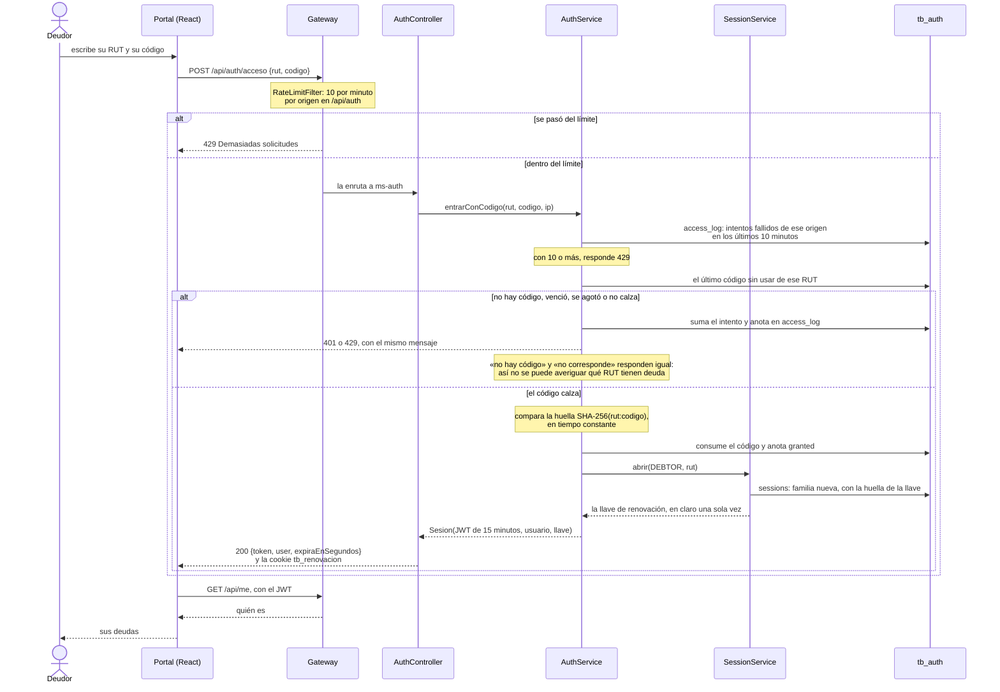

El JWT viaja en el cuerpo y el portal lo guarda **en memoria**. La llave de renovación va en una cookie
`HttpOnly`, `SameSite=Strict` y limitada a `/api/auth`: un script de la página puede usar la sesión mientras esté
abierta, pero no puede llevársela.

---

## 2. Entrar con un enlace al correo

Así entran el **usuario de una empresa** y el **admin de DataBridge**, cada uno por su puerta
(`/databridge/login` y `/admin/login`). Para el **deudor** es el respaldo, cuando no le llegó el código.

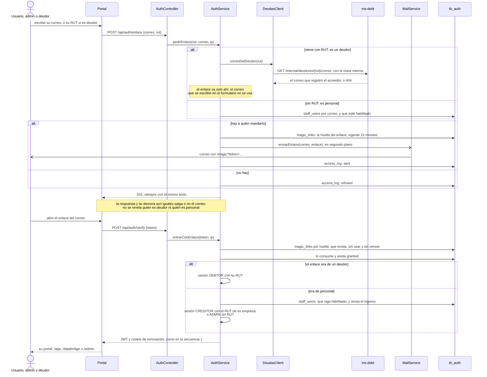

---

## 3. Renovar y cerrar la sesión

El JWT dura 15 minutos y no se puede revocar. Lo que mantiene a alguien adentro es la llave de renovación, y
cada llave sirve **una sola vez**: al usarla se jubila y deja otra en la misma familia.

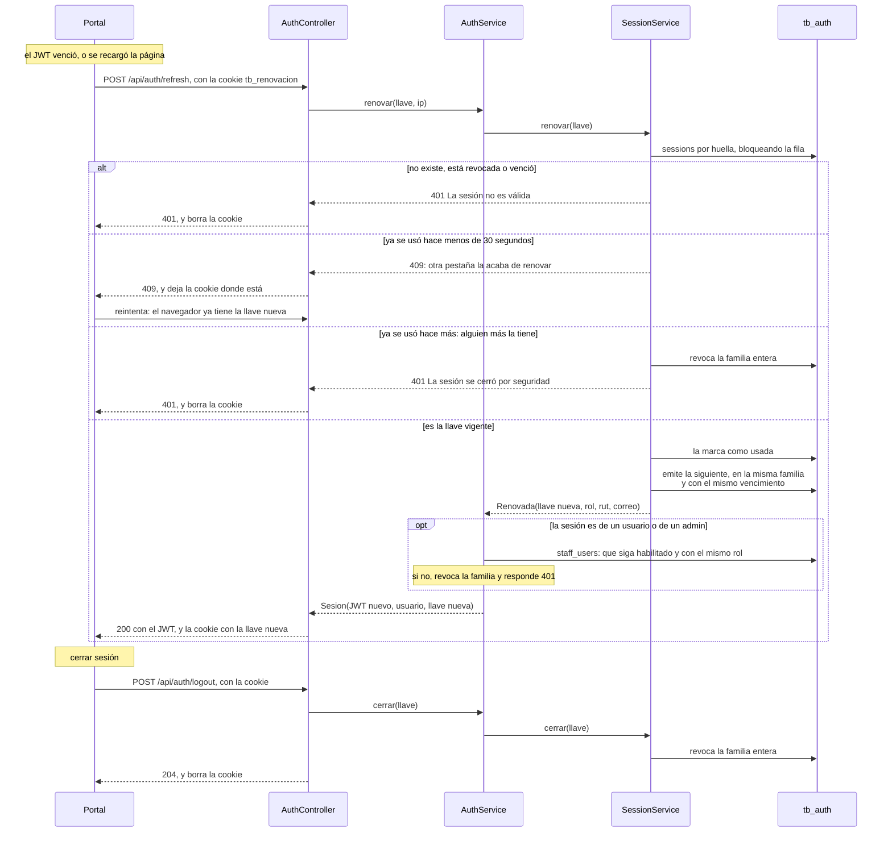

Renovar no alarga la sesión: la llave nueva hereda el vencimiento de la familia (7 días desde que se entró).

---

## 4. Entregar una cartera por la API

El escenario E1. El sistema de una empresa entrega su cartera, DataBridge decide deuda por deuda y, **después de
guardar**, invita a cada deudor.

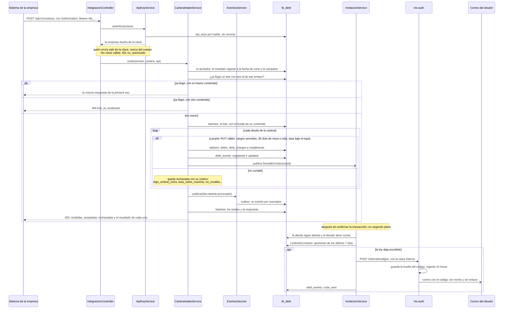

Una cartera cargada **por archivo** desde el portal (`POST /api/debts/cartera`) hace el mismo recorrido:
`CargaService` convierte la planilla con `CarteraCsv` y llama al mismo `CarteraIntakeService.recibir`.

---

## 5. Simular y aceptar un convenio

El escenario E4. La simulación no guarda nada; aceptar sí.

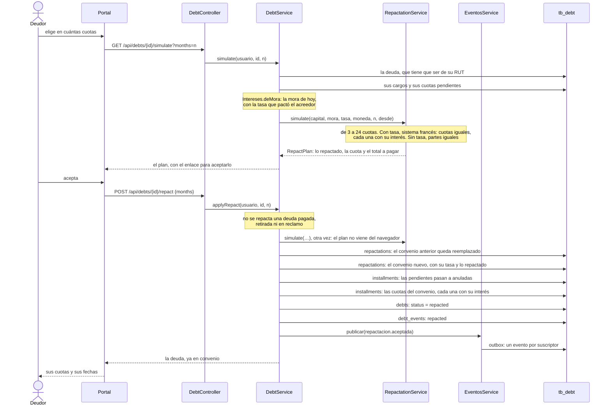

---

## 6. Pagar con Khipu

El escenario E3, y la función principal. **El navegador nunca dice cuánto hay que pagar ni si el pago salió
bien**: el monto lo pregunta ms-payments a ms-debt, y la aprobación la confirma con Khipu, de servidor a
servidor.

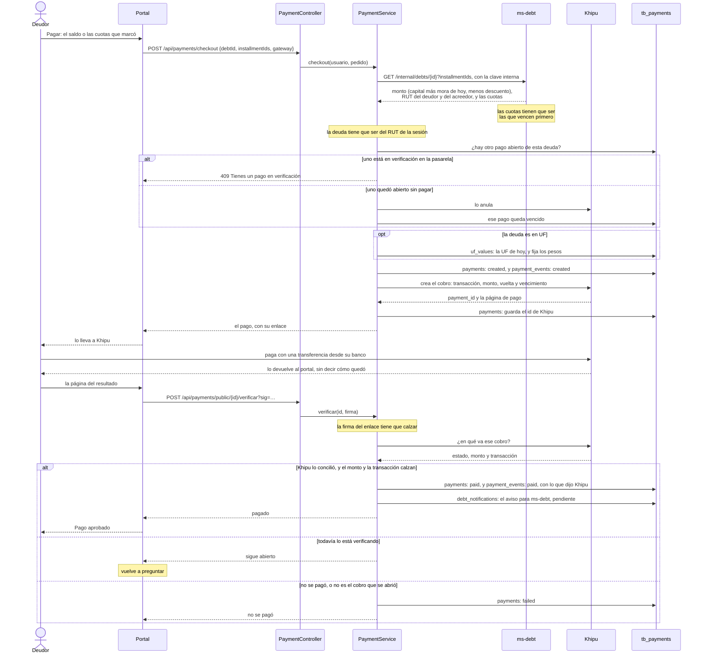

Si el deudor cierra la ventana antes de volver, el pago igual se registra: `ConciliacionPasarelas` le pregunta a
Khipu por los cobros abiertos cada 10 segundos, y hace exactamente la misma verificación. Lo que sigue al pago
está en la [secuencia 9](#9-el-aviso-del-pago-de-ms-payments-a-quien-entregó-la-cartera).

---

## 7. Pagar con Webpay

La misma idea con otra forma: en Webpay el deudor vuelve con un `token_ws`, y la transacción solo se cobra si
ms-payments la **confirma** con Transbank.

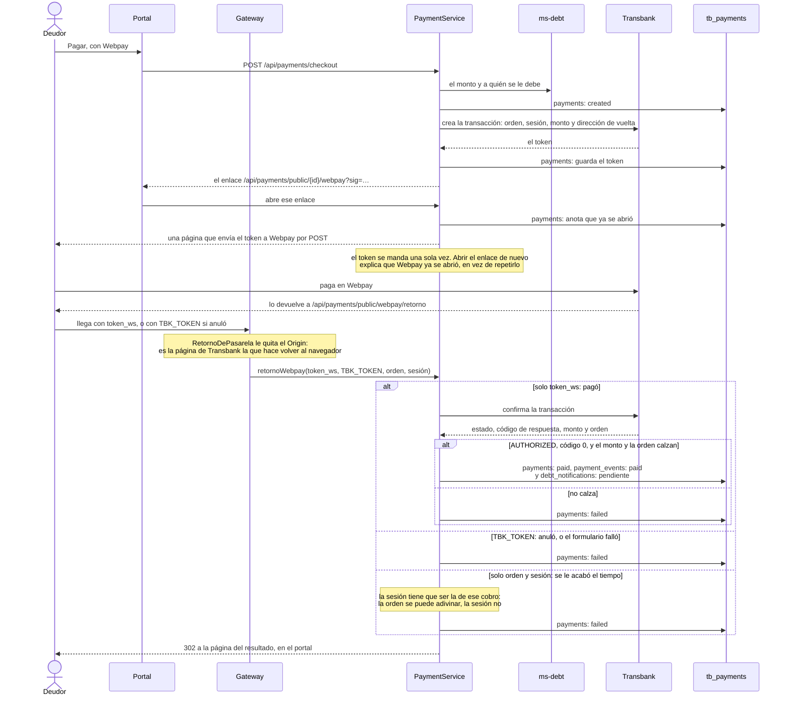

Si el deudor paga y cierra la ventana antes de volver, `ConciliacionPasarelas` le pregunta a Transbank por el
cobro y lo confirma desde ahí. Un cobro de Webpay abandonado vence a los 15 minutos en el ambiente de
integración de Transbank y a los 9 en producción.

---

## 8. Pagar con Mercado Pago

Checkout Pro. Mercado Pago no siempre puede devolver al deudor ni avisar (en local descarta las direcciones que
no son `https`), así que el estado nunca se toma de lo que llega: **siempre se le pregunta**.

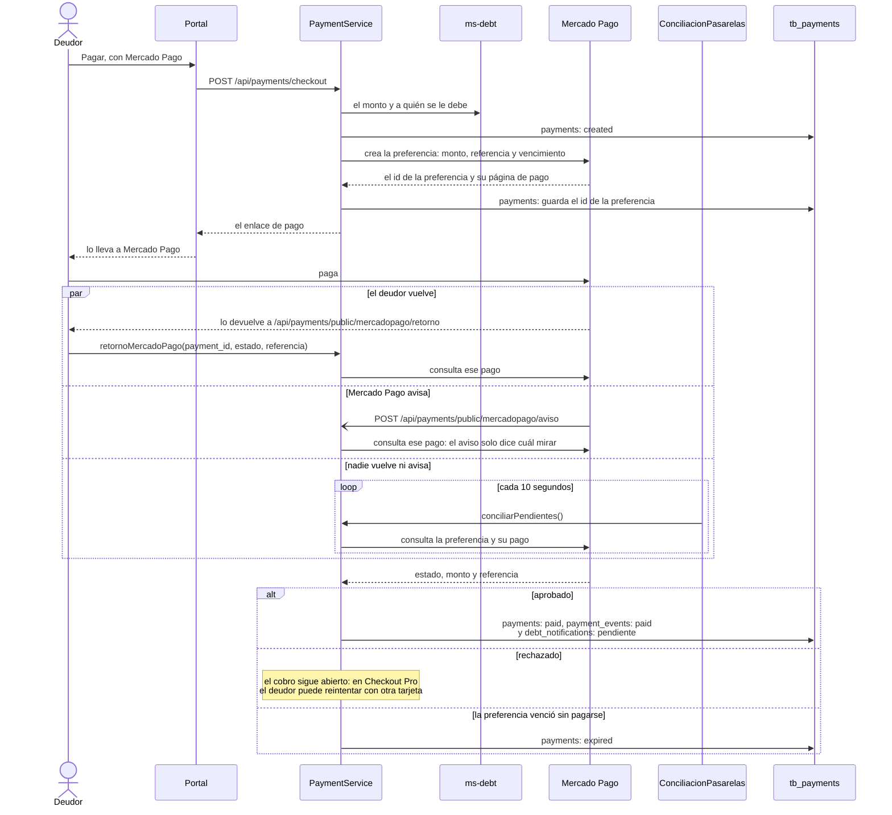

Por los tres caminos el pago se registra **una sola vez**: `payments` no deja repetir el par pasarela e id de la
transacción, y confirmar un pago ya pagado no hace nada.

---

## 9. El aviso del pago: de ms-payments a quien entregó la cartera

Lo que pasa después de cualquier pago confirmado. Hay **dos bandejas de salida**, una en cada servicio, y las
dos se escriben en la misma transacción que el hecho: si un sistema está caído, el aviso espera, no se pierde.

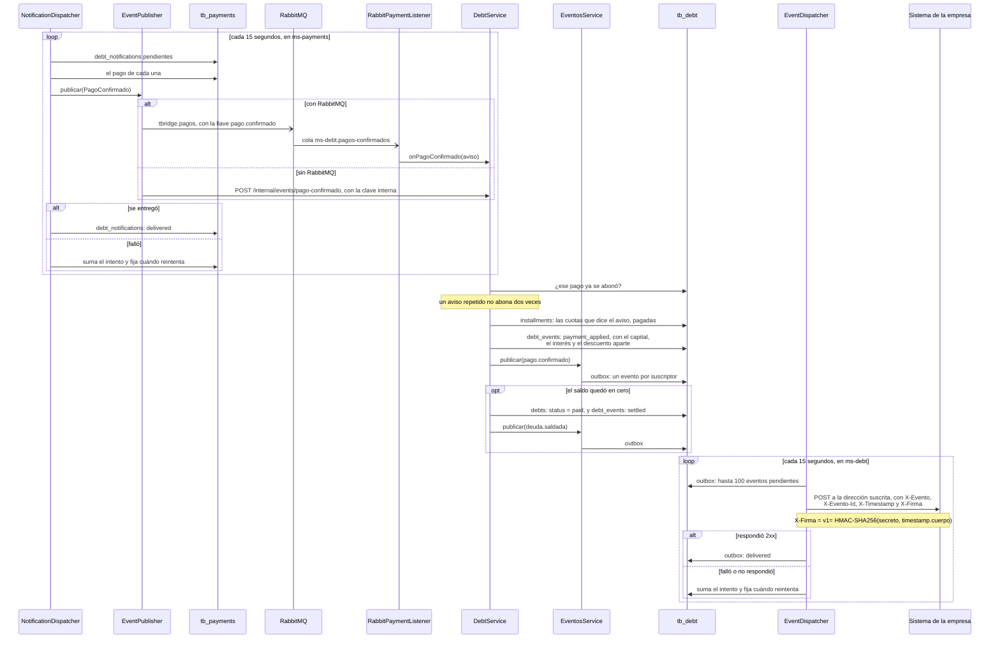

Por el mismo `EventDispatcher` salen todos los eventos del contrato: `lote.procesado`, `repactacion.aceptada`,
`pago.confirmado`, `deuda.saldada`, `deuda.disputada`, `deuda.reanudada`, `deuda.retirada` y `campana.avance`.

---

## 10. La campaña le escribe al deudor

El escenario E2. La estrategia la define la agencia; DataBridge la ejecuta dentro de lo que permite la ley.

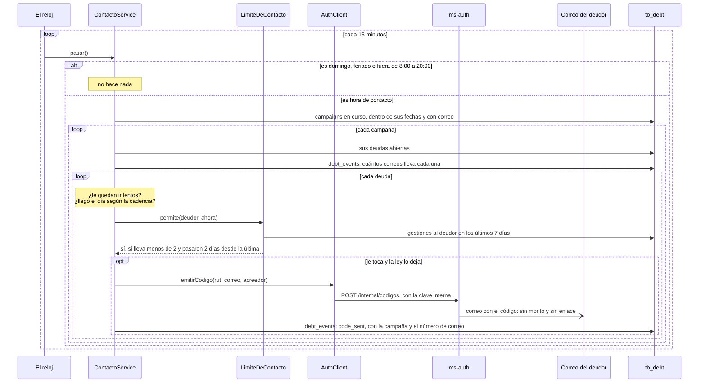

Un correo que no pudo salir no se pierde: en la pasada siguiente se vuelve a preguntar, y sale en cuanto la ley
lo deja. Una deuda repactada, pagada, en reclamo o retirada deja de recibir los correos de la campaña.

El **recordatorio de cuotas** (`RecordatorioService`, todos los días a las 9:00) sigue el mismo camino con otra
pregunta: las cuotas pendientes que vencen en los próximos 3 días, de deudores que no apagaron el recordatorio.
Pasa por el mismo `LimiteDeContacto` y por el mismo `POST /internal/codigos`, que en ese caso manda el correo
del recordatorio con la fecha de la cuota.

**A quién le llega de verdad.** En ms-auth, cada correo pasa por `ModoDePrueba` antes de salir. Con el buzón de
prueba de Docker, o en producción, llega a su destinatario. Con un servidor real y el modo de prueba activo,
llega directo solo si la dirección está en `CORREO_SOLO_A`; si no, va al buzón de `CORREO_DESVIAR_A` con el
destinatario original en el asunto, o no sale. Así la campaña no les escribe a los correos inventados de la
demo.

---

## 11. Reclamar una deuda y resolver el reclamo

El escenario E5. El reclamo lo abre el deudor y lo resuelve la empresa que cobra.

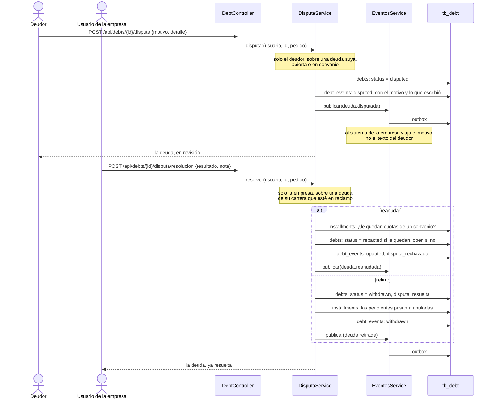

---

## 12. Preguntarle al asistente

ms-ai no tiene base ni acceso propio a las deudas: las pide a ms-debt **con la sesión del deudor**, así que no
puede ver nada que él no vea.

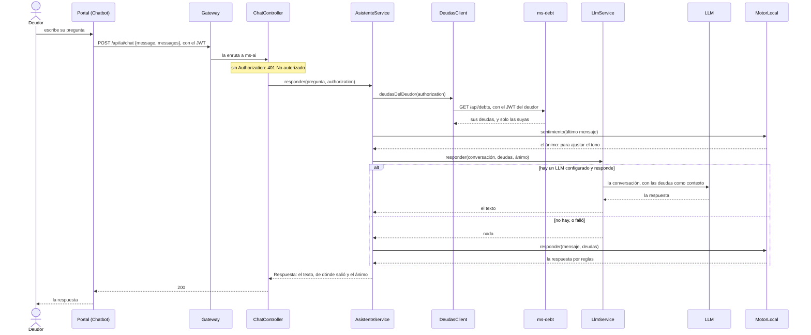

El asistente solo lee: no tiene ningún endpoint que cambie una deuda.

---

## 13. El admin abre su panel

Entra con su enlace ([secuencia 2](#2-entrar-con-un-enlace-al-correo), por `/admin/login`). La portada le
pregunta a cada servicio si responde, con su sesión.

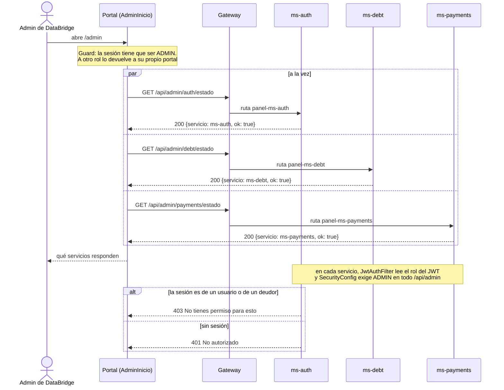

La regla es de la ruta entera, no de cada endpoint: uno nuevo bajo `/api/admin` no puede quedar abierto por
olvido. Y vale al revés: con una sesión `ADMIN`, ms-debt y ms-payments responden `403` a todo lo que no sea del
panel.

---

## 14. Una empresa conecta su sistema

Nada de esto se configura a mano en DataBridge: la empresa emite su clave, y su sistema hace el resto.

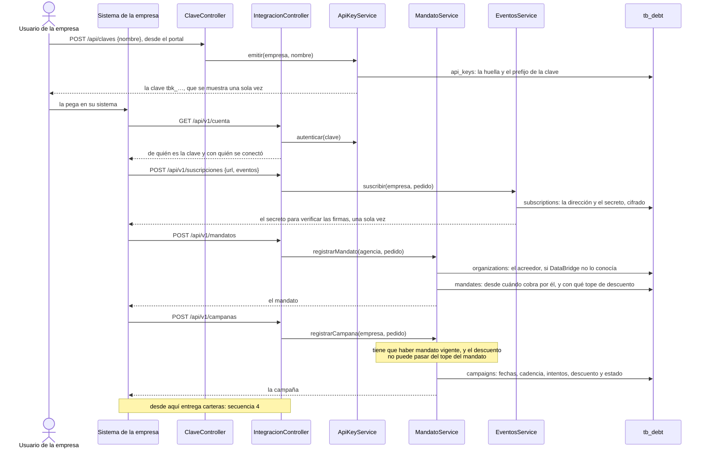

---

## 15. La UF del día

Una deuda en UF se cobra en pesos, con la UF del día en Chile. Ese valor se guarda: un pago tiene que poder
reconstruirse después, y el cobro no puede depender de que la fuente esté arriba.

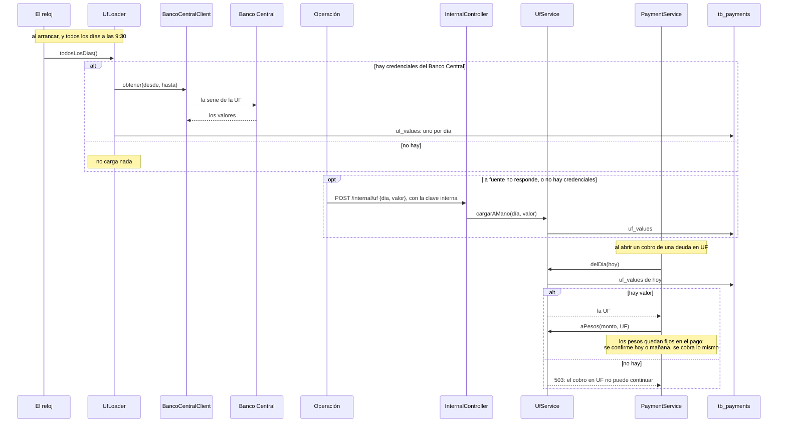

---

## 16. El admin da de alta una empresa y a su gente

Una empresa vive en ms-debt y sus personas en ms-auth, unidas por el RUT. Por eso dar de alta son **dos pasos**,
uno en cada servicio, y ms-auth le pregunta a ms-debt si la empresa existe antes de darle una persona.

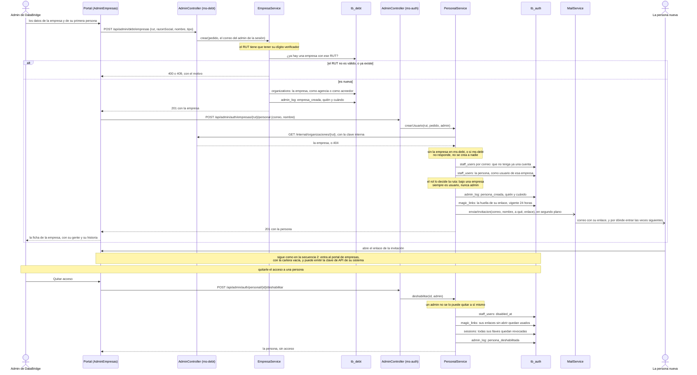

Si el segundo paso falla (el correo ya tenía una cuenta, o ms-debt no respondió), la empresa ya quedó
registrada: el portal lleva al admin a su ficha, que dice qué pasó, y desde ahí se le da acceso a la persona.
Quitarle el acceso a alguien no espera a que su sesión venza: sus llaves de renovación se revocan en el acto, y
lo único que le queda es el JWT vigente, que dura a lo más quince minutos.

Otro admin se da de alta igual, por `POST /api/admin/auth/admins`, sin el paso de ms-debt: un admin no es de
ninguna empresa.
