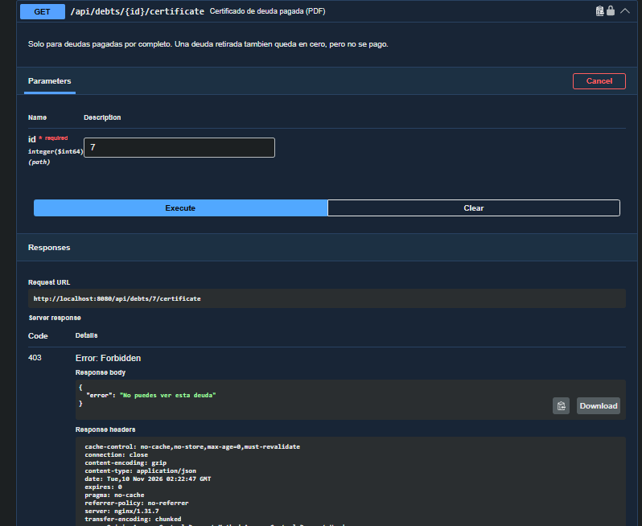
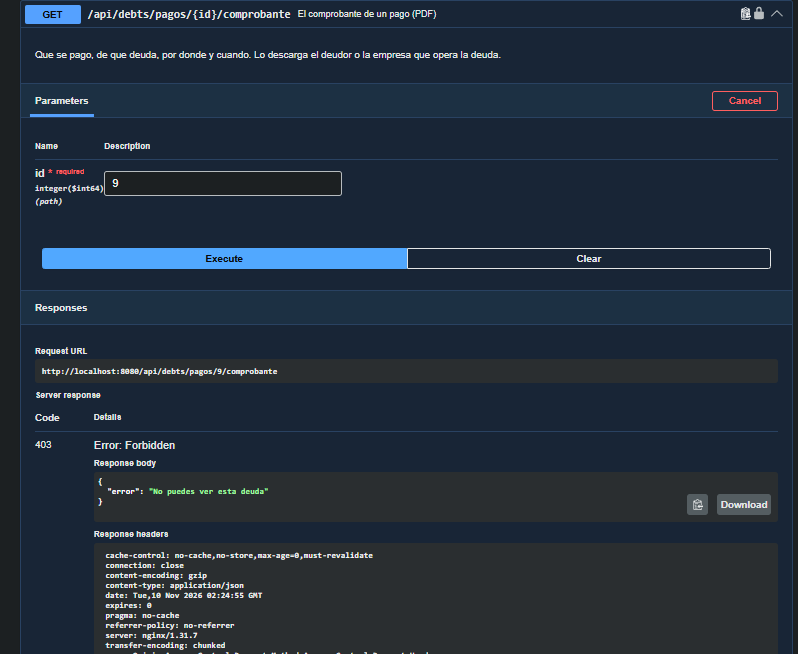

# Evidencia manual de #364 (IDOR/BOLA)

Prueba ejecutada el 9 de noviembre de 2026 contra la demo local (`http://localhost:8080`), con la
rama `pedro-test-364` y los datos de demostración. Se inició sesión como el deudor
`16482337-7` por el flujo real de código de acceso y Mailpit. En las capturas se ocultó la
cabecera `Authorization` para no publicar el JWT de la sesión.

| Petición | Resultado |
| --- | --- |
| `GET /api/debts` (propias) | `200` JSON |
| `GET /api/debts/pagos/8/comprobante` (propio) | `200` PDF |
| `GET /api/debts/pagos/9/comprobante` (de otro deudor) | `403` JSON `{"error":"No puedes ver esta deuda"}` |
| `GET /api/debts/7/certificate` (de otro deudor) | `403` JSON `{"error":"No puedes ver esta deuda"}` |
| `GET /api/debts/7` (de otro deudor) | `403` JSON `{"error":"No puedes ver esta deuda"}` |
| `GET /api/debts/2/certificate` (de otro deudor, deuda pagada) | `403` JSON `{"error":"No puedes ver esta deuda"}` |
| `GET /api/payments/2` (propio, ms-payments) | `200` JSON |

El `403` se mantiene aunque el cliente pida el PDF con `Accept: application/pdf`; el cuerpo del
error viaja en JSON y no incluye datos personales ni financieros del otro deudor.

## Capturas

## Pruebas automatizadas

- `ms-debt`: 548 pruebas en total, 10 de #364 (5 de integración y 5 de seguridad) contra MySQL
  real con Testcontainers.
- `ms-payments`: 309 pruebas en total, 9 de #364 (5 de integración y 4 de seguridad) contra MySQL
  real con Testcontainers.

No se ejecutaron pruebas de rendimiento ni se llamó a pasarelas reales; los correos salieron solo
a Mailpit.
